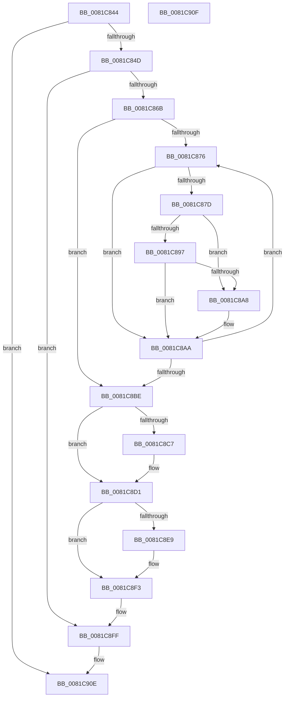

# AslpPathWildcardFreeFindContext

- RVA: `0x0081C844`–`0x0081C910` (길이 `204` bytes)
- VA: `0x000000014081C844`
- 실행 섹션: `PAGE`
- PDB 이름 있음: `예`; PDB Function 태그: `아니요`
- unwind 정보 RVA: `0x000D9934`
- 디코드: `59`개 명령, `204/204` bytes 표시
- 미해석 바이트: `0` (있으면 어셈블리에 `.byte`로 보존)

> 이 문서는 커널 이미지의 기계어와 PDB 기호를 분석해 생성했습니다. 4번과 5번은 함수 원형과 자료형을 바이너리 사용 방식에서 추정한 C 해석이며 원본 소스 복구 결과는 아닙니다.

## 1. Dependencies

- 직접 호출 지점: **5**; 고유 호출 대상: **4**
- 직접 호출자로 확인된 함수: **2**
- RIP 상대 이미지 참조: **0**

### Outgoing calls
- `0x0081C88E` → [ULongLongMult](../../text/44/ULongLongMult_function_00448380.md) (function, `0x00448380`)
- `0x0081C8AD` → [AslpPathWildcardFreeMatchNode](AslpPathWildcardFreeMatchNode_function_0081C918.md) (function, `0x0081C918`)
- `0x0081C8CC` → [ExFreePoolWithTag](../../poolcode/B8/ExFreePoolWithTag_function_00B82870.md) (function, `0x00B82870`)
- `0x0081C8E9` → [AslFree](../95/AslFree_function_0095B674.md) (function, `0x0095B674`)
- `0x0081C8F6` → [AslFree](../95/AslFree_function_0095B674.md) (function, `0x0095B674`)

### Direct callers
- [AslPathWildcardFindClose](AslPathWildcardFindClose_function_0081B4F0.md) at `0x0081B51B`
- [AslPathWildcardFindFirst](AslPathWildcardFindFirst_function_0081B534.md) at `0x0081BAEF`

### Static image references
- 디코드된 RIP-relative 메모리 참조가 없습니다.

## 2. Other-region calls and transfers

- 다른 실행 섹션으로 향하는 call: **2**
  - `0x0081C88E` → [ULongLongMult](../../text/44/ULongLongMult_function_00448380.md) (`PAGE` → `.text`)
  - `0x0081C8CC` → [ExFreePoolWithTag](../../poolcode/B8/ExFreePoolWithTag_function_00B82870.md) (`PAGE` → `POOLCODE`)
- 별도 외부 분기/꼬리 이동을 확인하지 못했습니다.

## 3. Assembly (complete function range)

```asm
0081C844  48 85 C9                        test rcx, rcx
0081C847  0F 84 C1 00 00 00               je 0x14081c90e
0081C84D  48 89 5C 24 10                  mov qword ptr [rsp + 0x10], rbx
0081C852  48 89 74 24 18                  mov qword ptr [rsp + 0x18], rsi
0081C857  57                              push rdi
0081C858  48 83 EC 20                     sub rsp, 0x20
0081C85C  48 8B 19                        mov rbx, qword ptr [rcx]
0081C85F  48 8B F9                        mov rdi, rcx
0081C862  48 85 DB                        test rbx, rbx
0081C865  0F 84 94 00 00 00               je 0x14081c8ff
0081C86B  48 8B 4B 20                     mov rcx, qword ptr [rbx + 0x20]
0081C86F  33 F6                           xor esi, esi
0081C871  48 85 C9                        test rcx, rcx
0081C874  74 48                           je 0x14081c8be
0081C876  33 C0                           xor eax, eax
0081C878  48 3B F1                        cmp rsi, rcx
0081C87B  73 2D                           jae 0x14081c8aa
0081C87D  48 8B 4B 18                     mov rcx, qword ptr [rbx + 0x18]
0081C881  4C 8D 44 24 30                  lea r8, [rsp + 0x30]
0081C886  48 21 44 24 30                  and qword ptr [rsp + 0x30], rax
0081C88B  48 8B D6                        mov rdx, rsi
0081C88E  E8 ED BA C2 FF                  call 0x140448380
0081C893  85 C0                           test eax, eax
0081C895  78 11                           js 0x14081c8a8
0081C897  48 8B 4B 38                     mov rcx, qword ptr [rbx + 0x38]
0081C89B  48 8B 44 24 30                  mov rax, qword ptr [rsp + 0x30]
0081C8A0  48 03 C1                        add rax, rcx
0081C8A3  48 3B C1                        cmp rax, rcx
0081C8A6  73 02                           jae 0x14081c8aa
0081C8A8  33 C0                           xor eax, eax
0081C8AA  48 8B C8                        mov rcx, rax
0081C8AD  E8 66 00 00 00                  call 0x14081c918
0081C8B2  48 8B 4B 20                     mov rcx, qword ptr [rbx + 0x20]
0081C8B6  48 FF C6                        inc rsi
0081C8B9  48 3B F1                        cmp rsi, rcx
0081C8BC  72 B8                           jb 0x14081c876
0081C8BE  48 8B 4B 38                     mov rcx, qword ptr [rbx + 0x38]
0081C8C2  48 85 C9                        test rcx, rcx
0081C8C5  74 0A                           je 0x14081c8d1
0081C8C7  BA 52 54 61 72                  mov edx, 0x72615452
0081C8CC  E8 9F 5F 36 00                  call 0x140b82870
0081C8D1  0F 57 C0                        xorps xmm0, xmm0
0081C8D4  0F 11 43 10                     movups xmmword ptr [rbx + 0x10], xmm0
0081C8D8  0F 11 43 20                     movups xmmword ptr [rbx + 0x20], xmm0
0081C8DC  0F 11 43 30                     movups xmmword ptr [rbx + 0x30], xmm0
0081C8E0  48 8B 53 08                     mov rdx, qword ptr [rbx + 8]
0081C8E4  48 85 D2                        test rdx, rdx
0081C8E7  74 0A                           je 0x14081c8f3
0081C8E9  E8 86 ED 13 00                  call 0x14095b674
0081C8EE  48 83 63 08 00                  and qword ptr [rbx + 8], 0
0081C8F3  48 8B D3                        mov rdx, rbx
0081C8F6  E8 79 ED 13 00                  call 0x14095b674
0081C8FB  48 83 27 00                     and qword ptr [rdi], 0
0081C8FF  48 8B 5C 24 38                  mov rbx, qword ptr [rsp + 0x38]
0081C904  48 8B 74 24 40                  mov rsi, qword ptr [rsp + 0x40]
0081C909  48 83 C4 20                     add rsp, 0x20
0081C90D  5F                              pop rdi
0081C90E  C3                              ret
0081C90F  CC                              int3
```

## 4. C-style interpretation (structured pseudocode)

```c
__int64 __fastcall AslpPathWildcardFreeFindContext(__int64 a1)
{
    __int64 result;
    __int64 v_rsi;
    __int64 v_rsp;
    unsigned __int64 v_stack_p10;
    unsigned __int64 v_stack_p18;
    unsigned __int64 v_stack_p8;

    if (a1 == 0) goto loc_0081C90E;
    v_stack_p10 = v_rbx;
    v_stack_p18 = v_rsi;
    v_rsp = (v_rsp) - (32);
    if (*(unsigned __int64 *)(a1) == 0) goto loc_0081C8FF;
    v_rsi = 0;
    if (*(unsigned __int64 *)(*(unsigned __int64 *)(a1) + 32) == 0) goto loc_0081C8BE;
loc_0081C876:
    result = 0;
    if (0 >= (*(unsigned __int64 *)(*(unsigned __int64 *)(a1) + 32))) goto loc_0081C8AA;
    result = ULongLongMult(*(unsigned __int64 *)(*(unsigned __int64 *)(a1) + 24), 0, v_stack_p8, a4);
    if (sign_flag) goto loc_0081C8A8;
    result = (v_stack_p8) + (*(unsigned __int64 *)(*(unsigned __int64 *)(a1) + 56));
    if (result < (*(unsigned __int64 *)(*(unsigned __int64 *)(a1) + 56))) {
        result = 0;
    }
    result = AslpPathWildcardFreeMatchNode(0, 0, v_stack_p8, a4);
    v_rsi = (v_rsi) + 1;
    if (v_rsi < (*(unsigned __int64 *)(*(unsigned __int64 *)(a1) + 32))) goto loc_0081C876;
loc_0081C8BE:
    if (*(unsigned __int64 *)(*(unsigned __int64 *)(a1) + 56) != 0) {
        a2 = 0x72615452ULL;
        result = ExFreePoolWithTag(*(unsigned __int64 *)(*(unsigned __int64 *)(a1) + 56), a2, v_stack_p8, a4);
    }
    *(unsigned __int64 *)(*(unsigned __int64 *)(a1) + 16) = v_xmm0;
    *(unsigned __int64 *)(*(unsigned __int64 *)(a1) + 32) = v_xmm0;
    *(unsigned __int64 *)(*(unsigned __int64 *)(a1) + 48) = v_xmm0;
    if (*(unsigned __int64 *)(*(unsigned __int64 *)(a1) + 8) != 0) {
        result = AslFree(*(unsigned __int64 *)(*(unsigned __int64 *)(a1) + 56), *(unsigned __int64 *)(*(unsigned __int64 *)(a1) + 8), v_stack_p8, a4);
    }
    result = AslFree(*(unsigned __int64 *)(*(unsigned __int64 *)(a1) + 56), *(unsigned __int64 *)(a1), v_stack_p8, a4);
loc_0081C8FF:
    v_rsp = (v_rsp) + (32);
loc_0081C90E:
    return result;
}
```

## 5. (Beta) C Style

```c
int64_t AslpPathWildcardFreeFindContext(int64_t Arg1)
{
    int64_t result;
    int64_t local_rsi;
    int64_t local_rsp;
    uint64_t v_stack_p10;
    uint64_t v_stack_p18;
    uint64_t v_stack_p8;

    if (Arg1 == 0) goto loc_0081C90E;
    v_stack_p10 = local_rbx;
    v_stack_p18 = local_rsi;
    local_rsp = (local_rsp) - (32);
    if (*(uint64_t *)(Arg1) == 0) goto loc_0081C8FF;
    local_rsi = 0;
    if (*(uint64_t *)(*(uint64_t *)(Arg1) + 0x20) == 0) goto loc_0081C8BE;
loc_0081C876:
    result = 0;
    if (0 >= (*(uint64_t *)(*(uint64_t *)(Arg1) + 0x20))) goto loc_0081C8AA;
    result = ULongLongMult(*(uint64_t *)(*(uint64_t *)(Arg1) + 0x18), 0, v_stack_p8, a4);
    if (sign_flag) goto loc_0081C8A8;
    result = (v_stack_p8) + (*(uint64_t *)(*(uint64_t *)(Arg1) + 0x38));
    if (result < (*(uint64_t *)(*(uint64_t *)(Arg1) + 0x38))) {
        result = 0;
    }
    result = AslpPathWildcardFreeMatchNode(0, 0, v_stack_p8, a4);
    local_rsi = (local_rsi) + 1;
    if (local_rsi < (*(uint64_t *)(*(uint64_t *)(Arg1) + 0x20))) goto loc_0081C876;
loc_0081C8BE:
    if (*(uint64_t *)(*(uint64_t *)(Arg1) + 0x38) != 0) {
        a2 = 0x72615452ULL;
        result = ExFreePoolWithTag(*(uint64_t *)(*(uint64_t *)(Arg1) + 0x38), a2, v_stack_p8, a4);
    }
    *(uint64_t *)(*(uint64_t *)(Arg1) + 0x10) = v_xmm0;
    *(uint64_t *)(*(uint64_t *)(Arg1) + 0x20) = v_xmm0;
    *(uint64_t *)(*(uint64_t *)(Arg1) + 0x30) = v_xmm0;
    if (*(uint64_t *)(*(uint64_t *)(Arg1) + 0x8) != 0) {
        result = AslFree(*(uint64_t *)(*(uint64_t *)(Arg1) + 0x38), *(uint64_t *)(*(uint64_t *)(Arg1) + 0x8), v_stack_p8, a4);
    }
    result = AslFree(*(uint64_t *)(*(uint64_t *)(Arg1) + 0x38), *(uint64_t *)(Arg1), v_stack_p8, a4);
loc_0081C8FF:
    local_rsp = (local_rsp) + (32);
loc_0081C90E:
    return result;
}
```

## 6. Execution-region graph

[열기: 2D/3D 그래프와 함수 탐색 컨트롤 패널](../../../control-panel.html?section=page&rva=0x0081C844&view=graph)

- 2D 그래프는 위에서 아래로 흐르고, 3D 그래프는 빈 공간을 드래그해 회전합니다. Shift+드래그는 이동, 휠은 확대·축소, 함수 노드 선택은 대상 보고서 이동입니다.

### Static fallback


