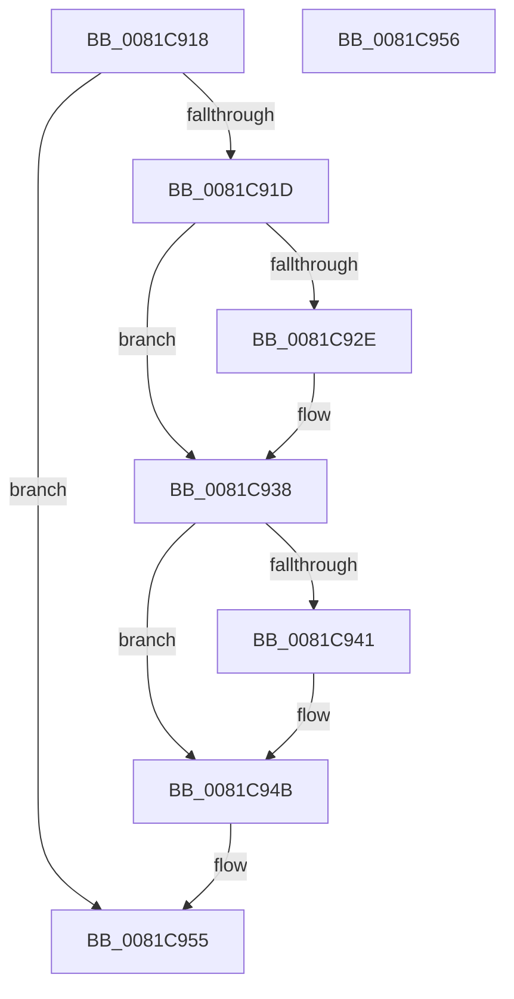

# AslpPathWildcardFreeMatchNode

- RVA: `0x0081C918`–`0x0081C957` (길이 `63` bytes)
- VA: `0x000000014081C918`
- 실행 섹션: `PAGE`
- PDB 이름 있음: `예`; PDB Function 태그: `아니요`
- unwind 정보 RVA: `0x000805BC`
- 디코드: `20`개 명령, `63/63` bytes 표시
- 미해석 바이트: `0` (있으면 어셈블리에 `.byte`로 보존)

> 이 문서는 커널 이미지의 기계어와 PDB 기호를 분석해 생성했습니다. 4번과 5번은 함수 원형과 자료형을 바이너리 사용 방식에서 추정한 C 해석이며 원본 소스 복구 결과는 아닙니다.

## 1. Dependencies

- 직접 호출 지점: **2**; 고유 호출 대상: **2**
- 직접 호출자로 확인된 함수: **4**
- RIP 상대 이미지 참조: **0**

### Outgoing calls
- `0x0081C92E` → [ZwClose](../../text/6A/ZwClose_function_006AD2B0.md) (function, `0x006AD2B0`)
- `0x0081C941` → [AslFree](../95/AslFree_function_0095B674.md) (function, `0x0095B674`)

### Direct callers
- [AslPathWildcardFindFirst](AslPathWildcardFindFirst_function_0081B534.md) at `0x0081BAF8`
- [AslPathWildcardFindNext](AslPathWildcardFindNext_function_0081BB2C.md) at `0x0081BCB4`
- [AslpPathWildcardAllocMatchNode](AslpPathWildcardAllocMatchNode_function_0081C620.md) at `0x0081C81E`
- [AslpPathWildcardFreeFindContext](AslpPathWildcardFreeFindContext_function_0081C844.md) at `0x0081C8AD`

### Static image references
- 디코드된 RIP-relative 메모리 참조가 없습니다.

## 2. Other-region calls and transfers

- 다른 실행 섹션으로 향하는 call: **1**
  - `0x0081C92E` → [ZwClose](../../text/6A/ZwClose_function_006AD2B0.md) (`PAGE` → `.text`)
- 별도 외부 분기/꼬리 이동을 확인하지 못했습니다.

## 3. Assembly (complete function range)

```asm
0081C918  48 85 C9                        test rcx, rcx
0081C91B  74 38                           je 0x14081c955
0081C91D  53                              push rbx
0081C91E  48 83 EC 20                     sub rsp, 0x20
0081C922  48 8B D9                        mov rbx, rcx
0081C925  48 8B 49 18                     mov rcx, qword ptr [rcx + 0x18]
0081C929  48 85 C9                        test rcx, rcx
0081C92C  74 0A                           je 0x14081c938
0081C92E  E8 7D 09 E9 FF                  call 0x1406ad2b0
0081C933  48 83 63 18 00                  and qword ptr [rbx + 0x18], 0
0081C938  48 8B 53 08                     mov rdx, qword ptr [rbx + 8]
0081C93C  48 85 D2                        test rdx, rdx
0081C93F  74 0A                           je 0x14081c94b
0081C941  E8 2E ED 13 00                  call 0x14095b674
0081C946  48 83 63 08 00                  and qword ptr [rbx + 8], 0
0081C94B  48 83 63 10 00                  and qword ptr [rbx + 0x10], 0
0081C950  48 83 C4 20                     add rsp, 0x20
0081C954  5B                              pop rbx
0081C955  C3                              ret
0081C956  CC                              int3
```

## 4. C-style interpretation (structured pseudocode)

```c
__int64 __fastcall AslpPathWildcardFreeMatchNode(__int64 a1)
{
    __int64 result;
    __int64 v_rsp;

    if (a1 == 0) goto loc_0081C955;
    v_rsp = (v_rsp) - (32);
    if (*(unsigned __int64 *)(a1 + 24) != 0) {
        result = ZwClose(*(unsigned __int64 *)(a1 + 24), a2, a3, a4);
    }
    if (*(unsigned __int64 *)(a1 + 8) != 0) {
        result = AslFree(*(unsigned __int64 *)(a1 + 24), *(unsigned __int64 *)(a1 + 8), a3, a4);
    }
    v_rsp = (v_rsp) + (32);
loc_0081C955:
    return result;
}
```

## 5. (Beta) C Style

```c
int64_t AslpPathWildcardFreeMatchNode(int64_t Arg1)
{
    int64_t result;
    int64_t local_rsp;

    if (Arg1 == 0) goto loc_0081C955;
    local_rsp = (local_rsp) - (32);
    if (*(uint64_t *)(Arg1 + 0x18) != 0) {
        result = ZwClose(*(uint64_t *)(Arg1 + 0x18), a2, a3, a4);
    }
    if (*(uint64_t *)(Arg1 + 0x8) != 0) {
        result = AslFree(*(uint64_t *)(Arg1 + 0x18), *(uint64_t *)(Arg1 + 0x8), a3, a4);
    }
    local_rsp = (local_rsp) + (32);
loc_0081C955:
    return result;
}
```

## 6. Execution-region graph

[열기: 2D/3D 그래프와 함수 탐색 컨트롤 패널](../../../control-panel.html?section=page&rva=0x0081C918&view=graph)

- 2D 그래프는 위에서 아래로 흐르고, 3D 그래프는 빈 공간을 드래그해 회전합니다. Shift+드래그는 이동, 휠은 확대·축소, 함수 노드 선택은 대상 보고서 이동입니다.

### Static fallback


