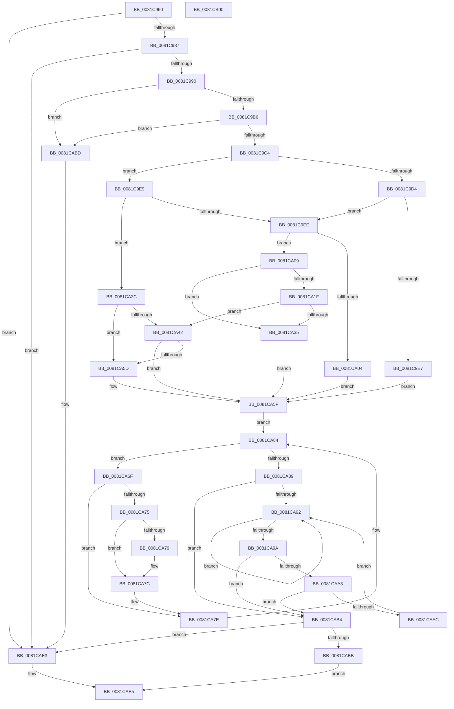

# AslpPathWildcardMakeLeaves

- RVA: `0x0081C960`–`0x0081CB01` (길이 `417` bytes)
- VA: `0x000000014081C960`
- 실행 섹션: `PAGE`
- PDB 이름 있음: `예`; PDB Function 태그: `아니요`
- unwind 정보 RVA: `0x00060130`
- 디코드: `119`개 명령, `417/417` bytes 표시
- 미해석 바이트: `0` (있으면 어셈블리에 `.byte`로 보존)

> 이 문서는 커널 이미지의 기계어와 PDB 기호를 분석해 생성했습니다. 4번과 5번은 함수 원형과 자료형을 바이너리 사용 방식에서 추정한 C 해석이며 원본 소스 복구 결과는 아닙니다.

## 1. Dependencies

- 직접 호출 지점: **8**; 고유 호출 대상: **5**
- 직접 호출자로 확인된 함수: **1**
- RIP 상대 이미지 참조: **7**

### Outgoing calls
- `0x0081C99E` → [RtlInitUnicodeString](../../text/42/RtlInitUnicodeString_function_0042A780.md) (function, `0x0042A780`)
- `0x0081C9DE` → [wcsnicmp](../../text/50/wcsnicmp_function_005001C0.md) (function, `0x005001C0`)
- `0x0081C9FB` → [wcsncmp](../../text/50/wcsncmp_function_00501CA0.md) (function, `0x00501CA0`)
- `0x0081CA16` → [wcsncmp](../../text/50/wcsncmp_function_00501CA0.md) (function, `0x00501CA0`)
- `0x0081CA2C` → [wcsncmp](../../text/50/wcsncmp_function_00501CA0.md) (function, `0x00501CA0`)
- `0x0081CA4F` → [wcsncmp](../../text/50/wcsncmp_function_00501CA0.md) (function, `0x00501CA0`)
- `0x0081CAA3` → [AslStringHasWildcard](AslStringHasWildcard_function_00819950.md) (function, `0x00819950`)
- `0x0081CADE` → [AslLogCallPrintf](../95/AslLogCallPrintf_function_0095E4EC.md) (function, `0x0095E4EC`)

### Direct callers
- [AslPathWildcardFindFirst](AslPathWildcardFindFirst_function_0081B534.md) at `0x0081B6A7`

### Static image references
- `0x0081C9D4` → RVA `0x0003F2F8` (`.rdata`; read)
- `0x0081C9F1` → RVA `0x0001BAC0` (`.rdata`; read)
- `0x0081CA0C` → RVA `0x0001BAB0` (`.rdata`; read)
- `0x0081CA22` → RVA `0x0003F328` (`.rdata`; read)
- `0x0081CA45` → RVA `0x0003F334` (`.rdata`; read)
- `0x0081CABD` → RVA `0x0003F340` (`.rdata`; read)
- `0x0081CAD2` → RVA `0x0003F550` (`.rdata`; read)

## 2. Other-region calls and transfers

- 다른 실행 섹션으로 향하는 call: **6**
  - `0x0081C99E` → [RtlInitUnicodeString](../../text/42/RtlInitUnicodeString_function_0042A780.md) (`PAGE` → `.text`)
  - `0x0081C9DE` → [wcsnicmp](../../text/50/wcsnicmp_function_005001C0.md) (`PAGE` → `.text`)
  - `0x0081C9FB` → [wcsncmp](../../text/50/wcsncmp_function_00501CA0.md) (`PAGE` → `.text`)
  - `0x0081CA16` → [wcsncmp](../../text/50/wcsncmp_function_00501CA0.md) (`PAGE` → `.text`)
  - `0x0081CA2C` → [wcsncmp](../../text/50/wcsncmp_function_00501CA0.md) (`PAGE` → `.text`)
  - `0x0081CA4F` → [wcsncmp](../../text/50/wcsncmp_function_00501CA0.md) (`PAGE` → `.text`)
- 별도 외부 분기/꼬리 이동을 확인하지 못했습니다.

## 3. Assembly (complete function range)

```asm
0081C960  48 8B C4                        mov rax, rsp
0081C963  48 89 58 08                     mov qword ptr [rax + 8], rbx
0081C967  48 89 68 10                     mov qword ptr [rax + 0x10], rbp
0081C96B  48 89 70 18                     mov qword ptr [rax + 0x18], rsi
0081C96F  48 89 78 20                     mov qword ptr [rax + 0x20], rdi
0081C973  41 56                           push r14
0081C975  48 83 EC 40                     sub rsp, 0x40
0081C979  33 ED                           xor ebp, ebp
0081C97B  48 8B F9                        mov rdi, rcx
0081C97E  48 85 C9                        test rcx, rcx
0081C981  0F 84 5C 01 00 00               je 0x14081cae3
0081C987  66 39 29                        cmp word ptr [rcx], bp
0081C98A  0F 84 53 01 00 00               je 0x14081cae3
0081C990  0F 57 C0                        xorps xmm0, xmm0
0081C993  48 8B D1                        mov rdx, rcx
0081C996  48 8D 48 E8                     lea rcx, [rax - 0x18]
0081C99A  0F 11 40 E8                     movups xmmword ptr [rax - 0x18], xmm0
0081C99E  E8 DD DD C0 FF                  call 0x14042a780
0081C9A3  0F B7 44 24 30                  movzx eax, word ptr [rsp + 0x30]
0081C9A8  44 8D 75 02                     lea r14d, [rbp + 2]
0081C9AC  66 41 3B C6                     cmp ax, r14w
0081C9B0  0F 82 07 01 00 00               jb 0x14081cabd
0081C9B6  48 8B 74 24 38                  mov rsi, qword ptr [rsp + 0x38]
0081C9BB  66 39 2E                        cmp word ptr [rsi], bp
0081C9BE  0F 84 F9 00 00 00               je 0x14081cabd
0081C9C4  66 D1 E8                        shr ax, 1
0081C9C7  44 8D 45 08                     lea r8d, [rbp + 8]
0081C9CB  8D 5D 04                        lea ebx, [rbp + 4]
0081C9CE  66 41 3B C0                     cmp ax, r8w
0081C9D2  72 15                           jb 0x14081c9e9
0081C9D4  48 8D 15 1D 29 82 FF            lea rdx, [rip - 0x7dd6e3]
0081C9DB  48 8B CE                        mov rcx, rsi
0081C9DE  E8 DD 37 CE FF                  call 0x1405001c0
0081C9E3  85 C0                           test eax, eax
0081C9E5  75 07                           jne 0x14081c9ee
0081C9E7  EB 76                           jmp 0x14081ca5f
0081C9E9  66 3B C3                        cmp ax, bx
0081C9EC  72 4E                           jb 0x14081ca3c
0081C9EE  4C 8B C3                        mov r8, rbx
0081C9F1  48 8D 15 C8 F0 7F FF            lea rdx, [rip - 0x800f38]
0081C9F8  48 8B CE                        mov rcx, rsi
0081C9FB  E8 A0 52 CE FF                  call 0x140501ca0
0081CA00  85 C0                           test eax, eax
0081CA02  75 05                           jne 0x14081ca09
0081CA04  41 8B DE                        mov ebx, r14d
0081CA07  EB 56                           jmp 0x14081ca5f
0081CA09  4C 8B C3                        mov r8, rbx
0081CA0C  48 8D 15 9D F0 7F FF            lea rdx, [rip - 0x800f63]
0081CA13  48 8B CE                        mov rcx, rsi
0081CA16  E8 85 52 CE FF                  call 0x140501ca0
0081CA1B  85 C0                           test eax, eax
0081CA1D  74 16                           je 0x14081ca35
0081CA1F  4C 8B C3                        mov r8, rbx
0081CA22  48 8D 15 FF 28 82 FF            lea rdx, [rip - 0x7dd701]
0081CA29  48 8B CE                        mov rcx, rsi
0081CA2C  E8 6F 52 CE FF                  call 0x140501ca0
0081CA31  85 C0                           test eax, eax
0081CA33  75 0D                           jne 0x14081ca42
0081CA35  BB 03 00 00 00                  mov ebx, 3
0081CA3A  EB 23                           jmp 0x14081ca5f
0081CA3C  66 41 3B C6                     cmp ax, r14w
0081CA40  76 1B                           jbe 0x14081ca5d
0081CA42  4D 8B C6                        mov r8, r14
0081CA45  48 8D 15 E8 28 82 FF            lea rdx, [rip - 0x7dd718]
0081CA4C  48 8B CE                        mov rcx, rsi
0081CA4F  E8 4C 52 CE FF                  call 0x140501ca0
0081CA54  BB 03 00 00 00                  mov ebx, 3
0081CA59  85 C0                           test eax, eax
0081CA5B  74 02                           je 0x14081ca5f
0081CA5D  8B DD                           mov ebx, ebp
0081CA5F  0F B7 0F                        movzx ecx, word ptr [rdi]
0081CA62  F7 DB                           neg ebx
0081CA64  48 8B C7                        mov rax, rdi
0081CA67  41 B9 5C 00 00 00               mov r9d, 0x5c
0081CA6D  EB 15                           jmp 0x14081ca84
0081CA6F  66 41 3B C9                     cmp cx, r9w
0081CA73  75 09                           jne 0x14081ca7e
0081CA75  85 DB                           test ebx, ebx
0081CA77  78 03                           js 0x14081ca7c
0081CA79  66 89 28                        mov word ptr [rax], bp
0081CA7C  FF C3                           inc ebx
0081CA7E  49 03 C6                        add rax, r14
0081CA81  0F B7 08                        movzx ecx, word ptr [rax]
0081CA84  66 85 C9                        test cx, cx
0081CA87  75 E6                           jne 0x14081ca6f
0081CA89  66 89 68 02                     mov word ptr [rax + 2], bp
0081CA8D  66 39 2F                        cmp word ptr [rdi], bp
0081CA90  74 22                           je 0x14081cab4
0081CA92  49 03 FE                        add rdi, r14
0081CA95  66 39 2F                        cmp word ptr [rdi], bp
0081CA98  75 F8                           jne 0x14081ca92
0081CA9A  48 8D 4F 02                     lea rcx, [rdi + 2]
0081CA9E  66 39 29                        cmp word ptr [rcx], bp
0081CAA1  74 11                           je 0x14081cab4
0081CAA3  E8 A8 CE FF FF                  call 0x140819950
0081CAA8  85 C0                           test eax, eax
0081CAAA  75 08                           jne 0x14081cab4
0081CAAC  66 44 89 0F                     mov word ptr [rdi], r9w
0081CAB0  FF CB                           dec ebx
0081CAB2  EB DE                           jmp 0x14081ca92
0081CAB4  8D 43 01                        lea eax, [rbx + 1]
0081CAB7  85 C0                           test eax, eax
0081CAB9  78 28                           js 0x14081cae3
0081CABB  EB 28                           jmp 0x14081cae5
0081CABD  4C 8D 0D 7C 28 82 FF            lea r9, [rip - 0x7dd784]
0081CAC4  C7 44 24 20 F2 00 00 C0         mov dword ptr [rsp + 0x20], 0xc00000f2
0081CACC  41 B8 E4 0B 00 00               mov r8d, 0xbe4
0081CAD2  48 8D 15 77 2A 82 FF            lea rdx, [rip - 0x7dd589]
0081CAD9  B9 01 00 00 00                  mov ecx, 1
0081CADE  E8 09 1A 14 00                  call 0x14095e4ec
0081CAE3  33 C0                           xor eax, eax
0081CAE5  48 8B 5C 24 50                  mov rbx, qword ptr [rsp + 0x50]
0081CAEA  48 8B 6C 24 58                  mov rbp, qword ptr [rsp + 0x58]
0081CAEF  48 8B 74 24 60                  mov rsi, qword ptr [rsp + 0x60]
0081CAF4  48 8B 7C 24 68                  mov rdi, qword ptr [rsp + 0x68]
0081CAF9  48 83 C4 40                     add rsp, 0x40
0081CAFD  41 5E                           pop r14
0081CAFF  C3                              ret
0081CB00  CC                              int3
```

## 4. C-style interpretation (structured pseudocode)

```c
__int64 __fastcall AslpPathWildcardMakeLeaves(__int64 a1)
{
    __int64 result;
    __int64 v_rbp;
    __int64 v_rbx;
    __int64 v_rdi;
    __int64 v_rsp;
    unsigned __int64 v_stack_m10;
    unsigned __int16 v_stack_m18;
    unsigned int v_stack_m28;
    unsigned __int64 v_stack_p10;
    unsigned __int64 v_stack_p18;
    unsigned __int64 v_stack_p20;
    unsigned __int64 v_stack_p8;

    *(unsigned __int64 *)(v_rsp + 8) = v_rbx;
    *(unsigned __int64 *)(v_rsp + 16) = v_rbp;
    *(unsigned __int64 *)(v_rsp + 24) = v_rsi;
    *(unsigned __int64 *)(v_rsp + 32) = v_rdi;
    v_rsp = (v_rsp) - (64);
    v_rbp = 0;
    if (a1 == 0) goto loc_0081CAE3;
    if ((*(unsigned __int16 *)(a1)) == 0) goto loc_0081CAE3;
    *(unsigned __int64 *)(v_rsp - 24) = v_xmm0;
    result = RtlInitUnicodeString(v_rsp - 24, a1, a3, a4);
    if (((unsigned __int16)(v_stack_m18)) < ((unsigned __int16)(v_rbp + 2))) goto loc_0081CABD;
    if ((*(unsigned __int16 *)(v_stack_m10)) == 0) goto loc_0081CABD;
    result = (unsigned __int16)((v_stack_m18) >> (1));
    if (((unsigned __int16)(result)) < ((unsigned __int16)(v_rbp + 8))) goto loc_0081C9E9;
    result = wcsnicmp(v_stack_m10, v_rip - 8247011, v_rbp + 8, a4);
    if ((unsigned int)(result) != 0) goto loc_0081C9EE;
    goto loc_0081CA5F;
loc_0081C9E9:
    if (((unsigned __int16)(result)) < ((unsigned __int16)(v_rbp + 4))) goto loc_0081CA3C;
loc_0081C9EE:
    result = wcsncmp(v_stack_m10, v_rip - 8392504, v_rbp + 4, a4);
    if ((unsigned int)(result) != 0) goto loc_0081CA09;
    goto loc_0081CA5F;
loc_0081CA09:
    result = wcsncmp(v_stack_m10, v_rip - 8392547, (unsigned int)((unsigned int)(v_rbp + 2)), a4);
    if ((unsigned int)(result) == 0) goto loc_0081CA35;
    result = wcsncmp(v_stack_m10, v_rip - 8247041, (unsigned int)((unsigned int)(v_rbp + 2)), a4);
    if ((unsigned int)(result) != 0) goto loc_0081CA42;
loc_0081CA35:
    goto loc_0081CA5F;
loc_0081CA3C:
    if (((unsigned __int16)(result)) <= ((unsigned __int16)(v_rbp + 2))) goto loc_0081CA5D;
loc_0081CA42:
    result = wcsncmp(v_stack_m10, v_rip - 8247064, v_rbp + 2, a4);
    v_rbx = 3;
    if ((unsigned int)(result) != 0) {
        v_rbx = 0;
    }
    v_rbx = (unsigned int)(-(v_rbx));
    goto loc_0081CA84;
loc_0081CA6F:
    if (((unsigned __int16)(*(unsigned __int16 *)(a1))) != 92) goto loc_0081CA7E;
    if (!(sign_flag)) {
        *(unsigned __int16 *)(a1) = 0;
    }
    v_rbx = (unsigned int)((v_rbx) + 1);
loc_0081CA7E:
    result = (a1) + (v_rbp + 2);
loc_0081CA84:
    if ((unsigned __int16)(*(unsigned __int16 *)(result)) != 0) goto loc_0081CA6F;
    *(unsigned __int16 *)(result + 2) = 0;
    if ((*(unsigned __int16 *)(a1)) == 0) goto loc_0081CAB4;
loc_0081CA92:
    v_rdi = (a1) + (v_rbp + 2);
    if ((*(unsigned __int16 *)(v_rdi)) != 0) goto loc_0081CA92;
    if ((*(unsigned __int16 *)(v_rdi + 2)) == 0) goto loc_0081CAB4;
    result = AslStringHasWildcard(v_rdi + 2, v_rip - 8247064, v_rbp + 2, 92);
    if ((unsigned int)(result) != 0) goto loc_0081CAB4;
    *(unsigned __int16 *)(v_rdi) = 92;
    v_rbx = (unsigned int)((v_rbx) - 1);
    goto loc_0081CA92;
loc_0081CAB4:
    if (sign_flag) goto loc_0081CAE3;
    goto loc_0081CAE5;
loc_0081CABD:
    v_stack_m28 = 0xC00000F2ULL;
    result = AslLogCallPrintf(1, v_rip - 8246665, (unsigned int)(0xBE4ULL), v_rip - 8247172);
loc_0081CAE3:
    result = 0;
loc_0081CAE5:
    v_rsp = (v_rsp) + (64);
    return result;
}
```

## 5. (Beta) C Style

```c
int64_t AslpPathWildcardMakeLeaves(void *Arg1)
{
    uint8_t *arg1 = (uint8_t *)Arg1;

    int64_t result;
    int64_t local_rbp;
    int64_t local_rbx;
    int64_t local_rdi;
    int64_t local_rsp;
    uint64_t v_stack_m10;
    uint16_t v_stack_m18;
    uint32_t v_stack_m28;
    uint64_t v_stack_p10;
    uint64_t v_stack_p18;
    uint64_t v_stack_p20;
    uint64_t v_stack_p8;

    *(uint64_t *)(local_rsp + 0x8) = local_rbx;
    *(uint64_t *)(local_rsp + 0x10) = local_rbp;
    *(uint64_t *)(local_rsp + 0x18) = local_rsi;
    *(uint64_t *)(local_rsp + 0x20) = local_rdi;
    local_rsp = (local_rsp) - (64);
    local_rbp = 0;
    if (Arg1 == NULL) goto loc_0081CAE3;
    if ((*(uint16_t *)(arg1)) == 0) goto loc_0081CAE3;
    *(uint64_t *)(local_rsp - 0x18) = v_xmm0;
    result = RtlInitUnicodeString(local_rsp - 24, Arg1, a3, a4);
    if (((uint16_t)(v_stack_m18)) < ((uint16_t)(local_rbp + 2))) goto loc_0081CABD;
    if ((*(uint16_t *)(v_stack_m10)) == 0) goto loc_0081CABD;
    result = (uint16_t)((v_stack_m18) >> (1));
    if (((uint16_t)(result)) < ((uint16_t)(local_rbp + 8))) goto loc_0081C9E9;
    result = wcsnicmp(v_stack_m10, v_rip - 8247011, local_rbp + 8, a4);
    if ((uint32_t)(result) != 0) goto loc_0081C9EE;
    goto loc_0081CA5F;
loc_0081C9E9:
    if (((uint16_t)(result)) < ((uint16_t)(local_rbp + 4))) goto loc_0081CA3C;
loc_0081C9EE:
    result = wcsncmp(v_stack_m10, v_rip - 8392504, local_rbp + 4, a4);
    if ((uint32_t)(result) != 0) goto loc_0081CA09;
    goto loc_0081CA5F;
loc_0081CA09:
    result = wcsncmp(v_stack_m10, v_rip - 8392547, (uint32_t)((uint32_t)(local_rbp + 2)), a4);
    if ((uint32_t)(result) == 0) goto loc_0081CA35;
    result = wcsncmp(v_stack_m10, v_rip - 8247041, (uint32_t)((uint32_t)(local_rbp + 2)), a4);
    if ((uint32_t)(result) != 0) goto loc_0081CA42;
loc_0081CA35:
    goto loc_0081CA5F;
loc_0081CA3C:
    if (((uint16_t)(result)) <= ((uint16_t)(local_rbp + 2))) goto loc_0081CA5D;
loc_0081CA42:
    result = wcsncmp(v_stack_m10, v_rip - 8247064, local_rbp + 2, a4);
    local_rbx = 3;
    if ((uint32_t)(result) != 0) {
        local_rbx = 0;
    }
    local_rbx = (uint32_t)(-(local_rbx));
    goto loc_0081CA84;
loc_0081CA6F:
    if (((uint16_t)(*(uint16_t *)(arg1))) != 92) goto loc_0081CA7E;
    if (!(sign_flag)) {
        *(uint16_t *)(arg1) = 0;
    }
    local_rbx = (uint32_t)((local_rbx) + 1);
loc_0081CA7E:
    result = (Arg1) + (local_rbp + 2);
loc_0081CA84:
    if ((uint16_t)(*(uint16_t *)(result)) != 0) goto loc_0081CA6F;
    *(uint16_t *)(result + 0x2) = 0;
    if ((*(uint16_t *)(arg1)) == 0) goto loc_0081CAB4;
loc_0081CA92:
    local_rdi = (Arg1) + (local_rbp + 2);
    if ((*(uint16_t *)(local_rdi)) != 0) goto loc_0081CA92;
    if ((*(uint16_t *)(local_rdi + 0x2)) == 0) goto loc_0081CAB4;
    result = AslStringHasWildcard(local_rdi + 2, v_rip - 8247064, local_rbp + 2, 92);
    if ((uint32_t)(result) != 0) goto loc_0081CAB4;
    *(uint16_t *)(local_rdi) = 92;
    local_rbx = (uint32_t)((local_rbx) - 1);
    goto loc_0081CA92;
loc_0081CAB4:
    if (sign_flag) goto loc_0081CAE3;
    goto loc_0081CAE5;
loc_0081CABD:
    v_stack_m28 = 0xC00000F2ULL;
    result = AslLogCallPrintf(1, v_rip - 8246665, (uint32_t)(0xBE4ULL), v_rip - 8247172);
loc_0081CAE3:
    result = 0;
loc_0081CAE5:
    local_rsp = (local_rsp) + (64);
    return result;
}
```

### 관측된 메모리 오프셋

구조체 형식이 확인되지 않은 접근은 인자 기준의 오프셋으로만 기록했습니다.

| 기준 인자 | 오프셋 표현 | 폭 (bit) | 접근 |
|---|---:|---:|---|
| `Arg1` | `+ 0x0` | `16` | `R` |
| `Arg1` | `+ 0x0` | `16` | `W` |
| `Arg1` | `+ 0x2` | `16` | `W` |
| `Arg1` | `+ 0x2` | `64` | `R` |

## 6. Execution-region graph

[열기: 2D/3D 그래프와 함수 탐색 컨트롤 패널](../../../control-panel.html?section=page&rva=0x0081C960&view=graph)

- 2D 그래프는 위에서 아래로 흐르고, 3D 그래프는 빈 공간을 드래그해 회전합니다. Shift+드래그는 이동, 휠은 확대·축소, 함수 노드 선택은 대상 보고서 이동입니다.

### Static fallback


