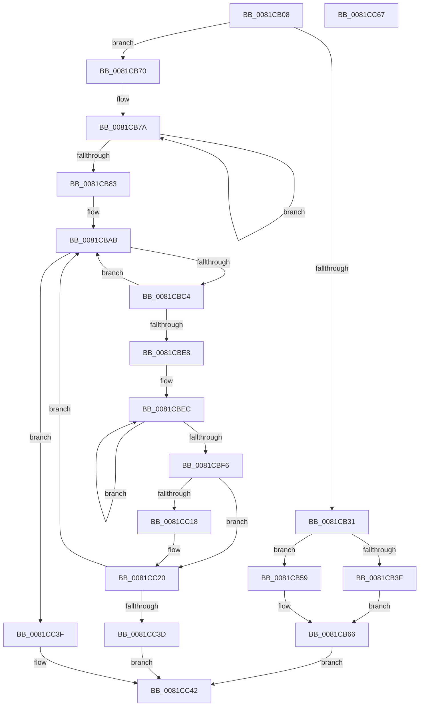

# AslpProcessMatchRegNode

- RVA: `0x0081CB08`–`0x0081CC68` (길이 `352` bytes)
- VA: `0x000000014081CB08`
- 실행 섹션: `PAGE`
- PDB 이름 있음: `예`; PDB Function 태그: `아니요`
- unwind 정보 RVA: `0x00060130`
- 디코드: `100`개 명령, `352/352` bytes 표시
- 미해석 바이트: `0` (있으면 어셈블리에 `.byte`로 보존)

> 이 문서는 커널 이미지의 기계어와 PDB 기호를 분석해 생성했습니다. 4번과 5번은 함수 원형과 자료형을 바이너리 사용 방식에서 추정한 C 해석이며 원본 소스 복구 결과는 아닙니다.

## 1. Dependencies

- 직접 호출 지점: **9**; 고유 호출 대상: **8**
- 직접 호출자로 확인된 함수: **1**
- RIP 상대 이미지 참조: **0**

### Outgoing calls
- `0x0081CB50` → [AslRegistryGetKey](AslRegistryGetKey_function_00819F64.md) (function, `0x00819F64`)
- `0x0081CB59` → [ZwClose](../../text/6A/ZwClose_function_006AD2B0.md) (function, `0x006AD2B0`)
- `0x0081CB96` → [AslAlloc](../95/AslAlloc_function_0095BD34.md) (function, `0x0095BD34`)
- `0x0081CBB9` → [AslRegistryEnumKey](AslRegistryEnumKey_function_00819EB0.md) (function, `0x00819EB0`)
- `0x0081CBD8` → [AslStringPatternMatchExW](../95/AslStringPatternMatchExW_function_0095E850.md) (function, `0x0095E850`)
- `0x0081CC07` → [RtlAppendUnicodeToString](../../text/40/RtlAppendUnicodeToString_function_0040F990.md) (function, `0x0040F990`)
- `0x0081CC18` → [ZwClose](../../text/6A/ZwClose_function_006AD2B0.md) (function, `0x006AD2B0`)
- `0x0081CC2E` → [AslRegistryOpenSubKey](AslRegistryOpenSubKey_function_0081A3E0.md) (function, `0x0081A3E0`)
- `0x0081CC45` → [AslFree](../95/AslFree_function_0095B674.md) (function, `0x0095B674`)

### Direct callers
- [AslRegWildcardFindNext](AslRegWildcardFindNext_function_0081C3B0.md) at `0x0081C3DE`

### Static image references
- 디코드된 RIP-relative 메모리 참조가 없습니다.

## 2. Other-region calls and transfers

- 다른 실행 섹션으로 향하는 call: **3**
  - `0x0081CB59` → [ZwClose](../../text/6A/ZwClose_function_006AD2B0.md) (`PAGE` → `.text`)
  - `0x0081CC07` → [RtlAppendUnicodeToString](../../text/40/RtlAppendUnicodeToString_function_0040F990.md) (`PAGE` → `.text`)
  - `0x0081CC18` → [ZwClose](../../text/6A/ZwClose_function_006AD2B0.md) (`PAGE` → `.text`)
- 별도 외부 분기/꼬리 이동을 확인하지 못했습니다.

## 3. Assembly (complete function range)

```asm
0081CB08  48 8B C4                        mov rax, rsp
0081CB0B  48 89 58 08                     mov qword ptr [rax + 8], rbx
0081CB0F  48 89 68 10                     mov qword ptr [rax + 0x10], rbp
0081CB13  48 89 70 18                     mov qword ptr [rax + 0x18], rsi
0081CB17  48 89 78 20                     mov qword ptr [rax + 0x20], rdi
0081CB1B  41 56                           push r14
0081CB1D  48 83 EC 40                     sub rsp, 0x40
0081CB21  0F 57 C0                        xorps xmm0, xmm0
0081CB24  48 8B F1                        mov rsi, rcx
0081CB27  0F 11 40 E8                     movups xmmword ptr [rax - 0x18], xmm0
0081CB2B  48 39 51 08                     cmp qword ptr [rcx + 8], rdx
0081CB2F  75 3F                           jne 0x14081cb70
0081CB31  48 8D 59 20                     lea rbx, [rcx + 0x20]
0081CB35  33 FF                           xor edi, edi
0081CB37  48 8B 0B                        mov rcx, qword ptr [rbx]
0081CB3A  48 85 C9                        test rcx, rcx
0081CB3D  75 1A                           jne 0x14081cb59
0081CB3F  48 8B 56 18                     mov rdx, qword ptr [rsi + 0x18]
0081CB43  44 8D 49 01                     lea r9d, [rcx + 1]
0081CB47  48 8B CB                        mov rcx, rbx
0081CB4A  41 B8 19 00 02 00               mov r8d, 0x20019
0081CB50  E8 0F D4 FF FF                  call 0x140819f64
0081CB55  8B D8                           mov ebx, eax
0081CB57  EB 0D                           jmp 0x14081cb66
0081CB59  E8 52 07 E9 FF                  call 0x1406ad2b0
0081CB5E  48 89 3B                        mov qword ptr [rbx], rdi
0081CB61  BB 1A 00 00 80                  mov ebx, 0x8000001a
0081CB66  4C 8B 74 24 38                  mov r14, qword ptr [rsp + 0x38]
0081CB6B  E9 D2 00 00 00                  jmp 0x14081cc42
0081CB70  48 8B 49 18                     mov rcx, qword ptr [rcx + 0x18]
0081CB74  48 83 C8 FF                     or rax, 0xffffffffffffffff
0081CB78  33 FF                           xor edi, edi
0081CB7A  48 FF C0                        inc rax
0081CB7D  66 39 3C 41                     cmp word ptr [rcx + rax*2], di
0081CB81  75 F7                           jne 0x14081cb7a
0081CB83  B9 05 01 00 00                  mov ecx, 0x105
0081CB88  66 03 C1                        add ax, cx
0081CB8B  66 03 C0                        add ax, ax
0081CB8E  0F B7 D0                        movzx edx, ax
0081CB91  66 89 54 24 32                  mov word ptr [rsp + 0x32], dx
0081CB96  E8 99 F1 13 00                  call 0x14095bd34
0081CB9B  48 8B 4E 08                     mov rcx, qword ptr [rsi + 8]
0081CB9F  4C 8B F0                        mov r14, rax
0081CBA2  48 89 44 24 38                  mov qword ptr [rsp + 0x38], rax
0081CBA7  48 8B 69 20                     mov rbp, qword ptr [rcx + 0x20]
0081CBAB  66 41 89 3E                     mov word ptr [r14], di
0081CBAF  4C 8B C5                        mov r8, rbp
0081CBB2  44 8B 4E 28                     mov r9d, dword ptr [rsi + 0x28]
0081CBB6  49 8B CE                        mov rcx, r14
0081CBB9  E8 F2 D2 FF FF                  call 0x140819eb0
0081CBBE  8B D8                           mov ebx, eax
0081CBC0  85 C0                           test eax, eax
0081CBC2  78 7B                           js 0x14081cc3f
0081CBC4  48 8B 46 18                     mov rax, qword ptr [rsi + 0x18]
0081CBC8  49 8B D6                        mov rdx, r14
0081CBCB  FF 46 28                        inc dword ptr [rsi + 0x28]
0081CBCE  0F B7 18                        movzx ebx, word ptr [rax]
0081CBD1  66 89 38                        mov word ptr [rax], di
0081CBD4  48 8B 4E 10                     mov rcx, qword ptr [rsi + 0x10]
0081CBD8  E8 73 1C 14 00                  call 0x14095e850
0081CBDD  48 8B 4E 18                     mov rcx, qword ptr [rsi + 0x18]
0081CBE1  66 89 19                        mov word ptr [rcx], bx
0081CBE4  85 C0                           test eax, eax
0081CBE6  74 C3                           je 0x14081cbab
0081CBE8  48 83 C8 FF                     or rax, 0xffffffffffffffff
0081CBEC  48 FF C0                        inc rax
0081CBEF  66 41 39 3C 46                  cmp word ptr [r14 + rax*2], di
0081CBF4  75 F6                           jne 0x14081cbec
0081CBF6  48 8B 56 18                     mov rdx, qword ptr [rsi + 0x18]
0081CBFA  48 8D 4C 24 30                  lea rcx, [rsp + 0x30]
0081CBFF  66 03 C0                        add ax, ax
0081CC02  66 89 44 24 30                  mov word ptr [rsp + 0x30], ax
0081CC07  E8 84 2D BF FF                  call 0x14040f990
0081CC0C  48 8D 5E 20                     lea rbx, [rsi + 0x20]
0081CC10  48 8B 0B                        mov rcx, qword ptr [rbx]
0081CC13  48 85 C9                        test rcx, rcx
0081CC16  74 08                           je 0x14081cc20
0081CC18  E8 93 06 E9 FF                  call 0x1406ad2b0
0081CC1D  48 89 3B                        mov qword ptr [rbx], rdi
0081CC20  4C 8B 74 24 38                  mov r14, qword ptr [rsp + 0x38]
0081CC25  48 8B D5                        mov rdx, rbp
0081CC28  4D 8B C6                        mov r8, r14
0081CC2B  48 8B CB                        mov rcx, rbx
0081CC2E  E8 AD D7 FF FF                  call 0x14081a3e0
0081CC33  8B D8                           mov ebx, eax
0081CC35  85 C0                           test eax, eax
0081CC37  0F 88 6E FF FF FF               js 0x14081cbab
0081CC3D  EB 03                           jmp 0x14081cc42
0081CC3F  89 7E 28                        mov dword ptr [rsi + 0x28], edi
0081CC42  49 8B D6                        mov rdx, r14
0081CC45  E8 2A EA 13 00                  call 0x14095b674
0081CC4A  48 8B 6C 24 58                  mov rbp, qword ptr [rsp + 0x58]
0081CC4F  8B C3                           mov eax, ebx
0081CC51  48 8B 5C 24 50                  mov rbx, qword ptr [rsp + 0x50]
0081CC56  48 8B 74 24 60                  mov rsi, qword ptr [rsp + 0x60]
0081CC5B  48 8B 7C 24 68                  mov rdi, qword ptr [rsp + 0x68]
0081CC60  48 83 C4 40                     add rsp, 0x40
0081CC64  41 5E                           pop r14
0081CC66  C3                              ret
0081CC67  CC                              int3
```

## 4. C-style interpretation (structured pseudocode)

```c
__int64 __fastcall AslpProcessMatchRegNode(__int64 a1, __int64 a2)
{
    __int64 result;
    __int64 v_rdi;
    __int64 v_rsp;
    unsigned __int64 v_stack_m10;
    unsigned __int16 v_stack_m16;
    unsigned __int64 v_stack_m18;
    unsigned __int64 v_stack_p10;
    unsigned __int64 v_stack_p18;
    unsigned __int64 v_stack_p20;
    unsigned __int64 v_stack_p8;

    *(unsigned __int64 *)(v_rsp + 8) = v_rbx;
    *(unsigned __int64 *)(v_rsp + 16) = v_rbp;
    *(unsigned __int64 *)(v_rsp + 24) = v_rsi;
    *(unsigned __int64 *)(v_rsp + 32) = v_rdi;
    v_rsp = (v_rsp) - (64);
    *(unsigned __int64 *)(v_rsp - 24) = v_xmm0;
    if ((*(unsigned __int64 *)(a1 + 8)) != a2) goto loc_0081CB70;
    v_rdi = 0;
    if (*(unsigned __int64 *)(a1 + 32) != 0) goto loc_0081CB59;
    result = AslRegistryGetKey(a1 + 32, *(unsigned __int64 *)(a1 + 24), (unsigned int)(0x20019ULL), *(unsigned __int64 *)(a1 + 32) + 1);
    goto loc_0081CB66;
loc_0081CB59:
    result = ZwClose(a1 + 32, *(unsigned __int64 *)(a1 + 24), (unsigned int)(0x20019ULL), *(unsigned __int64 *)(a1 + 32) + 1);
    *(unsigned __int64 *)((unsigned int)((unsigned int)(result))) = 0;
loc_0081CB66:
    goto loc_0081CC42;
loc_0081CB70:
    result = (result) | (-1);
    v_rdi = 0;
loc_0081CB7A:
    result = (result) + 1;
    if ((*(unsigned __int16 *)(*(unsigned __int64 *)(a1 + 32 + 24) + result * 2)) != 0) goto loc_0081CB7A;
    result = (unsigned __int16)((result) + (261));
    result = (unsigned __int16)((result) + ((unsigned __int16)(result)));
    v_stack_m16 = (unsigned __int16)((unsigned __int16)(result));
    result = AslAlloc(261, (unsigned __int16)(result), (unsigned int)(0x20019ULL), *(unsigned __int64 *)(a1 + 32) + 1);
    v_stack_m10 = result;
loc_0081CBAB:
    *(unsigned __int16 *)(result) = 0;
    result = AslRegistryEnumKey(result, (unsigned __int16)(result), *(unsigned __int64 *)(*(unsigned __int64 *)(a1 + 8) + 32), (unsigned int)(*(unsigned int *)(a1 + 40)));
    if (sign_flag) goto loc_0081CC3F;
    *(unsigned __int16 *)(*(unsigned __int64 *)(a1 + 24)) = 0;
    result = AslStringPatternMatchExW(*(unsigned __int64 *)(a1 + 16), result, *(unsigned __int64 *)(*(unsigned __int64 *)(a1 + 8) + 32), (unsigned int)(*(unsigned int *)(a1 + 40)));
    *(unsigned __int16 *)(*(unsigned __int64 *)(a1 + 24)) = (unsigned __int16)(*(unsigned __int16 *)(*(unsigned __int64 *)(a1 + 24)));
    if ((unsigned int)(result) == 0) goto loc_0081CBAB;
    result = (result) | (-1);
loc_0081CBEC:
    result = (result) + 1;
    if ((*(unsigned __int16 *)(result + result * 2)) != 0) goto loc_0081CBEC;
    result = (unsigned __int16)((result) + ((unsigned __int16)(result)));
    v_stack_m18 = (unsigned __int16)(result);
    result = RtlAppendUnicodeToString(v_stack_m18, *(unsigned __int64 *)(a1 + 24), *(unsigned __int64 *)(*(unsigned __int64 *)(a1 + 8) + 32), (unsigned int)(*(unsigned int *)(a1 + 40)));
    if (*(unsigned __int64 *)(a1 + 32) != 0) {
        result = ZwClose(*(unsigned __int64 *)(a1 + 32), *(unsigned __int64 *)(a1 + 24), *(unsigned __int64 *)(*(unsigned __int64 *)(a1 + 8) + 32), (unsigned int)(*(unsigned int *)(a1 + 40)));
        *(unsigned __int64 *)(a1 + 32) = 0;
    }
    result = AslRegistryOpenSubKey(a1 + 32, *(unsigned __int64 *)(*(unsigned __int64 *)(a1 + 8) + 32), v_stack_m10, (unsigned int)(*(unsigned int *)(a1 + 40)));
    if (sign_flag) goto loc_0081CBAB;
    goto loc_0081CC42;
loc_0081CC3F:
    *(unsigned int *)(a1 + 40) = 0;
loc_0081CC42:
    result = AslFree(a1 + 32, v_stack_m10, v_stack_m10, (unsigned int)(*(unsigned int *)(a1 + 40)));
    v_rsp = (v_rsp) + (64);
    return (unsigned int)((unsigned int)((unsigned int)((unsigned int)(result))));
}
```

## 5. (Beta) C Style

```c
int64_t AslpProcessMatchRegNode(void *Arg1, int64_t Arg2)
{
    uint8_t *arg1 = (uint8_t *)Arg1;

    int64_t result;
    int64_t local_rdi;
    int64_t local_rsp;
    uint64_t v_stack_m10;
    uint16_t v_stack_m16;
    uint64_t v_stack_m18;
    uint64_t v_stack_p10;
    uint64_t v_stack_p18;
    uint64_t v_stack_p20;
    uint64_t v_stack_p8;

    *(uint64_t *)(local_rsp + 0x8) = local_rbx;
    *(uint64_t *)(local_rsp + 0x10) = local_rbp;
    *(uint64_t *)(local_rsp + 0x18) = local_rsi;
    *(uint64_t *)(local_rsp + 0x20) = local_rdi;
    local_rsp = (local_rsp) - (64);
    *(uint64_t *)(local_rsp - 0x18) = v_xmm0;
    if ((*(uint64_t *)(arg1 + 0x8)) != Arg2) goto loc_0081CB70;
    local_rdi = 0;
    if (*(uint64_t *)(arg1 + 0x20) != 0) goto loc_0081CB59;
    result = AslRegistryGetKey(Arg1 + 32, *(uint64_t *)(arg1 + 0x18), (uint32_t)(0x20019ULL), *(uint64_t *)(arg1 + 0x20) + 1);
    goto loc_0081CB66;
loc_0081CB59:
    result = ZwClose(Arg1 + 32, *(uint64_t *)(arg1 + 0x18), (uint32_t)(0x20019ULL), *(uint64_t *)(arg1 + 0x20) + 1);
    *(uint64_t *)((uint32_t)((uint32_t)(result))) = 0;
loc_0081CB66:
    goto loc_0081CC42;
loc_0081CB70:
    result = (result) | (-1);
    local_rdi = 0;
loc_0081CB7A:
    result = (result) + 1;
    if ((*(uint16_t *)(*(uint64_t *)(arg1 + 0x20 + 0x18) + result * 2)) != 0) goto loc_0081CB7A;
    result = (uint16_t)((result) + (261));
    result = (uint16_t)((result) + ((uint16_t)(result)));
    v_stack_m16 = (uint16_t)((uint16_t)(result));
    result = AslAlloc(261, (uint16_t)(result), (uint32_t)(0x20019ULL), *(uint64_t *)(arg1 + 0x20) + 1);
    v_stack_m10 = result;
loc_0081CBAB:
    *(uint16_t *)(result) = 0;
    result = AslRegistryEnumKey(result, (uint16_t)(result), *(uint64_t *)(*(uint64_t *)(arg1 + 0x8) + 0x20), (uint32_t)(*(uint32_t *)(arg1 + 0x28)));
    if (sign_flag) goto loc_0081CC3F;
    *(uint16_t *)(*(uint64_t *)(arg1 + 0x18)) = 0;
    result = AslStringPatternMatchExW(*(uint64_t *)(arg1 + 0x10), result, *(uint64_t *)(*(uint64_t *)(arg1 + 0x8) + 0x20), (uint32_t)(*(uint32_t *)(arg1 + 0x28)));
    *(uint16_t *)(*(uint64_t *)(arg1 + 0x18)) = (uint16_t)(*(uint16_t *)(*(uint64_t *)(arg1 + 0x18)));
    if ((uint32_t)(result) == 0) goto loc_0081CBAB;
    result = (result) | (-1);
loc_0081CBEC:
    result = (result) + 1;
    if ((*(uint16_t *)(result + result * 2)) != 0) goto loc_0081CBEC;
    result = (uint16_t)((result) + ((uint16_t)(result)));
    v_stack_m18 = (uint16_t)(result);
    result = RtlAppendUnicodeToString(v_stack_m18, *(uint64_t *)(arg1 + 0x18), *(uint64_t *)(*(uint64_t *)(arg1 + 0x8) + 0x20), (uint32_t)(*(uint32_t *)(arg1 + 0x28)));
    if (*(uint64_t *)(arg1 + 0x20) != 0) {
        result = ZwClose(*(uint64_t *)(arg1 + 0x20), *(uint64_t *)(arg1 + 0x18), *(uint64_t *)(*(uint64_t *)(arg1 + 0x8) + 0x20), (uint32_t)(*(uint32_t *)(arg1 + 0x28)));
        *(uint64_t *)(arg1 + 0x20) = 0;
    }
    result = AslRegistryOpenSubKey(Arg1 + 32, *(uint64_t *)(*(uint64_t *)(arg1 + 0x8) + 0x20), v_stack_m10, (uint32_t)(*(uint32_t *)(arg1 + 0x28)));
    if (sign_flag) goto loc_0081CBAB;
    goto loc_0081CC42;
loc_0081CC3F:
    *(uint32_t *)(arg1 + 0x28) = 0;
loc_0081CC42:
    result = AslFree(Arg1 + 32, v_stack_m10, v_stack_m10, (uint32_t)(*(uint32_t *)(arg1 + 0x28)));
    local_rsp = (local_rsp) + (64);
    return (uint32_t)((uint32_t)((uint32_t)((uint32_t)(result))));
}
```

### 관측된 메모리 오프셋

구조체 형식이 확인되지 않은 접근은 인자 기준의 오프셋으로만 기록했습니다.

| 기준 인자 | 오프셋 표현 | 폭 (bit) | 접근 |
|---|---:|---:|---|
| `Arg1` | `+ 0x0` | `64` | `R` |
| `Arg1` | `+ 0x0` | `64` | `W` |
| `Arg1` | `+ 0x8` | `64` | `R` |
| `Arg1` | `+ 0x10` | `64` | `R` |
| `Arg1` | `+ 0x18` | `64` | `R` |
| `Arg1` | `+ 0x20` | `64` | `R` |
| `Arg1` | `+ 0x28` | `32` | `R` |
| `Arg1` | `+ 0x28` | `32` | `R/W` |
| `Arg1` | `+ 0x28` | `32` | `W` |

## 6. Execution-region graph

[열기: 2D/3D 그래프와 함수 탐색 컨트롤 패널](../../../control-panel.html?section=page&rva=0x0081CB08&view=graph)

- 2D 그래프는 위에서 아래로 흐르고, 3D 그래프는 빈 공간을 드래그해 회전합니다. Shift+드래그는 이동, 휠은 확대·축소, 함수 노드 선택은 대상 보고서 이동입니다.

### Static fallback


