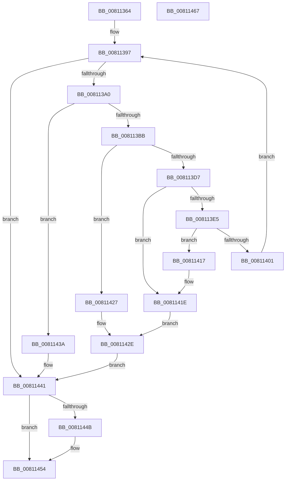

# MiAcceptNewAccelerators

- RVA: `0x00811364`–`0x00811468` (길이 `260` bytes)
- VA: `0x0000000140811364`
- 실행 섹션: `PAGE`
- PDB 이름 있음: `예`; PDB Function 태그: `아니요`
- unwind 정보 RVA: `0x000D9588`
- 디코드: `74`개 명령, `260/260` bytes 표시
- 미해석 바이트: `0` (있으면 어셈블리에 `.byte`로 보존)

> 이 문서는 커널 이미지의 기계어와 PDB 기호를 분석해 생성했습니다. 4번과 5번은 함수 원형과 자료형을 바이너리 사용 방식에서 추정한 C 해석이며 원본 소스 복구 결과는 아닙니다.

## 1. Dependencies

- 직접 호출 지점: **4**; 고유 호출 대상: **4**
- 직접 호출자로 확인된 함수: **1**
- RIP 상대 이미지 참조: **4**

### Outgoing calls
- `0x008113AE` → [MiAllocatePool](../../text/35/MiAllocatePool_function_0035B540.md) (function, `0x0035B540`)
- `0x008113CE` → [MiQueryAcceleratorHandle](MiQueryAcceleratorHandle_function_00811470.md) (function, `0x00811470`)
- `0x00811433` → [ExFreePoolWithTag](../../poolcode/B8/ExFreePoolWithTag_function_00B82870.md) (function, `0x00B82870`)
- `0x0081144F` → [MiSignalNewAcceleratorsAvailable](../../text/69/MiSignalNewAcceleratorsAvailable_function_006974E4.md) (function, `0x006974E4`)

### Direct callers
- [MmAcceleratorCallbackRoutine](MmAcceleratorCallbackRoutine_function_00811520.md) at `0x00811549`

### Static image references
- `0x008113D7` → RVA `0x00FC5000` (`ALMOSTRO`; read)
- `0x0081141E` → RVA `0x00E37557` (`.data`; write)
- `0x00811427` → RVA `0x00E37556` (`.data`; write)
- `0x0081143A` → RVA `0x00E37555` (`.data`; write)

## 2. Other-region calls and transfers

- 다른 실행 섹션으로 향하는 call: **3**
  - `0x008113AE` → [MiAllocatePool](../../text/35/MiAllocatePool_function_0035B540.md) (`PAGE` → `.text`)
  - `0x00811433` → [ExFreePoolWithTag](../../poolcode/B8/ExFreePoolWithTag_function_00B82870.md) (`PAGE` → `POOLCODE`)
  - `0x0081144F` → [MiSignalNewAcceleratorsAvailable](../../text/69/MiSignalNewAcceleratorsAvailable_function_006974E4.md) (`PAGE` → `.text`)
- 별도 외부 분기/꼬리 이동을 확인하지 못했습니다.

## 3. Assembly (complete function range)

```asm
00811364  48 89 5C 24 18                  mov qword ptr [rsp + 0x18], rbx
00811369  48 89 74 24 20                  mov qword ptr [rsp + 0x20], rsi
0081136E  55                              push rbp
0081136F  57                              push rdi
00811370  41 56                           push r14
00811372  48 8B EC                        mov rbp, rsp
00811375  48 83 EC 30                     sub rsp, 0x30
00811379  48 83 65 28 00                  and qword ptr [rbp + 0x28], 0
0081137E  48 8D 45 F0                     lea rax, [rbp - 0x10]
00811382  83 65 20 00                     and dword ptr [rbp + 0x20], 0
00811386  48 8B F1                        mov rsi, rcx
00811389  48 89 45 F8                     mov qword ptr [rbp - 8], rax
0081138D  33 FF                           xor edi, edi
0081138F  48 8D 45 F0                     lea rax, [rbp - 0x10]
00811393  48 89 45 F0                     mov qword ptr [rbp - 0x10], rax
00811397  3B 7E 08                        cmp edi, dword ptr [rsi + 8]
0081139A  0F 83 A1 00 00 00               jae 0x140811441
008113A0  BA 38 00 00 00                  mov edx, 0x38
008113A5  41 B8 4D 69 48 61               mov r8d, 0x6148694d
008113AB  8D 4A 08                        lea ecx, [rdx + 8]
008113AE  E8 8D A1 B4 FF                  call 0x14035b540
008113B3  48 8B D8                        mov rbx, rax
008113B6  48 85 C0                        test rax, rax
008113B9  74 7F                           je 0x14081143a
008113BB  48 8B 4E 10                     mov rcx, qword ptr [rsi + 0x10]
008113BF  4C 8D 45 28                     lea r8, [rbp + 0x28]
008113C3  48 8D 55 20                     lea rdx, [rbp + 0x20]
008113C7  4C 8B 34 F9                     mov r14, qword ptr [rcx + rdi*8]
008113CB  49 8B CE                        mov rcx, r14
008113CE  E8 9D 00 00 00                  call 0x140811470
008113D3  85 C0                           test eax, eax
008113D5  78 50                           js 0x140811427
008113D7  0F B7 0D 22 3C 7B 00            movzx ecx, word ptr [rip + 0x7b3c22]
008113DE  8B 45 20                        mov eax, dword ptr [rbp + 0x20]
008113E1  3B C1                           cmp eax, ecx
008113E3  73 39                           jae 0x14081141e
008113E5  89 43 18                        mov dword ptr [rbx + 0x18], eax
008113E8  48 8D 4D F0                     lea rcx, [rbp - 0x10]
008113EC  48 8B 45 28                     mov rax, qword ptr [rbp + 0x28]
008113F0  48 89 43 20                     mov qword ptr [rbx + 0x20], rax
008113F4  4C 89 73 10                     mov qword ptr [rbx + 0x10], r14
008113F8  48 8B 45 F8                     mov rax, qword ptr [rbp - 8]
008113FC  48 39 08                        cmp qword ptr [rax], rcx
008113FF  75 16                           jne 0x140811417
00811401  48 89 43 08                     mov qword ptr [rbx + 8], rax
00811405  48 8D 4D F0                     lea rcx, [rbp - 0x10]
00811409  48 89 0B                        mov qword ptr [rbx], rcx
0081140C  FF C7                           inc edi
0081140E  48 89 18                        mov qword ptr [rax], rbx
00811411  48 89 5D F8                     mov qword ptr [rbp - 8], rbx
00811415  EB 80                           jmp 0x140811397
00811417  B9 03 00 00 00                  mov ecx, 3
0081141C  CD 29                           int 0x29
0081141E  C6 05 32 61 62 00 01            mov byte ptr [rip + 0x626132], 1
00811425  EB 07                           jmp 0x14081142e
00811427  C6 05 28 61 62 00 01            mov byte ptr [rip + 0x626128], 1
0081142E  33 D2                           xor edx, edx
00811430  48 8B CB                        mov rcx, rbx
00811433  E8 38 14 37 00                  call 0x140b82870
00811438  EB 07                           jmp 0x140811441
0081143A  C6 05 14 61 62 00 01            mov byte ptr [rip + 0x626114], 1
00811441  48 8D 45 F0                     lea rax, [rbp - 0x10]
00811445  48 39 45 F0                     cmp qword ptr [rbp - 0x10], rax
00811449  74 09                           je 0x140811454
0081144B  48 8D 4D F0                     lea rcx, [rbp - 0x10]
0081144F  E8 90 60 E8 FF                  call 0x1406974e4
00811454  48 8B 5C 24 60                  mov rbx, qword ptr [rsp + 0x60]
00811459  48 8B 74 24 68                  mov rsi, qword ptr [rsp + 0x68]
0081145E  48 83 C4 30                     add rsp, 0x30
00811462  41 5E                           pop r14
00811464  5F                              pop rdi
00811465  5D                              pop rbp
00811466  C3                              ret
00811467  CC                              int3
```

## 4. C-style interpretation (structured pseudocode)

```c
__int64 __fastcall MiAcceptNewAccelerators(__int64 a1)
{
    __int64 result;
    __int64 v_rdi;
    __int64 v_rsp;
    unsigned __int64 v_stack_m20;
    unsigned __int64 v_stack_m28;
    unsigned __int64 v_stack_p10;
    unsigned __int64 v_stack_p18;
    unsigned __int64 v_stack_p20;
    unsigned int v_stack_p8;

    v_stack_p18 = v_rbx;
    v_stack_p20 = v_rsi;
    v_rsp = (v_rsp) - (48);
    v_stack_m20 = v_stack_m28;
    v_rdi = 0;
    v_stack_m28 = v_stack_m28;
loc_00811397:
    if (0 >= (*(unsigned int *)(a1 + 8))) goto loc_00811441;
    result = MiAllocatePool(56 + 8, 56, (unsigned int)(0x6148694DULL), a4);
    if (result == 0) goto loc_0081143A;
    result = MiQueryAcceleratorHandle(*(unsigned __int64 *)(*(unsigned __int64 *)(a1 + 16) + v_rdi * 8), v_stack_p8, v_stack_p10, a4);
    if (sign_flag) goto loc_00811427;
    if (((unsigned int)((unsigned int)(v_stack_p8))) >= ((unsigned int)(*(unsigned __int16 *)(v_rip + 8076322)))) goto loc_0081141E;
    *(unsigned int *)(result + 24) = (unsigned int)((unsigned int)(v_stack_p8));
    *(unsigned __int64 *)(result + 32) = v_stack_p10;
    *(unsigned __int64 *)(result + 16) = *(unsigned __int64 *)(*(unsigned __int64 *)(a1 + 16) + v_rdi * 8);
    if ((*(unsigned __int64 *)(v_stack_m20)) != v_stack_m28) goto loc_00811417;
    *(unsigned __int64 *)(result + 8) = v_stack_m20;
    *(unsigned __int64 *)(result) = v_stack_m28;
    v_rdi = (unsigned int)((v_rdi) + 1);
    *(unsigned __int64 *)(v_stack_m20) = result;
    v_stack_m20 = result;
    goto loc_00811397;
loc_00811417:
loc_0081141E:
    *(unsigned __int8 *)(v_rip + 6447410) = 1;
    goto loc_0081142E;
loc_00811427:
    *(unsigned __int8 *)(v_rip + 6447400) = 1;
loc_0081142E:
    a2 = 0;
    result = ExFreePoolWithTag(result, a2, v_stack_p10, a4);
    goto loc_00811441;
loc_0081143A:
    *(unsigned __int8 *)(v_rip + 6447380) = 1;
loc_00811441:
    result = v_stack_m28;
    if (v_stack_m28 != v_stack_m28) {
        a1 = v_stack_m28;
        result = MiSignalNewAcceleratorsAvailable(a1, a2, v_stack_p10, a4);
    }
    v_rsp = (v_rsp) + (48);
    return result;
}
```

## 5. (Beta) C Style

```c
int64_t MiAcceptNewAccelerators(void *Arg1)
{
    uint8_t *arg1 = (uint8_t *)Arg1;

    int64_t result;
    int64_t local_rdi;
    int64_t local_rsp;
    uint64_t v_stack_m20;
    uint64_t v_stack_m28;
    uint64_t v_stack_p10;
    uint64_t v_stack_p18;
    uint64_t v_stack_p20;
    uint32_t v_stack_p8;

    v_stack_p18 = local_rbx;
    v_stack_p20 = local_rsi;
    local_rsp = (local_rsp) - (48);
    v_stack_m20 = v_stack_m28;
    local_rdi = 0;
    v_stack_m28 = v_stack_m28;
loc_00811397:
    if (0 >= (*(uint32_t *)(arg1 + 0x8))) goto loc_00811441;
    result = MiAllocatePool(56 + 8, 56, (uint32_t)(0x6148694DULL), a4);
    if (result == 0) goto loc_0081143A;
    result = MiQueryAcceleratorHandle(*(uint64_t *)(*(uint64_t *)(arg1 + 0x10) + local_rdi * 8), v_stack_p8, v_stack_p10, a4);
    if (sign_flag) goto loc_00811427;
    if (((uint32_t)((uint32_t)(v_stack_p8))) >= ((uint32_t)(*(uint16_t *)(v_rip + 0x7B3C22)))) goto loc_0081141E;
    *(uint32_t *)(result + 0x18) = (uint32_t)((uint32_t)(v_stack_p8));
    *(uint64_t *)(result + 0x20) = v_stack_p10;
    *(uint64_t *)(result + 0x10) = *(uint64_t *)(*(uint64_t *)(arg1 + 0x10) + local_rdi * 8);
    if ((*(uint64_t *)(v_stack_m20)) != v_stack_m28) goto loc_00811417;
    *(uint64_t *)(result + 0x8) = v_stack_m20;
    *(uint64_t *)(result) = v_stack_m28;
    local_rdi = (uint32_t)((local_rdi) + 1);
    *(uint64_t *)(v_stack_m20) = result;
    v_stack_m20 = result;
    goto loc_00811397;
loc_00811417:
loc_0081141E:
    *(uint8_t *)(v_rip + 0x626132) = 1;
    goto loc_0081142E;
loc_00811427:
    *(uint8_t *)(v_rip + 0x626128) = 1;
loc_0081142E:
    a2 = 0;
    result = ExFreePoolWithTag(result, a2, v_stack_p10, a4);
    goto loc_00811441;
loc_0081143A:
    *(uint8_t *)(v_rip + 0x626114) = 1;
loc_00811441:
    result = v_stack_m28;
    if (v_stack_m28 != v_stack_m28) {
        Arg1 = v_stack_m28;
        result = MiSignalNewAcceleratorsAvailable(Arg1, a2, v_stack_p10, a4);
    }
    local_rsp = (local_rsp) + (48);
    return result;
}
```

### 관측된 메모리 오프셋

구조체 형식이 확인되지 않은 접근은 인자 기준의 오프셋으로만 기록했습니다.

| 기준 인자 | 오프셋 표현 | 폭 (bit) | 접근 |
|---|---:|---:|---|
| `Arg1` | `+ 0x8` | `32` | `R` |
| `Arg1` | `+ 0x10` | `64` | `R` |

## 6. Execution-region graph

[열기: 2D/3D 그래프와 함수 탐색 컨트롤 패널](../../../control-panel.html?section=page&rva=0x00811364&view=graph)

- 2D 그래프는 위에서 아래로 흐르고, 3D 그래프는 빈 공간을 드래그해 회전합니다. Shift+드래그는 이동, 휠은 확대·축소, 함수 노드 선택은 대상 보고서 이동입니다.

### Static fallback


