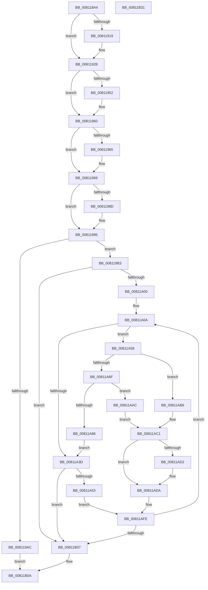

# MiCopyLargeVad

- RVA: `0x008118A4`–`0x00811B32` (길이 `654` bytes)
- VA: `0x00000001408118A4`
- 실행 섹션: `PAGE`
- PDB 이름 있음: `예`; PDB Function 태그: `아니요`
- unwind 정보 RVA: `0x000C8C6C`
- 디코드: `182`개 명령, `654/654` bytes 표시
- 미해석 바이트: `0` (있으면 어셈블리에 `.byte`로 보존)

> 이 문서는 커널 이미지의 기계어와 PDB 기호를 분석해 생성했습니다. 4번과 5번은 함수 원형과 자료형을 바이너리 사용 방식에서 추정한 C 해석이며 원본 소스 복구 결과는 아닙니다.

## 1. Dependencies

- 직접 호출 지점: **19**; 고유 호출 대상: **12**
- 직접 호출자로 확인된 함수: **1**
- RIP 상대 이미지 참조: **1**

### Outgoing calls
- `0x00811904` → [MiLocateLockedVadEvent](../../text/2A/MiLocateLockedVadEvent_function_002A7A0C.md) (function, `0x002A7A0C`)
- `0x0081190F` → [MiLocateLockedVadEvent](../../text/2A/MiLocateLockedVadEvent_function_002A7A0C.md) (function, `0x002A7A0C`)
- `0x00811931` → [KiStackAttachProcess](../../text/21/KiStackAttachProcess_function_00216820.md) (function, `0x00216820`)
- `0x00811942` → [KeAbPreAcquire](../../text/21/KeAbPreAcquire_function_00210230.md) (function, `0x00210230`)
- `0x0081195B` → [ExfAcquirePushLockExclusiveEx](../../text/20/ExfAcquirePushLockExclusiveEx_function_0020FC90.md) (function, `0x0020FC90`)
- `0x00811975` → [MiMapUserLargePages](../../text/3D/MiMapUserLargePages_function_003D26F4.md) (function, `0x003D26F4`)
- `0x00811990` → [ExfTryToWakePushLock](../../text/26/ExfTryToWakePushLock_function_00265DD0.md) (function, `0x00265DD0`)
- `0x00811998` → [KeAbPostRelease](../../text/2E/KeAbPostRelease_function_002E1600.md) (function, `0x002E1600`)
- `0x008119A3` → [KiUnstackDetachProcess](../../text/21/KiUnstackDetachProcess_function_00217D30.md) (function, `0x00217D30`)
- `0x00811A31` → [ExLockUserBuffer](../95/ExLockUserBuffer_function_009533B8.md) (function, `0x009533B8`)
- `0x00811A62` → [KiStackAttachProcess](../../text/21/KiStackAttachProcess_function_00216820.md) (function, `0x00216820`)
- `0x00811A8A` → [ExLockUserBuffer](../95/ExLockUserBuffer_function_009533B8.md) (function, `0x009533B8`)
- `0x00811A9C` → [KiUnstackDetachProcess](../../text/21/KiUnstackDetachProcess_function_00217D30.md) (function, `0x00217D30`)
- `0x00811AA5` → [ExUnlockUserBuffer](../../text/29/ExUnlockUserBuffer_function_0029F258.md) (function, `0x0029F258`)
- `0x00811AC8` → [memcpy](../../text/6C/memcpy_function_006C6840.md) (function, `0x006C6840`)
- `0x00811AD5` → [ExUnlockUserBuffer](../../text/29/ExUnlockUserBuffer_function_0029F258.md) (function, `0x0029F258`)
- `0x00811AE0` → [KiUnstackDetachProcess](../../text/21/KiUnstackDetachProcess_function_00217D30.md) (function, `0x00217D30`)
- `0x00811AE9` → [ExUnlockUserBuffer](../../text/29/ExUnlockUserBuffer_function_0029F258.md) (function, `0x0029F258`)
- `0x00811B11` → [_security_check_cookie](../../text/6A/_security_check_cookie_function_006AC640.md) (function, `0x006AC640`)

### Direct callers
- [MiMapChildLargePageVads](../AC/MiMapChildLargePageVads_function_00ACDE80.md) at `0x00ACDF23`

### Static image references
- `0x008118C0` → RVA `0x00E0A740` (`.data`; read)

## 2. Other-region calls and transfers

- 다른 실행 섹션으로 향하는 call: **17**
  - `0x00811904` → [MiLocateLockedVadEvent](../../text/2A/MiLocateLockedVadEvent_function_002A7A0C.md) (`PAGE` → `.text`)
  - `0x0081190F` → [MiLocateLockedVadEvent](../../text/2A/MiLocateLockedVadEvent_function_002A7A0C.md) (`PAGE` → `.text`)
  - `0x00811931` → [KiStackAttachProcess](../../text/21/KiStackAttachProcess_function_00216820.md) (`PAGE` → `.text`)
  - `0x00811942` → [KeAbPreAcquire](../../text/21/KeAbPreAcquire_function_00210230.md) (`PAGE` → `.text`)
  - `0x0081195B` → [ExfAcquirePushLockExclusiveEx](../../text/20/ExfAcquirePushLockExclusiveEx_function_0020FC90.md) (`PAGE` → `.text`)
  - `0x00811975` → [MiMapUserLargePages](../../text/3D/MiMapUserLargePages_function_003D26F4.md) (`PAGE` → `.text`)
  - `0x00811990` → [ExfTryToWakePushLock](../../text/26/ExfTryToWakePushLock_function_00265DD0.md) (`PAGE` → `.text`)
  - `0x00811998` → [KeAbPostRelease](../../text/2E/KeAbPostRelease_function_002E1600.md) (`PAGE` → `.text`)
  - `0x008119A3` → [KiUnstackDetachProcess](../../text/21/KiUnstackDetachProcess_function_00217D30.md) (`PAGE` → `.text`)
  - `0x00811A62` → [KiStackAttachProcess](../../text/21/KiStackAttachProcess_function_00216820.md) (`PAGE` → `.text`)
  - `0x00811A9C` → [KiUnstackDetachProcess](../../text/21/KiUnstackDetachProcess_function_00217D30.md) (`PAGE` → `.text`)
  - `0x00811AA5` → [ExUnlockUserBuffer](../../text/29/ExUnlockUserBuffer_function_0029F258.md) (`PAGE` → `.text`)
  - `0x00811AC8` → [memcpy](../../text/6C/memcpy_function_006C6840.md) (`PAGE` → `.text`)
  - `0x00811AD5` → [ExUnlockUserBuffer](../../text/29/ExUnlockUserBuffer_function_0029F258.md) (`PAGE` → `.text`)
  - `0x00811AE0` → [KiUnstackDetachProcess](../../text/21/KiUnstackDetachProcess_function_00217D30.md) (`PAGE` → `.text`)
  - `0x00811AE9` → [ExUnlockUserBuffer](../../text/29/ExUnlockUserBuffer_function_0029F258.md) (`PAGE` → `.text`)
  - `0x00811B11` → [_security_check_cookie](../../text/6A/_security_check_cookie_function_006AC640.md) (`PAGE` → `.text`)
- 별도 외부 분기/꼬리 이동을 확인하지 못했습니다.

## 3. Assembly (complete function range)

```asm
008118A4  48 89 5C 24 20                  mov qword ptr [rsp + 0x20], rbx
008118A9  55                              push rbp
008118AA  56                              push rsi
008118AB  57                              push rdi
008118AC  41 54                           push r12
008118AE  41 55                           push r13
008118B0  41 56                           push r14
008118B2  41 57                           push r15
008118B4  48 8D 6C 24 D9                  lea rbp, [rsp - 0x27]
008118B9  48 81 EC 90 00 00 00            sub rsp, 0x90
008118C0  48 8B 05 79 8E 5F 00            mov rax, qword ptr [rip + 0x5f8e79]
008118C7  48 33 C4                        xor rax, rsp
008118CA  48 89 45 1F                     mov qword ptr [rbp + 0x1f], rax
008118CE  45 33 FF                        xor r15d, r15d
008118D1  48 89 4D E7                     mov qword ptr [rbp - 0x19], rcx
008118D5  0F 57 C0                        xorps xmm0, xmm0
008118D8  4C 89 7D DF                     mov qword ptr [rbp - 0x21], r15
008118DC  4C 8B F2                        mov r14, rdx
008118DF  4C 89 7D D7                     mov qword ptr [rbp - 0x29], r15
008118E3  4C 8B C9                        mov r9, rcx
008118E6  4C 89 7D CF                     mov qword ptr [rbp - 0x31], r15
008118EA  41 8D 57 10                     lea edx, [r15 + 0x10]
008118EE  4C 89 7D C7                     mov qword ptr [rbp - 0x39], r15
008118F2  49 8B C8                        mov rcx, r8
008118F5  49 8B F0                        mov rsi, r8
008118F8  0F 11 45 EF                     movups xmmword ptr [rbp - 0x11], xmm0
008118FC  0F 11 45 FF                     movups xmmword ptr [rbp - 1], xmm0
00811900  0F 11 45 0F                     movups xmmword ptr [rbp + 0xf], xmm0
00811904  E8 03 61 A9 FF                  call 0x1402a7a0c
00811909  49 8B CE                        mov rcx, r14
0081190C  4C 8B C0                        mov r8, rax
0081190F  E8 F8 60 A9 FF                  call 0x1402a7a0c
00811914  4D 85 C0                        test r8, r8
00811917  74 0F                           je 0x140811928
00811919  8A 48 08                        mov cl, byte ptr [rax + 8]
0081191C  41 88 48 08                     mov byte ptr [r8 + 8], cl
00811920  48 8B 48 10                     mov rcx, qword ptr [rax + 0x10]
00811924  49 89 48 10                     mov qword ptr [r8 + 0x10], rcx
00811928  4C 8D 45 EF                     lea r8, [rbp - 0x11]
0081192C  33 D2                           xor edx, edx
0081192E  49 8B C9                        mov rcx, r9
00811931  E8 EA 4E A0 FF                  call 0x140216820
00811936  48 8D 5E 28                     lea rbx, [rsi + 0x28]
0081193A  45 33 C0                        xor r8d, r8d
0081193D  48 8B CB                        mov rcx, rbx
00811940  33 D2                           xor edx, edx
00811942  E8 E9 E8 9F FF                  call 0x140210230
00811947  F0 48 0F BA 2B 00               lock bts qword ptr [rbx], 0
0081194D  48 8B F8                        mov rdi, rax
00811950  73 0E                           jae 0x140811960
00811952  4C 8B C3                        mov r8, rbx
00811955  48 8B D0                        mov rdx, rax
00811958  48 8B CB                        mov rcx, rbx
0081195B  E8 30 E3 9F FF                  call 0x14020fc90
00811960  48 85 FF                        test rdi, rdi
00811963  74 04                           je 0x140811969
00811965  C6 47 0A 01                     mov byte ptr [rdi + 0xa], 1
00811969  45 33 C9                        xor r9d, r9d
0081196C  45 33 C0                        xor r8d, r8d
0081196F  41 8B D7                        mov edx, r15d
00811972  48 8B CE                        mov rcx, rsi
00811975  E8 7A 0D BC FF                  call 0x1403d26f4
0081197A  8B F8                           mov edi, eax
0081197C  48 83 CA FF                     or rdx, 0xffffffffffffffff
00811980  F0 48 0F C1 13                  lock xadd qword ptr [rbx], rdx
00811985  80 E2 06                        and dl, 6
00811988  80 FA 02                        cmp dl, 2
0081198B  75 08                           jne 0x140811995
0081198D  48 8B CB                        mov rcx, rbx
00811990  E8 3B 44 A5 FF                  call 0x140265dd0
00811995  48 8B CB                        mov rcx, rbx
00811998  E8 63 FC AC FF                  call 0x1402e1600
0081199D  33 D2                           xor edx, edx
0081199F  48 8D 4D EF                     lea rcx, [rbp - 0x11]
008119A3  E8 88 63 A0 FF                  call 0x140217d30
008119A8  85 FF                           test edi, edi
008119AA  79 07                           jns 0x1408119b3
008119AC  8B C7                           mov eax, edi
008119AE  E9 57 01 00 00                  jmp 0x140811b0a
008119B3  41 8B 46 18                     mov eax, dword ptr [r14 + 0x18]
008119B7  45 8B E7                        mov r12d, r15d
008119BA  41 0F B6 4E 20                  movzx ecx, byte ptr [r14 + 0x20]
008119BF  BB 00 00 E0 FF                  mov ebx, 0xffe00000
008119C4  41 0F B6 7E 21                  movzx edi, byte ptr [r14 + 0x21]
008119C9  44 8B 6E 30                     mov r13d, dword ptr [rsi + 0x30]
008119CD  48 C1 E7 20                     shl rdi, 0x20
008119D1  41 81 E5 00 02 00 00            and r13d, 0x200
008119D8  48 C1 E1 20                     shl rcx, 0x20
008119DC  48 0B C8                        or rcx, rax
008119DF  41 8B 46 1C                     mov eax, dword ptr [r14 + 0x1c]
008119E3  48 0B F8                        or rdi, rax
008119E6  4C 8B F9                        mov r15, rcx
008119E9  48 2B F9                        sub rdi, rcx
008119EC  49 C1 E7 0C                     shl r15, 0xc
008119F0  48 FF C7                        inc rdi
008119F3  48 C1 E7 0C                     shl rdi, 0xc
008119F7  48 85 FF                        test rdi, rdi
008119FA  0F 84 07 01 00 00               je 0x140811b07
00811A00  49 BE 00 00 E0 FF FF FF FF 7F   movabs r14, 0x7fffffffffe00000
00811A0A  48 8D 45 D7                     lea rax, [rbp - 0x29]
00811A0E  48 3B FB                        cmp rdi, rbx
00811A11  48 89 44 24 28                  mov qword ptr [rsp + 0x28], rax
00811A16  48 8B F3                        mov rsi, rbx
00811A19  48 0F 46 F7                     cmovbe rsi, rdi
00811A1D  48 8D 45 DF                     lea rax, [rbp - 0x21]
00811A21  8B D6                           mov edx, esi
00811A23  48 89 44 24 20                  mov qword ptr [rsp + 0x20], rax
00811A28  45 33 C9                        xor r9d, r9d
00811A2B  41 B0 01                        mov r8b, 1
00811A2E  49 8B CF                        mov rcx, r15
00811A31  E8 82 19 14 00                  call 0x1409533b8
00811A36  44 8B E0                        mov r12d, eax
00811A39  85 C0                           test eax, eax
00811A3B  79 1B                           jns 0x140811a58
00811A3D  48 8B DE                        mov rbx, rsi
00811A40  48 D1 EB                        shr rbx, 1
00811A43  49 23 DE                        and rbx, r14
00811A46  48 81 FB 00 00 20 00            cmp rbx, 0x200000
00811A4D  0F 82 B4 00 00 00               jb 0x140811b07
00811A53  E9 A6 00 00 00                  jmp 0x140811afe
00811A58  48 8B 4D E7                     mov rcx, qword ptr [rbp - 0x19]
00811A5C  4C 8D 45 EF                     lea r8, [rbp - 0x11]
00811A60  33 D2                           xor edx, edx
00811A62  E8 B9 4D A0 FF                  call 0x140216820
00811A67  49 8B CF                        mov rcx, r15
00811A6A  45 85 ED                        test r13d, r13d
00811A6D  75 47                           jne 0x140811ab6
00811A6F  48 8D 45 CF                     lea rax, [rbp - 0x31]
00811A73  8B D6                           mov edx, esi
00811A75  48 89 44 24 28                  mov qword ptr [rsp + 0x28], rax
00811A7A  45 8D 4D 01                     lea r9d, [r13 + 1]
00811A7E  48 8D 45 C7                     lea rax, [rbp - 0x39]
00811A82  45 8A C1                        mov r8b, r9b
00811A85  48 89 44 24 20                  mov qword ptr [rsp + 0x20], rax
00811A8A  E8 29 19 14 00                  call 0x1409533b8
00811A8F  44 8B E0                        mov r12d, eax
00811A92  85 C0                           test eax, eax
00811A94  79 16                           jns 0x140811aac
00811A96  33 D2                           xor edx, edx
00811A98  48 8D 4D EF                     lea rcx, [rbp - 0x11]
00811A9C  E8 8F 62 A0 FF                  call 0x140217d30
00811AA1  48 8B 4D D7                     mov rcx, qword ptr [rbp - 0x29]
00811AA5  E8 AE D7 A8 FF                  call 0x14029f258
00811AAA  EB 91                           jmp 0x140811a3d
00811AAC  4C 8B 75 CF                     mov r14, qword ptr [rbp - 0x31]
00811AB0  48 8B 4D C7                     mov rcx, qword ptr [rbp - 0x39]
00811AB4  EB 0B                           jmp 0x140811ac1
00811AB6  45 33 F6                        xor r14d, r14d
00811AB9  48 89 4D C7                     mov qword ptr [rbp - 0x39], rcx
00811ABD  4C 89 75 CF                     mov qword ptr [rbp - 0x31], r14
00811AC1  48 8B 55 DF                     mov rdx, qword ptr [rbp - 0x21]
00811AC5  4C 8B C6                        mov r8, rsi
00811AC8  E8 73 4D EB FF                  call 0x1406c6840
00811ACD  45 85 ED                        test r13d, r13d
00811AD0  75 08                           jne 0x140811ada
00811AD2  49 8B CE                        mov rcx, r14
00811AD5  E8 7E D7 A8 FF                  call 0x14029f258
00811ADA  33 D2                           xor edx, edx
00811ADC  48 8D 4D EF                     lea rcx, [rbp - 0x11]
00811AE0  E8 4B 62 A0 FF                  call 0x140217d30
00811AE5  48 8B 4D D7                     mov rcx, qword ptr [rbp - 0x29]
00811AE9  E8 6A D7 A8 FF                  call 0x14029f258
00811AEE  48 2B FE                        sub rdi, rsi
00811AF1  49 BE 00 00 E0 FF FF FF FF 7F   movabs r14, 0x7fffffffffe00000
00811AFB  4C 03 FE                        add r15, rsi
00811AFE  48 85 FF                        test rdi, rdi
00811B01  0F 85 03 FF FF FF               jne 0x140811a0a
00811B07  41 8B C4                        mov eax, r12d
00811B0A  48 8B 4D 1F                     mov rcx, qword ptr [rbp + 0x1f]
00811B0E  48 33 CC                        xor rcx, rsp
00811B11  E8 2A AB E9 FF                  call 0x1406ac640
00811B16  48 8B 9C 24 E8 00 00 00         mov rbx, qword ptr [rsp + 0xe8]
00811B1E  48 81 C4 90 00 00 00            add rsp, 0x90
00811B25  41 5F                           pop r15
00811B27  41 5E                           pop r14
00811B29  41 5D                           pop r13
00811B2B  41 5C                           pop r12
00811B2D  5F                              pop rdi
00811B2E  5E                              pop rsi
00811B2F  5D                              pop rbp
00811B30  C3                              ret
00811B31  CC                              int3
```

## 4. C-style interpretation (structured pseudocode)

```c
__int64 __fastcall MiCopyLargeVad(__int64 a1, __int64 a2, __int64 a3)
{
    __int64 result;
    __int64 v_r13;
    __int64 v_r14;
    __int64 v_r15;
    __int64 v_rbx;
    __int64 v_rdi;
    __int64 v_rsi;
    __int64 v_rsp;
    unsigned __int64 v_stack_m40;
    unsigned __int64 v_stack_m50;
    unsigned __int64 v_stack_m5F;
    unsigned __int64 v_stack_m60;
    unsigned __int64 v_stack_m70;
    unsigned __int64 v_stack_m78;
    unsigned __int64 v_stack_m80;
    unsigned __int64 v_stack_m88;
    unsigned __int64 v_stack_m90;
    unsigned __int64 v_stack_m98;
    unsigned __int64 v_stack_mA0;
    unsigned __int64 v_stack_mA8;
    unsigned __int64 v_stack_p20;

    v_stack_p20 = v_rbx;
    v_rsp = (v_rsp) - (144);
    result = (*(unsigned __int64 *)(v_rip + 6262393)) ^ (v_rsp);
    v_stack_m40 = result;
    v_r15 = 0;
    v_stack_m78 = a1;
    v_stack_m80 = 0;
    v_stack_m88 = 0;
    v_stack_m90 = 0;
    v_stack_m98 = 0;
    v_stack_m70 = v_xmm0;
    v_stack_m60 = v_xmm0;
    v_stack_m50 = v_xmm0;
    result = MiLocateLockedVadEvent(a3, v_r15 + 16, a3, a1);
    result = MiLocateLockedVadEvent(a2, v_r15 + 16, result, a1);
    if (result != 0) {
        a1 = *(unsigned __int8 *)(result + 8);
        *(unsigned __int8 *)(result + 8) = (unsigned __int8)(a1);
        a1 = *(unsigned __int64 *)(result + 16);
        *(unsigned __int64 *)(result + 16) = a1;
    }
    a2 = 0;
    result = KiStackAttachProcess(a1, a2, v_stack_m70, a1);
    a3 = 0;
    a2 = 0;
    result = KeAbPreAcquire(a3 + 40, a2, a3, a1);
    if (!(condition_is_above_or_equal)) {
        a3 = a3 + 40;
        a2 = result;
        a1 = a3 + 40;
        result = ExfAcquirePushLockExclusiveEx(a1, a2, a3, a1);
    }
    if (result != 0) {
        *(unsigned __int8 *)(result + 10) = 1;
    }
    a4 = 0;
    a3 = 0;
    result = MiMapUserLargePages(0, 0, a3, a4);
    a2 = (0) | (-1);
    a2 = (unsigned __int8)((a2) & (6));
    if (((unsigned __int8)(a2)) == 2) {
        a1 = a3 + 40;
        result = ExfTryToWakePushLock(a1, a2, a3, a4);
    }
    result = KeAbPostRelease(a3 + 40, a2, a3, a4);
    a2 = 0;
    result = KiUnstackDetachProcess(v_stack_m70, a2, a3, a4);
    if (!sign_flag) goto loc_008119B3;
    goto loc_00811B0A;
loc_008119B3:
    v_rdi = (*(unsigned __int8 *)(a2 + 33)) << (32);
    v_r13 = (unsigned int)(((unsigned int)(*(unsigned int *)(a3 + 48))) & (512));
    a1 = (*(unsigned __int8 *)(a2 + 32)) << (32);
    a1 = (a1) | ((unsigned int)(*(unsigned int *)(a2 + 24)));
    v_rdi = (v_rdi) | ((unsigned int)(*(unsigned int *)(a2 + 28)));
    v_rdi = (v_rdi) - (a1);
    v_r15 = (a1) << (12);
    v_rdi = (v_rdi) + 1;
    v_rdi = (v_rdi) << (12);
    if (v_rdi == 0) goto loc_00811B07;
loc_00811A0A:
    v_stack_mA0 = v_stack_m88;
    v_rsi = (unsigned int)(0xFFE00000ULL);
    if (v_rdi <= ((unsigned int)(0xFFE00000ULL))) { v_rsi = v_rdi; }
    v_stack_mA8 = v_stack_m80;
    a4 = 0;
    result = ExLockUserBuffer(v_r15, (unsigned int)((unsigned int)(v_rsi)), 1, a4);
    if (!sign_flag) goto loc_00811A58;
loc_00811A3D:
    v_rbx = (v_rsi) >> (1);
    v_rbx = (v_rbx) & (0);
    if (v_rbx < 0x200000ULL) goto loc_00811B07;
    goto loc_00811AFE;
loc_00811A58:
    a2 = 0;
    result = KiStackAttachProcess(v_stack_m78, a2, v_stack_m70, a4);
    if ((unsigned int)(v_r13) != 0) goto loc_00811AB6;
    v_stack_mA0 = v_stack_m90;
    v_stack_mA8 = v_stack_m98;
    result = ExLockUserBuffer(v_r15, (unsigned int)((unsigned int)(v_rsi)), (unsigned __int8)(v_r13 + 1), v_r13 + 1);
    if (!sign_flag) goto loc_00811AAC;
    a2 = 0;
    result = KiUnstackDetachProcess(v_stack_m70, a2, (unsigned __int8)(v_r13 + 1), v_r13 + 1);
    result = ExUnlockUserBuffer(v_stack_m88, a2, (unsigned __int8)(v_r13 + 1), v_r13 + 1);
    goto loc_00811A3D;
loc_00811AAC:
    goto loc_00811AC1;
loc_00811AB6:
    v_r14 = 0;
    v_stack_m98 = v_stack_m98;
    v_stack_m90 = 0;
loc_00811AC1:
    result = memcpy(v_stack_m98, v_stack_m80, v_rsi, v_r13 + 1);
    if ((unsigned int)(v_r13) == 0) {
        a1 = 0;
        result = ExUnlockUserBuffer(a1, v_stack_m80, v_rsi, v_r13 + 1);
    }
    a2 = 0;
    result = KiUnstackDetachProcess(v_stack_m70, a2, v_rsi, v_r13 + 1);
    result = ExUnlockUserBuffer(v_stack_m88, a2, v_rsi, v_r13 + 1);
    v_rdi = (v_rdi) - (v_rsi);
    v_r15 = (v_r15) + (v_rsi);
loc_00811AFE:
    if (v_rdi != 0) goto loc_00811A0A;
loc_00811B07:
loc_00811B0A:
    a1 = (v_stack_m40) ^ (v_rsp);
    result = _security_check_cookie(a1, a2, v_rsi, v_r13 + 1);
    v_rsp = (v_rsp) + (144);
    return result;
}
```

## 5. (Beta) C Style

```c
int64_t MiCopyLargeVad(int64_t Arg1, void *Arg2, void *Arg3)
{
    uint8_t *arg2 = (uint8_t *)Arg2;
    uint8_t *arg3 = (uint8_t *)Arg3;

    int64_t result;
    int64_t local_r13;
    int64_t local_r14;
    int64_t local_r15;
    int64_t local_rbx;
    int64_t local_rdi;
    int64_t local_rsi;
    int64_t local_rsp;
    uint64_t v_stack_m40;
    uint64_t v_stack_m50;
    uint64_t v_stack_m5F;
    uint64_t v_stack_m60;
    uint64_t v_stack_m70;
    uint64_t v_stack_m78;
    uint64_t v_stack_m80;
    uint64_t v_stack_m88;
    uint64_t v_stack_m90;
    uint64_t v_stack_m98;
    uint64_t v_stack_mA0;
    uint64_t v_stack_mA8;
    uint64_t v_stack_p20;

    v_stack_p20 = local_rbx;
    local_rsp = (local_rsp) - (144);
    result = (*(uint64_t *)(v_rip + 0x5F8E79)) ^ (local_rsp);
    v_stack_m40 = result;
    local_r15 = 0;
    v_stack_m78 = Arg1;
    v_stack_m80 = 0;
    v_stack_m88 = 0;
    v_stack_m90 = 0;
    v_stack_m98 = 0;
    v_stack_m70 = v_xmm0;
    v_stack_m60 = v_xmm0;
    v_stack_m50 = v_xmm0;
    result = MiLocateLockedVadEvent(Arg3, local_r15 + 16, Arg3, Arg1);
    result = MiLocateLockedVadEvent(Arg2, local_r15 + 16, result, Arg1);
    if (result != 0) {
        Arg1 = *(uint8_t *)(result + 0x8);
        *(uint8_t *)(result + 0x8) = (uint8_t)(Arg1);
        Arg1 = *(uint64_t *)(result + 0x10);
        *(uint64_t *)(result + 0x10) = Arg1;
    }
    Arg2 = 0;
    result = KiStackAttachProcess(Arg1, Arg2, v_stack_m70, Arg1);
    Arg3 = 0;
    Arg2 = 0;
    result = KeAbPreAcquire(Arg3 + 40, Arg2, Arg3, Arg1);
    if (!(condition_is_above_or_equal)) {
        Arg3 = Arg3 + 40;
        Arg2 = result;
        Arg1 = Arg3 + 40;
        result = ExfAcquirePushLockExclusiveEx(Arg1, Arg2, Arg3, Arg1);
    }
    if (result != 0) {
        *(uint8_t *)(result + 0xA) = 1;
    }
    a4 = 0;
    Arg3 = 0;
    result = MiMapUserLargePages(0, 0, Arg3, a4);
    Arg2 = (0) | (-1);
    Arg2 = (uint8_t)((Arg2) & (6));
    if (((uint8_t)(Arg2)) == 2) {
        Arg1 = Arg3 + 40;
        result = ExfTryToWakePushLock(Arg1, Arg2, Arg3, a4);
    }
    result = KeAbPostRelease(Arg3 + 40, Arg2, Arg3, a4);
    Arg2 = 0;
    result = KiUnstackDetachProcess(v_stack_m70, Arg2, Arg3, a4);
    if (!sign_flag) goto loc_008119B3;
    goto loc_00811B0A;
loc_008119B3:
    local_rdi = (*(uint8_t *)(arg2 + 0x21)) << (32);
    local_r13 = (uint32_t)(((uint32_t)(*(uint32_t *)(arg3 + 0x30))) & (512));
    Arg1 = (*(uint8_t *)(arg2 + 0x20)) << (32);
    Arg1 = (Arg1) | ((uint32_t)(*(uint32_t *)(arg2 + 0x18)));
    local_rdi = (local_rdi) | ((uint32_t)(*(uint32_t *)(arg2 + 0x1C)));
    local_rdi = (local_rdi) - (Arg1);
    local_r15 = (Arg1) << (12);
    local_rdi = (local_rdi) + 1;
    local_rdi = (local_rdi) << (12);
    if (local_rdi == 0) goto loc_00811B07;
loc_00811A0A:
    v_stack_mA0 = v_stack_m88;
    local_rsi = (uint32_t)(0xFFE00000ULL);
    if (local_rdi <= ((uint32_t)(0xFFE00000ULL))) { local_rsi = local_rdi; }
    v_stack_mA8 = v_stack_m80;
    a4 = 0;
    result = ExLockUserBuffer(local_r15, (uint32_t)((uint32_t)(local_rsi)), 1, a4);
    if (!sign_flag) goto loc_00811A58;
loc_00811A3D:
    local_rbx = (local_rsi) >> (1);
    local_rbx = (local_rbx) & (0);
    if (local_rbx < 0x200000ULL) goto loc_00811B07;
    goto loc_00811AFE;
loc_00811A58:
    Arg2 = 0;
    result = KiStackAttachProcess(v_stack_m78, Arg2, v_stack_m70, a4);
    if ((uint32_t)(local_r13) != 0) goto loc_00811AB6;
    v_stack_mA0 = v_stack_m90;
    v_stack_mA8 = v_stack_m98;
    result = ExLockUserBuffer(local_r15, (uint32_t)((uint32_t)(local_rsi)), (uint8_t)(local_r13 + 1), local_r13 + 1);
    if (!sign_flag) goto loc_00811AAC;
    Arg2 = 0;
    result = KiUnstackDetachProcess(v_stack_m70, Arg2, (uint8_t)(local_r13 + 1), local_r13 + 1);
    result = ExUnlockUserBuffer(v_stack_m88, Arg2, (uint8_t)(local_r13 + 1), local_r13 + 1);
    goto loc_00811A3D;
loc_00811AAC:
    goto loc_00811AC1;
loc_00811AB6:
    local_r14 = 0;
    v_stack_m98 = v_stack_m98;
    v_stack_m90 = 0;
loc_00811AC1:
    result = memcpy(v_stack_m98, v_stack_m80, local_rsi, local_r13 + 1);
    if ((uint32_t)(local_r13) == 0) {
        Arg1 = 0;
        result = ExUnlockUserBuffer(Arg1, v_stack_m80, local_rsi, local_r13 + 1);
    }
    Arg2 = 0;
    result = KiUnstackDetachProcess(v_stack_m70, Arg2, local_rsi, local_r13 + 1);
    result = ExUnlockUserBuffer(v_stack_m88, Arg2, local_rsi, local_r13 + 1);
    local_rdi = (local_rdi) - (local_rsi);
    local_r15 = (local_r15) + (local_rsi);
loc_00811AFE:
    if (local_rdi != 0) goto loc_00811A0A;
loc_00811B07:
loc_00811B0A:
    Arg1 = (v_stack_m40) ^ (local_rsp);
    result = _security_check_cookie(Arg1, Arg2, local_rsi, local_r13 + 1);
    local_rsp = (local_rsp) + (144);
    return result;
}
```

### 관측된 메모리 오프셋

구조체 형식이 확인되지 않은 접근은 인자 기준의 오프셋으로만 기록했습니다.

| 기준 인자 | 오프셋 표현 | 폭 (bit) | 접근 |
|---|---:|---:|---|
| `Arg2` | `+ 0x18` | `32` | `R` |
| `Arg2` | `+ 0x1C` | `32` | `R` |
| `Arg2` | `+ 0x20` | `8` | `R` |
| `Arg2` | `+ 0x21` | `8` | `R` |
| `Arg3` | `+ 0x0` | `64` | `R/W` |
| `Arg3` | `+ 0x28` | `64` | `R` |
| `Arg3` | `+ 0x30` | `32` | `R` |

## 6. Execution-region graph

[열기: 2D/3D 그래프와 함수 탐색 컨트롤 패널](../../../control-panel.html?section=page&rva=0x008118A4&view=graph)

- 2D 그래프는 위에서 아래로 흐르고, 3D 그래프는 빈 공간을 드래그해 회전합니다. Shift+드래그는 이동, 휠은 확대·축소, 함수 노드 선택은 대상 보고서 이동입니다.

### Static fallback


