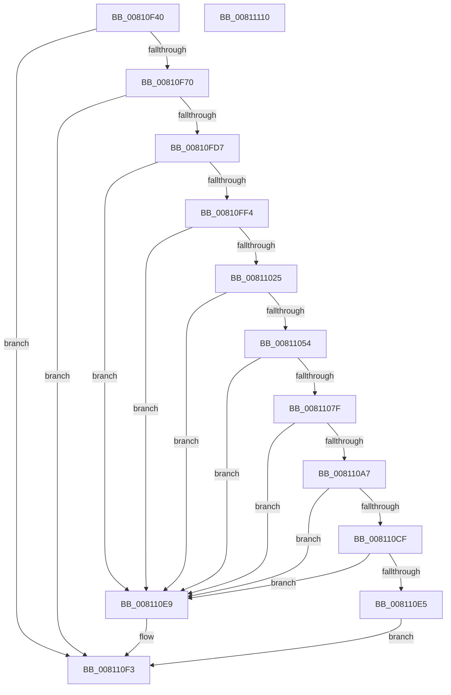

# MiCreateMemoryEventSD

- RVA: `0x00810F40`–`0x00811111` (길이 `465` bytes)
- VA: `0x0000000140810F40`
- 실행 섹션: `PAGE`
- PDB 이름 있음: `예`; PDB Function 태그: `아니요`
- unwind 정보 RVA: `0x000C5A00`
- 디코드: `122`개 명령, `465/465` bytes 표시
- 미해석 바이트: `0` (있으면 어셈블리에 `.byte`로 보존)

> 이 문서는 커널 이미지의 기계어와 PDB 기호를 분석해 생성했습니다. 4번과 5번은 함수 원형과 자료형을 바이너리 사용 방식에서 추정한 C 해석이며 원본 소스 복구 결과는 아닙니다.

## 1. Dependencies

- 직접 호출 지점: **15**; 고유 호출 대상: **7**
- 직접 호출자로 확인된 함수: **1**
- RIP 상대 이미지 참조: **5**

### Outgoing calls
- `0x00810F61` → [RtlCreateSecurityDescriptor](../9F/RtlCreateSecurityDescriptor_function_009F1DF0.md) (function, `0x009F1DF0`)
- `0x00810F77` → [RtlLengthSid](../../text/45/RtlLengthSid_function_0045D270.md) (function, `0x0045D270`)
- `0x00810F85` → [RtlLengthSid](../../text/45/RtlLengthSid_function_0045D270.md) (function, `0x0045D270`)
- `0x00810F93` → [RtlLengthSid](../../text/45/RtlLengthSid_function_0045D270.md) (function, `0x0045D270`)
- `0x00810FA1` → [RtlLengthSid](../../text/45/RtlLengthSid_function_0045D270.md) (function, `0x0045D270`)
- `0x00810FAF` → [RtlLengthSid](../../text/45/RtlLengthSid_function_0045D270.md) (function, `0x0045D270`)
- `0x00810FC6` → [MiAllocatePool](../../text/35/MiAllocatePool_function_0035B540.md) (function, `0x0035B540`)
- `0x00810FE5` → [RtlCreateAcl](../91/RtlCreateAcl_function_00916F00.md) (function, `0x00916F00`)
- `0x00811016` → [RtlpAddKnownAce](../92/RtlpAddKnownAce_function_00929A20.md) (function, `0x00929A20`)
- `0x00811045` → [RtlpAddKnownAce](../92/RtlpAddKnownAce_function_00929A20.md) (function, `0x00929A20`)
- `0x00811074` → [RtlpAddKnownAce](../92/RtlpAddKnownAce_function_00929A20.md) (function, `0x00929A20`)
- `0x0081109C` → [RtlpAddKnownAce](../92/RtlpAddKnownAce_function_00929A20.md) (function, `0x00929A20`)
- `0x008110C4` → [RtlpAddKnownAce](../92/RtlpAddKnownAce_function_00929A20.md) (function, `0x00929A20`)
- `0x008110DA` → [RtlSetDaclSecurityDescriptor](../9E/RtlSetDaclSecurityDescriptor_function_009EC210.md) (function, `0x009EC210`)
- `0x008110EE` → [ExFreePoolWithTag](../../poolcode/B8/ExFreePoolWithTag_function_00B82870.md) (function, `0x00B82870`)

### Direct callers
- [MiInitializeMemoryEvents](MiInitializeMemoryEvents_function_0081123C.md) at `0x00811262`

### Static image references
- `0x00810F70` → RVA `0x00E67BC0` (`.data`; read)
- `0x00810F7C` → RVA `0x00E67D60` (`.data`; read)
- `0x00810F8A` → RVA `0x00E67D48` (`.data`; read)
- `0x00810F98` → RVA `0x00FD9A68` (`PAGEDATA`; read)
- `0x00810FA6` → RVA `0x00E67D58` (`.data`; read)

## 2. Other-region calls and transfers

- 다른 실행 섹션으로 향하는 call: **7**
  - `0x00810F77` → [RtlLengthSid](../../text/45/RtlLengthSid_function_0045D270.md) (`PAGE` → `.text`)
  - `0x00810F85` → [RtlLengthSid](../../text/45/RtlLengthSid_function_0045D270.md) (`PAGE` → `.text`)
  - `0x00810F93` → [RtlLengthSid](../../text/45/RtlLengthSid_function_0045D270.md) (`PAGE` → `.text`)
  - `0x00810FA1` → [RtlLengthSid](../../text/45/RtlLengthSid_function_0045D270.md) (`PAGE` → `.text`)
  - `0x00810FAF` → [RtlLengthSid](../../text/45/RtlLengthSid_function_0045D270.md) (`PAGE` → `.text`)
  - `0x00810FC6` → [MiAllocatePool](../../text/35/MiAllocatePool_function_0035B540.md) (`PAGE` → `.text`)
  - `0x008110EE` → [ExFreePoolWithTag](../../poolcode/B8/ExFreePoolWithTag_function_00B82870.md) (`PAGE` → `POOLCODE`)
- 별도 외부 분기/꼬리 이동을 확인하지 못했습니다.

## 3. Assembly (complete function range)

```asm
00810F40  48 8B C4                        mov rax, rsp
00810F43  48 89 58 08                     mov qword ptr [rax + 8], rbx
00810F47  48 89 68 10                     mov qword ptr [rax + 0x10], rbp
00810F4B  48 89 70 18                     mov qword ptr [rax + 0x18], rsi
00810F4F  48 89 78 20                     mov qword ptr [rax + 0x20], rdi
00810F53  41 57                           push r15
00810F55  48 83 EC 30                     sub rsp, 0x30
00810F59  BA 01 00 00 00                  mov edx, 1
00810F5E  48 8B F1                        mov rsi, rcx
00810F61  E8 8A 0E 1E 00                  call 0x1409f1df0
00810F66  8B F8                           mov edi, eax
00810F68  85 C0                           test eax, eax
00810F6A  0F 88 83 01 00 00               js 0x1408110f3
00810F70  48 8B 0D 49 6C 65 00            mov rcx, qword ptr [rip + 0x656c49]
00810F77  E8 F4 C2 C4 FF                  call 0x14045d270
00810F7C  48 8B 0D DD 6D 65 00            mov rcx, qword ptr [rip + 0x656ddd]
00810F83  8B D8                           mov ebx, eax
00810F85  E8 E6 C2 C4 FF                  call 0x14045d270
00810F8A  48 8B 0D B7 6D 65 00            mov rcx, qword ptr [rip + 0x656db7]
00810F91  03 D8                           add ebx, eax
00810F93  E8 D8 C2 C4 FF                  call 0x14045d270
00810F98  48 8B 0D C9 8A 7C 00            mov rcx, qword ptr [rip + 0x7c8ac9]
00810F9F  03 D8                           add ebx, eax
00810FA1  E8 CA C2 C4 FF                  call 0x14045d270
00810FA6  48 8B 0D AB 6D 65 00            mov rcx, qword ptr [rip + 0x656dab]
00810FAD  03 D8                           add ebx, eax
00810FAF  E8 BC C2 C4 FF                  call 0x14045d270
00810FB4  B9 00 01 00 00                  mov ecx, 0x100
00810FB9  41 B8 44 61 63 6C               mov r8d, 0x6c636144
00810FBF  8D 68 44                        lea ebp, [rax + 0x44]
00810FC2  03 EB                           add ebp, ebx
00810FC4  8B D5                           mov edx, ebp
00810FC6  E8 75 A5 B4 FF                  call 0x14035b540
00810FCB  48 8B D8                        mov rbx, rax
00810FCE  48 85 C0                        test rax, rax
00810FD1  0F 84 1C 01 00 00               je 0x1408110f3
00810FD7  41 BF 02 00 00 00               mov r15d, 2
00810FDD  8B D5                           mov edx, ebp
00810FDF  45 8B C7                        mov r8d, r15d
00810FE2  48 8B C8                        mov rcx, rax
00810FE5  E8 16 5F 10 00                  call 0x140916f00
00810FEA  8B F8                           mov edi, eax
00810FEC  85 C0                           test eax, eax
00810FEE  0F 88 F5 00 00 00               js 0x1408110e9
00810FF4  48 8B 0D 4D 6D 65 00            mov rcx, qword ptr [rip + 0x656d4d]
00810FFB  BD 01 00 12 00                  mov ebp, 0x120001
00811000  C6 44 24 28 00                  mov byte ptr [rsp + 0x28], 0
00811005  44 8B CD                        mov r9d, ebp
00811008  48 89 4C 24 20                  mov qword ptr [rsp + 0x20], rcx
0081100D  45 33 C0                        xor r8d, r8d
00811010  48 8B CB                        mov rcx, rbx
00811013  41 8B D7                        mov edx, r15d
00811016  E8 05 8A 11 00                  call 0x140929a20
0081101B  8B F8                           mov edi, eax
0081101D  85 C0                           test eax, eax
0081101F  0F 88 C4 00 00 00               js 0x1408110e9
00811025  48 8B 05 3C 8A 7C 00            mov rax, qword ptr [rip + 0x7c8a3c]
0081102C  41 B9 03 00 1F 00               mov r9d, 0x1f0003
00811032  C6 44 24 28 00                  mov byte ptr [rsp + 0x28], 0
00811037  45 33 C0                        xor r8d, r8d
0081103A  41 8B D7                        mov edx, r15d
0081103D  48 89 44 24 20                  mov qword ptr [rsp + 0x20], rax
00811042  48 8B CB                        mov rcx, rbx
00811045  E8 D6 89 11 00                  call 0x140929a20
0081104A  8B F8                           mov edi, eax
0081104C  85 C0                           test eax, eax
0081104E  0F 88 95 00 00 00               js 0x1408110e9
00811054  48 8B 05 FD 6C 65 00            mov rax, qword ptr [rip + 0x656cfd]
0081105B  41 B9 03 00 1F 00               mov r9d, 0x1f0003
00811061  C6 44 24 28 00                  mov byte ptr [rsp + 0x28], 0
00811066  45 33 C0                        xor r8d, r8d
00811069  41 8B D7                        mov edx, r15d
0081106C  48 89 44 24 20                  mov qword ptr [rsp + 0x20], rax
00811071  48 8B CB                        mov rcx, rbx
00811074  E8 A7 89 11 00                  call 0x140929a20
00811079  8B F8                           mov edi, eax
0081107B  85 C0                           test eax, eax
0081107D  78 6A                           js 0x1408110e9
0081107F  48 8B 05 DA 6C 65 00            mov rax, qword ptr [rip + 0x656cda]
00811086  44 8B CD                        mov r9d, ebp
00811089  C6 44 24 28 00                  mov byte ptr [rsp + 0x28], 0
0081108E  45 33 C0                        xor r8d, r8d
00811091  41 8B D7                        mov edx, r15d
00811094  48 89 44 24 20                  mov qword ptr [rsp + 0x20], rax
00811099  48 8B CB                        mov rcx, rbx
0081109C  E8 7F 89 11 00                  call 0x140929a20
008110A1  8B F8                           mov edi, eax
008110A3  85 C0                           test eax, eax
008110A5  78 42                           js 0x1408110e9
008110A7  48 8B 05 12 6B 65 00            mov rax, qword ptr [rip + 0x656b12]
008110AE  44 8B CD                        mov r9d, ebp
008110B1  C6 44 24 28 00                  mov byte ptr [rsp + 0x28], 0
008110B6  45 33 C0                        xor r8d, r8d
008110B9  41 8B D7                        mov edx, r15d
008110BC  48 89 44 24 20                  mov qword ptr [rsp + 0x20], rax
008110C1  48 8B CB                        mov rcx, rbx
008110C4  E8 57 89 11 00                  call 0x140929a20
008110C9  8B F8                           mov edi, eax
008110CB  85 C0                           test eax, eax
008110CD  78 1A                           js 0x1408110e9
008110CF  45 33 C9                        xor r9d, r9d
008110D2  4C 8B C3                        mov r8, rbx
008110D5  B2 01                           mov dl, 1
008110D7  48 8B CE                        mov rcx, rsi
008110DA  E8 31 B1 1D 00                  call 0x1409ec210
008110DF  8B F8                           mov edi, eax
008110E1  85 C0                           test eax, eax
008110E3  78 04                           js 0x1408110e9
008110E5  33 FF                           xor edi, edi
008110E7  EB 0A                           jmp 0x1408110f3
008110E9  33 D2                           xor edx, edx
008110EB  48 8B CB                        mov rcx, rbx
008110EE  E8 7D 17 37 00                  call 0x140b82870
008110F3  48 8B 5C 24 40                  mov rbx, qword ptr [rsp + 0x40]
008110F8  8B C7                           mov eax, edi
008110FA  48 8B 7C 24 58                  mov rdi, qword ptr [rsp + 0x58]
008110FF  48 8B 6C 24 48                  mov rbp, qword ptr [rsp + 0x48]
00811104  48 8B 74 24 50                  mov rsi, qword ptr [rsp + 0x50]
00811109  48 83 C4 30                     add rsp, 0x30
0081110D  41 5F                           pop r15
0081110F  C3                              ret
00811110  CC                              int3
```

## 4. C-style interpretation (structured pseudocode)

```c
__int64 __fastcall MiCreateMemoryEventSD(__int64 a1)
{
    __int64 result;
    __int64 v_rbp;
    __int64 v_rbx;
    __int64 v_rdi;
    __int64 v_rsp;
    unsigned __int8 v_stack_m10;
    unsigned __int64 v_stack_m18;
    unsigned __int64 v_stack_p10;
    unsigned __int64 v_stack_p18;
    unsigned __int64 v_stack_p20;
    unsigned __int64 v_stack_p8;

    *(unsigned __int64 *)(v_rsp + 8) = v_rbx;
    *(unsigned __int64 *)(v_rsp + 16) = v_rbp;
    *(unsigned __int64 *)(v_rsp + 24) = v_rsi;
    *(unsigned __int64 *)(v_rsp + 32) = v_rdi;
    v_rsp = (v_rsp) - (48);
    result = RtlCreateSecurityDescriptor(a1, 1, a3, a4);
    if (sign_flag) goto loc_008110F3;
    result = RtlLengthSid(*(unsigned __int64 *)(v_rip + 6646857), 1, a3, a4);
    result = RtlLengthSid(*(unsigned __int64 *)(v_rip + 6647261), 1, a3, a4);
    v_rbx = (unsigned int)(((unsigned int)((unsigned int)(result))) + ((unsigned int)(result)));
    result = RtlLengthSid(*(unsigned __int64 *)(v_rip + 6647223), 1, a3, a4);
    v_rbx = (unsigned int)((v_rbx) + ((unsigned int)(result)));
    result = RtlLengthSid(*(unsigned __int64 *)(v_rip + 8161993), 1, a3, a4);
    v_rbx = (unsigned int)((v_rbx) + ((unsigned int)(result)));
    result = RtlLengthSid(*(unsigned __int64 *)(v_rip + 6647211), 1, a3, a4);
    v_rbp = (unsigned int)((result + 68) + ((unsigned int)(v_rbx)));
    result = MiAllocatePool(256, (unsigned int)((unsigned int)(v_rbp)), (unsigned int)(0x6C636144ULL), a4);
    if (result == 0) goto loc_008110F3;
    result = RtlCreateAcl(result, (unsigned int)((unsigned int)(v_rbp)), 2, a4);
    if (sign_flag) goto loc_008110E9;
    v_stack_m10 = 0;
    v_stack_m18 = *(unsigned __int64 *)(v_rip + 6647117);
    a3 = 0;
    result = RtlpAddKnownAce(result, 2, a3, (unsigned int)((unsigned int)((unsigned int)(0x120001ULL))));
    if (sign_flag) goto loc_008110E9;
    v_stack_m10 = 0;
    a3 = 0;
    v_stack_m18 = *(unsigned __int64 *)(v_rip + 8161852);
    result = RtlpAddKnownAce(result, 2, a3, (unsigned int)(0x1F0003ULL));
    if (sign_flag) goto loc_008110E9;
    v_stack_m10 = 0;
    a3 = 0;
    v_stack_m18 = *(unsigned __int64 *)(v_rip + 6647037);
    result = RtlpAddKnownAce(result, 2, a3, (unsigned int)(0x1F0003ULL));
    if (sign_flag) goto loc_008110E9;
    v_stack_m10 = 0;
    a3 = 0;
    v_stack_m18 = *(unsigned __int64 *)(v_rip + 6647002);
    result = RtlpAddKnownAce(result, 2, a3, (unsigned int)((unsigned int)((unsigned int)(0x120001ULL))));
    if (sign_flag) goto loc_008110E9;
    v_stack_m10 = 0;
    a3 = 0;
    v_stack_m18 = *(unsigned __int64 *)(v_rip + 6646546);
    result = RtlpAddKnownAce(result, 2, a3, (unsigned int)((unsigned int)((unsigned int)(0x120001ULL))));
    if (sign_flag) goto loc_008110E9;
    a4 = 0;
    result = RtlSetDaclSecurityDescriptor(a1, 1, result, a4);
    if (sign_flag) goto loc_008110E9;
    v_rdi = 0;
    goto loc_008110F3;
loc_008110E9:
    a2 = 0;
    result = ExFreePoolWithTag(result, a2, result, a4);
loc_008110F3:
    v_rsp = (v_rsp) + (48);
    return 0;
}
```

## 5. (Beta) C Style

```c
int64_t MiCreateMemoryEventSD(int64_t Arg1)
{
    int64_t result;
    int64_t local_rbp;
    int64_t local_rbx;
    int64_t local_rdi;
    int64_t local_rsp;
    uint8_t v_stack_m10;
    uint64_t v_stack_m18;
    uint64_t v_stack_p10;
    uint64_t v_stack_p18;
    uint64_t v_stack_p20;
    uint64_t v_stack_p8;

    *(uint64_t *)(local_rsp + 0x8) = local_rbx;
    *(uint64_t *)(local_rsp + 0x10) = local_rbp;
    *(uint64_t *)(local_rsp + 0x18) = local_rsi;
    *(uint64_t *)(local_rsp + 0x20) = local_rdi;
    local_rsp = (local_rsp) - (48);
    result = RtlCreateSecurityDescriptor(Arg1, 1, a3, a4);
    if (sign_flag) goto loc_008110F3;
    result = RtlLengthSid(*(uint64_t *)(v_rip + 0x656C49), 1, a3, a4);
    result = RtlLengthSid(*(uint64_t *)(v_rip + 0x656DDD), 1, a3, a4);
    local_rbx = (uint32_t)(((uint32_t)((uint32_t)(result))) + ((uint32_t)(result)));
    result = RtlLengthSid(*(uint64_t *)(v_rip + 0x656DB7), 1, a3, a4);
    local_rbx = (uint32_t)((local_rbx) + ((uint32_t)(result)));
    result = RtlLengthSid(*(uint64_t *)(v_rip + 0x7C8AC9), 1, a3, a4);
    local_rbx = (uint32_t)((local_rbx) + ((uint32_t)(result)));
    result = RtlLengthSid(*(uint64_t *)(v_rip + 0x656DAB), 1, a3, a4);
    local_rbp = (uint32_t)((result + 68) + ((uint32_t)(local_rbx)));
    result = MiAllocatePool(256, (uint32_t)((uint32_t)(local_rbp)), (uint32_t)(0x6C636144ULL), a4);
    if (result == 0) goto loc_008110F3;
    result = RtlCreateAcl(result, (uint32_t)((uint32_t)(local_rbp)), 2, a4);
    if (sign_flag) goto loc_008110E9;
    v_stack_m10 = 0;
    v_stack_m18 = *(uint64_t *)(v_rip + 0x656D4D);
    a3 = 0;
    result = RtlpAddKnownAce(result, 2, a3, (uint32_t)((uint32_t)((uint32_t)(0x120001ULL))));
    if (sign_flag) goto loc_008110E9;
    v_stack_m10 = 0;
    a3 = 0;
    v_stack_m18 = *(uint64_t *)(v_rip + 0x7C8A3C);
    result = RtlpAddKnownAce(result, 2, a3, (uint32_t)(0x1F0003ULL));
    if (sign_flag) goto loc_008110E9;
    v_stack_m10 = 0;
    a3 = 0;
    v_stack_m18 = *(uint64_t *)(v_rip + 0x656CFD);
    result = RtlpAddKnownAce(result, 2, a3, (uint32_t)(0x1F0003ULL));
    if (sign_flag) goto loc_008110E9;
    v_stack_m10 = 0;
    a3 = 0;
    v_stack_m18 = *(uint64_t *)(v_rip + 0x656CDA);
    result = RtlpAddKnownAce(result, 2, a3, (uint32_t)((uint32_t)((uint32_t)(0x120001ULL))));
    if (sign_flag) goto loc_008110E9;
    v_stack_m10 = 0;
    a3 = 0;
    v_stack_m18 = *(uint64_t *)(v_rip + 0x656B12);
    result = RtlpAddKnownAce(result, 2, a3, (uint32_t)((uint32_t)((uint32_t)(0x120001ULL))));
    if (sign_flag) goto loc_008110E9;
    a4 = 0;
    result = RtlSetDaclSecurityDescriptor(Arg1, 1, result, a4);
    if (sign_flag) goto loc_008110E9;
    local_rdi = 0;
    goto loc_008110F3;
loc_008110E9:
    a2 = 0;
    result = ExFreePoolWithTag(result, a2, result, a4);
loc_008110F3:
    local_rsp = (local_rsp) + (48);
    return 0;
}
```

## 6. Execution-region graph

[열기: 2D/3D 그래프와 함수 탐색 컨트롤 패널](../../../control-panel.html?section=page&rva=0x00810F40&view=graph)

- 2D 그래프는 위에서 아래로 흐르고, 3D 그래프는 빈 공간을 드래그해 회전합니다. Shift+드래그는 이동, 휠은 확대·축소, 함수 노드 선택은 대상 보고서 이동입니다.

### Static fallback


