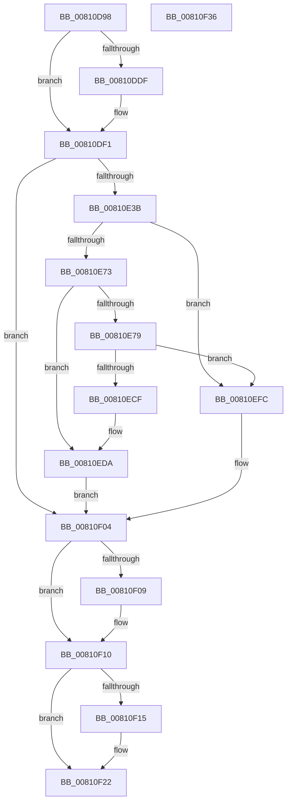

# MiCreateMemoryEvent

- RVA: `0x00810D98`–`0x00810F37` (길이 `415` bytes)
- VA: `0x0000000140810D98`
- 실행 섹션: `PAGE`
- PDB 이름 있음: `예`; PDB Function 태그: `아니요`
- unwind 정보 RVA: `0x000D9558`
- 디코드: `112`개 명령, `415/415` bytes 표시
- 미해석 바이트: `0` (있으면 어셈블리에 `.byte`로 보존)

> 이 문서는 커널 이미지의 기계어와 PDB 기호를 분석해 생성했습니다. 4번과 5번은 함수 원형과 자료형을 바이너리 사용 방식에서 추정한 C 해석이며 원본 소스 복구 결과는 아닙니다.

## 1. Dependencies

- 직접 호출 지점: **6**; 고유 호출 대상: **5**
- 직접 호출자로 확인된 함수: **1**
- RIP 상대 이미지 참조: **2**

### Outgoing calls
- `0x00810E28` → [ZwCreateEvent](../../text/6A/ZwCreateEvent_function_006AD9D0.md) (function, `0x006AD9D0`)
- `0x00810E64` → [ObpReferenceObjectByHandleWithTag](../86/ObpReferenceObjectByHandleWithTag_function_00869650.md) (function, `0x00869650`)
- `0x00810EC4` → [ObCreateSymbolicLink](../A3/ObCreateSymbolicLink_function_00A33B98.md) (function, `0x00A33B98`)
- `0x00810ED5` → [ObCloseHandle](../8A/ObCloseHandle_function_008A1870.md) (function, `0x008A1870`)
- `0x00810F0B` → [ObCloseHandle](../8A/ObCloseHandle_function_008A1870.md) (function, `0x008A1870`)
- `0x00810F1D` → [ObfDereferenceObjectWithTag](../../text/2F/ObfDereferenceObjectWithTag_function_002F78E0.md) (function, `0x002F78E0`)

### Direct callers
- [MiInitializeMemoryEvents](MiInitializeMemoryEvents_function_0081123C.md) at `0x008112EE`

### Static image references
- `0x00810E3B` → RVA `0x00FC6B80` (`ALMOSTRO`; read)
- `0x00810E79` → RVA `0x00A70A70` (`MiResolveMemoryEvent`; read)

## 2. Other-region calls and transfers

- 다른 실행 섹션으로 향하는 call: **2**
  - `0x00810E28` → [ZwCreateEvent](../../text/6A/ZwCreateEvent_function_006AD9D0.md) (`PAGE` → `.text`)
  - `0x00810F1D` → [ObfDereferenceObjectWithTag](../../text/2F/ObfDereferenceObjectWithTag_function_002F78E0.md) (`PAGE` → `.text`)
- 별도 외부 분기/꼬리 이동을 확인하지 못했습니다.

## 3. Assembly (complete function range)

```asm
00810D98  40 55                           push rbp
00810D9A  53                              push rbx
00810D9B  56                              push rsi
00810D9C  57                              push rdi
00810D9D  41 54                           push r12
00810D9F  41 56                           push r14
00810DA1  41 57                           push r15
00810DA3  48 8D 6C 24 F1                  lea rbp, [rsp - 0xf]
00810DA8  48 81 EC A0 00 00 00            sub rsp, 0xa0
00810DAF  0F 28 01                        movaps xmm0, xmmword ptr [rcx]
00810DB2  45 33 E4                        xor r12d, r12d
00810DB5  4C 63 FA                        movsxd r15, edx
00810DB8  41 8B DC                        mov ebx, r12d
00810DBB  48 89 5D 5F                     mov qword ptr [rbp + 0x5f], rbx
00810DBF  4D 8B F1                        mov r14, r9
00810DC2  4C 89 65 67                     mov qword ptr [rbp + 0x67], r12
00810DC6  48 8B F1                        mov rsi, rcx
00810DC9  44 89 65 DB                     mov dword ptr [rbp - 0x25], r12d
00810DCD  44 89 65 F3                     mov dword ptr [rbp - 0xd], r12d
00810DD1  4C 89 65 4F                     mov qword ptr [rbp + 0x4f], r12
00810DD5  F3 0F 7F 45 AF                  movdqu xmmword ptr [rbp - 0x51], xmm0
00810DDA  4D 85 C0                        test r8, r8
00810DDD  74 12                           je 0x140810df1
00810DDF  48 83 45 B7 02                  add qword ptr [rbp - 0x49], 2
00810DE4  B8 FE FF 00 00                  mov eax, 0xfffe
00810DE9  66 01 45 AF                     add word ptr [rbp - 0x51], ax
00810DED  66 01 45 B1                     add word ptr [rbp - 0x4f], ax
00810DF1  4C 89 45 DF                     mov qword ptr [rbp - 0x21], r8
00810DF5  48 8D 45 AF                     lea rax, [rbp - 0x51]
00810DF9  4C 8D 45 D7                     lea r8, [rbp - 0x29]
00810DFD  48 89 45 E7                     mov qword ptr [rbp - 0x19], rax
00810E01  45 33 C9                        xor r9d, r9d
00810E04  C7 45 D7 30 00 00 00            mov dword ptr [rbp - 0x29], 0x30
00810E0B  BA 03 00 1F 00                  mov edx, 0x1f0003
00810E10  C7 45 EF 00 02 00 00            mov dword ptr [rbp - 0x11], 0x200
00810E17  48 8D 4D 4F                     lea rcx, [rbp + 0x4f]
00810E1B  4C 89 75 F7                     mov qword ptr [rbp - 9], r14
00810E1F  4C 89 65 FF                     mov qword ptr [rbp - 1], r12
00810E23  44 88 64 24 20                  mov byte ptr [rsp + 0x20], r12b
00810E28  E8 A3 CB E9 FF                  call 0x1406ad9d0
00810E2D  48 8B 4D 4F                     mov rcx, qword ptr [rbp + 0x4f]
00810E31  8B F8                           mov edi, eax
00810E33  85 C0                           test eax, eax
00810E35  0F 88 C9 00 00 00               js 0x140810f04
00810E3B  4C 8B 05 3E 5D 7B 00            mov r8, qword ptr [rip + 0x7b5d3e]
00810E42  48 8D 45 5F                     lea rax, [rbp + 0x5f]
00810E46  4C 89 64 24 38                  mov qword ptr [rsp + 0x38], r12
00810E4B  45 33 C9                        xor r9d, r9d
00810E4E  4C 89 64 24 30                  mov qword ptr [rsp + 0x30], r12
00810E53  48 89 44 24 28                  mov qword ptr [rsp + 0x28], rax
00810E58  C7 44 24 20 4D 6D 50 6F         mov dword ptr [rsp + 0x20], 0x6f506d4d
00810E60  41 8D 51 02                     lea edx, [r9 + 2]
00810E64  E8 E7 87 05 00                  call 0x140869650
00810E69  8B F8                           mov edi, eax
00810E6B  85 C0                           test eax, eax
00810E6D  0F 88 89 00 00 00               js 0x140810efc
00810E73  44 39 65 6F                     cmp dword ptr [rbp + 0x6f], r12d
00810E77  74 61                           je 0x140810eda
00810E79  48 8D 05 F0 FB 25 00            lea rax, [rip + 0x25fbf0]
00810E80  C7 45 D7 30 00 00 00            mov dword ptr [rbp - 0x29], 0x30
00810E87  4C 8D 4D BF                     lea r9, [rbp - 0x41]
00810E8B  48 89 45 C7                     mov qword ptr [rbp - 0x39], rax
00810E8F  4C 8D 45 D7                     lea r8, [rbp - 0x29]
00810E93  4C 89 65 DF                     mov qword ptr [rbp - 0x21], r12
00810E97  BA 01 00 0F 00                  mov edx, 0xf0001
00810E9C  C7 45 EF 10 02 00 00            mov dword ptr [rbp - 0x11], 0x210
00810EA3  48 8D 4D 67                     lea rcx, [rbp + 0x67]
00810EA7  48 89 75 E7                     mov qword ptr [rbp - 0x19], rsi
00810EAB  4C 89 75 F7                     mov qword ptr [rbp - 9], r14
00810EAF  4C 89 65 FF                     mov qword ptr [rbp - 1], r12
00810EB3  48 C7 45 BF 01 00 00 00         mov qword ptr [rbp - 0x41], 1
00810EBB  4C 89 7D CF                     mov qword ptr [rbp - 0x31], r15
00810EBF  44 88 64 24 20                  mov byte ptr [rsp + 0x20], r12b
00810EC4  E8 CF 2C 22 00                  call 0x140a33b98
00810EC9  8B F8                           mov edi, eax
00810ECB  85 C0                           test eax, eax
00810ECD  78 2D                           js 0x140810efc
00810ECF  48 8B 4D 67                     mov rcx, qword ptr [rbp + 0x67]
00810ED3  33 D2                           xor edx, edx
00810ED5  E8 96 09 09 00                  call 0x1408a1870
00810EDA  48 8B 4D 77                     mov rcx, qword ptr [rbp + 0x77]
00810EDE  41 8B FC                        mov edi, r12d
00810EE1  48 8B 45 5F                     mov rax, qword ptr [rbp + 0x5f]
00810EE5  48 89 01                        mov qword ptr [rcx], rax
00810EE8  48 8B 4D 7F                     mov rcx, qword ptr [rbp + 0x7f]
00810EEC  48 8B 45 4F                     mov rax, qword ptr [rbp + 0x4f]
00810EF0  48 89 01                        mov qword ptr [rcx], rax
00810EF3  49 8B CC                        mov rcx, r12
00810EF6  48 89 4D 4F                     mov qword ptr [rbp + 0x4f], rcx
00810EFA  EB 08                           jmp 0x140810f04
00810EFC  48 8B 4D 4F                     mov rcx, qword ptr [rbp + 0x4f]
00810F00  48 8B 5D 5F                     mov rbx, qword ptr [rbp + 0x5f]
00810F04  48 85 C9                        test rcx, rcx
00810F07  74 07                           je 0x140810f10
00810F09  33 D2                           xor edx, edx
00810F0B  E8 60 09 09 00                  call 0x1408a1870
00810F10  48 85 DB                        test rbx, rbx
00810F13  74 0D                           je 0x140810f22
00810F15  BA 4D 6D 50 6F                  mov edx, 0x6f506d4d
00810F1A  48 8B CB                        mov rcx, rbx
00810F1D  E8 BE 69 AE FF                  call 0x1402f78e0
00810F22  8B C7                           mov eax, edi
00810F24  48 81 C4 A0 00 00 00            add rsp, 0xa0
00810F2B  41 5F                           pop r15
00810F2D  41 5E                           pop r14
00810F2F  41 5C                           pop r12
00810F31  5F                              pop rdi
00810F32  5E                              pop rsi
00810F33  5B                              pop rbx
00810F34  5D                              pop rbp
00810F35  C3                              ret
00810F36  CC                              int3
```

## 4. C-style interpretation (structured pseudocode)

```c
__int64 __fastcall MiCreateMemoryEvent(__int64 a1, int a2, __int64 a3, __int64 a4, unsigned int a5, __int64 a6, __int64 a7)
{
    __int64 result;
    __int64 v_r12;
    __int64 v_rsp;
    unsigned __int64 v_stack_m47;
    unsigned __int64 v_stack_m48;
    unsigned __int64 v_stack_m50;
    unsigned int v_stack_m54;
    unsigned int v_stack_m58;
    unsigned __int64 v_stack_m60;
    unsigned __int64 v_stack_m68;
    unsigned int v_stack_m6C;
    unsigned __int64 v_stack_m70;
    unsigned __int64 v_stack_m78;
    unsigned __int64 v_stack_m80;
    unsigned __int64 v_stack_m88;
    unsigned __int64 v_stack_m90;
    unsigned __int16 v_stack_m96;
    unsigned __int64 v_stack_m98;
    unsigned __int64 v_stack_mA0;
    unsigned __int64 v_stack_mA8;
    unsigned __int64 v_stack_mB0;
    unsigned __int8 v_stack_mB8;
    unsigned __int64 v_stack_p18;
    unsigned __int64 v_stack_p20;
    unsigned __int64 v_stack_p8;

    v_rsp = (v_rsp) - (160);
    v_r12 = 0;
    v_stack_p18 = 0;
    v_stack_p20 = 0;
    v_stack_m6C = 0;
    v_stack_m54 = 0;
    v_stack_p8 = 0;
    v_stack_m98 = v_xmm0;
    if (a3 != 0) {
        result = 0xFFFEULL;
    }
    v_stack_m68 = a3;
    v_stack_m60 = v_stack_m98;
    a4 = 0;
    v_stack_m70 = 48;
    v_stack_m58 = 512;
    v_stack_m50 = 0;
    v_stack_m48 = 0;
    v_stack_mB8 = 0;
    result = ZwCreateEvent(v_stack_p8, (unsigned int)(0x1F0003ULL), v_stack_m70, a4);
    if (sign_flag) goto loc_00810F04;
    v_stack_mA0 = 0;
    a4 = 0;
    v_stack_mA8 = 0;
    v_stack_mB0 = v_stack_p18;
    v_stack_mB8 = 0x6F506D4DULL;
    result = ObpReferenceObjectByHandleWithTag(v_stack_p8, a4 + 2, *(unsigned __int64 *)(v_rip + 8084798), a4);
    if (sign_flag) goto loc_00810EFC;
    if (a5 == 0) goto loc_00810EDA;
    v_stack_m70 = 48;
    v_stack_m80 = v_rip + 2489328;
    v_stack_m68 = 0;
    v_stack_m58 = 528;
    v_stack_m60 = a1;
    v_stack_m50 = 0;
    v_stack_m48 = 0;
    v_stack_m88 = 1;
    v_stack_m78 = (int)(a2);
    v_stack_mB8 = 0;
    result = ObCreateSymbolicLink(v_stack_p20, (unsigned int)(0xF0001ULL), v_stack_m70, v_stack_m88);
    if (sign_flag) goto loc_00810EFC;
    a2 = 0;
    result = ObCloseHandle(v_stack_p20, a2, v_stack_m70, v_stack_m88);
loc_00810EDA:
    *(unsigned __int64 *)(a6) = v_stack_p18;
    *(unsigned __int64 *)(a7) = v_stack_p8;
    v_stack_p8 = 0;
    goto loc_00810F04;
loc_00810EFC:
loc_00810F04:
    result = v_stack_p8;
    if (v_stack_p8 != 0) {
        a2 = 0;
        result = ObCloseHandle(v_stack_p8, a2, v_stack_m70, v_stack_m88);
    }
    if (v_stack_p18 != 0) {
        a2 = 0x6F506D4DULL;
        a1 = v_stack_p18;
        result = ObfDereferenceObjectWithTag(a1, a2, v_stack_m70, v_stack_m88);
    }
    v_rsp = (v_rsp) + (160);
    return 0;
}
```

## 5. (Beta) C Style

```c
int64_t MiCreateMemoryEvent(void *Arg1, int32_t Arg2, int64_t Arg3, int64_t Arg4, uint32_t Arg5, void *Arg6, void *Arg7)
{
    uint8_t *arg1 = (uint8_t *)Arg1;
    uint8_t *arg6 = (uint8_t *)Arg6;
    uint8_t *arg7 = (uint8_t *)Arg7;

    int64_t result;
    int64_t local_r12;
    int64_t local_rsp;
    uint64_t v_stack_m47;
    uint64_t v_stack_m48;
    uint64_t v_stack_m50;
    uint32_t v_stack_m54;
    uint32_t v_stack_m58;
    uint64_t v_stack_m60;
    uint64_t v_stack_m68;
    uint32_t v_stack_m6C;
    uint64_t v_stack_m70;
    uint64_t v_stack_m78;
    uint64_t v_stack_m80;
    uint64_t v_stack_m88;
    uint64_t v_stack_m90;
    uint16_t v_stack_m96;
    uint64_t v_stack_m98;
    uint64_t v_stack_mA0;
    uint64_t v_stack_mA8;
    uint64_t v_stack_mB0;
    uint8_t v_stack_mB8;
    uint64_t v_stack_p18;
    uint64_t v_stack_p20;
    uint64_t v_stack_p8;

    local_rsp = (local_rsp) - (160);
    local_r12 = 0;
    v_stack_p18 = 0;
    v_stack_p20 = 0;
    v_stack_m6C = 0;
    v_stack_m54 = 0;
    v_stack_p8 = 0;
    v_stack_m98 = v_xmm0;
    if (Arg3 != 0) {
        result = 0xFFFEULL;
    }
    v_stack_m68 = Arg3;
    v_stack_m60 = v_stack_m98;
    Arg4 = 0;
    v_stack_m70 = 48;
    v_stack_m58 = 512;
    v_stack_m50 = 0;
    v_stack_m48 = 0;
    v_stack_mB8 = 0;
    result = ZwCreateEvent(v_stack_p8, (uint32_t)(0x1F0003ULL), v_stack_m70, Arg4);
    if (sign_flag) goto loc_00810F04;
    v_stack_mA0 = 0;
    Arg4 = 0;
    v_stack_mA8 = 0;
    v_stack_mB0 = v_stack_p18;
    v_stack_mB8 = 0x6F506D4DULL;
    result = ObpReferenceObjectByHandleWithTag(v_stack_p8, Arg4 + 2, *(uint64_t *)(v_rip + 0x7B5D3E), Arg4);
    if (sign_flag) goto loc_00810EFC;
    if (Arg5 == 0) goto loc_00810EDA;
    v_stack_m70 = 48;
    v_stack_m80 = v_rip + 2489328;
    v_stack_m68 = 0;
    v_stack_m58 = 528;
    v_stack_m60 = Arg1;
    v_stack_m50 = 0;
    v_stack_m48 = 0;
    v_stack_m88 = 1;
    v_stack_m78 = (int32_t)(Arg2);
    v_stack_mB8 = 0;
    result = ObCreateSymbolicLink(v_stack_p20, (uint32_t)(0xF0001ULL), v_stack_m70, v_stack_m88);
    if (sign_flag) goto loc_00810EFC;
    Arg2 = 0;
    result = ObCloseHandle(v_stack_p20, Arg2, v_stack_m70, v_stack_m88);
loc_00810EDA:
    *(uint64_t *)(arg6) = v_stack_p18;
    *(uint64_t *)(arg7) = v_stack_p8;
    v_stack_p8 = 0;
    goto loc_00810F04;
loc_00810EFC:
loc_00810F04:
    result = v_stack_p8;
    if (v_stack_p8 != 0) {
        Arg2 = 0;
        result = ObCloseHandle(v_stack_p8, Arg2, v_stack_m70, v_stack_m88);
    }
    if (v_stack_p18 != 0) {
        Arg2 = 0x6F506D4DULL;
        Arg1 = v_stack_p18;
        result = ObfDereferenceObjectWithTag(Arg1, Arg2, v_stack_m70, v_stack_m88);
    }
    local_rsp = (local_rsp) + (160);
    return 0;
}
```

### 관측된 메모리 오프셋

구조체 형식이 확인되지 않은 접근은 인자 기준의 오프셋으로만 기록했습니다.

| 기준 인자 | 오프셋 표현 | 폭 (bit) | 접근 |
|---|---:|---:|---|
| `Arg1` | `+ 0x0` | `128` | `R` |
| `Arg6` | `+ 0x0` | `64` | `W` |
| `Arg7` | `+ 0x0` | `64` | `W` |

## 6. Execution-region graph

[열기: 2D/3D 그래프와 함수 탐색 컨트롤 패널](../../../control-panel.html?section=page&rva=0x00810D98&view=graph)

- 2D 그래프는 위에서 아래로 흐르고, 3D 그래프는 빈 공간을 드래그해 회전합니다. Shift+드래그는 이동, 휠은 확대·축소, 함수 노드 선택은 대상 보고서 이동입니다.

### Static fallback


