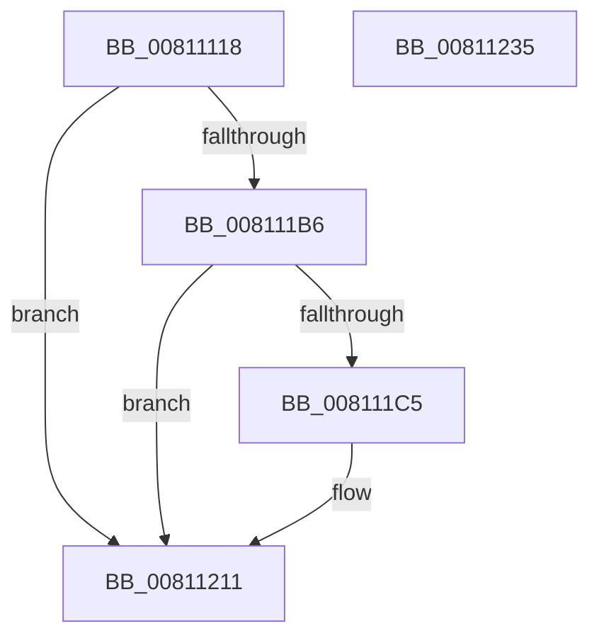

# MiCreatePartitionNamespace

- RVA: `0x00811118`–`0x00811236` (길이 `286` bytes)
- VA: `0x0000000140811118`
- 실행 섹션: `PAGE`
- PDB 이름 있음: `예`; PDB Function 태그: `아니요`
- unwind 정보 RVA: `0x000D28F8`
- 디코드: `71`개 명령, `286/286` bytes 표시
- 미해석 바이트: `0` (있으면 어셈블리에 `.byte`로 보존)

> 이 문서는 커널 이미지의 기계어와 PDB 기호를 분석해 생성했습니다. 4번과 5번은 함수 원형과 자료형을 바이너리 사용 방식에서 추정한 C 해석이며 원본 소스 복구 결과는 아닙니다.

## 1. Dependencies

- 직접 호출 지점: **5**; 고유 호출 대상: **4**
- 직접 호출자로 확인된 함수: **1**
- RIP 상대 이미지 참조: **2**

### Outgoing calls
- `0x0081115D` → [RtlInitUnicodeString](../../text/42/RtlInitUnicodeString_function_0042A780.md) (function, `0x0042A780`)
- `0x008111AB` → [ZwCreateDirectoryObjectEx](../../text/6A/ZwCreateDirectoryObjectEx_function_006AE670.md) (function, `0x006AE670`)
- `0x008111BA` → [ObCreateKernelObjectsSD](../74/ObCreateKernelObjectsSD_function_0074D7A8.md) (function, `0x0074D7A8`)
- `0x0081120A` → [ZwCreateDirectoryObjectEx](../../text/6A/ZwCreateDirectoryObjectEx_function_006AE670.md) (function, `0x006AE670`)
- `0x00811215` → [ObCleanupSecurityDescriptor](../74/ObCleanupSecurityDescriptor_function_0074D734.md) (function, `0x0074D734`)

### Direct callers
- [MiInitializeMemoryEvents](MiInitializeMemoryEvents_function_0081123C.md) at `0x00811274`

### Static image references
- `0x0081117F` → RVA `0x00FD9AA8` (`PAGEDATA`; read)
- `0x008111E9` → RVA `0x0000BEF0` (`.rdata`; read)

## 2. Other-region calls and transfers

- 다른 실행 섹션으로 향하는 call: **3**
  - `0x0081115D` → [RtlInitUnicodeString](../../text/42/RtlInitUnicodeString_function_0042A780.md) (`PAGE` → `.text`)
  - `0x008111AB` → [ZwCreateDirectoryObjectEx](../../text/6A/ZwCreateDirectoryObjectEx_function_006AE670.md) (`PAGE` → `.text`)
  - `0x0081120A` → [ZwCreateDirectoryObjectEx](../../text/6A/ZwCreateDirectoryObjectEx_function_006AE670.md) (`PAGE` → `.text`)
- 별도 외부 분기/꼬리 이동을 확인하지 못했습니다.

## 3. Assembly (complete function range)

```asm
00811118  48 8B C4                        mov rax, rsp
0081111B  48 89 58 08                     mov qword ptr [rax + 8], rbx
0081111F  48 89 70 10                     mov qword ptr [rax + 0x10], rsi
00811123  48 89 78 18                     mov qword ptr [rax + 0x18], rdi
00811127  55                              push rbp
00811128  48 8D 68 A1                     lea rbp, [rax - 0x5f]
0081112C  48 81 EC A0 00 00 00            sub rsp, 0xa0
00811133  33 C0                           xor eax, eax
00811135  0F 57 C9                        xorps xmm1, xmm1
00811138  21 45 3B                        and dword ptr [rbp + 0x3b], eax
0081113B  48 8B F9                        mov rdi, rcx
0081113E  0F 57 C0                        xorps xmm0, xmm0
00811141  89 45 23                        mov dword ptr [rbp + 0x23], eax
00811144  21 45 23                        and dword ptr [rbp + 0x23], eax
00811147  48 8D 4D E7                     lea rcx, [rbp - 0x19]
0081114B  33 D2                           xor edx, edx
0081114D  48 89 45 17                     mov qword ptr [rbp + 0x17], rax
00811151  0F 11 45 E7                     movups xmmword ptr [rbp - 0x19], xmm0
00811155  0F 11 4D F7                     movups xmmword ptr [rbp - 9], xmm1
00811159  0F 11 4D 07                     movups xmmword ptr [rbp + 7], xmm1
0081115D  E8 1E 96 C1 FF                  call 0x14042a780
00811162  48 83 65 27 00                  and qword ptr [rbp + 0x27], 0
00811167  48 8D 45 E7                     lea rax, [rbp - 0x19]
0081116B  48 83 65 47 00                  and qword ptr [rbp + 0x47], 0
00811170  48 8D B7 E8 00 00 00            lea rsi, [rdi + 0xe8]
00811177  48 89 45 2F                     mov qword ptr [rbp + 0x2f], rax
0081117B  4C 8D 45 1F                     lea r8, [rbp + 0x1f]
0081117F  48 8B 05 22 89 7C 00            mov rax, qword ptr [rip + 0x7c8922]
00811186  45 33 C9                        xor r9d, r9d
00811189  BA 0F 00 0F 00                  mov edx, 0xf000f
0081118E  48 89 45 3F                     mov qword ptr [rbp + 0x3f], rax
00811192  48 8B CE                        mov rcx, rsi
00811195  C7 45 1F 30 00 00 00            mov dword ptr [rbp + 0x1f], 0x30
0081119C  C7 45 37 40 02 00 00            mov dword ptr [rbp + 0x37], 0x240
008111A3  C7 44 24 20 02 00 00 00         mov dword ptr [rsp + 0x20], 2
008111AB  E8 C0 D4 E9 FF                  call 0x1406ae670
008111B0  8B D8                           mov ebx, eax
008111B2  85 C0                           test eax, eax
008111B4  78 5B                           js 0x140811211
008111B6  48 8D 4D F7                     lea rcx, [rbp - 9]
008111BA  E8 E9 C5 F3 FF                  call 0x14074d7a8
008111BF  8B D8                           mov ebx, eax
008111C1  85 C0                           test eax, eax
008111C3  78 4C                           js 0x140811211
008111C5  48 8B 06                        mov rax, qword ptr [rsi]
008111C8  48 8D 8F F0 00 00 00            lea rcx, [rdi + 0xf0]
008111CF  48 83 65 47 00                  and qword ptr [rbp + 0x47], 0
008111D4  4C 8D 45 1F                     lea r8, [rbp + 0x1f]
008111D8  83 64 24 20 00                  and dword ptr [rsp + 0x20], 0
008111DD  45 33 C9                        xor r9d, r9d
008111E0  48 89 45 27                     mov qword ptr [rbp + 0x27], rax
008111E4  BA 0F 00 0F 00                  mov edx, 0xf000f
008111E9  48 8D 05 00 AD 7F FF            lea rax, [rip - 0x805300]
008111F0  C7 45 1F 30 00 00 00            mov dword ptr [rbp + 0x1f], 0x30
008111F7  48 89 45 2F                     mov qword ptr [rbp + 0x2f], rax
008111FB  48 8D 45 F7                     lea rax, [rbp - 9]
008111FF  48 89 45 3F                     mov qword ptr [rbp + 0x3f], rax
00811203  C7 45 37 40 02 00 00            mov dword ptr [rbp + 0x37], 0x240
0081120A  E8 61 D4 E9 FF                  call 0x1406ae670
0081120F  8B D8                           mov ebx, eax
00811211  48 8D 4D F7                     lea rcx, [rbp - 9]
00811215  E8 1A C5 F3 FF                  call 0x14074d734
0081121A  4C 8D 9C 24 A0 00 00 00         lea r11, [rsp + 0xa0]
00811222  8B C3                           mov eax, ebx
00811224  49 8B 5B 10                     mov rbx, qword ptr [r11 + 0x10]
00811228  49 8B 73 18                     mov rsi, qword ptr [r11 + 0x18]
0081122C  49 8B 7B 20                     mov rdi, qword ptr [r11 + 0x20]
00811230  49 8B E3                        mov rsp, r11
00811233  5D                              pop rbp
00811234  C3                              ret
00811235  CC                              int3
```

## 4. C-style interpretation (structured pseudocode)

```c
__int64 __fastcall MiCreatePartitionNamespace(__int64 a1, int a2, __int64 a3, int a4)
{
    __int64 result;
    __int64 v_rbx;
    __int64 v_rsp;
    unsigned __int64 v_stack_m8;
    unsigned int v_stack_m88;

    *(unsigned __int64 *)(v_rsp + 8) = v_rbx;
    *(unsigned __int64 *)(v_rsp + 16) = v_rsi;
    *(unsigned __int64 *)(v_rsp + 24) = v_rdi;
    v_rsp = (v_rsp) - (160);
    result = 0;
    *(unsigned int *)(v_rsp - 95 + 35) = 0;
    a2 = 0;
    *(unsigned __int64 *)(v_rsp - 95 + 23) = 0;
    *(unsigned __int64 *)(v_rsp - 95 - 25) = v_xmm0;
    *(unsigned __int64 *)(v_rsp - 95 - 9) = v_xmm1;
    *(unsigned __int64 *)(v_rsp - 95 + 7) = v_xmm1;
    result = RtlInitUnicodeString(v_rsp - 95 - 25, a2, a3, a4);
    *(unsigned __int64 *)(v_rsp - 95 + 47) = v_rsp - 95 - 25;
    a4 = 0;
    *(unsigned __int64 *)(v_rsp - 95 + 63) = *(unsigned __int64 *)(v_rip + 8161570);
    *(unsigned int *)(v_rsp - 95 + 31) = 48;
    *(unsigned int *)(v_rsp - 95 + 55) = 576;
    v_stack_m88 = 2;
    result = ZwCreateDirectoryObjectEx(a1 + 232, (unsigned int)(0xF000FULL), v_rsp - 95 + 31, a4);
    if (sign_flag) goto loc_00811211;
    result = ObCreateKernelObjectsSD(v_rsp - 95 - 9, (unsigned int)(0xF000FULL), v_rsp - 95 + 31, a4);
    v_rbx = (unsigned int)((unsigned int)(result));
    if (!(sign_flag)) {
        result = *(unsigned __int64 *)(a1 + 232);
        a1 = a1 + 240;
        a3 = v_rsp - 95 + 31;
        a4 = 0;
        *(unsigned __int64 *)(v_rsp - 95 + 39) = result;
        a2 = 0xF000FULL;
        result = v_rip - 8409856;
        *(unsigned int *)(v_rsp - 95 + 31) = 48;
        *(unsigned __int64 *)(v_rsp - 95 + 47) = result;
        result = v_rsp - 95 - 9;
        *(unsigned __int64 *)(v_rsp - 95 + 63) = result;
        *(unsigned int *)(v_rsp - 95 + 55) = 576;
        result = ZwCreateDirectoryObjectEx(a1, a2, a3, a4);
        v_rbx = (unsigned int)(result);
    }
    result = ObCleanupSecurityDescriptor(v_rsp - 95 - 9, a2, a3, a4);
    return (unsigned int)((unsigned int)(v_rbx));
}
```

## 5. (Beta) C Style

```c
int64_t MiCreatePartitionNamespace(void *Arg1, int32_t Arg2, int64_t Arg3, int32_t Arg4)
{
    uint8_t *arg1 = (uint8_t *)Arg1;

    int64_t result;
    int64_t local_rbx;
    int64_t local_rsp;
    uint64_t v_stack_m8;
    uint32_t v_stack_m88;

    *(uint64_t *)(local_rsp + 0x8) = local_rbx;
    *(uint64_t *)(local_rsp + 0x10) = local_rsi;
    *(uint64_t *)(local_rsp + 0x18) = local_rdi;
    local_rsp = (local_rsp) - (160);
    result = 0;
    *(uint32_t *)(local_rsp - 0x5F + 0x23) = 0;
    Arg2 = 0;
    *(uint64_t *)(local_rsp - 0x5F + 0x17) = 0;
    *(uint64_t *)(local_rsp - 0x5F - 0x19) = v_xmm0;
    *(uint64_t *)(local_rsp - 0x5F - 0x9) = v_xmm1;
    *(uint64_t *)(local_rsp - 0x5F + 0x7) = v_xmm1;
    result = RtlInitUnicodeString(local_rsp - 95 - 25, Arg2, Arg3, Arg4);
    *(uint64_t *)(local_rsp - 0x5F + 0x2F) = local_rsp - 95 - 25;
    Arg4 = 0;
    *(uint64_t *)(local_rsp - 0x5F + 0x3F) = *(uint64_t *)(v_rip + 0x7C8922);
    *(uint32_t *)(local_rsp - 0x5F + 0x1F) = 48;
    *(uint32_t *)(local_rsp - 0x5F + 0x37) = 576;
    v_stack_m88 = 2;
    result = ZwCreateDirectoryObjectEx(Arg1 + 232, (uint32_t)(0xF000FULL), local_rsp - 95 + 31, Arg4);
    if (sign_flag) goto loc_00811211;
    result = ObCreateKernelObjectsSD(local_rsp - 95 - 9, (uint32_t)(0xF000FULL), local_rsp - 95 + 31, Arg4);
    local_rbx = (uint32_t)((uint32_t)(result));
    if (!(sign_flag)) {
        result = *(uint64_t *)(arg1 + 0xE8);
        Arg1 = Arg1 + 240;
        Arg3 = local_rsp - 95 + 31;
        Arg4 = 0;
        *(uint64_t *)(local_rsp - 0x5F + 0x27) = result;
        Arg2 = 0xF000FULL;
        result = v_rip - 8409856;
        *(uint32_t *)(local_rsp - 0x5F + 0x1F) = 48;
        *(uint64_t *)(local_rsp - 0x5F + 0x2F) = result;
        result = local_rsp - 95 - 9;
        *(uint64_t *)(local_rsp - 0x5F + 0x3F) = result;
        *(uint32_t *)(local_rsp - 0x5F + 0x37) = 576;
        result = ZwCreateDirectoryObjectEx(Arg1, Arg2, Arg3, Arg4);
        local_rbx = (uint32_t)(result);
    }
    result = ObCleanupSecurityDescriptor(local_rsp - 95 - 9, Arg2, Arg3, Arg4);
    return (uint32_t)((uint32_t)(local_rbx));
}
```

### 관측된 메모리 오프셋

구조체 형식이 확인되지 않은 접근은 인자 기준의 오프셋으로만 기록했습니다.

| 기준 인자 | 오프셋 표현 | 폭 (bit) | 접근 |
|---|---:|---:|---|
| `Arg1` | `+ 0x0` | `64` | `R` |
| `Arg1` | `+ 0xE8` | `64` | `R` |
| `Arg1` | `+ 0xF0` | `64` | `R` |

## 6. Execution-region graph

[열기: 2D/3D 그래프와 함수 탐색 컨트롤 패널](../../../control-panel.html?section=page&rva=0x00811118&view=graph)

- 2D 그래프는 위에서 아래로 흐르고, 3D 그래프는 빈 공간을 드래그해 회전합니다. Shift+드래그는 이동, 휠은 확대·축소, 함수 노드 선택은 대상 보고서 이동입니다.

### Static fallback


