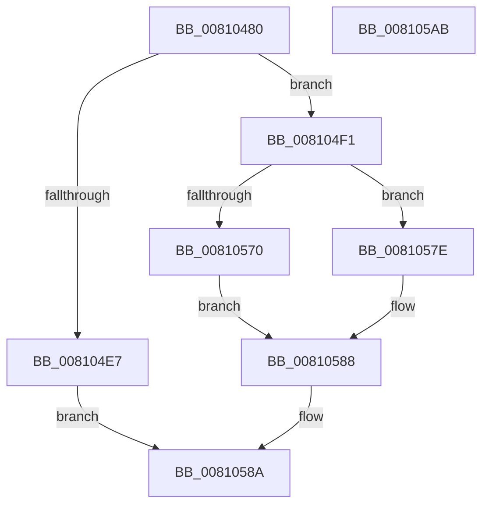

# MiCreatePerNodeZeroingConductor

- RVA: `0x00810480`–`0x008105AC` (길이 `300` bytes)
- VA: `0x0000000140810480`
- 실행 섹션: `PAGE`
- PDB 이름 있음: `예`; PDB Function 태그: `아니요`
- unwind 정보 RVA: `0x000D94A4`
- 디코드: `77`개 명령, `300/300` bytes 표시
- 미해석 바이트: `0` (있으면 어셈블리에 `.byte`로 보존)

> 이 문서는 커널 이미지의 기계어와 PDB 기호를 분석해 생성했습니다. 4번과 5번은 함수 원형과 자료형을 바이너리 사용 방식에서 추정한 C 해석이며 원본 소스 복구 결과는 아닙니다.

## 1. Dependencies

- 직접 호출 지점: **5**; 고유 호출 대상: **5**
- 직접 호출자로 확인된 함수: **1**
- RIP 상대 이미지 참조: **3**

### Outgoing calls
- `0x008104BA` → [MiGetNodeSystemInformation](../../text/47/MiGetNodeSystemInformation_function_0047D390.md) (function, `0x0047D390`)
- `0x008104DA` → [ExAllocatePoolMm](../../text/35/ExAllocatePoolMm_function_0035B690.md) (function, `0x0035B690`)
- `0x00810565` → [PsCreateSystemThreadEx](../9E/PsCreateSystemThreadEx_function_009ED120.md) (function, `0x009ED120`)
- `0x00810583` → [ExFreePoolWithTag](../../poolcode/B8/ExFreePoolWithTag_function_00B82870.md) (function, `0x00B82870`)
- `0x00810592` → [_security_check_cookie](../../text/6A/_security_check_cookie_function_006AC640.md) (function, `0x006AC640`)

### Direct callers
- [MiZeroPageThread](../../text/69/MiZeroPageThread_function_00696D80.md) at `0x00696E55`

### Static image references
- `0x00810490` → RVA `0x00E0A740` (`.data`; read)
- `0x00810524` → RVA `0x00E2DBD8` (`.data`; read)
- `0x00810548` → RVA `0x00810AC0` (`MiNodeZeroConductor`; read)

## 2. Other-region calls and transfers

- 다른 실행 섹션으로 향하는 call: **4**
  - `0x008104BA` → [MiGetNodeSystemInformation](../../text/47/MiGetNodeSystemInformation_function_0047D390.md) (`PAGE` → `.text`)
  - `0x008104DA` → [ExAllocatePoolMm](../../text/35/ExAllocatePoolMm_function_0035B690.md) (`PAGE` → `.text`)
  - `0x00810583` → [ExFreePoolWithTag](../../poolcode/B8/ExFreePoolWithTag_function_00B82870.md) (`PAGE` → `POOLCODE`)
  - `0x00810592` → [_security_check_cookie](../../text/6A/_security_check_cookie_function_006AC640.md) (`PAGE` → `.text`)
- 별도 외부 분기/꼬리 이동을 확인하지 못했습니다.

## 3. Assembly (complete function range)

```asm
00810480  48 89 5C 24 18                  mov qword ptr [rsp + 0x18], rbx
00810485  55                              push rbp
00810486  56                              push rsi
00810487  57                              push rdi
00810488  41 56                           push r14
0081048A  41 57                           push r15
0081048C  48 83 EC 70                     sub rsp, 0x70
00810490  48 8B 05 A9 A2 5F 00            mov rax, qword ptr [rip + 0x5fa2a9]
00810497  48 33 C4                        xor rax, rsp
0081049A  48 89 44 24 68                  mov qword ptr [rsp + 0x68], rax
0081049F  48 83 64 24 50 00               and qword ptr [rsp + 0x50], 0
008104A5  48 8B E9                        mov rbp, rcx
008104A8  8B DA                           mov ebx, edx
008104AA  45 8B F8                        mov r15d, r8d
008104AD  48 69 F3 80 DF 00 00            imul rsi, rbx, 0xdf80
008104B4  48 03 71 10                     add rsi, qword ptr [rcx + 0x10]
008104B8  8B CA                           mov ecx, edx
008104BA  E8 D1 CE C6 FF                  call 0x14047d390
008104BF  44 8B CA                        mov r9d, edx
008104C2  B9 40 00 00 00                  mov ecx, 0x40
008104C7  41 0F BA E9 1F                  bts r9d, 0x1f
008104CC  BA 18 04 00 00                  mov edx, 0x418
008104D1  41 B8 4D 69 5A 63               mov r8d, 0x635a694d
008104D7  4C 8B F0                        mov r14, rax
008104DA  E8 B1 B1 B4 FF                  call 0x14035b690
008104DF  48 8B F8                        mov rdi, rax
008104E2  48 85 C0                        test rax, rax
008104E5  75 0A                           jne 0x1408104f1
008104E7  B8 9A 00 00 C0                  mov eax, 0xc000009a
008104EC  E9 99 00 00 00                  jmp 0x14081058a
008104F1  89 58 38                        mov dword ptr [rax + 0x38], ebx
008104F4  48 8D 4C 24 50                  lea rcx, [rsp + 0x50]
008104F9  48 89 68 30                     mov qword ptr [rax + 0x30], rbp
008104FD  BA FF FF 1F 00                  mov edx, 0x1fffff
00810502  48 83 C0 70                     add rax, 0x70
00810506  48 89 40 08                     mov qword ptr [rax + 8], rax
0081050A  48 89 00                        mov qword ptr [rax], rax
0081050D  44 88 7F 50                     mov byte ptr [rdi + 0x50], r15b
00810511  48 8B 85 B8 00 00 00            mov rax, qword ptr [rbp + 0xb8]
00810518  41 F6 46 24 01                  test byte ptr [r14 + 0x24], 1
0081051D  4C 8B 88 80 00 00 00            mov r9, qword ptr [rax + 0x80]
00810524  48 8D 05 AD D6 61 00            lea rax, [rip + 0x61d6ad]
0081052B  49 0F 44 C6                     cmove rax, r14
0081052F  48 83 64 24 40 00               and qword ptr [rsp + 0x40], 0
00810535  45 33 C0                        xor r8d, r8d
00810538  48 8B 00                        mov rax, qword ptr [rax]
0081053B  0F 10 00                        movups xmm0, xmmword ptr [rax]
0081053E  48 8D 44 24 58                  lea rax, [rsp + 0x58]
00810543  48 89 44 24 38                  mov qword ptr [rsp + 0x38], rax
00810548  48 8D 05 71 05 00 00            lea rax, [rip + 0x571]
0081054F  48 89 7C 24 30                  mov qword ptr [rsp + 0x30], rdi
00810554  48 89 44 24 28                  mov qword ptr [rsp + 0x28], rax
00810559  48 83 64 24 20 00               and qword ptr [rsp + 0x20], 0
0081055F  F3 0F 7F 44 24 58               movdqu xmmword ptr [rsp + 0x58], xmm0
00810565  E8 B6 CB 1D 00                  call 0x1409ed120
0081056A  8B D8                           mov ebx, eax
0081056C  85 C0                           test eax, eax
0081056E  78 0E                           js 0x14081057e
00810570  48 8B 4C 24 50                  mov rcx, qword ptr [rsp + 0x50]
00810575  48 89 8E B8 3B 00 00            mov qword ptr [rsi + 0x3bb8], rcx
0081057C  EB 0A                           jmp 0x140810588
0081057E  33 D2                           xor edx, edx
00810580  48 8B CF                        mov rcx, rdi
00810583  E8 E8 22 37 00                  call 0x140b82870
00810588  8B C3                           mov eax, ebx
0081058A  48 8B 4C 24 68                  mov rcx, qword ptr [rsp + 0x68]
0081058F  48 33 CC                        xor rcx, rsp
00810592  E8 A9 C0 E9 FF                  call 0x1406ac640
00810597  48 8B 9C 24 B0 00 00 00         mov rbx, qword ptr [rsp + 0xb0]
0081059F  48 83 C4 70                     add rsp, 0x70
008105A3  41 5F                           pop r15
008105A5  41 5E                           pop r14
008105A7  5F                              pop rdi
008105A8  5E                              pop rsi
008105A9  5D                              pop rbp
008105AA  C3                              ret
008105AB  CC                              int3
```

## 4. C-style interpretation (structured pseudocode)

```c
__int64 __fastcall MiCreatePerNodeZeroingConductor(__int64 a1, int a2, int a3)
{
    __int64 result;
    __int64 v_rsi;
    __int64 v_rsp;
    unsigned __int64 v_stack_m30;
    unsigned __int64 v_stack_m40;
    unsigned __int64 v_stack_m48;
    unsigned __int64 v_stack_m58;
    unsigned __int64 v_stack_m60;
    unsigned __int64 v_stack_m68;
    unsigned __int64 v_stack_m70;
    unsigned __int64 v_stack_m78;
    unsigned __int64 v_stack_p18;

    v_stack_p18 = v_rbx;
    v_rsp = (v_rsp) - (112);
    result = (*(unsigned __int64 *)(v_rip + 6267561)) ^ (v_rsp);
    v_stack_m30 = result;
    v_rsi = (v_rsi) * ((unsigned int)(a2));
    v_rsi = (v_rsi) + (*(unsigned __int64 *)(a1 + 16));
    result = MiGetNodeSystemInformation((unsigned int)(a2), a2, a3, a4);
    result = ExAllocatePoolMm(64, (unsigned int)(0x418ULL), (unsigned int)(0x635A694DULL), (unsigned int)(a2));
    if (result != 0) goto loc_008104F1;
    goto loc_0081058A;
loc_008104F1:
    *(unsigned int *)((unsigned int)(0xC000009AULL) + 56) = (unsigned int)((unsigned int)(a2));
    *(unsigned __int64 *)((unsigned int)(0xC000009AULL) + 48) = a1;
    result = ((unsigned int)(0xC000009AULL)) + (112);
    *(unsigned __int64 *)(result + 8) = result;
    *(unsigned __int64 *)(result) = result;
    *(unsigned __int8 *)(result + 80) = (unsigned __int8)((unsigned int)(a3));
    result = v_rip + 6411949;
    if (((*(unsigned __int8 *)(result + 36)) & (1)) == 0) { result = result; }
    a3 = 0;
    v_stack_m60 = v_stack_m40;
    v_stack_m68 = result;
    v_stack_m70 = v_rip + 1393;
    v_stack_m40 = v_xmm0;
    result = PsCreateSystemThreadEx(v_stack_m48, (unsigned int)(0x1FFFFFULL), a3, *(unsigned __int64 *)(*(unsigned __int64 *)(a1 + 184) + 128));
    if (sign_flag) goto loc_0081057E;
    *(unsigned __int64 *)(v_rsi + 15288) = v_stack_m48;
    goto loc_00810588;
loc_0081057E:
    a2 = 0;
    result = ExFreePoolWithTag(result, a2, a3, *(unsigned __int64 *)(*(unsigned __int64 *)(a1 + 184) + 128));
loc_00810588:
loc_0081058A:
    a1 = (v_stack_m30) ^ (v_rsp);
    result = _security_check_cookie(a1, a2, a3, *(unsigned __int64 *)(*(unsigned __int64 *)(a1 + 184) + 128));
    v_rsp = (v_rsp) + (112);
    return result;
}
```

## 5. (Beta) C Style

```c
int64_t MiCreatePerNodeZeroingConductor(void *Arg1, int32_t Arg2, int32_t Arg3)
{
    uint8_t *arg1 = (uint8_t *)Arg1;

    int64_t result;
    int64_t local_rsi;
    int64_t local_rsp;
    uint64_t v_stack_m30;
    uint64_t v_stack_m40;
    uint64_t v_stack_m48;
    uint64_t v_stack_m58;
    uint64_t v_stack_m60;
    uint64_t v_stack_m68;
    uint64_t v_stack_m70;
    uint64_t v_stack_m78;
    uint64_t v_stack_p18;

    v_stack_p18 = local_rbx;
    local_rsp = (local_rsp) - (112);
    result = (*(uint64_t *)(v_rip + 0x5FA2A9)) ^ (local_rsp);
    v_stack_m30 = result;
    local_rsi = (local_rsi) * ((uint32_t)(Arg2));
    local_rsi = (local_rsi) + (*(uint64_t *)(arg1 + 0x10));
    result = MiGetNodeSystemInformation((uint32_t)(Arg2), Arg2, Arg3, a4);
    result = ExAllocatePoolMm(64, (uint32_t)(0x418ULL), (uint32_t)(0x635A694DULL), (uint32_t)(Arg2));
    if (result != 0) goto loc_008104F1;
    goto loc_0081058A;
loc_008104F1:
    *(uint32_t *)((uint32_t)(0xC000009AULL) + 0x38) = (uint32_t)((uint32_t)(Arg2));
    *(void **)((uint32_t)(0xC000009AULL) + 0x30) = Arg1;
    result = ((uint32_t)(0xC000009AULL)) + (112);
    *(uint64_t *)(result + 0x8) = result;
    *(uint64_t *)(result) = result;
    *(uint8_t *)(result + 0x50) = (uint8_t)((uint32_t)(Arg3));
    result = v_rip + 6411949;
    if (((*(uint8_t *)(result + 0x24)) & (1)) == 0) { result = result; }
    Arg3 = 0;
    v_stack_m60 = v_stack_m40;
    v_stack_m68 = result;
    v_stack_m70 = v_rip + 1393;
    v_stack_m40 = v_xmm0;
    result = PsCreateSystemThreadEx(v_stack_m48, (uint32_t)(0x1FFFFFULL), Arg3, *(uint64_t *)(*(uint64_t *)(arg1 + 0xB8) + 0x80));
    if (sign_flag) goto loc_0081057E;
    *(uint64_t *)(local_rsi + 0x3BB8) = v_stack_m48;
    goto loc_00810588;
loc_0081057E:
    Arg2 = 0;
    result = ExFreePoolWithTag(result, Arg2, Arg3, *(uint64_t *)(*(uint64_t *)(arg1 + 0xB8) + 0x80));
loc_00810588:
loc_0081058A:
    Arg1 = (v_stack_m30) ^ (local_rsp);
    result = _security_check_cookie(Arg1, Arg2, Arg3, *(uint64_t *)(*(uint64_t *)(arg1 + 0xB8) + 0x80));
    local_rsp = (local_rsp) + (112);
    return result;
}
```

### 관측된 메모리 오프셋

구조체 형식이 확인되지 않은 접근은 인자 기준의 오프셋으로만 기록했습니다.

| 기준 인자 | 오프셋 표현 | 폭 (bit) | 접근 |
|---|---:|---:|---|
| `Arg1` | `+ 0x10` | `64` | `R` |
| `Arg1` | `+ 0xB8` | `64` | `R` |

## 6. Execution-region graph

[열기: 2D/3D 그래프와 함수 탐색 컨트롤 패널](../../../control-panel.html?section=page&rva=0x00810480&view=graph)

- 2D 그래프는 위에서 아래로 흐르고, 3D 그래프는 빈 공간을 드래그해 회전합니다. Shift+드래그는 이동, 휠은 확대·축소, 함수 노드 선택은 대상 보고서 이동입니다.

### Static fallback


