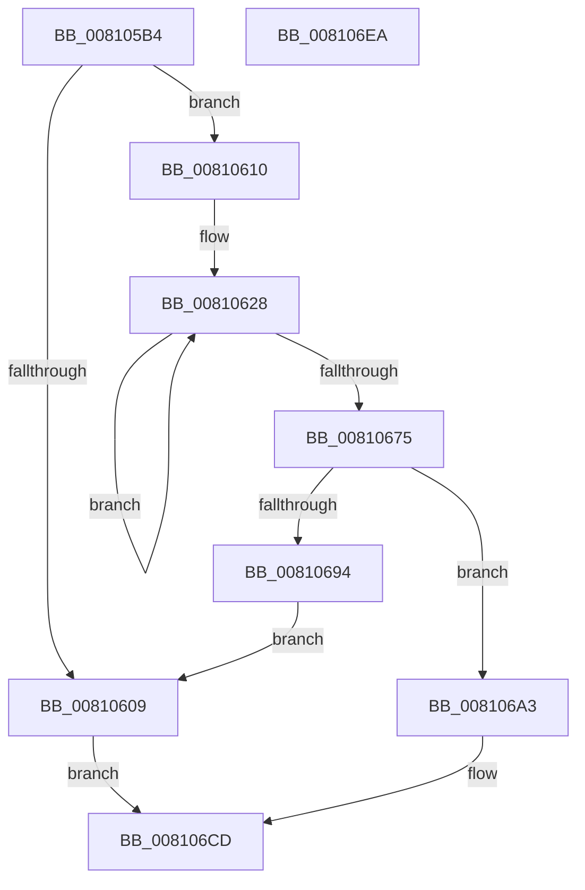

# MiCreateZeroThreadContext

- RVA: `0x008105B4`–`0x008106EB` (길이 `311` bytes)
- VA: `0x00000001408105B4`
- 실행 섹션: `PAGE`
- PDB 이름 있음: `예`; PDB Function 태그: `아니요`
- unwind 정보 RVA: `0x00075C18`
- 디코드: `79`개 명령, `311/311` bytes 표시
- 미해석 바이트: `0` (있으면 어셈블리에 `.byte`로 보존)

> 이 문서는 커널 이미지의 기계어와 PDB 기호를 분석해 생성했습니다. 4번과 5번은 함수 원형과 자료형을 바이너리 사용 방식에서 추정한 C 해석이며 원본 소스 복구 결과는 아닙니다.

## 1. Dependencies

- 직접 호출 지점: **8**; 고유 호출 대상: **8**
- 직접 호출자로 확인된 함수: **1**
- RIP 상대 이미지 참조: **0**

### Outgoing calls
- `0x008105DD` → [MiGetClosestNodeWithProcessors](../../text/43/MiGetClosestNodeWithProcessors_function_0043EEE0.md) (function, `0x0043EEE0`)
- `0x008105FC` → [ExAllocatePoolMm](../../text/35/ExAllocatePoolMm_function_0035B690.md) (function, `0x0035B690`)
- `0x0081062D` → [ExGenRandom](../../text/41/ExGenRandom_function_0041B010.md) (function, `0x0041B010`)
- `0x0081064B` → [MiInitializePageColorBase](../../text/32/MiInitializePageColorBase_function_00320410.md) (function, `0x00320410`)
- `0x0081068B` → [MiCreateUltraThreadContext](../../text/28/MiCreateUltraThreadContext_function_00288200.md) (function, `0x00288200`)
- `0x00810699` → [ExFreePoolWithTag](../../poolcode/B8/ExFreePoolWithTag_function_00B82870.md) (function, `0x00B82870`)
- `0x008106B1` → [KeInitializeEvent](../../text/40/KeInitializeEvent_function_0040DD10.md) (function, `0x0040DD10`)
- `0x008106BE` → [MiSetZeroThreadState](../../text/4A/MiSetZeroThreadState_function_004ACABC.md) (function, `0x004ACABC`)

### Direct callers
- [MiStartZeroEngineThreads](MiStartZeroEngineThreads_function_00810CCC.md) at `0x00810D0C`

### Static image references
- 디코드된 RIP-relative 메모리 참조가 없습니다.

## 2. Other-region calls and transfers

- 다른 실행 섹션으로 향하는 call: **8**
  - `0x008105DD` → [MiGetClosestNodeWithProcessors](../../text/43/MiGetClosestNodeWithProcessors_function_0043EEE0.md) (`PAGE` → `.text`)
  - `0x008105FC` → [ExAllocatePoolMm](../../text/35/ExAllocatePoolMm_function_0035B690.md) (`PAGE` → `.text`)
  - `0x0081062D` → [ExGenRandom](../../text/41/ExGenRandom_function_0041B010.md) (`PAGE` → `.text`)
  - `0x0081064B` → [MiInitializePageColorBase](../../text/32/MiInitializePageColorBase_function_00320410.md) (`PAGE` → `.text`)
  - `0x0081068B` → [MiCreateUltraThreadContext](../../text/28/MiCreateUltraThreadContext_function_00288200.md) (`PAGE` → `.text`)
  - `0x00810699` → [ExFreePoolWithTag](../../poolcode/B8/ExFreePoolWithTag_function_00B82870.md) (`PAGE` → `POOLCODE`)
  - `0x008106B1` → [KeInitializeEvent](../../text/40/KeInitializeEvent_function_0040DD10.md) (`PAGE` → `.text`)
  - `0x008106BE` → [MiSetZeroThreadState](../../text/4A/MiSetZeroThreadState_function_004ACABC.md) (`PAGE` → `.text`)
- 별도 외부 분기/꼬리 이동을 확인하지 못했습니다.

## 3. Assembly (complete function range)

```asm
008105B4  48 89 5C 24 08                  mov qword ptr [rsp + 8], rbx
008105B9  48 89 6C 24 10                  mov qword ptr [rsp + 0x10], rbp
008105BE  48 89 74 24 18                  mov qword ptr [rsp + 0x18], rsi
008105C3  57                              push rdi
008105C4  41 54                           push r12
008105C6  41 55                           push r13
008105C8  41 56                           push r14
008105CA  41 57                           push r15
008105CC  48 83 EC 20                     sub rsp, 0x20
008105D0  48 8B E9                        mov rbp, rcx
008105D3  48 8B 89 B0 00 00 00            mov rcx, qword ptr [rcx + 0xb0]
008105DA  8B 49 38                        mov ecx, dword ptr [rcx + 0x38]
008105DD  E8 FE E8 C2 FF                  call 0x14043eee0
008105E2  44 8B C8                        mov r9d, eax
008105E5  BA B0 02 00 00                  mov edx, 0x2b0
008105EA  41 0F BA E9 1F                  bts r9d, 0x1f
008105EF  B9 40 00 00 00                  mov ecx, 0x40
008105F4  41 B8 4D 69 5A 74               mov r8d, 0x745a694d
008105FA  8B D8                           mov ebx, eax
008105FC  E8 8F B0 B4 FF                  call 0x14035b690
00810601  48 8B F8                        mov rdi, rax
00810604  48 85 C0                        test rax, rax
00810607  75 07                           jne 0x140810610
00810609  33 C0                           xor eax, eax
0081060B  E9 BD 00 00 00                  jmp 0x1408106cd
00810610  45 33 F6                        xor r14d, r14d
00810613  4C 8D A0 60 02 00 00            lea r12, [rax + 0x260]
0081061A  45 33 FF                        xor r15d, r15d
0081061D  4C 8D A8 50 02 00 00            lea r13, [rax + 0x250]
00810624  41 8D 76 04                     lea esi, [r14 + 4]
00810628  B9 01 00 00 00                  mov ecx, 1
0081062D  E8 DE A9 C0 FF                  call 0x14041b010
00810632  4C 8D 8F 60 02 00 00            lea r9, [rdi + 0x260]
00810639  41 89 45 00                     mov dword ptr [r13], eax
0081063D  4D 03 CF                        add r9, r15
00810640  44 8D 43 01                     lea r8d, [rbx + 1]
00810644  BA 03 00 00 00                  mov edx, 3
00810649  33 C9                           xor ecx, ecx
0081064B  E8 C0 FD B0 FF                  call 0x140320410
00810650  4C 8D 8F 50 02 00 00            lea r9, [rdi + 0x250]
00810657  49 83 C7 10                     add r15, 0x10
0081065B  4D 03 CE                        add r9, r14
0081065E  4D 8D 6D 04                     lea r13, [r13 + 4]
00810662  49 83 C6 04                     add r14, 4
00810666  4D 89 0C 24                     mov qword ptr [r12], r9
0081066A  4D 8D 64 24 10                  lea r12, [r12 + 0x10]
0081066F  48 83 EE 01                     sub rsi, 1
00810673  75 B3                           jne 0x140810628
00810675  48 8D 8F C0 01 00 00            lea rcx, [rdi + 0x1c0]
0081067C  44 8D 4E 08                     lea r9d, [rsi + 8]
00810680  44 8D 46 0E                     lea r8d, [rsi + 0xe]
00810684  48 8D 97 60 02 00 00            lea rdx, [rdi + 0x260]
0081068B  E8 70 7B A7 FF                  call 0x140288200
00810690  85 C0                           test eax, eax
00810692  75 0F                           jne 0x1408106a3
00810694  33 D2                           xor edx, edx
00810696  48 8B CF                        mov rcx, rdi
00810699  E8 D2 21 37 00                  call 0x140b82870
0081069E  E9 66 FF FF FF                  jmp 0x140810609
008106A3  45 33 C0                        xor r8d, r8d
008106A6  48 8D 8F 88 01 00 00            lea rcx, [rdi + 0x188]
008106AD  41 8D 50 01                     lea edx, [r8 + 1]
008106B1  E8 5A D6 BF FF                  call 0x14040dd10
008106B6  BA 02 00 00 00                  mov edx, 2
008106BB  48 8B CF                        mov rcx, rdi
008106BE  E8 F9 C3 C9 FF                  call 0x1404acabc
008106C3  48 8B C7                        mov rax, rdi
008106C6  48 89 AF 50 01 00 00            mov qword ptr [rdi + 0x150], rbp
008106CD  48 8B 5C 24 50                  mov rbx, qword ptr [rsp + 0x50]
008106D2  48 8B 6C 24 58                  mov rbp, qword ptr [rsp + 0x58]
008106D7  48 8B 74 24 60                  mov rsi, qword ptr [rsp + 0x60]
008106DC  48 83 C4 20                     add rsp, 0x20
008106E0  41 5F                           pop r15
008106E2  41 5E                           pop r14
008106E4  41 5D                           pop r13
008106E6  41 5C                           pop r12
008106E8  5F                              pop rdi
008106E9  C3                              ret
008106EA  CC                              int3
```

## 4. C-style interpretation (structured pseudocode)

```c
__int64 __fastcall MiCreateZeroThreadContext(__int64 a1)
{
    __int64 result;
    __int64 v_r14;
    __int64 v_r15;
    __int64 v_rsi;
    __int64 v_rsp;
    unsigned __int64 v_stack_p10;
    unsigned __int64 v_stack_p18;
    unsigned __int64 v_stack_p8;

    v_stack_p8 = v_rbx;
    v_stack_p10 = v_rbp;
    v_stack_p18 = v_rsi;
    v_rsp = (v_rsp) - (32);
    result = MiGetClosestNodeWithProcessors((unsigned int)(*(unsigned int *)(*(unsigned __int64 *)(a1 + 176) + 56)), a2, a3, a4);
    result = ExAllocatePoolMm(64, 688, (unsigned int)(0x745A694DULL), (unsigned int)((unsigned int)(result)));
    if (result != 0) goto loc_00810610;
loc_00810609:
    result = 0;
    goto loc_008106CD;
loc_00810610:
    v_r14 = 0;
    v_r15 = 0;
loc_00810628:
    result = ExGenRandom(1, 688, (unsigned int)(0x745A694DULL), (unsigned int)((unsigned int)(result)));
    *(unsigned int *)(result + 592) = (unsigned int)(result);
    a4 = (result + 608) + (0);
    a1 = 0;
    result = MiInitializePageColorBase(a1, 3, (unsigned int)((unsigned int)(result)) + 1, a4);
    v_r15 = (v_r15) + (16);
    a4 = (result + 592) + (0);
    v_r14 = (v_r14) + (4);
    *(unsigned __int64 *)(result + 608) = a4;
    v_rsi = (v_r14 + 4) - (1);
    if (condition_is_not_equal) goto loc_00810628;
    result = MiCreateUltraThreadContext(result + 448, result + 608, v_rsi + 14, v_rsi + 8);
    if ((unsigned int)(result) != 0) goto loc_008106A3;
    a2 = 0;
    result = ExFreePoolWithTag(result, a2, v_rsi + 14, v_rsi + 8);
    goto loc_00810609;
loc_008106A3:
    a3 = 0;
    result = KeInitializeEvent(result + 392, a3 + 1, a3, v_rsi + 8);
    result = MiSetZeroThreadState(result, 2, a3, v_rsi + 8);
    *(unsigned __int64 *)(result + 336) = 0;
loc_008106CD:
    v_rsp = (v_rsp) + (32);
    return result;
}
```

## 5. (Beta) C Style

```c
int64_t MiCreateZeroThreadContext(void *Arg1)
{
    uint8_t *arg1 = (uint8_t *)Arg1;

    int64_t result;
    int64_t local_r14;
    int64_t local_r15;
    int64_t local_rsi;
    int64_t local_rsp;
    uint64_t v_stack_p10;
    uint64_t v_stack_p18;
    uint64_t v_stack_p8;

    v_stack_p8 = local_rbx;
    v_stack_p10 = local_rbp;
    v_stack_p18 = local_rsi;
    local_rsp = (local_rsp) - (32);
    result = MiGetClosestNodeWithProcessors((uint32_t)(*(uint32_t *)(*(uint64_t *)(arg1 + 0xB0) + 0x38)), a2, a3, a4);
    result = ExAllocatePoolMm(64, 688, (uint32_t)(0x745A694DULL), (uint32_t)((uint32_t)(result)));
    if (result != 0) goto loc_00810610;
loc_00810609:
    result = 0;
    goto loc_008106CD;
loc_00810610:
    local_r14 = 0;
    local_r15 = 0;
loc_00810628:
    result = ExGenRandom(1, 688, (uint32_t)(0x745A694DULL), (uint32_t)((uint32_t)(result)));
    *(uint32_t *)(result + 0x250) = (uint32_t)(result);
    a4 = (result + 608) + (0);
    Arg1 = 0;
    result = MiInitializePageColorBase(Arg1, 3, (uint32_t)((uint32_t)(result)) + 1, a4);
    local_r15 = (local_r15) + (16);
    a4 = (result + 592) + (0);
    local_r14 = (local_r14) + (4);
    *(uint64_t *)(result + 0x260) = a4;
    local_rsi = (local_r14 + 4) - (1);
    if (condition_is_not_equal) goto loc_00810628;
    result = MiCreateUltraThreadContext(result + 448, result + 608, local_rsi + 14, local_rsi + 8);
    if ((uint32_t)(result) != 0) goto loc_008106A3;
    a2 = 0;
    result = ExFreePoolWithTag(result, a2, local_rsi + 14, local_rsi + 8);
    goto loc_00810609;
loc_008106A3:
    a3 = 0;
    result = KeInitializeEvent(result + 392, a3 + 1, a3, local_rsi + 8);
    result = MiSetZeroThreadState(result, 2, a3, local_rsi + 8);
    *(uint64_t *)(result + 0x150) = 0;
loc_008106CD:
    local_rsp = (local_rsp) + (32);
    return result;
}
```

### 관측된 메모리 오프셋

구조체 형식이 확인되지 않은 접근은 인자 기준의 오프셋으로만 기록했습니다.

| 기준 인자 | 오프셋 표현 | 폭 (bit) | 접근 |
|---|---:|---:|---|
| `Arg1` | `+ 0xB0` | `64` | `R` |

## 6. Execution-region graph

[열기: 2D/3D 그래프와 함수 탐색 컨트롤 패널](../../../control-panel.html?section=page&rva=0x008105B4&view=graph)

- 2D 그래프는 위에서 아래로 흐르고, 3D 그래프는 빈 공간을 드래그해 회전합니다. Shift+드래그는 이동, 휠은 확대·축소, 함수 노드 선택은 대상 보고서 이동입니다.

### Static fallback


