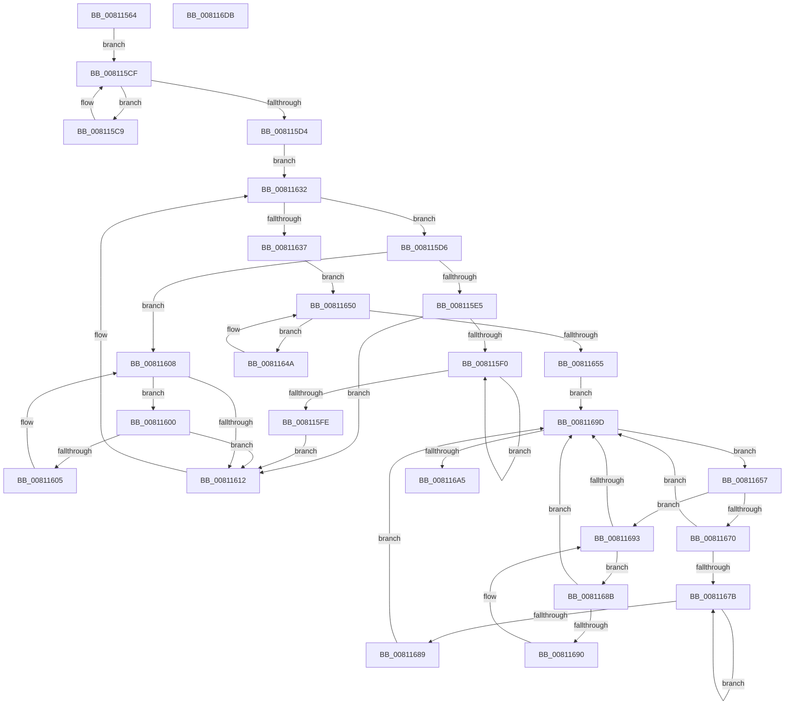

# MiDeleteInsertedCloneVads

- RVA: `0x00811564`–`0x008116DC` (길이 `376` bytes)
- VA: `0x0000000140811564`
- 실행 섹션: `PAGE`
- PDB 이름 있음: `예`; PDB Function 태그: `아니요`
- unwind 정보 RVA: `0x0008CE9C`
- 디코드: `112`개 명령, `376/376` bytes 표시
- 미해석 바이트: `0` (있으면 어셈블리에 `.byte`로 보존)

> 이 문서는 커널 이미지의 기계어와 PDB 기호를 분석해 생성했습니다. 4번과 5번은 함수 원형과 자료형을 바이너리 사용 방식에서 추정한 C 해석이며 원본 소스 복구 결과는 아닙니다.

## 1. Dependencies

- 직접 호출 지점: **9**; 고유 호출 대상: **8**
- 직접 호출자로 확인된 함수: **1**
- RIP 상대 이미지 참조: **1**

### Outgoing calls
- `0x008115AB` → [KiStackAttachProcess](../../text/21/KiStackAttachProcess_function_00216820.md) (function, `0x00216820`)
- `0x00811618` → [MiLockVad](../../text/29/MiLockVad_function_00295810.md) (function, `0x00295810`)
- `0x00811620` → [MiReferenceVad](../../text/29/MiReferenceVad_function_00295890.md) (function, `0x00295890`)
- `0x0081162D` → [MiDeleteVad](../88/MiDeleteVad_function_00888C80.md) (function, `0x00888C80`)
- `0x0081163C` → [MiDeleteCloneZombies](../../text/49/MiDeleteCloneZombies_function_0049A7B8.md) (function, `0x0049A7B8`)
- `0x0081165F` → [MiDeleteCloneDescriptor](../../text/4F/MiDeleteCloneDescriptor_function_004F9E28.md) (function, `0x004F9E28`)
- `0x008116A7` → [MiDeleteCloneZombies](../../text/49/MiDeleteCloneZombies_function_0049A7B8.md) (function, `0x0049A7B8`)
- `0x008116B3` → [KiUnstackDetachProcess](../../text/21/KiUnstackDetachProcess_function_00217D30.md) (function, `0x00217D30`)
- `0x008116C0` → [_security_check_cookie](../../text/6A/_security_check_cookie_function_006AC640.md) (function, `0x006AC640`)

### Direct callers
- [MiCloneProcessAddressSpace](../AD/MiCloneProcessAddressSpace_function_00AD6F7C.md) at `0x00AD70DC`

### Static image references
- `0x00811578` → RVA `0x00E0A740` (`.data`; read)

## 2. Other-region calls and transfers

- 다른 실행 섹션으로 향하는 call: **8**
  - `0x008115AB` → [KiStackAttachProcess](../../text/21/KiStackAttachProcess_function_00216820.md) (`PAGE` → `.text`)
  - `0x00811618` → [MiLockVad](../../text/29/MiLockVad_function_00295810.md) (`PAGE` → `.text`)
  - `0x00811620` → [MiReferenceVad](../../text/29/MiReferenceVad_function_00295890.md) (`PAGE` → `.text`)
  - `0x0081163C` → [MiDeleteCloneZombies](../../text/49/MiDeleteCloneZombies_function_0049A7B8.md) (`PAGE` → `.text`)
  - `0x0081165F` → [MiDeleteCloneDescriptor](../../text/4F/MiDeleteCloneDescriptor_function_004F9E28.md) (`PAGE` → `.text`)
  - `0x008116A7` → [MiDeleteCloneZombies](../../text/49/MiDeleteCloneZombies_function_0049A7B8.md) (`PAGE` → `.text`)
  - `0x008116B3` → [KiUnstackDetachProcess](../../text/21/KiUnstackDetachProcess_function_00217D30.md) (`PAGE` → `.text`)
  - `0x008116C0` → [_security_check_cookie](../../text/6A/_security_check_cookie_function_006AC640.md) (`PAGE` → `.text`)
- 별도 외부 분기/꼬리 이동을 확인하지 못했습니다.

## 3. Assembly (complete function range)

```asm
00811564  4C 8B DC                        mov r11, rsp
00811567  49 89 5B 10                     mov qword ptr [r11 + 0x10], rbx
0081156B  49 89 6B 18                     mov qword ptr [r11 + 0x18], rbp
0081156F  49 89 73 20                     mov qword ptr [r11 + 0x20], rsi
00811573  57                              push rdi
00811574  48 83 EC 60                     sub rsp, 0x60
00811578  48 8B 05 C1 91 5F 00            mov rax, qword ptr [rip + 0x5f91c1]
0081157F  48 33 C4                        xor rax, rsp
00811582  48 89 44 24 50                  mov qword ptr [rsp + 0x50], rax
00811587  0F 57 C0                        xorps xmm0, xmm0
0081158A  4D 8D 43 B8                     lea r8, [r11 - 0x48]
0081158E  0F 11 44 24 20                  movups xmmword ptr [rsp + 0x20], xmm0
00811593  33 D2                           xor edx, edx
00811595  48 8B F9                        mov rdi, rcx
00811598  0F 11 44 24 30                  movups xmmword ptr [rsp + 0x30], xmm0
0081159D  0F 11 44 24 40                  movups xmmword ptr [rsp + 0x40], xmm0
008115A2  65 48 8B 2C 25 88 01 00 00      mov rbp, qword ptr gs:[0x188]
008115AB  E8 70 52 A0 FF                  call 0x140216820
008115B0  48 8B 87 10 04 00 00            mov rax, qword ptr [rdi + 0x410]
008115B7  80 88 25 04 00 00 01            or byte ptr [rax + 0x425], 1
008115BE  48 8B 87 58 05 00 00            mov rax, qword ptr [rdi + 0x558]
008115C5  33 DB                           xor ebx, ebx
008115C7  EB 06                           jmp 0x1408115cf
008115C9  48 8B D8                        mov rbx, rax
008115CC  48 8B 00                        mov rax, qword ptr [rax]
008115CF  48 85 C0                        test rax, rax
008115D2  75 F5                           jne 0x1408115c9
008115D4  EB 5C                           jmp 0x140811632
008115D6  48 8B 43 08                     mov rax, qword ptr [rbx + 8]
008115DA  48 8B F3                        mov rsi, rbx
008115DD  48 8B CB                        mov rcx, rbx
008115E0  48 85 C0                        test rax, rax
008115E3  74 23                           je 0x140811608
008115E5  48 8B 08                        mov rcx, qword ptr [rax]
008115E8  48 8B D8                        mov rbx, rax
008115EB  48 85 C9                        test rcx, rcx
008115EE  74 22                           je 0x140811612
008115F0  48 8B 01                        mov rax, qword ptr [rcx]
008115F3  48 8B D9                        mov rbx, rcx
008115F6  48 8B C8                        mov rcx, rax
008115F9  48 85 C0                        test rax, rax
008115FC  75 F2                           jne 0x1408115f0
008115FE  EB 12                           jmp 0x140811612
00811600  48 39 0B                        cmp qword ptr [rbx], rcx
00811603  74 0D                           je 0x140811612
00811605  48 8B CB                        mov rcx, rbx
00811608  48 8B 5B 10                     mov rbx, qword ptr [rbx + 0x10]
0081160C  48 83 E3 FC                     and rbx, 0xfffffffffffffffc
00811610  75 EE                           jne 0x140811600
00811612  48 8B D6                        mov rdx, rsi
00811615  48 8B CD                        mov rcx, rbp
00811618  E8 F3 41 A8 FF                  call 0x140295810
0081161D  48 8B CE                        mov rcx, rsi
00811620  E8 6B 42 A8 FF                  call 0x140295890
00811625  48 8B CE                        mov rcx, rsi
00811628  45 33 C0                        xor r8d, r8d
0081162B  33 D2                           xor edx, edx
0081162D  E8 4E 76 07 00                  call 0x140888c80
00811632  48 85 DB                        test rbx, rbx
00811635  75 9F                           jne 0x1408115d6
00811637  33 D2                           xor edx, edx
00811639  48 8B CF                        mov rcx, rdi
0081163C  E8 77 91 C8 FF                  call 0x14049a7b8
00811641  48 8B 87 80 02 00 00            mov rax, qword ptr [rdi + 0x280]
00811648  EB 06                           jmp 0x140811650
0081164A  48 8B D8                        mov rbx, rax
0081164D  48 8B 00                        mov rax, qword ptr [rax]
00811650  48 85 C0                        test rax, rax
00811653  75 F5                           jne 0x14081164a
00811655  EB 46                           jmp 0x14081169d
00811657  48 83 63 30 00                  and qword ptr [rbx + 0x30], 0
0081165C  48 8B D3                        mov rdx, rbx
0081165F  E8 C4 87 CE FF                  call 0x1404f9e28
00811664  48 8B 43 08                     mov rax, qword ptr [rbx + 8]
00811668  48 8B CB                        mov rcx, rbx
0081166B  48 85 C0                        test rax, rax
0081166E  74 23                           je 0x140811693
00811670  48 8B 08                        mov rcx, qword ptr [rax]
00811673  48 8B D8                        mov rbx, rax
00811676  48 85 C9                        test rcx, rcx
00811679  74 22                           je 0x14081169d
0081167B  48 8B 01                        mov rax, qword ptr [rcx]
0081167E  48 8B D9                        mov rbx, rcx
00811681  48 8B C8                        mov rcx, rax
00811684  48 85 C0                        test rax, rax
00811687  75 F2                           jne 0x14081167b
00811689  EB 12                           jmp 0x14081169d
0081168B  48 39 0B                        cmp qword ptr [rbx], rcx
0081168E  74 0D                           je 0x14081169d
00811690  48 8B CB                        mov rcx, rbx
00811693  48 8B 5B 10                     mov rbx, qword ptr [rbx + 0x10]
00811697  48 83 E3 FC                     and rbx, 0xfffffffffffffffc
0081169B  75 EE                           jne 0x14081168b
0081169D  48 8B CF                        mov rcx, rdi
008116A0  48 85 DB                        test rbx, rbx
008116A3  75 B2                           jne 0x140811657
008116A5  33 D2                           xor edx, edx
008116A7  E8 0C 91 C8 FF                  call 0x14049a7b8
008116AC  33 D2                           xor edx, edx
008116AE  48 8D 4C 24 20                  lea rcx, [rsp + 0x20]
008116B3  E8 78 66 A0 FF                  call 0x140217d30
008116B8  48 8B 4C 24 50                  mov rcx, qword ptr [rsp + 0x50]
008116BD  48 33 CC                        xor rcx, rsp
008116C0  E8 7B AF E9 FF                  call 0x1406ac640
008116C5  4C 8D 5C 24 60                  lea r11, [rsp + 0x60]
008116CA  49 8B 5B 18                     mov rbx, qword ptr [r11 + 0x18]
008116CE  49 8B 6B 20                     mov rbp, qword ptr [r11 + 0x20]
008116D2  49 8B 73 28                     mov rsi, qword ptr [r11 + 0x28]
008116D6  49 8B E3                        mov rsp, r11
008116D9  5F                              pop rdi
008116DA  C3                              ret
008116DB  CC                              int3
```

## 4. C-style interpretation (structured pseudocode)

```c
__int64 __fastcall MiDeleteInsertedCloneVads(__int64 a1, int a2)
{
    __int64 result;
    __int64 v_rbx;
    __int64 v_rsp;
    unsigned __int64 v_stack_m18;
    unsigned __int64 v_stack_m28;
    unsigned __int64 v_stack_m38;
    unsigned __int64 v_stack_m48;
    unsigned __int64 v_stack_m8;

    *(unsigned __int64 *)(v_rsp + 16) = v_rbx;
    *(unsigned __int64 *)(v_rsp + 24) = v_rbp;
    *(unsigned __int64 *)(v_rsp + 32) = v_rsi;
    v_rsp = (v_rsp) - (96);
    result = (*(unsigned __int64 *)(v_rip + 6263233)) ^ (v_rsp);
    v_stack_m18 = result;
    v_stack_m48 = v_xmm0;
    a2 = 0;
    v_stack_m38 = v_xmm0;
    v_stack_m28 = v_xmm0;
    result = KiStackAttachProcess(a1, a2, v_rsp - 72, a4);
    v_rbx = 0;
    goto loc_008115CF;
loc_008115C9:
loc_008115CF:
    if (*(unsigned __int64 *)(*(unsigned __int64 *)(a1 + 1368)) != 0) goto loc_008115C9;
    goto loc_00811632;
loc_008115D6:
    if (*(unsigned __int64 *)(*(unsigned __int64 *)(a1 + 1368) + 8) == 0) goto loc_00811608;
    if (*(unsigned __int64 *)(*(unsigned __int64 *)(*(unsigned __int64 *)(a1 + 1368) + 8)) == 0) goto loc_00811612;
loc_008115F0:
    if (*(unsigned __int64 *)(*(unsigned __int64 *)(*(unsigned __int64 *)(*(unsigned __int64 *)(a1 + 1368) + 8))) != 0) goto loc_008115F0;
    goto loc_00811612;
loc_00811600:
    if ((*(unsigned __int64 *)(*(unsigned __int64 *)(*(unsigned __int64 *)(*(unsigned __int64 *)(a1 + 1368) + 8)))) == (*(unsigned __int64 *)(*(unsigned __int64 *)(*(unsigned __int64 *)(*(unsigned __int64 *)(a1 + 1368) + 8))))) goto loc_00811612;
loc_00811608:
    v_rbx = (*(unsigned __int64 *)(*(unsigned __int64 *)(*(unsigned __int64 *)(*(unsigned __int64 *)(a1 + 1368) + 8)) + 16)) & (-4);
    if (condition_is_not_equal) goto loc_00811600;
loc_00811612:
    result = MiLockVad(*(unsigned __int64 *)(gs_base + (0 + 392)), *(unsigned __int64 *)(a1 + 1368), v_rsp - 72, a4);
    result = MiReferenceVad(*(unsigned __int64 *)(a1 + 1368), *(unsigned __int64 *)(a1 + 1368), v_rsp - 72, a4);
    a3 = 0;
    a2 = 0;
    result = MiDeleteVad(*(unsigned __int64 *)(a1 + 1368), a2, a3, a4);
loc_00811632:
    if (v_rbx != 0) goto loc_008115D6;
    a2 = 0;
    result = MiDeleteCloneZombies(a1, a2, a3, a4);
    goto loc_00811650;
loc_0081164A:
loc_00811650:
    if (*(unsigned __int64 *)(*(unsigned __int64 *)(a1 + 640)) != 0) goto loc_0081164A;
    goto loc_0081169D;
loc_00811657:
    result = MiDeleteCloneDescriptor(a1, *(unsigned __int64 *)(a1 + 640), a3, a4);
    if (*(unsigned __int64 *)(*(unsigned __int64 *)(a1 + 640) + 8) == 0) goto loc_00811693;
    if (*(unsigned __int64 *)(*(unsigned __int64 *)(*(unsigned __int64 *)(a1 + 640) + 8)) == 0) goto loc_0081169D;
loc_0081167B:
    if (*(unsigned __int64 *)(*(unsigned __int64 *)(*(unsigned __int64 *)(*(unsigned __int64 *)(a1 + 640) + 8))) != 0) goto loc_0081167B;
    goto loc_0081169D;
loc_0081168B:
    if ((*(unsigned __int64 *)(*(unsigned __int64 *)(*(unsigned __int64 *)(*(unsigned __int64 *)(a1 + 640) + 8)))) == (*(unsigned __int64 *)(*(unsigned __int64 *)(*(unsigned __int64 *)(*(unsigned __int64 *)(a1 + 640) + 8))))) goto loc_0081169D;
loc_00811693:
    v_rbx = (*(unsigned __int64 *)(*(unsigned __int64 *)(*(unsigned __int64 *)(*(unsigned __int64 *)(a1 + 640) + 8)) + 16)) & (-4);
    if (condition_is_not_equal) goto loc_0081168B;
loc_0081169D:
    if (v_rbx != 0) goto loc_00811657;
    a2 = 0;
    result = MiDeleteCloneZombies(a1, a2, a3, a4);
    a2 = 0;
    result = KiUnstackDetachProcess(v_stack_m48, a2, a3, a4);
    a1 = (v_stack_m18) ^ (v_rsp);
    result = _security_check_cookie(a1, a2, a3, a4);
    return result;
}
```

## 5. (Beta) C Style

```c
int64_t MiDeleteInsertedCloneVads(void *Arg1, int32_t Arg2)
{
    uint8_t *arg1 = (uint8_t *)Arg1;

    int64_t result;
    int64_t local_rbx;
    int64_t local_rsp;
    uint64_t v_stack_m18;
    uint64_t v_stack_m28;
    uint64_t v_stack_m38;
    uint64_t v_stack_m48;
    uint64_t v_stack_m8;

    *(uint64_t *)(local_rsp + 0x10) = local_rbx;
    *(uint64_t *)(local_rsp + 0x18) = local_rbp;
    *(uint64_t *)(local_rsp + 0x20) = local_rsi;
    local_rsp = (local_rsp) - (96);
    result = (*(uint64_t *)(v_rip + 0x5F91C1)) ^ (local_rsp);
    v_stack_m18 = result;
    v_stack_m48 = v_xmm0;
    Arg2 = 0;
    v_stack_m38 = v_xmm0;
    v_stack_m28 = v_xmm0;
    result = KiStackAttachProcess(Arg1, Arg2, local_rsp - 72, a4);
    local_rbx = 0;
    goto loc_008115CF;
loc_008115C9:
loc_008115CF:
    if (*(uint64_t *)(*(uint64_t *)(arg1 + 0x558)) != 0) goto loc_008115C9;
    goto loc_00811632;
loc_008115D6:
    if (*(uint64_t *)(*(uint64_t *)(arg1 + 0x558) + 0x8) == 0) goto loc_00811608;
    if (*(uint64_t *)(*(uint64_t *)(*(uint64_t *)(arg1 + 0x558) + 0x8)) == 0) goto loc_00811612;
loc_008115F0:
    if (*(uint64_t *)(*(uint64_t *)(*(uint64_t *)(*(uint64_t *)(arg1 + 0x558) + 0x8))) != 0) goto loc_008115F0;
    goto loc_00811612;
loc_00811600:
    if ((*(uint64_t *)(*(uint64_t *)(*(uint64_t *)(*(uint64_t *)(arg1 + 0x558) + 0x8)))) == (*(uint64_t *)(*(uint64_t *)(*(uint64_t *)(*(uint64_t *)(arg1 + 0x558) + 0x8))))) goto loc_00811612;
loc_00811608:
    local_rbx = (*(uint64_t *)(*(uint64_t *)(*(uint64_t *)(*(uint64_t *)(arg1 + 0x558) + 0x8)) + 0x10)) & (-4);
    if (condition_is_not_equal) goto loc_00811600;
loc_00811612:
    result = MiLockVad(*(uint64_t *)(gs_base + (0 + 0x188)), *(uint64_t *)(arg1 + 0x558), local_rsp - 72, a4);
    result = MiReferenceVad(*(uint64_t *)(arg1 + 0x558), *(uint64_t *)(arg1 + 0x558), local_rsp - 72, a4);
    a3 = 0;
    Arg2 = 0;
    result = MiDeleteVad(*(uint64_t *)(arg1 + 0x558), Arg2, a3, a4);
loc_00811632:
    if (local_rbx != 0) goto loc_008115D6;
    Arg2 = 0;
    result = MiDeleteCloneZombies(Arg1, Arg2, a3, a4);
    goto loc_00811650;
loc_0081164A:
loc_00811650:
    if (*(uint64_t *)(*(uint64_t *)(arg1 + 0x280)) != 0) goto loc_0081164A;
    goto loc_0081169D;
loc_00811657:
    result = MiDeleteCloneDescriptor(Arg1, *(uint64_t *)(arg1 + 0x280), a3, a4);
    if (*(uint64_t *)(*(uint64_t *)(arg1 + 0x280) + 0x8) == 0) goto loc_00811693;
    if (*(uint64_t *)(*(uint64_t *)(*(uint64_t *)(arg1 + 0x280) + 0x8)) == 0) goto loc_0081169D;
loc_0081167B:
    if (*(uint64_t *)(*(uint64_t *)(*(uint64_t *)(*(uint64_t *)(arg1 + 0x280) + 0x8))) != 0) goto loc_0081167B;
    goto loc_0081169D;
loc_0081168B:
    if ((*(uint64_t *)(*(uint64_t *)(*(uint64_t *)(*(uint64_t *)(arg1 + 0x280) + 0x8)))) == (*(uint64_t *)(*(uint64_t *)(*(uint64_t *)(*(uint64_t *)(arg1 + 0x280) + 0x8))))) goto loc_0081169D;
loc_00811693:
    local_rbx = (*(uint64_t *)(*(uint64_t *)(*(uint64_t *)(*(uint64_t *)(arg1 + 0x280) + 0x8)) + 0x10)) & (-4);
    if (condition_is_not_equal) goto loc_0081168B;
loc_0081169D:
    if (local_rbx != 0) goto loc_00811657;
    Arg2 = 0;
    result = MiDeleteCloneZombies(Arg1, Arg2, a3, a4);
    Arg2 = 0;
    result = KiUnstackDetachProcess(v_stack_m48, Arg2, a3, a4);
    Arg1 = (v_stack_m18) ^ (local_rsp);
    result = _security_check_cookie(Arg1, Arg2, a3, a4);
    return result;
}
```

### 관측된 메모리 오프셋

구조체 형식이 확인되지 않은 접근은 인자 기준의 오프셋으로만 기록했습니다.

| 기준 인자 | 오프셋 표현 | 폭 (bit) | 접근 |
|---|---:|---:|---|
| `Arg1` | `+ 0x280` | `64` | `R` |
| `Arg1` | `+ 0x410` | `64` | `R` |
| `Arg1` | `+ 0x558` | `64` | `R` |

## 6. Execution-region graph

[열기: 2D/3D 그래프와 함수 탐색 컨트롤 패널](../../../control-panel.html?section=page&rva=0x00811564&view=graph)

- 2D 그래프는 위에서 아래로 흐르고, 3D 그래프는 빈 공간을 드래그해 회전합니다. Shift+드래그는 이동, 휠은 확대·축소, 함수 노드 선택은 대상 보고서 이동입니다.

### Static fallback


