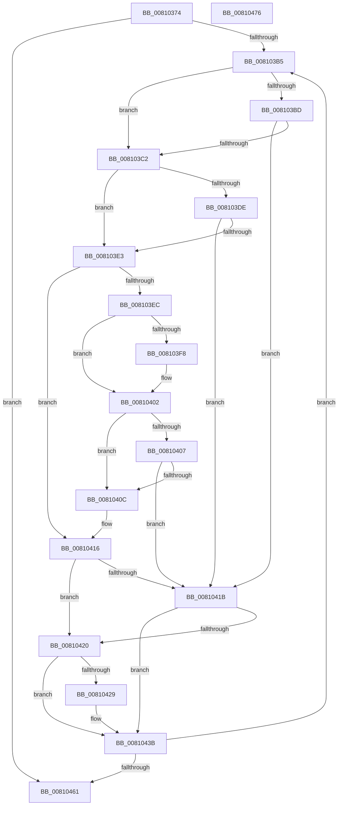

# MiDeleteNewlyCreatedPartialVads

- RVA: `0x00810374`–`0x00810477` (길이 `259` bytes)
- VA: `0x0000000140810374`
- 실행 섹션: `PAGE`
- PDB 이름 있음: `예`; PDB Function 태그: `아니요`
- unwind 정보 RVA: `0x0007D3C0`
- 디코드: `72`개 명령, `259/259` bytes 표시
- 미해석 바이트: `0` (있으면 어셈블리에 `.byte`로 보존)

> 이 문서는 커널 이미지의 기계어와 PDB 기호를 분석해 생성했습니다. 4번과 5번은 함수 원형과 자료형을 바이너리 사용 방식에서 추정한 C 해석이며 원본 소스 복구 결과는 아닙니다.

## 1. Dependencies

- 직접 호출 지점: **8**; 고유 호출 대상: **8**
- 직접 호출자로 확인된 함수: **1**
- RIP 상대 이미지 참조: **0**

### Outgoing calls
- `0x008103CA` → [MiComputeVadCharges](../../text/2C/MiComputeVadCharges_function_002C3348.md) (function, `0x002C3348`)
- `0x008103D4` → [MiReturnVadCharges](../88/MiReturnVadCharges_function_008875B8.md) (function, `0x008875B8`)
- `0x008103FD` → [ObfReferenceObjectWithTag](../../text/21/ObfReferenceObjectWithTag_function_00210710.md) (function, `0x00210710`)
- `0x00810411` → [MiUpControlAreaRefs](../../text/3B/MiUpControlAreaRefs_function_003B2BF0.md) (function, `0x003B2BF0`)
- `0x00810436` → [MiRemoveSharedCommitNode](../88/MiRemoveSharedCommitNode_function_008889A0.md) (function, `0x008889A0`)
- `0x0081043E` → [MiFreeRotateView](../7F/MiFreeRotateView_function_007FE6CC.md) (function, `0x007FE6CC`)
- `0x00810446` → [MiFreePlaceholderStorage](../AA/MiFreePlaceholderStorage_function_00AAC868.md) (function, `0x00AAC868`)
- `0x00810450` → [ExFreePoolWithTag](../../poolcode/B8/ExFreePoolWithTag_function_00B82870.md) (function, `0x00B82870`)

### Direct callers
- [MiAllocateSplitVads](../88/MiAllocateSplitVads_function_00887818.md) at `0x008878AB`

### Static image references
- 디코드된 RIP-relative 메모리 참조가 없습니다.

## 2. Other-region calls and transfers

- 다른 실행 섹션으로 향하는 call: **4**
  - `0x008103CA` → [MiComputeVadCharges](../../text/2C/MiComputeVadCharges_function_002C3348.md) (`PAGE` → `.text`)
  - `0x008103FD` → [ObfReferenceObjectWithTag](../../text/21/ObfReferenceObjectWithTag_function_00210710.md) (`PAGE` → `.text`)
  - `0x00810411` → [MiUpControlAreaRefs](../../text/3B/MiUpControlAreaRefs_function_003B2BF0.md) (`PAGE` → `.text`)
  - `0x00810450` → [ExFreePoolWithTag](../../poolcode/B8/ExFreePoolWithTag_function_00B82870.md) (`PAGE` → `POOLCODE`)
- 별도 외부 분기/꼬리 이동을 확인하지 못했습니다.

## 3. Assembly (complete function range)

```asm
00810374  4C 8B DC                        mov r11, rsp
00810377  49 89 5B 08                     mov qword ptr [r11 + 8], rbx
0081037B  49 89 6B 10                     mov qword ptr [r11 + 0x10], rbp
0081037F  49 89 73 18                     mov qword ptr [r11 + 0x18], rsi
00810383  57                              push rdi
00810384  48 83 EC 40                     sub rsp, 0x40
00810388  48 8B 39                        mov rdi, qword ptr [rcx]
0081038B  33 C0                           xor eax, eax
0081038D  8B 59 28                        mov ebx, dword ptr [rcx + 0x28]
00810390  0F 57 C0                        xorps xmm0, xmm0
00810393  0F 11 44 24 20                  movups xmmword ptr [rsp + 0x20], xmm0
00810398  49 89 43 E8                     mov qword ptr [r11 - 0x18], rax
0081039C  65 48 8B 04 25 88 01 00 00      mov rax, qword ptr gs:[0x188]
008103A5  48 8B A8 B8 00 00 00            mov rbp, qword ptr [rax + 0xb8]
008103AC  48 85 FF                        test rdi, rdi
008103AF  0F 84 AC 00 00 00               je 0x140810461
008103B5  48 8B 37                        mov rsi, qword ptr [rdi]
008103B8  48 85 F6                        test rsi, rsi
008103BB  75 05                           jne 0x1408103c2
008103BD  F6 C3 02                        test bl, 2
008103C0  74 59                           je 0x14081041b
008103C2  48 8D 54 24 20                  lea rdx, [rsp + 0x20]
008103C7  48 8B CF                        mov rcx, rdi
008103CA  E8 79 2F AB FF                  call 0x1402c3348
008103CF  48 8D 4C 24 20                  lea rcx, [rsp + 0x20]
008103D4  E8 DF 71 07 00                  call 0x1408875b8
008103D9  48 85 F6                        test rsi, rsi
008103DC  75 05                           jne 0x1408103e3
008103DE  F6 C3 02                        test bl, 2
008103E1  74 38                           je 0x14081041b
008103E3  F7 47 30 00 00 20 00            test dword ptr [rdi + 0x30], 0x200000
008103EA  75 2A                           jne 0x140810416
008103EC  48 8B 8F 80 00 00 00            mov rcx, qword ptr [rdi + 0x80]
008103F3  48 85 C9                        test rcx, rcx
008103F6  74 0A                           je 0x140810402
008103F8  BA 4D 6D 53 63                  mov edx, 0x63536d4d
008103FD  E8 0E 03 A0 FF                  call 0x140210710
00810402  48 85 F6                        test rsi, rsi
00810405  75 05                           jne 0x14081040c
00810407  F6 C3 04                        test bl, 4
0081040A  74 0F                           je 0x14081041b
0081040C  33 D2                           xor edx, edx
0081040E  48 8B CF                        mov rcx, rdi
00810411  E8 DA 27 BA FF                  call 0x1403b2bf0
00810416  48 85 F6                        test rsi, rsi
00810419  75 05                           jne 0x140810420
0081041B  F6 C3 01                        test bl, 1
0081041E  74 1B                           je 0x14081043b
00810420  F7 47 30 00 00 20 00            test dword ptr [rdi + 0x30], 0x200000
00810427  75 12                           jne 0x14081043b
00810429  48 8B 4F 48                     mov rcx, qword ptr [rdi + 0x48]
0081042D  45 33 C0                        xor r8d, r8d
00810430  48 8B D5                        mov rdx, rbp
00810433  48 8B 09                        mov rcx, qword ptr [rcx]
00810436  E8 65 85 07 00                  call 0x1408889a0
0081043B  48 8B CF                        mov rcx, rdi
0081043E  E8 89 E2 FE FF                  call 0x1407fe6cc
00810443  48 8B CF                        mov rcx, rdi
00810446  E8 1D C4 29 00                  call 0x140aac868
0081044B  33 D2                           xor edx, edx
0081044D  48 8B CF                        mov rcx, rdi
00810450  E8 1B 24 37 00                  call 0x140b82870
00810455  48 8B FE                        mov rdi, rsi
00810458  48 85 F6                        test rsi, rsi
0081045B  0F 85 54 FF FF FF               jne 0x1408103b5
00810461  48 8B 5C 24 50                  mov rbx, qword ptr [rsp + 0x50]
00810466  48 8B 6C 24 58                  mov rbp, qword ptr [rsp + 0x58]
0081046B  48 8B 74 24 60                  mov rsi, qword ptr [rsp + 0x60]
00810470  48 83 C4 40                     add rsp, 0x40
00810474  5F                              pop rdi
00810475  C3                              ret
00810476  CC                              int3
```

## 4. C-style interpretation (structured pseudocode)

```c
__int64 __fastcall MiDeleteNewlyCreatedPartialVads(__int64 a1, __int64 a2, int a3)
{
    __int64 result;
    __int64 v_rsp;
    unsigned __int64 v_stack_m28;
    unsigned __int64 v_stack_p10;
    unsigned __int64 v_stack_p18;
    unsigned __int64 v_stack_p8;

    *(unsigned __int64 *)(v_rsp + 8) = v_rbx;
    *(unsigned __int64 *)(v_rsp + 16) = v_rbp;
    *(unsigned __int64 *)(v_rsp + 24) = v_rsi;
    v_rsp = (v_rsp) - (64);
    result = 0;
    v_stack_m28 = v_xmm0;
    *(unsigned __int64 *)(v_rsp - 24) = 0;
    if (*(unsigned __int64 *)(a1) == 0) goto loc_00810461;
loc_008103B5:
    if (*(unsigned __int64 *)(*(unsigned __int64 *)(a1)) != 0) goto loc_008103C2;
    if ((((unsigned __int8)((unsigned int)(*(unsigned int *)(a1 + 40)))) & (2)) == 0) goto loc_0081041B;
loc_008103C2:
    result = MiComputeVadCharges(*(unsigned __int64 *)(a1), v_stack_m28, a3, a4);
    result = MiReturnVadCharges(v_stack_m28, v_stack_m28, a3, a4);
    if (*(unsigned __int64 *)(*(unsigned __int64 *)(a1)) != 0) goto loc_008103E3;
    if ((((unsigned __int8)((unsigned int)(*(unsigned int *)(a1 + 40)))) & (2)) == 0) goto loc_0081041B;
loc_008103E3:
    if (((*(unsigned int *)(*(unsigned __int64 *)(a1) + 48)) & (0x200000ULL)) != 0) goto loc_00810416;
    if (*(unsigned __int64 *)(*(unsigned __int64 *)(a1) + 128) != 0) {
        a2 = 0x63536D4DULL;
        result = ObfReferenceObjectWithTag(*(unsigned __int64 *)(*(unsigned __int64 *)(a1) + 128), a2, a3, a4);
    }
    if (*(unsigned __int64 *)(*(unsigned __int64 *)(a1)) != 0) goto loc_0081040C;
    if ((((unsigned __int8)((unsigned int)(*(unsigned int *)(a1 + 40)))) & (4)) == 0) goto loc_0081041B;
loc_0081040C:
    a2 = 0;
    result = MiUpControlAreaRefs(*(unsigned __int64 *)(a1), a2, a3, a4);
loc_00810416:
    if (*(unsigned __int64 *)(*(unsigned __int64 *)(a1)) != 0) goto loc_00810420;
loc_0081041B:
    if ((((unsigned __int8)((unsigned int)(*(unsigned int *)(a1 + 40)))) & (1)) == 0) goto loc_0081043B;
loc_00810420:
    if (((*(unsigned int *)(*(unsigned __int64 *)(a1) + 48)) & (0x200000ULL)) == 0) {
        a1 = *(unsigned __int64 *)(*(unsigned __int64 *)(a1) + 72);
        a3 = 0;
        a2 = *(unsigned __int64 *)(*(unsigned __int64 *)(gs_base + (0 + 392)) + 184);
        a1 = *(unsigned __int64 *)(a1);
        result = MiRemoveSharedCommitNode(a1, a2, a3, a4);
    }
    result = MiFreeRotateView(*(unsigned __int64 *)(a1), a2, a3, a4);
    result = MiFreePlaceholderStorage(*(unsigned __int64 *)(a1), a2, a3, a4);
    a2 = 0;
    result = ExFreePoolWithTag(*(unsigned __int64 *)(a1), a2, a3, a4);
    if (*(unsigned __int64 *)(*(unsigned __int64 *)(a1)) != 0) goto loc_008103B5;
loc_00810461:
    v_rsp = (v_rsp) + (64);
    return result;
}
```

## 5. (Beta) C Style

```c
int64_t MiDeleteNewlyCreatedPartialVads(void *Arg1, int64_t Arg2, int32_t Arg3)
{
    uint8_t *arg1 = (uint8_t *)Arg1;

    int64_t result;
    int64_t local_rsp;
    uint64_t v_stack_m28;
    uint64_t v_stack_p10;
    uint64_t v_stack_p18;
    uint64_t v_stack_p8;

    *(uint64_t *)(local_rsp + 0x8) = local_rbx;
    *(uint64_t *)(local_rsp + 0x10) = local_rbp;
    *(uint64_t *)(local_rsp + 0x18) = local_rsi;
    local_rsp = (local_rsp) - (64);
    result = 0;
    v_stack_m28 = v_xmm0;
    *(uint64_t *)(local_rsp - 0x18) = 0;
    if (*(uint64_t *)(arg1) == 0) goto loc_00810461;
loc_008103B5:
    if (*(uint64_t *)(*(uint64_t *)(arg1)) != 0) goto loc_008103C2;
    if ((((uint8_t)((uint32_t)(*(uint32_t *)(arg1 + 0x28)))) & (2)) == 0) goto loc_0081041B;
loc_008103C2:
    result = MiComputeVadCharges(*(uint64_t *)(arg1), v_stack_m28, Arg3, a4);
    result = MiReturnVadCharges(v_stack_m28, v_stack_m28, Arg3, a4);
    if (*(uint64_t *)(*(uint64_t *)(arg1)) != 0) goto loc_008103E3;
    if ((((uint8_t)((uint32_t)(*(uint32_t *)(arg1 + 0x28)))) & (2)) == 0) goto loc_0081041B;
loc_008103E3:
    if (((*(uint32_t *)(*(uint64_t *)(arg1) + 0x30)) & (0x200000ULL)) != 0) goto loc_00810416;
    if (*(uint64_t *)(*(uint64_t *)(arg1) + 0x80) != 0) {
        Arg2 = 0x63536D4DULL;
        result = ObfReferenceObjectWithTag(*(uint64_t *)(*(uint64_t *)(arg1) + 0x80), Arg2, Arg3, a4);
    }
    if (*(uint64_t *)(*(uint64_t *)(arg1)) != 0) goto loc_0081040C;
    if ((((uint8_t)((uint32_t)(*(uint32_t *)(arg1 + 0x28)))) & (4)) == 0) goto loc_0081041B;
loc_0081040C:
    Arg2 = 0;
    result = MiUpControlAreaRefs(*(uint64_t *)(arg1), Arg2, Arg3, a4);
loc_00810416:
    if (*(uint64_t *)(*(uint64_t *)(arg1)) != 0) goto loc_00810420;
loc_0081041B:
    if ((((uint8_t)((uint32_t)(*(uint32_t *)(arg1 + 0x28)))) & (1)) == 0) goto loc_0081043B;
loc_00810420:
    if (((*(uint32_t *)(*(uint64_t *)(arg1) + 0x30)) & (0x200000ULL)) == 0) {
        Arg1 = *(uint64_t *)(*(uint64_t *)(arg1) + 0x48);
        Arg3 = 0;
        Arg2 = *(uint64_t *)(*(uint64_t *)(gs_base + (0 + 0x188)) + 0xB8);
        Arg1 = *(uint64_t *)(arg1);
        result = MiRemoveSharedCommitNode(Arg1, Arg2, Arg3, a4);
    }
    result = MiFreeRotateView(*(uint64_t *)(arg1), Arg2, Arg3, a4);
    result = MiFreePlaceholderStorage(*(uint64_t *)(arg1), Arg2, Arg3, a4);
    Arg2 = 0;
    result = ExFreePoolWithTag(*(uint64_t *)(arg1), Arg2, Arg3, a4);
    if (*(uint64_t *)(*(uint64_t *)(arg1)) != 0) goto loc_008103B5;
loc_00810461:
    local_rsp = (local_rsp) + (64);
    return result;
}
```

### 관측된 메모리 오프셋

구조체 형식이 확인되지 않은 접근은 인자 기준의 오프셋으로만 기록했습니다.

| 기준 인자 | 오프셋 표현 | 폭 (bit) | 접근 |
|---|---:|---:|---|
| `Arg1` | `+ 0x0` | `64` | `R` |
| `Arg1` | `+ 0x28` | `32` | `R` |

## 6. Execution-region graph

[열기: 2D/3D 그래프와 함수 탐색 컨트롤 패널](../../../control-panel.html?section=page&rva=0x00810374&view=graph)

- 2D 그래프는 위에서 아래로 흐르고, 3D 그래프는 빈 공간을 드래그해 회전합니다. Shift+드래그는 이동, 휠은 확대·축소, 함수 노드 선택은 대상 보고서 이동입니다.

### Static fallback


