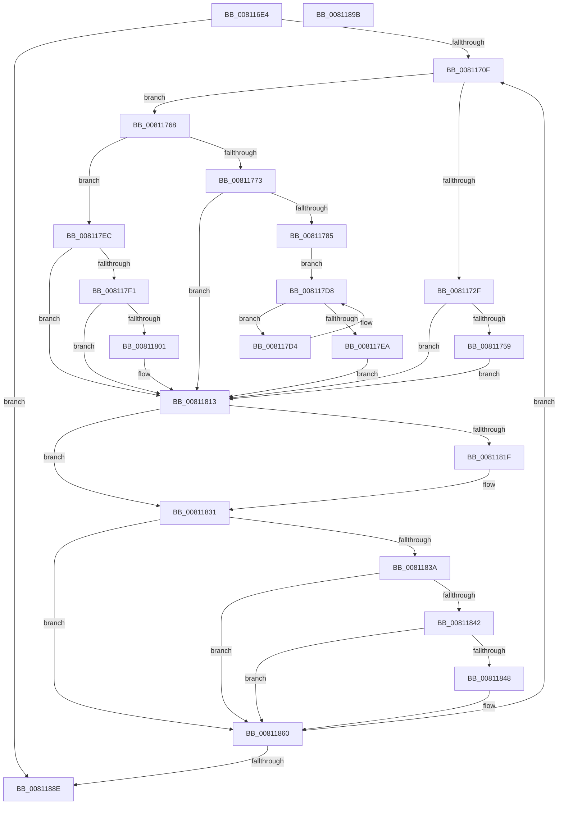

# MiDeletePartialCloneVads

- RVA: `0x008116E4`–`0x0081189C` (길이 `440` bytes)
- VA: `0x00000001408116E4`
- 실행 섹션: `PAGE`
- PDB 이름 있음: `예`; PDB Function 태그: `아니요`
- unwind 정보 RVA: `0x000C7F20`
- 디코드: `121`개 명령, `440/440` bytes 표시
- 미해석 바이트: `0` (있으면 어셈블리에 `.byte`로 보존)

> 이 문서는 커널 이미지의 기계어와 PDB 기호를 분석해 생성했습니다. 4번과 5번은 함수 원형과 자료형을 바이너리 사용 방식에서 추정한 C 해석이며 원본 소스 복구 결과는 아닙니다.

## 1. Dependencies

- 직접 호출 지점: **16**; 고유 호출 대상: **14**
- 직접 호출자로 확인된 함수: **2**
- RIP 상대 이미지 참조: **0**

### Outgoing calls
- `0x0081171E` → [MiFreeVadEventBitmap](../AD/MiFreeVadEventBitmap_function_00ADB6B8.md) (function, `0x00ADB6B8`)
- `0x00811726` → [MiIsVadLargePrivate](../../text/32/MiIsVadLargePrivate_function_0032F720.md) (function, `0x0032F720`)
- `0x00811734` → [MiGetVadWakeList](../../text/43/MiGetVadWakeList_function_00431134.md) (function, `0x00431134`)
- `0x0081174B` → [MiFreeLargePageView](../9B/MiFreeLargePageView_function_009BB3B4.md) (function, `0x009BB3B4`)
- `0x0081175E` → [ExFreePoolWithTag](../../poolcode/B8/ExFreePoolWithTag_function_00B82870.md) (function, `0x00B82870`)
- `0x008117AA` → [MiGetProtoPteAddress](../../text/32/MiGetProtoPteAddress_function_0032E970.md) (function, `0x0032E970`)
- `0x008117C8` → [MiGetProtoPteAddress](../../text/32/MiGetProtoPteAddress_function_0032E970.md) (function, `0x0032E970`)
- `0x008117DE` → [MiDecrementLargeSubsections](../../text/4D/MiDecrementLargeSubsections_function_004D2BE0.md) (function, `0x004D2BE0`)
- `0x00811804` → [PsGetProcessSessionIdEx](../../text/22/PsGetProcessSessionIdEx_function_0022F8F0.md) (function, `0x0022F8F0`)
- `0x0081180E` → [MiDereferencePerSessionProtos](../A2/MiDereferencePerSessionProtos_function_00A2EDE8.md) (function, `0x00A2EDE8`)
- `0x00811816` → [MiVadHasSharedCommit](../97/MiVadHasSharedCommit_function_0097E7F4.md) (function, `0x0097E7F4`)
- `0x0081182C` → [MiRemoveSharedCommitNode](../88/MiRemoveSharedCommitNode_function_008889A0.md) (function, `0x008889A0`)
- `0x00811863` → [MiFreePlaceholderStorage](../AA/MiFreePlaceholderStorage_function_00AAC868.md) (function, `0x00AAC868`)
- `0x0081186B` → [MiFreeVadEvents](../../text/67/MiFreeVadEvents_function_0067E3EC.md) (function, `0x0067E3EC`)
- `0x00811873` → [MiCloneDiscardVadCommit](../AB/MiCloneDiscardVadCommit_function_00AB0CD8.md) (function, `0x00AB0CD8`)
- `0x0081187D` → [ExFreePoolWithTag](../../poolcode/B8/ExFreePoolWithTag_function_00B82870.md) (function, `0x00B82870`)

### Direct callers
- [MiInsertChildVads](../97/MiInsertChildVads_function_0097DBB0.md) at `0x0097DCF4`
- [MiAllocateChildVads](../97/MiAllocateChildVads_function_0097E380.md) at `0x0097E7E4`

### Static image references
- 디코드된 RIP-relative 메모리 참조가 없습니다.

## 2. Other-region calls and transfers

- 다른 실행 섹션으로 향하는 call: **9**
  - `0x00811726` → [MiIsVadLargePrivate](../../text/32/MiIsVadLargePrivate_function_0032F720.md) (`PAGE` → `.text`)
  - `0x00811734` → [MiGetVadWakeList](../../text/43/MiGetVadWakeList_function_00431134.md) (`PAGE` → `.text`)
  - `0x0081175E` → [ExFreePoolWithTag](../../poolcode/B8/ExFreePoolWithTag_function_00B82870.md) (`PAGE` → `POOLCODE`)
  - `0x008117AA` → [MiGetProtoPteAddress](../../text/32/MiGetProtoPteAddress_function_0032E970.md) (`PAGE` → `.text`)
  - `0x008117C8` → [MiGetProtoPteAddress](../../text/32/MiGetProtoPteAddress_function_0032E970.md) (`PAGE` → `.text`)
  - `0x008117DE` → [MiDecrementLargeSubsections](../../text/4D/MiDecrementLargeSubsections_function_004D2BE0.md) (`PAGE` → `.text`)
  - `0x00811804` → [PsGetProcessSessionIdEx](../../text/22/PsGetProcessSessionIdEx_function_0022F8F0.md) (`PAGE` → `.text`)
  - `0x0081186B` → [MiFreeVadEvents](../../text/67/MiFreeVadEvents_function_0067E3EC.md) (`PAGE` → `.text`)
  - `0x0081187D` → [ExFreePoolWithTag](../../poolcode/B8/ExFreePoolWithTag_function_00B82870.md) (`PAGE` → `POOLCODE`)
- 별도 외부 분기/꼬리 이동을 확인하지 못했습니다.

## 3. Assembly (complete function range)

```asm
008116E4  48 89 5C 24 18                  mov qword ptr [rsp + 0x18], rbx
008116E9  55                              push rbp
008116EA  56                              push rsi
008116EB  57                              push rdi
008116EC  48 83 EC 20                     sub rsp, 0x20
008116F0  65 48 8B 04 25 88 01 00 00      mov rax, qword ptr gs:[0x188]
008116F9  48 8B F9                        mov rdi, rcx
008116FC  48 8B D9                        mov rbx, rcx
008116FF  48 8B A8 B8 00 00 00            mov rbp, qword ptr [rax + 0xb8]
00811706  48 85 C9                        test rcx, rcx
00811709  0F 84 7F 01 00 00               je 0x14081188e
0081170F  48 8B 3F                        mov rdi, qword ptr [rdi]
00811712  41 B8 04 00 00 00               mov r8d, 4
00811718  48 8B D3                        mov rdx, rbx
0081171B  48 8B CD                        mov rcx, rbp
0081171E  E8 95 9F 2C 00                  call 0x140adb6b8
00811723  48 8B CB                        mov rcx, rbx
00811726  E8 F5 DF B1 FF                  call 0x14032f720
0081172B  85 C0                           test eax, eax
0081172D  74 39                           je 0x140811768
0081172F  BA 10 00 00 00                  mov edx, 0x10
00811734  E8 FB F9 C1 FF                  call 0x140431134
00811739  41 B9 01 00 00 00               mov r9d, 1
0081173F  4C 8B C0                        mov r8, rax
00811742  48 8B D3                        mov rdx, rbx
00811745  48 8B CD                        mov rcx, rbp
00811748  48 8B F0                        mov rsi, rax
0081174B  E8 64 9C 1A 00                  call 0x1409bb3b4
00811750  48 85 F6                        test rsi, rsi
00811753  0F 84 BA 00 00 00               je 0x140811813
00811759  33 D2                           xor edx, edx
0081175B  48 8B CE                        mov rcx, rsi
0081175E  E8 0D 11 37 00                  call 0x140b82870
00811763  E9 AB 00 00 00                  jmp 0x140811813
00811768  8B 43 30                        mov eax, dword ptr [rbx + 0x30]
0081176B  83 E0 70                        and eax, 0x70
0081176E  83 F8 50                        cmp eax, 0x50
00811771  75 79                           jne 0x1408117ec
00811773  48 8B 43 48                     mov rax, qword ptr [rbx + 0x48]
00811777  48 8B 08                        mov rcx, qword ptr [rax]
0081177A  48 83 79 40 00                  cmp qword ptr [rcx + 0x40], 0
0081177F  0F 84 8E 00 00 00               je 0x140811813
00811785  0F B6 53 20                     movzx edx, byte ptr [rbx + 0x20]
00811789  4C 8D 4C 24 48                  lea r9, [rsp + 0x48]
0081178E  8B 43 18                        mov eax, dword ptr [rbx + 0x18]
00811791  45 33 C0                        xor r8d, r8d
00811794  48 83 64 24 48 00               and qword ptr [rsp + 0x48], 0
0081179A  48 8B CB                        mov rcx, rbx
0081179D  48 83 64 24 40 00               and qword ptr [rsp + 0x40], 0
008117A3  48 C1 E2 20                     shl rdx, 0x20
008117A7  48 0B D0                        or rdx, rax
008117AA  E8 C1 D1 B1 FF                  call 0x14032e970
008117AF  0F B6 53 21                     movzx edx, byte ptr [rbx + 0x21]
008117B3  4C 8D 4C 24 40                  lea r9, [rsp + 0x40]
008117B8  8B 43 1C                        mov eax, dword ptr [rbx + 0x1c]
008117BB  45 33 C0                        xor r8d, r8d
008117BE  48 C1 E2 20                     shl rdx, 0x20
008117C2  48 8B CB                        mov rcx, rbx
008117C5  48 0B D0                        or rdx, rax
008117C8  E8 A3 D1 B1 FF                  call 0x14032e970
008117CD  48 8B 74 24 48                  mov rsi, qword ptr [rsp + 0x48]
008117D2  EB 04                           jmp 0x1408117d8
008117D4  48 8B 76 10                     mov rsi, qword ptr [rsi + 0x10]
008117D8  48 8B D6                        mov rdx, rsi
008117DB  48 8B CE                        mov rcx, rsi
008117DE  E8 FD 13 CC FF                  call 0x1404d2be0
008117E3  48 3B 74 24 40                  cmp rsi, qword ptr [rsp + 0x40]
008117E8  75 EA                           jne 0x1408117d4
008117EA  EB 27                           jmp 0x140811813
008117EC  83 F8 20                        cmp eax, 0x20
008117EF  75 22                           jne 0x140811813
008117F1  48 8B 43 48                     mov rax, qword ptr [rbx + 0x48]
008117F5  48 8B 30                        mov rsi, qword ptr [rax]
008117F8  F7 46 38 00 00 00 08            test dword ptr [rsi + 0x38], 0x8000000
008117FF  74 12                           je 0x140811813
00811801  48 8B CD                        mov rcx, rbp
00811804  E8 E7 E0 A1 FF                  call 0x14022f8f0
00811809  8B D0                           mov edx, eax
0081180B  48 8B CE                        mov rcx, rsi
0081180E  E8 D5 D5 21 00                  call 0x140a2ede8
00811813  48 8B CB                        mov rcx, rbx
00811816  E8 D9 CF 16 00                  call 0x14097e7f4
0081181B  85 C0                           test eax, eax
0081181D  74 12                           je 0x140811831
0081181F  48 8B 4B 48                     mov rcx, qword ptr [rbx + 0x48]
00811823  45 33 C0                        xor r8d, r8d
00811826  48 8B D5                        mov rdx, rbp
00811829  48 8B 09                        mov rcx, qword ptr [rcx]
0081182C  E8 6F 71 07 00                  call 0x1408889a0
00811831  8B 4B 30                        mov ecx, dword ptr [rbx + 0x30]
00811834  0F BA E1 15                     bt ecx, 0x15
00811838  72 26                           jb 0x140811860
0081183A  8B C1                           mov eax, ecx
0081183C  24 70                           and al, 0x70
0081183E  3C 20                           cmp al, 0x20
00811840  75 1E                           jne 0x140811860
00811842  0F BA E1 16                     bt ecx, 0x16
00811846  73 18                           jae 0x140811860
00811848  48 8B 95 10 04 00 00            mov rdx, qword ptr [rbp + 0x410]
0081184F  48 8B 82 40 04 00 00            mov rax, qword ptr [rdx + 0x440]
00811856  48 FF C8                        dec rax
00811859  48 89 82 40 04 00 00            mov qword ptr [rdx + 0x440], rax
00811860  48 8B CB                        mov rcx, rbx
00811863  E8 00 B0 29 00                  call 0x140aac868
00811868  48 8B CB                        mov rcx, rbx
0081186B  E8 7C CB E6 FF                  call 0x14067e3ec
00811870  48 8B CB                        mov rcx, rbx
00811873  E8 60 F4 29 00                  call 0x140ab0cd8
00811878  33 D2                           xor edx, edx
0081187A  48 8B CB                        mov rcx, rbx
0081187D  E8 EE 0F 37 00                  call 0x140b82870
00811882  48 8B DF                        mov rbx, rdi
00811885  48 85 FF                        test rdi, rdi
00811888  0F 85 81 FE FF FF               jne 0x14081170f
0081188E  48 8B 5C 24 50                  mov rbx, qword ptr [rsp + 0x50]
00811893  48 83 C4 20                     add rsp, 0x20
00811897  5F                              pop rdi
00811898  5E                              pop rsi
00811899  5D                              pop rbp
0081189A  C3                              ret
0081189B  CC                              int3
```

## 4. C-style interpretation (structured pseudocode)

```c
__int64 __fastcall MiDeletePartialCloneVads(__int64 a1)
{
    __int64 result;
    __int64 v_rsp;
    unsigned __int64 v_stack_p10;
    unsigned __int64 v_stack_p18;
    unsigned __int64 v_stack_p8;

    v_stack_p18 = v_rbx;
    v_rsp = (v_rsp) - (32);
    if (a1 == 0) goto loc_0081188E;
loc_0081170F:
    result = MiFreeVadEventBitmap(*(unsigned __int64 *)(*(unsigned __int64 *)(gs_base + (0 + 392)) + 184), a1, 4, a4);
    result = MiIsVadLargePrivate(a1, a1, 4, a4);
    if ((unsigned int)(result) == 0) goto loc_00811768;
    result = MiGetVadWakeList(a1, 16, 4, a4);
    result = MiFreeLargePageView(*(unsigned __int64 *)(*(unsigned __int64 *)(gs_base + (0 + 392)) + 184), a1, result, 1);
    if (result == 0) goto loc_00811813;
    a2 = 0;
    result = ExFreePoolWithTag(result, a2, result, 1);
    goto loc_00811813;
loc_00811768:
    result = (unsigned int)(((unsigned int)(*(unsigned int *)(a1 + 48))) & (112));
    if (((unsigned int)(result)) != 80) goto loc_008117EC;
    if ((*(unsigned __int64 *)(*(unsigned __int64 *)(*(unsigned __int64 *)(a1 + 72)) + 64)) == 0) goto loc_00811813;
    a3 = 0;
    a2 = (*(unsigned __int8 *)(a1 + 32)) << (32);
    a2 = (a2) | ((unsigned int)(*(unsigned int *)(a1 + 24)));
    result = MiGetProtoPteAddress(a1, a2, a3, v_stack_p10);
    a3 = 0;
    a2 = (*(unsigned __int8 *)(a1 + 33)) << (32);
    a2 = (a2) | ((unsigned int)(*(unsigned int *)(a1 + 28)));
    result = MiGetProtoPteAddress(a1, a2, a3, v_stack_p8);
    goto loc_008117D8;
loc_008117D4:
loc_008117D8:
    result = MiDecrementLargeSubsections(*(unsigned __int64 *)(v_stack_p10 + 16), *(unsigned __int64 *)(v_stack_p10 + 16), a3, v_stack_p8);
    if ((*(unsigned __int64 *)(v_stack_p10 + 16)) != v_stack_p8) goto loc_008117D4;
    goto loc_00811813;
loc_008117EC:
    if (((unsigned int)(result)) != 32) goto loc_00811813;
    result = *(unsigned __int64 *)(a1 + 72);
    if (((*(unsigned int *)(*(unsigned __int64 *)(*(unsigned __int64 *)(a1 + 72)) + 56)) & (0x8000000ULL)) != 0) {
        a1 = *(unsigned __int64 *)(*(unsigned __int64 *)(gs_base + (0 + 392)) + 184);
        result = PsGetProcessSessionIdEx(a1, *(unsigned __int64 *)(v_stack_p10 + 16), a3, v_stack_p8);
        a2 = (unsigned int)(result);
        a1 = *(unsigned __int64 *)(*(unsigned __int64 *)(a1 + 72));
        result = MiDereferencePerSessionProtos(a1, a2, a3, v_stack_p8);
    }
    result = MiVadHasSharedCommit(a1, a2, a3, v_stack_p8);
    if ((unsigned int)(result) != 0) {
        a1 = *(unsigned __int64 *)(a1 + 72);
        a3 = 0;
        a2 = *(unsigned __int64 *)(*(unsigned __int64 *)(gs_base + (0 + 392)) + 184);
        a1 = *(unsigned __int64 *)(a1);
        result = MiRemoveSharedCommitNode(a1, a2, a3, v_stack_p8);
    }
    if (condition_is_below) goto loc_00811860;
    result = (unsigned __int8)(((unsigned int)((unsigned int)((unsigned int)(*(unsigned int *)(a1 + 48))))) & (112));
    if (((unsigned __int8)(result)) != 32) goto loc_00811860;
    if (((unsigned __int8)(result)) < 32) {
        a2 = *(unsigned __int64 *)(*(unsigned __int64 *)(*(unsigned __int64 *)(gs_base + (0 + 392)) + 184) + 1040);
        result = *(unsigned __int64 *)(a2 + 1088);
        result = (result) - 1;
        *(unsigned __int64 *)(a2 + 1088) = result;
    }
    result = MiFreePlaceholderStorage(a1, a2, a3, v_stack_p8);
    result = MiFreeVadEvents(a1, a2, a3, v_stack_p8);
    result = MiCloneDiscardVadCommit(a1, a2, a3, v_stack_p8);
    a2 = 0;
    result = ExFreePoolWithTag(a1, a2, a3, v_stack_p8);
    if (*(unsigned __int64 *)(a1) != 0) goto loc_0081170F;
loc_0081188E:
    v_rsp = (v_rsp) + (32);
    return result;
}
```

## 5. (Beta) C Style

```c
int64_t MiDeletePartialCloneVads(int64_t Arg1)
{
    int64_t result;
    int64_t local_rsp;
    uint64_t v_stack_p10;
    uint64_t v_stack_p18;
    uint64_t v_stack_p8;

    v_stack_p18 = local_rbx;
    local_rsp = (local_rsp) - (32);
    if (Arg1 == 0) goto loc_0081188E;
loc_0081170F:
    result = MiFreeVadEventBitmap(*(uint64_t *)(*(uint64_t *)(gs_base + (0 + 0x188)) + 0xB8), Arg1, 4, a4);
    result = MiIsVadLargePrivate(Arg1, Arg1, 4, a4);
    if ((uint32_t)(result) == 0) goto loc_00811768;
    result = MiGetVadWakeList(Arg1, 16, 4, a4);
    result = MiFreeLargePageView(*(uint64_t *)(*(uint64_t *)(gs_base + (0 + 0x188)) + 0xB8), Arg1, result, 1);
    if (result == 0) goto loc_00811813;
    a2 = 0;
    result = ExFreePoolWithTag(result, a2, result, 1);
    goto loc_00811813;
loc_00811768:
    result = (uint32_t)(((uint32_t)(*(uint32_t *)(Arg1 + 0x30))) & (112));
    if (((uint32_t)(result)) != 80) goto loc_008117EC;
    if ((*(uint64_t *)(*(uint64_t *)(*(uint64_t *)(Arg1 + 0x48)) + 0x40)) == 0) goto loc_00811813;
    a3 = 0;
    a2 = (*(uint8_t *)(Arg1 + 0x20)) << (32);
    a2 = (a2) | ((uint32_t)(*(uint32_t *)(Arg1 + 0x18)));
    result = MiGetProtoPteAddress(Arg1, a2, a3, v_stack_p10);
    a3 = 0;
    a2 = (*(uint8_t *)(Arg1 + 0x21)) << (32);
    a2 = (a2) | ((uint32_t)(*(uint32_t *)(Arg1 + 0x1C)));
    result = MiGetProtoPteAddress(Arg1, a2, a3, v_stack_p8);
    goto loc_008117D8;
loc_008117D4:
loc_008117D8:
    result = MiDecrementLargeSubsections(*(uint64_t *)(v_stack_p10 + 0x10), *(uint64_t *)(v_stack_p10 + 0x10), a3, v_stack_p8);
    if ((*(uint64_t *)(v_stack_p10 + 0x10)) != v_stack_p8) goto loc_008117D4;
    goto loc_00811813;
loc_008117EC:
    if (((uint32_t)(result)) != 32) goto loc_00811813;
    result = *(uint64_t *)(Arg1 + 0x48);
    if (((*(uint32_t *)(*(uint64_t *)(*(uint64_t *)(Arg1 + 0x48)) + 0x38)) & (0x8000000ULL)) != 0) {
        Arg1 = *(uint64_t *)(*(uint64_t *)(gs_base + (0 + 0x188)) + 0xB8);
        result = PsGetProcessSessionIdEx(Arg1, *(uint64_t *)(v_stack_p10 + 0x10), a3, v_stack_p8);
        a2 = (uint32_t)(result);
        Arg1 = *(uint64_t *)(*(uint64_t *)(Arg1 + 0x48));
        result = MiDereferencePerSessionProtos(Arg1, a2, a3, v_stack_p8);
    }
    result = MiVadHasSharedCommit(Arg1, a2, a3, v_stack_p8);
    if ((uint32_t)(result) != 0) {
        Arg1 = *(uint64_t *)(Arg1 + 0x48);
        a3 = 0;
        a2 = *(uint64_t *)(*(uint64_t *)(gs_base + (0 + 0x188)) + 0xB8);
        Arg1 = *(uint64_t *)(Arg1);
        result = MiRemoveSharedCommitNode(Arg1, a2, a3, v_stack_p8);
    }
    if (condition_is_below) goto loc_00811860;
    result = (uint8_t)(((uint32_t)((uint32_t)((uint32_t)(*(uint32_t *)(Arg1 + 0x30))))) & (112));
    if (((uint8_t)(result)) != 32) goto loc_00811860;
    if (((uint8_t)(result)) < 32) {
        a2 = *(uint64_t *)(*(uint64_t *)(*(uint64_t *)(gs_base + (0 + 0x188)) + 0xB8) + 0x410);
        result = *(uint64_t *)(a2 + 0x440);
        result = (result) - 1;
        *(uint64_t *)(a2 + 0x440) = result;
    }
    result = MiFreePlaceholderStorage(Arg1, a2, a3, v_stack_p8);
    result = MiFreeVadEvents(Arg1, a2, a3, v_stack_p8);
    result = MiCloneDiscardVadCommit(Arg1, a2, a3, v_stack_p8);
    a2 = 0;
    result = ExFreePoolWithTag(Arg1, a2, a3, v_stack_p8);
    if (*(uint64_t *)(Arg1) != 0) goto loc_0081170F;
loc_0081188E:
    local_rsp = (local_rsp) + (32);
    return result;
}
```

## 6. Execution-region graph

[열기: 2D/3D 그래프와 함수 탐색 컨트롤 패널](../../../control-panel.html?section=page&rva=0x008116E4&view=graph)

- 2D 그래프는 위에서 아래로 흐르고, 3D 그래프는 빈 공간을 드래그해 회전합니다. Shift+드래그는 이동, 휠은 확대·축소, 함수 노드 선택은 대상 보고서 이동입니다.

### Static fallback


