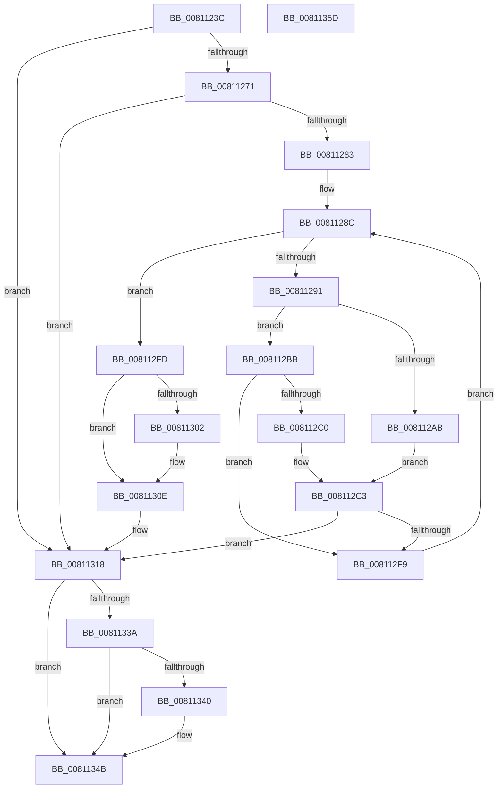

# MiInitializeMemoryEvents

- RVA: `0x0081123C`–`0x0081135E` (길이 `290` bytes)
- VA: `0x000000014081123C`
- 실행 섹션: `PAGE`
- PDB 이름 있음: `예`; PDB Function 태그: `아니요`
- unwind 정보 RVA: `0x000D9574`
- 디코드: `91`개 명령, `290/290` bytes 표시
- 미해석 바이트: `0` (있으면 어셈블리에 `.byte`로 보존)

> 이 문서는 커널 이미지의 기계어와 PDB 기호를 분석해 생성했습니다. 4번과 5번은 함수 원형과 자료형을 바이너리 사용 방식에서 추정한 C 해석이며 원본 소스 복구 결과는 아닙니다.

## 1. Dependencies

- 직접 호출 지점: **8**; 고유 호출 대상: **8**
- 직접 호출자로 확인된 함수: **2**
- RIP 상대 이미지 참조: **2**

### Outgoing calls
- `0x00811262` → [MiCreateMemoryEventSD](MiCreateMemoryEventSD_function_00810F40.md) (function, `0x00810F40`)
- `0x00811274` → [MiCreatePartitionNamespace](MiCreatePartitionNamespace_function_00811118.md) (function, `0x00811118`)
- `0x008112EE` → [MiCreateMemoryEvent](MiCreateMemoryEvent_function_00810D98.md) (function, `0x00810D98`)
- `0x00811302` → [MiInitializePagedPoolEvents](../../init/C6/MiInitializePagedPoolEvents_function_00C64C44.md) (function, `0x00C64C44`)
- `0x00811309` → [MiSignalNonPagedPoolWatchers](../../text/67/MiSignalNonPagedPoolWatchers_function_0067CAC8.md) (function, `0x0067CAC8`)
- `0x00811311` → [MiUpdateAvailableEvents](../../text/68/MiUpdateAvailableEvents_function_0068BF94.md) (function, `0x0068BF94`)
- `0x00811331` → [RtlGetDaclSecurityDescriptor](../../text/45/RtlGetDaclSecurityDescriptor_function_00459570.md) (function, `0x00459570`)
- `0x00811346` → [ExFreePoolWithTag](../../poolcode/B8/ExFreePoolWithTag_function_00B82870.md) (function, `0x00B82870`)

### Direct callers
- [MmCreatePartition](../80/MmCreatePartition_function_0080DC3C.md) at `0x0080DCEC`
- [MiInitSystem](../../init/C5/MiInitSystem_function_00C5E6C0.md) at `0x00C5EBA8`

### Static image references
- `0x00811285` → RVA `0x00E38D00` (`.data`; read)
- `0x00811293` → RVA `0x00003030` (`.rdata`; read)

## 2. Other-region calls and transfers

- 다른 실행 섹션으로 향하는 call: **5**
  - `0x00811302` → [MiInitializePagedPoolEvents](../../init/C6/MiInitializePagedPoolEvents_function_00C64C44.md) (`PAGE` → `INIT`)
  - `0x00811309` → [MiSignalNonPagedPoolWatchers](../../text/67/MiSignalNonPagedPoolWatchers_function_0067CAC8.md) (`PAGE` → `.text`)
  - `0x00811311` → [MiUpdateAvailableEvents](../../text/68/MiUpdateAvailableEvents_function_0068BF94.md) (`PAGE` → `.text`)
  - `0x00811331` → [RtlGetDaclSecurityDescriptor](../../text/45/RtlGetDaclSecurityDescriptor_function_00459570.md) (`PAGE` → `.text`)
  - `0x00811346` → [ExFreePoolWithTag](../../poolcode/B8/ExFreePoolWithTag_function_00B82870.md) (`PAGE` → `POOLCODE`)
- 별도 외부 분기/꼬리 이동을 확인하지 못했습니다.

## 3. Assembly (complete function range)

```asm
0081123C  40 55                           push rbp
0081123E  53                              push rbx
0081123F  56                              push rsi
00811240  57                              push rdi
00811241  41 57                           push r15
00811243  48 8B EC                        mov rbp, rsp
00811246  48 83 EC 70                     sub rsp, 0x70
0081124A  0F 57 C0                        xorps xmm0, xmm0
0081124D  48 8B F9                        mov rdi, rcx
00811250  33 C0                           xor eax, eax
00811252  48 8D 4D D0                     lea rcx, [rbp - 0x30]
00811256  0F 11 45 D0                     movups xmmword ptr [rbp - 0x30], xmm0
0081125A  48 89 45 F0                     mov qword ptr [rbp - 0x10], rax
0081125E  0F 11 45 E0                     movups xmmword ptr [rbp - 0x20], xmm0
00811262  E8 D9 FC FF FF                  call 0x140810f40
00811267  8B D8                           mov ebx, eax
00811269  85 C0                           test eax, eax
0081126B  0F 88 A7 00 00 00               js 0x140811318
00811271  48 8B CF                        mov rcx, rdi
00811274  E8 9F FE FF FF                  call 0x140811118
00811279  8B D8                           mov ebx, eax
0081127B  85 C0                           test eax, eax
0081127D  0F 88 95 00 00 00               js 0x140811318
00811283  33 F6                           xor esi, esi
00811285  4C 8D 3D 74 7A 62 00            lea r15, [rip + 0x627a74]
0081128C  83 FE 0B                        cmp esi, 0xb
0081128F  73 6C                           jae 0x1408112fd
00811291  8B CE                           mov ecx, esi
00811293  48 8D 05 96 1D 7F FF            lea rax, [rip - 0x80e26a]
0081129A  48 C1 E1 04                     shl rcx, 4
0081129E  45 33 C0                        xor r8d, r8d
008112A1  48 03 C8                        add rcx, rax
008112A4  8B D6                           mov edx, esi
008112A6  83 FE 04                        cmp esi, 4
008112A9  72 10                           jb 0x1408112bb
008112AB  4C 8B 97 E8 00 00 00            mov r10, qword ptr [rdi + 0xe8]
008112B2  49 3B FF                        cmp rdi, r15
008112B5  41 0F 94 C0                     sete r8b
008112B9  EB 08                           jmp 0x1408112c3
008112BB  49 3B FF                        cmp rdi, r15
008112BE  75 39                           jne 0x1408112f9
008112C0  45 33 D2                        xor r10d, r10d
008112C3  48 83 C2 1F                     add rdx, 0x1f
008112C7  48 8D 87 50 01 00 00            lea rax, [rdi + 0x150]
008112CE  48 8D 04 F0                     lea rax, [rax + rsi*8]
008112D2  48 89 44 24 30                  mov qword ptr [rsp + 0x30], rax
008112D7  4C 8D 4D D0                     lea r9, [rbp - 0x30]
008112DB  48 8D 14 D7                     lea rdx, [rdi + rdx*8]
008112DF  48 89 54 24 28                  mov qword ptr [rsp + 0x28], rdx
008112E4  8B D6                           mov edx, esi
008112E6  44 89 44 24 20                  mov dword ptr [rsp + 0x20], r8d
008112EB  4D 8B C2                        mov r8, r10
008112EE  E8 A5 FA FF FF                  call 0x140810d98
008112F3  8B D8                           mov ebx, eax
008112F5  85 C0                           test eax, eax
008112F7  78 1F                           js 0x140811318
008112F9  FF C6                           inc esi
008112FB  EB 8F                           jmp 0x14081128c
008112FD  49 3B FF                        cmp rdi, r15
00811300  75 0C                           jne 0x14081130e
00811302  E8 3D 39 45 00                  call 0x140c64c44
00811307  33 C9                           xor ecx, ecx
00811309  E8 BA B7 E6 FF                  call 0x14067cac8
0081130E  48 8B CF                        mov rcx, rdi
00811311  E8 7E AC E7 FF                  call 0x14068bf94
00811316  33 DB                           xor ebx, ebx
00811318  48 83 65 48 00                  and qword ptr [rbp + 0x48], 0
0081131D  4C 8D 4D 40                     lea r9, [rbp + 0x40]
00811321  4C 8D 45 48                     lea r8, [rbp + 0x48]
00811325  C6 45 38 00                     mov byte ptr [rbp + 0x38], 0
00811329  48 8D 55 38                     lea rdx, [rbp + 0x38]
0081132D  48 8D 4D D0                     lea rcx, [rbp - 0x30]
00811331  E8 3A 82 C4 FF                  call 0x140459570
00811336  85 C0                           test eax, eax
00811338  78 11                           js 0x14081134b
0081133A  80 7D 38 00                     cmp byte ptr [rbp + 0x38], 0
0081133E  74 0B                           je 0x14081134b
00811340  48 8B 4D 48                     mov rcx, qword ptr [rbp + 0x48]
00811344  33 D2                           xor edx, edx
00811346  E8 25 15 37 00                  call 0x140b82870
0081134B  F7 D3                           not ebx
0081134D  C1 EB 1F                        shr ebx, 0x1f
00811350  8B C3                           mov eax, ebx
00811352  48 83 C4 70                     add rsp, 0x70
00811356  41 5F                           pop r15
00811358  5F                              pop rdi
00811359  5E                              pop rsi
0081135A  5B                              pop rbx
0081135B  5D                              pop rbp
0081135C  C3                              ret
0081135D  CC                              int3
```

## 4. C-style interpretation (structured pseudocode)

```c
__int64 __fastcall MiInitializeMemoryEvents(__int64 a1, __int64 a2, int a3)
{
    __int64 result;
    __int64 v_r10;
    __int64 v_rbx;
    __int64 v_rsi;
    __int64 v_rsp;
    unsigned __int64 v_stack_m38;
    unsigned __int64 v_stack_m48;
    unsigned __int64 v_stack_m58;
    unsigned __int64 v_stack_m68;
    unsigned __int64 v_stack_m70;
    unsigned int v_stack_m78;
    unsigned __int8 v_stack_p10;
    unsigned __int64 v_stack_p18;
    unsigned __int64 v_stack_p20;

    v_rsp = (v_rsp) - (112);
    result = 0;
    v_stack_m58 = v_xmm0;
    v_stack_m38 = 0;
    v_stack_m48 = v_xmm0;
    result = MiCreateMemoryEventSD(v_stack_m58, a2, a3, a4);
    if (sign_flag) goto loc_00811318;
    result = MiCreatePartitionNamespace(a1, a2, a3, a4);
    if (sign_flag) goto loc_00811318;
    v_rsi = 0;
loc_0081128C:
    if (0 >= 11) goto loc_008112FD;
    a1 = (0) << (4);
    a3 = 0;
    a1 = (a1) + (v_rip - 8446570);
    if (0 < 4) goto loc_008112BB;
    a3 = (a1 == (v_rip + 6453876)) ? 1 : 0;
    goto loc_008112C3;
loc_008112BB:
    if (a1 != (v_rip + 6453876)) goto loc_008112F9;
    v_r10 = 0;
loc_008112C3:
    a2 = (0) + (31);
    v_stack_m68 = a1 + 336 + v_rsi * 8;
    v_stack_m70 = a1 + a2 * 8;
    v_stack_m78 = a3;
    result = MiCreateMemoryEvent(a1, 0, 0, v_stack_m58);
    if (sign_flag) goto loc_00811318;
loc_008112F9:
    v_rsi = (unsigned int)((v_rsi) + 1);
    goto loc_0081128C;
loc_008112FD:
    if (a1 == (v_rip + 6453876)) {
        result = MiInitializePagedPoolEvents(a1, 0, 0, v_stack_m58);
        a1 = 0;
        result = MiSignalNonPagedPoolWatchers(a1, 0, 0, v_stack_m58);
    }
    result = MiUpdateAvailableEvents(0, 0, 0, v_stack_m58);
    v_rbx = 0;
loc_00811318:
    v_stack_p10 = 0;
    result = RtlGetDaclSecurityDescriptor(v_stack_m58, v_stack_p10, v_stack_p20, v_stack_p18);
    if (sign_flag) goto loc_0081134B;
    if (v_stack_p10 != 0) {
        a1 = v_stack_p20;
        a2 = 0;
        result = ExFreePoolWithTag(a1, a2, v_stack_p20, v_stack_p18);
    }
    v_rbx = (unsigned int)(~(v_rbx));
    v_rbx = (unsigned int)((v_rbx) >> (31));
    v_rsp = (v_rsp) + (112);
    return (unsigned int)((unsigned int)(v_rbx));
}
```

## 5. (Beta) C Style

```c
int64_t MiInitializeMemoryEvents(int64_t Arg1, int64_t Arg2, int32_t Arg3)
{
    int64_t result;
    int64_t local_r10;
    int64_t local_rbx;
    int64_t local_rsi;
    int64_t local_rsp;
    uint64_t v_stack_m38;
    uint64_t v_stack_m48;
    uint64_t v_stack_m58;
    uint64_t v_stack_m68;
    uint64_t v_stack_m70;
    uint32_t v_stack_m78;
    uint8_t v_stack_p10;
    uint64_t v_stack_p18;
    uint64_t v_stack_p20;

    local_rsp = (local_rsp) - (112);
    result = 0;
    v_stack_m58 = v_xmm0;
    v_stack_m38 = 0;
    v_stack_m48 = v_xmm0;
    result = MiCreateMemoryEventSD(v_stack_m58, Arg2, Arg3, a4);
    if (sign_flag) goto loc_00811318;
    result = MiCreatePartitionNamespace(Arg1, Arg2, Arg3, a4);
    if (sign_flag) goto loc_00811318;
    local_rsi = 0;
loc_0081128C:
    if (0 >= 11) goto loc_008112FD;
    Arg1 = (0) << (4);
    Arg3 = 0;
    Arg1 = (Arg1) + (v_rip - 8446570);
    if (0 < 4) goto loc_008112BB;
    Arg3 = (Arg1 == (v_rip + 6453876)) ? 1 : 0;
    goto loc_008112C3;
loc_008112BB:
    if (Arg1 != (v_rip + 6453876)) goto loc_008112F9;
    local_r10 = 0;
loc_008112C3:
    Arg2 = (0) + (31);
    v_stack_m68 = Arg1 + 336 + local_rsi * 8;
    v_stack_m70 = Arg1 + Arg2 * 8;
    v_stack_m78 = Arg3;
    result = MiCreateMemoryEvent(Arg1, 0, 0, v_stack_m58);
    if (sign_flag) goto loc_00811318;
loc_008112F9:
    local_rsi = (uint32_t)((local_rsi) + 1);
    goto loc_0081128C;
loc_008112FD:
    if (Arg1 == (v_rip + 6453876)) {
        result = MiInitializePagedPoolEvents(Arg1, 0, 0, v_stack_m58);
        Arg1 = 0;
        result = MiSignalNonPagedPoolWatchers(Arg1, 0, 0, v_stack_m58);
    }
    result = MiUpdateAvailableEvents(0, 0, 0, v_stack_m58);
    local_rbx = 0;
loc_00811318:
    v_stack_p10 = 0;
    result = RtlGetDaclSecurityDescriptor(v_stack_m58, v_stack_p10, v_stack_p20, v_stack_p18);
    if (sign_flag) goto loc_0081134B;
    if (v_stack_p10 != 0) {
        Arg1 = v_stack_p20;
        Arg2 = 0;
        result = ExFreePoolWithTag(Arg1, Arg2, v_stack_p20, v_stack_p18);
    }
    local_rbx = (uint32_t)(~(local_rbx));
    local_rbx = (uint32_t)((local_rbx) >> (31));
    local_rsp = (local_rsp) + (112);
    return (uint32_t)((uint32_t)(local_rbx));
}
```

## 6. Execution-region graph

[열기: 2D/3D 그래프와 함수 탐색 컨트롤 패널](../../../control-panel.html?section=page&rva=0x0081123C&view=graph)

- 2D 그래프는 위에서 아래로 흐르고, 3D 그래프는 빈 공간을 드래그해 회전합니다. Shift+드래그는 이동, 휠은 확대·축소, 함수 노드 선택은 대상 보고서 이동입니다.

### Static fallback


