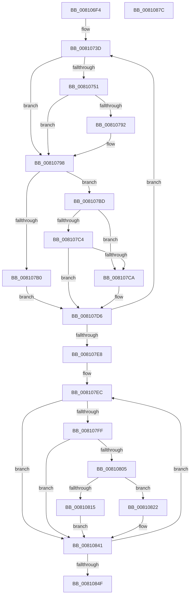

# MiInitializeZeroEngines

- RVA: `0x008106F4`–`0x0081087D` (길이 `393` bytes)
- VA: `0x00000001408106F4`
- 실행 섹션: `PAGE`
- PDB 이름 있음: `예`; PDB Function 태그: `아니요`
- unwind 정보 RVA: `0x000D9464`
- 디코드: `106`개 명령, `393/393` bytes 표시
- 미해석 바이트: `0` (있으면 어셈블리에 `.byte`로 보존)

> 이 문서는 커널 이미지의 기계어와 PDB 기호를 분석해 생성했습니다. 4번과 5번은 함수 원형과 자료형을 바이너리 사용 방식에서 추정한 C 해석이며 원본 소스 복구 결과는 아닙니다.

## 1. Dependencies

- 직접 호출 지점: **7**; 고유 호출 대상: **7**
- 직접 호출자로 확인된 함수: **1**
- RIP 상대 이미지 참조: **1**

### Outgoing calls
- `0x0081072B` → [memset](../../text/6C/memset_function_006C6C40.md) (function, `0x006C6C40`)
- `0x008107A4` → [MiAbsorbPossibleEngineChanges](../../text/69/MiAbsorbPossibleEngineChanges_function_006958B4.md) (function, `0x006958B4`)
- `0x0081080C` → [MiZeroPageCalibrate](../../text/69/MiZeroPageCalibrate_function_0069A69C.md) (function, `0x0069A69C`)
- `0x00810825` → [MiComputeCacheAttributeSpeeds](../../text/69/MiComputeCacheAttributeSpeeds_function_006999E8.md) (function, `0x006999E8`)
- `0x00810832` → [MiGetOptimalProcessorWriteCount](../../text/4B/MiGetOptimalProcessorWriteCount_function_004BF380.md) (function, `0x004BF380`)
- `0x0081083C` → [MiZeroEngineSetOptimalCount](../../text/69/MiZeroEngineSetOptimalCount_function_0069682C.md) (function, `0x0069682C`)
- `0x0081085A` → [_security_check_cookie](../../text/6A/_security_check_cookie_function_006AC640.md) (function, `0x006AC640`)

### Direct callers
- [MiNodeZeroConductor](MiNodeZeroConductor_function_00810AC0.md) at `0x00810BA0`

### Static image references
- `0x0081070F` → RVA `0x00E0A740` (`.data`; read)

## 2. Other-region calls and transfers

- 다른 실행 섹션으로 향하는 call: **7**
  - `0x0081072B` → [memset](../../text/6C/memset_function_006C6C40.md) (`PAGE` → `.text`)
  - `0x008107A4` → [MiAbsorbPossibleEngineChanges](../../text/69/MiAbsorbPossibleEngineChanges_function_006958B4.md) (`PAGE` → `.text`)
  - `0x0081080C` → [MiZeroPageCalibrate](../../text/69/MiZeroPageCalibrate_function_0069A69C.md) (`PAGE` → `.text`)
  - `0x00810825` → [MiComputeCacheAttributeSpeeds](../../text/69/MiComputeCacheAttributeSpeeds_function_006999E8.md) (`PAGE` → `.text`)
  - `0x00810832` → [MiGetOptimalProcessorWriteCount](../../text/4B/MiGetOptimalProcessorWriteCount_function_004BF380.md) (`PAGE` → `.text`)
  - `0x0081083C` → [MiZeroEngineSetOptimalCount](../../text/69/MiZeroEngineSetOptimalCount_function_0069682C.md) (`PAGE` → `.text`)
  - `0x0081085A` → [_security_check_cookie](../../text/6A/_security_check_cookie_function_006AC640.md) (`PAGE` → `.text`)
- 별도 외부 분기/꼬리 이동을 확인하지 못했습니다.

## 3. Assembly (complete function range)

```asm
008106F4  4C 8B DC                        mov r11, rsp
008106F7  49 89 5B 10                     mov qword ptr [r11 + 0x10], rbx
008106FB  49 89 6B 18                     mov qword ptr [r11 + 0x18], rbp
008106FF  49 89 73 20                     mov qword ptr [r11 + 0x20], rsi
00810703  57                              push rdi
00810704  41 56                           push r14
00810706  41 57                           push r15
00810708  48 81 EC 80 00 00 00            sub rsp, 0x80
0081070F  48 8B 05 2A A0 5F 00            mov rax, qword ptr [rip + 0x5fa02a]
00810716  48 33 C4                        xor rax, rsp
00810719  48 89 44 24 70                  mov qword ptr [rsp + 0x70], rax
0081071E  33 D2                           xor edx, edx
00810720  48 8B E9                        mov rbp, rcx
00810723  49 8D 4B 88                     lea rcx, [r11 - 0x78]
00810727  44 8D 42 50                     lea r8d, [rdx + 0x50]
0081072B  E8 10 65 EB FF                  call 0x1406c6c40
00810730  45 33 FF                        xor r15d, r15d
00810733  33 FF                           xor edi, edi
00810735  33 F6                           xor esi, esi
00810737  41 BE 01 00 00 00               mov r14d, 1
0081073D  48 8D 9D 88 00 00 00            lea rbx, [rbp + 0x88]
00810744  48 03 DE                        add rbx, rsi
00810747  48 83 BB B0 00 00 00 00         cmp qword ptr [rbx + 0xb0], 0
0081074F  75 47                           jne 0x140810798
00810751  48 89 AB B0 00 00 00            mov qword ptr [rbx + 0xb0], rbp
00810758  89 3B                           mov dword ptr [rbx], edi
0081075A  8B 45 38                        mov eax, dword ptr [rbp + 0x38]
0081075D  48 69 C8 80 DF 00 00            imul rcx, rax, 0xdf80
00810764  48 8B 45 30                     mov rax, qword ptr [rbp + 0x30]
00810768  48 03 48 10                     add rcx, qword ptr [rax + 0x10]
0081076C  48 8D 83 C0 00 00 00            lea rax, [rbx + 0xc0]
00810773  48 89 8B D0 00 00 00            mov qword ptr [rbx + 0xd0], rcx
0081077A  48 89 40 08                     mov qword ptr [rax + 8], rax
0081077E  48 89 00                        mov qword ptr [rax], rax
00810781  48 8D 43 78                     lea rax, [rbx + 0x78]
00810785  48 89 40 08                     mov qword ptr [rax + 8], rax
00810789  48 89 00                        mov qword ptr [rax], rax
0081078C  80 7D 50 00                     cmp byte ptr [rbp + 0x50], 0
00810790  74 06                           je 0x140810798
00810792  66 C7 43 1D 01 01               mov word ptr [rbx + 0x1d], 0x101
00810798  48 8D 54 24 20                  lea rdx, [rsp + 0x20]
0081079D  C6 43 20 00                     mov byte ptr [rbx + 0x20], 0
008107A1  48 8B CB                        mov rcx, rbx
008107A4  E8 0B 51 E8 FF                  call 0x1406958b4
008107A9  80 7C 24 21 00                  cmp byte ptr [rsp + 0x21], 0
008107AE  75 0D                           jne 0x1408107bd
008107B0  C6 43 20 01                     mov byte ptr [rbx + 0x20], 1
008107B4  45 33 F6                        xor r14d, r14d
008107B7  C6 43 23 01                     mov byte ptr [rbx + 0x23], 1
008107BB  EB 19                           jmp 0x1408107d6
008107BD  80 7C 24 20 00                  cmp byte ptr [rsp + 0x20], 0
008107C2  75 06                           jne 0x1408107ca
008107C4  80 7B 21 00                     cmp byte ptr [rbx + 0x21], 0
008107C8  74 0C                           je 0x1408107d6
008107CA  8B CF                           mov ecx, edi
008107CC  B8 01 00 00 00                  mov eax, 1
008107D1  D3 E0                           shl eax, cl
008107D3  44 0B F8                        or r15d, eax
008107D6  FF C7                           inc edi
008107D8  48 81 C6 30 01 00 00            add rsi, 0x130
008107DF  83 FF 03                        cmp edi, 3
008107E2  0F 8C 55 FF FF FF               jl 0x14081073d
008107E8  33 FF                           xor edi, edi
008107EA  33 F6                           xor esi, esi
008107EC  48 8D 9D 88 00 00 00            lea rbx, [rbp + 0x88]
008107F3  48 03 DE                        add rbx, rsi
008107F6  83 BB AC 00 00 00 00            cmp dword ptr [rbx + 0xac], 0
008107FD  74 42                           je 0x140810841
008107FF  41 0F A3 FF                     bt r15d, edi
00810803  73 3C                           jae 0x140810841
00810805  48 8B CB                        mov rcx, rbx
00810808  C6 43 21 00                     mov byte ptr [rbx + 0x21], 0
0081080C  E8 8B 9E E8 FF                  call 0x14069a69c
00810811  85 C0                           test eax, eax
00810813  75 0D                           jne 0x140810822
00810815  C6 43 21 01                     mov byte ptr [rbx + 0x21], 1
00810819  45 33 F6                        xor r14d, r14d
0081081C  C6 43 23 01                     mov byte ptr [rbx + 0x23], 1
00810820  EB 1F                           jmp 0x140810841
00810822  48 8B CB                        mov rcx, rbx
00810825  E8 BE 91 E8 FF                  call 0x1406999e8
0081082A  8B 4D 38                        mov ecx, dword ptr [rbp + 0x38]
0081082D  45 33 C9                        xor r9d, r9d
00810830  8B D7                           mov edx, edi
00810832  E8 49 EB CA FF                  call 0x1404bf380
00810837  8B D0                           mov edx, eax
00810839  48 8B CB                        mov rcx, rbx
0081083C  E8 EB 5F E8 FF                  call 0x14069682c
00810841  FF C7                           inc edi
00810843  48 81 C6 30 01 00 00            add rsi, 0x130
0081084A  83 FF 03                        cmp edi, 3
0081084D  7C 9D                           jl 0x1408107ec
0081084F  41 8B C6                        mov eax, r14d
00810852  48 8B 4C 24 70                  mov rcx, qword ptr [rsp + 0x70]
00810857  48 33 CC                        xor rcx, rsp
0081085A  E8 E1 BD E9 FF                  call 0x1406ac640
0081085F  4C 8D 9C 24 80 00 00 00         lea r11, [rsp + 0x80]
00810867  49 8B 5B 28                     mov rbx, qword ptr [r11 + 0x28]
0081086B  49 8B 6B 30                     mov rbp, qword ptr [r11 + 0x30]
0081086F  49 8B 73 38                     mov rsi, qword ptr [r11 + 0x38]
00810873  49 8B E3                        mov rsp, r11
00810876  41 5F                           pop r15
00810878  41 5E                           pop r14
0081087A  5F                              pop rdi
0081087B  C3                              ret
0081087C  CC                              int3
```

## 4. C-style interpretation (structured pseudocode)

```c
__int64 __fastcall MiInitializeZeroEngines(__int64 a1, int a2, __int64 a3, int a4)
{
    __int64 result;
    __int64 v_r14;
    __int64 v_r15;
    __int64 v_rbx;
    __int64 v_rdi;
    __int64 v_rsi;
    __int64 v_rsp;
    unsigned __int64 v_stack_m18;
    unsigned __int64 v_stack_m28;
    unsigned __int8 v_stack_m77;
    unsigned __int64 v_stack_m78;

    *(unsigned __int64 *)(v_rsp + 16) = v_rbx;
    *(unsigned __int64 *)(v_rsp + 24) = v_rbp;
    *(unsigned __int64 *)(v_rsp + 32) = v_rsi;
    v_rsp = (v_rsp) - (128);
    result = (*(unsigned __int64 *)(v_rip + 6266922)) ^ (v_rsp);
    v_stack_m28 = result;
    a2 = 0;
    result = memset(v_rsp - 120, a2, a2 + 80, a4);
    v_r15 = 0;
    v_rdi = 0;
    v_rsi = 0;
loc_0081073D:
    v_rbx = (a1 + 136) + (0);
    if ((*(unsigned __int64 *)(v_rbx + 176)) != 0) goto loc_00810798;
    *(unsigned __int64 *)(v_rbx + 176) = a1;
    *(unsigned int *)(v_rbx) = 0;
    a1 = (v_rsp - 120) * ((unsigned int)(*(unsigned int *)(a1 + 56)));
    a1 = (a1) + (*(unsigned __int64 *)(*(unsigned __int64 *)(a1 + 48) + 16));
    *(unsigned __int64 *)(v_rbx + 208) = a1;
    *(unsigned __int64 *)(v_rbx + 192 + 8) = v_rbx + 192;
    *(unsigned __int64 *)(v_rbx + 192) = v_rbx + 192;
    *(unsigned __int64 *)(v_rbx + 120 + 8) = v_rbx + 120;
    *(unsigned __int64 *)(v_rbx + 120) = v_rbx + 120;
    if ((*(unsigned __int8 *)(a1 + 80)) != 0) {
        *(unsigned __int16 *)(v_rbx + 29) = 257;
    }
    *(unsigned __int8 *)(v_rbx + 32) = 0;
    result = MiAbsorbPossibleEngineChanges(v_rbx, v_stack_m78, a2 + 80, a4);
    if (v_stack_m77 != 0) goto loc_008107BD;
    *(unsigned __int8 *)(v_rbx + 32) = 1;
    v_r14 = 0;
    *(unsigned __int8 *)(v_rbx + 35) = 1;
    goto loc_008107D6;
loc_008107BD:
    if (v_stack_m78 != 0) goto loc_008107CA;
    if ((*(unsigned __int8 *)(v_rbx + 33)) != 0) {
        a1 = 0;
        result = 1;
        result = (unsigned int)((result) << ((unsigned __int8)(a1)));
        v_r15 = (unsigned int)((v_r15) | ((unsigned int)(result)));
    }
    v_rdi = (unsigned int)((v_rdi) + 1);
    v_rsi = (v_rsi) + (304);
    if (((unsigned int)(v_rdi)) < 3) goto loc_0081073D;
    v_rdi = 0;
    v_rsi = 0;
loc_008107EC:
    v_rbx = (a1 + 136) + (0);
    if ((*(unsigned int *)(v_rbx + 172)) == 0) goto loc_00810841;
    if ((*(unsigned int *)(v_rbx + 172)) >= 0) goto loc_00810841;
    *(unsigned __int8 *)(v_rbx + 33) = 0;
    result = MiZeroPageCalibrate(v_rbx, v_stack_m78, a2 + 80, a4);
    if ((unsigned int)(result) != 0) goto loc_00810822;
    *(unsigned __int8 *)(v_rbx + 33) = 1;
    v_r14 = 0;
    *(unsigned __int8 *)(v_rbx + 35) = 1;
    goto loc_00810841;
loc_00810822:
    result = MiComputeCacheAttributeSpeeds(v_rbx, v_stack_m78, a2 + 80, a4);
    a4 = 0;
    result = MiGetOptimalProcessorWriteCount((unsigned int)(*(unsigned int *)(a1 + 56)), 0, a2 + 80, a4);
    result = MiZeroEngineSetOptimalCount(v_rbx, (unsigned int)((unsigned int)(result)), a2 + 80, a4);
loc_00810841:
    v_rdi = (unsigned int)((v_rdi) + 1);
    v_rsi = (v_rsi) + (304);
    if (((unsigned int)(v_rdi)) < 3) goto loc_008107EC;
    a1 = (v_stack_m28) ^ (v_rsp);
    result = _security_check_cookie(a1, (unsigned int)((unsigned int)(result)), a2 + 80, a4);
    return result;
}
```

## 5. (Beta) C Style

```c
int64_t MiInitializeZeroEngines(void *Arg1, int32_t Arg2, int64_t Arg3, int32_t Arg4)
{
    uint8_t *arg1 = (uint8_t *)Arg1;

    int64_t result;
    int64_t local_r14;
    int64_t local_r15;
    int64_t local_rbx;
    int64_t local_rdi;
    int64_t local_rsi;
    int64_t local_rsp;
    uint64_t v_stack_m18;
    uint64_t v_stack_m28;
    uint8_t v_stack_m77;
    uint64_t v_stack_m78;

    *(uint64_t *)(local_rsp + 0x10) = local_rbx;
    *(uint64_t *)(local_rsp + 0x18) = local_rbp;
    *(uint64_t *)(local_rsp + 0x20) = local_rsi;
    local_rsp = (local_rsp) - (128);
    result = (*(uint64_t *)(v_rip + 0x5FA02A)) ^ (local_rsp);
    v_stack_m28 = result;
    Arg2 = 0;
    result = memset(local_rsp - 120, Arg2, Arg2 + 80, Arg4);
    local_r15 = 0;
    local_rdi = 0;
    local_rsi = 0;
loc_0081073D:
    local_rbx = (Arg1 + 136) + (0);
    if ((*(uint64_t *)(local_rbx + 0xB0)) != 0) goto loc_00810798;
    *(void **)(local_rbx + 0xB0) = Arg1;
    *(uint32_t *)(local_rbx) = 0;
    Arg1 = (local_rsp - 120) * ((uint32_t)(*(uint32_t *)(arg1 + 0x38)));
    Arg1 = (Arg1) + (*(uint64_t *)(*(uint64_t *)(arg1 + 0x30) + 0x10));
    *(void **)(local_rbx + 0xD0) = Arg1;
    *(uint64_t *)(local_rbx + 0xC0 + 0x8) = local_rbx + 192;
    *(uint64_t *)(local_rbx + 0xC0) = local_rbx + 192;
    *(uint64_t *)(local_rbx + 0x78 + 0x8) = local_rbx + 120;
    *(uint64_t *)(local_rbx + 0x78) = local_rbx + 120;
    if ((*(uint8_t *)(arg1 + 0x50)) != 0) {
        *(uint16_t *)(local_rbx + 0x1D) = 257;
    }
    *(uint8_t *)(local_rbx + 0x20) = 0;
    result = MiAbsorbPossibleEngineChanges(local_rbx, v_stack_m78, Arg2 + 80, Arg4);
    if (v_stack_m77 != 0) goto loc_008107BD;
    *(uint8_t *)(local_rbx + 0x20) = 1;
    local_r14 = 0;
    *(uint8_t *)(local_rbx + 0x23) = 1;
    goto loc_008107D6;
loc_008107BD:
    if (v_stack_m78 != 0) goto loc_008107CA;
    if ((*(uint8_t *)(local_rbx + 0x21)) != 0) {
        Arg1 = 0;
        result = 1;
        result = (uint32_t)((result) << ((uint8_t)(Arg1)));
        local_r15 = (uint32_t)((local_r15) | ((uint32_t)(result)));
    }
    local_rdi = (uint32_t)((local_rdi) + 1);
    local_rsi = (local_rsi) + (304);
    if (((uint32_t)(local_rdi)) < 3) goto loc_0081073D;
    local_rdi = 0;
    local_rsi = 0;
loc_008107EC:
    local_rbx = (Arg1 + 136) + (0);
    if ((*(uint32_t *)(local_rbx + 0xAC)) == 0) goto loc_00810841;
    if ((*(uint32_t *)(local_rbx + 0xAC)) >= 0) goto loc_00810841;
    *(uint8_t *)(local_rbx + 0x21) = 0;
    result = MiZeroPageCalibrate(local_rbx, v_stack_m78, Arg2 + 80, Arg4);
    if ((uint32_t)(result) != 0) goto loc_00810822;
    *(uint8_t *)(local_rbx + 0x21) = 1;
    local_r14 = 0;
    *(uint8_t *)(local_rbx + 0x23) = 1;
    goto loc_00810841;
loc_00810822:
    result = MiComputeCacheAttributeSpeeds(local_rbx, v_stack_m78, Arg2 + 80, Arg4);
    Arg4 = 0;
    result = MiGetOptimalProcessorWriteCount((uint32_t)(*(uint32_t *)(arg1 + 0x38)), 0, Arg2 + 80, Arg4);
    result = MiZeroEngineSetOptimalCount(local_rbx, (uint32_t)((uint32_t)(result)), Arg2 + 80, Arg4);
loc_00810841:
    local_rdi = (uint32_t)((local_rdi) + 1);
    local_rsi = (local_rsi) + (304);
    if (((uint32_t)(local_rdi)) < 3) goto loc_008107EC;
    Arg1 = (v_stack_m28) ^ (local_rsp);
    result = _security_check_cookie(Arg1, (uint32_t)((uint32_t)(result)), Arg2 + 80, Arg4);
    return result;
}
```

### 관측된 메모리 오프셋

구조체 형식이 확인되지 않은 접근은 인자 기준의 오프셋으로만 기록했습니다.

| 기준 인자 | 오프셋 표현 | 폭 (bit) | 접근 |
|---|---:|---:|---|
| `Arg1` | `+ 0x0` | `32` | `W` |
| `Arg1` | `+ 0x0` | `64` | `W` |
| `Arg1` | `+ 0x8` | `64` | `W` |
| `Arg1` | `+ 0x1D` | `16` | `W` |
| `Arg1` | `+ 0x20` | `8` | `W` |
| `Arg1` | `+ 0x21` | `8` | `R` |
| `Arg1` | `+ 0x21` | `8` | `W` |
| `Arg1` | `+ 0x23` | `8` | `W` |
| `Arg1` | `+ 0x30` | `64` | `R` |
| `Arg1` | `+ 0x38` | `32` | `R` |
| `Arg1` | `+ 0x50` | `8` | `R` |
| `Arg1` | `+ 0x78` | `64` | `R` |
| `Arg1` | `+ 0x88` | `64` | `R` |
| `Arg1` | `+ 0xAC` | `32` | `R` |
| `Arg1` | `+ 0xB0` | `64` | `R` |
| `Arg1` | `+ 0xB0` | `64` | `W` |
| `Arg1` | `+ 0xC0` | `64` | `R` |
| `Arg1` | `+ 0xD0` | `64` | `W` |

## 6. Execution-region graph

[열기: 2D/3D 그래프와 함수 탐색 컨트롤 패널](../../../control-panel.html?section=page&rva=0x008106F4&view=graph)

- 2D 그래프는 위에서 아래로 흐르고, 3D 그래프는 빈 공간을 드래그해 회전합니다. Shift+드래그는 이동, 휠은 확대·축소, 함수 노드 선택은 대상 보고서 이동입니다.

### Static fallback


