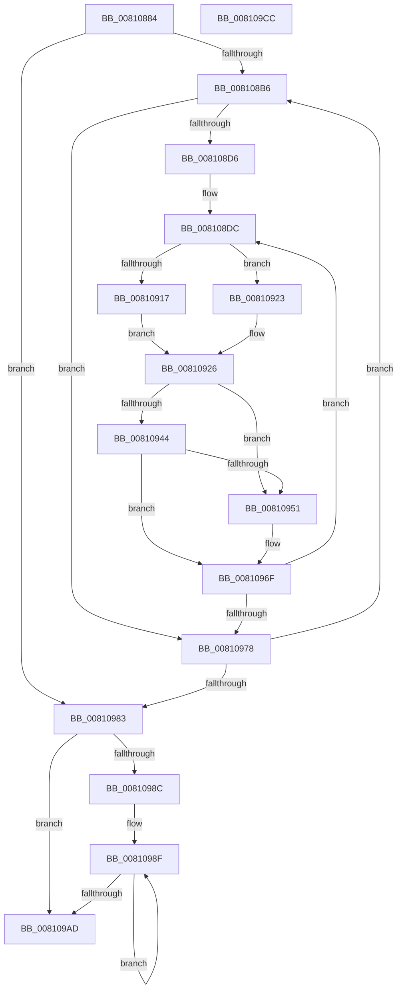

# MiInitializeZeroingDomains

- RVA: `0x00810884`–`0x008109CD` (길이 `329` bytes)
- VA: `0x0000000140810884`
- 실행 섹션: `PAGE`
- PDB 이름 있음: `예`; PDB Function 태그: `아니요`
- unwind 정보 RVA: `0x000847EC`
- 디코드: `88`개 명령, `329/329` bytes 표시
- 미해석 바이트: `0` (있으면 어셈블리에 `.byte`로 보존)

> 이 문서는 커널 이미지의 기계어와 PDB 기호를 분석해 생성했습니다. 4번과 5번은 함수 원형과 자료형을 바이너리 사용 방식에서 추정한 C 해석이며 원본 소스 복구 결과는 아닙니다.

## 1. Dependencies

- 직접 호출 지점: **5**; 고유 호출 대상: **5**
- 직접 호출자로 확인된 함수: **1**
- RIP 상대 이미지 참조: **1**

### Outgoing calls
- `0x008108E1` → [KeFindFirstSetRightGroupAffinity](../../text/2C/KeFindFirstSetRightGroupAffinity_function_002CFB10.md) (function, `0x002CFB10`)
- `0x00810919` → [MiGetNodeBaseDomain](../../text/68/MiGetNodeBaseDomain_function_0068C2D0.md) (function, `0x0068C2D0`)
- `0x00810929` → [MiGetProcessorDomain](../../text/4E/MiGetProcessorDomain_function_004E429C.md) (function, `0x004E429C`)
- `0x00810947` → [MiGetEngineType](../../text/4F/MiGetEngineType_function_004F9660.md) (function, `0x004F9660`)
- `0x0081099E` → [memcpy](../../text/6C/memcpy_function_006C6840.md) (function, `0x006C6840`)

### Direct callers
- [MiAbsorbPossibleEngineChanges](../../text/69/MiAbsorbPossibleEngineChanges_function_006958B4.md) at `0x00695BA2`

### Static image references
- `0x008108EA` → RVA `0x00FC8C40` (`ALMOSTRO`; read)

## 2. Other-region calls and transfers

- 다른 실행 섹션으로 향하는 call: **5**
  - `0x008108E1` → [KeFindFirstSetRightGroupAffinity](../../text/2C/KeFindFirstSetRightGroupAffinity_function_002CFB10.md) (`PAGE` → `.text`)
  - `0x00810919` → [MiGetNodeBaseDomain](../../text/68/MiGetNodeBaseDomain_function_0068C2D0.md) (`PAGE` → `.text`)
  - `0x00810929` → [MiGetProcessorDomain](../../text/4E/MiGetProcessorDomain_function_004E429C.md) (`PAGE` → `.text`)
  - `0x00810947` → [MiGetEngineType](../../text/4F/MiGetEngineType_function_004F9660.md) (`PAGE` → `.text`)
  - `0x0081099E` → [memcpy](../../text/6C/memcpy_function_006C6840.md) (`PAGE` → `.text`)
- 별도 외부 분기/꼬리 이동을 확인하지 못했습니다.

## 3. Assembly (complete function range)

```asm
00810884  48 8B C4                        mov rax, rsp
00810887  48 89 58 08                     mov qword ptr [rax + 8], rbx
0081088B  48 89 68 10                     mov qword ptr [rax + 0x10], rbp
0081088F  48 89 70 18                     mov qword ptr [rax + 0x18], rsi
00810893  48 89 78 20                     mov qword ptr [rax + 0x20], rdi
00810897  41 54                           push r12
00810899  41 56                           push r14
0081089B  41 57                           push r15
0081089D  48 83 EC 30                     sub rsp, 0x30
008108A1  44 8B 71 0C                     mov r14d, dword ptr [rcx + 0xc]
008108A5  33 FF                           xor edi, edi
008108A7  44 8B E2                        mov r12d, edx
008108AA  48 8B D9                        mov rbx, rcx
008108AD  39 79 04                        cmp dword ptr [rcx + 4], edi
008108B0  0F 86 CD 00 00 00               jbe 0x140810983
008108B6  48 8B 43 20                     mov rax, qword ptr [rbx + 0x20]
008108BA  8B F7                           mov esi, edi
008108BC  48 03 F6                        add rsi, rsi
008108BF  0F 10 04 F0                     movups xmm0, xmmword ptr [rax + rsi*8]
008108C3  66 48 0F 7E C5                  movq rbp, xmm0
008108C8  0F 11 44 24 20                  movups xmmword ptr [rsp + 0x20], xmm0
008108CD  48 85 ED                        test rbp, rbp
008108D0  0F 84 A2 00 00 00               je 0x140810978
008108D6  44 0F B7 7C 24 28               movzx r15d, word ptr [rsp + 0x28]
008108DC  48 8D 4C 24 20                  lea rcx, [rsp + 0x20]
008108E1  E8 2A F2 AB FF                  call 0x1402cfb10
008108E6  4C 8B 53 28                     mov r10, qword ptr [rbx + 0x28]
008108EA  4C 8D 0D 4F 83 7B 00            lea r9, [rip + 0x7b834f]
008108F1  44 8B D8                        mov r11d, eax
008108F4  4F 8B 0C D9                     mov r9, qword ptr [r9 + r11*8]
008108F8  49 8B 89 C8 00 00 00            mov rcx, qword ptr [r9 + 0xc8]
008108FF  49 8D 91 54 87 00 00            lea rdx, [r9 + 0x8754]
00810906  48 F7 D1                        not rcx
00810909  48 23 E9                        and rbp, rcx
0081090C  80 7B 02 00                     cmp byte ptr [rbx + 2], 0
00810910  48 89 6C 24 20                  mov qword ptr [rsp + 0x20], rbp
00810915  74 0C                           je 0x140810923
00810917  8B 0A                           mov ecx, dword ptr [rdx]
00810919  E8 B2 B9 E7 FF                  call 0x14068c2d0
0081091E  44 8B C0                        mov r8d, eax
00810921  EB 03                           jmp 0x140810926
00810923  45 33 C0                        xor r8d, r8d
00810926  41 8B CB                        mov ecx, r11d
00810929  E8 6E 39 CD FF                  call 0x1404e429c
0081092E  41 03 C0                        add eax, r8d
00810931  48 8D 0C 40                     lea rcx, [rax + rax*2]
00810935  48 C1 E1 04                     shl rcx, 4
00810939  4C 03 D1                        add r10, rcx
0081093C  4D 8B 02                        mov r8, qword ptr [r10]
0081093F  45 85 E4                        test r12d, r12d
00810942  74 0D                           je 0x140810951
00810944  49 8B C9                        mov rcx, r9
00810947  E8 14 8D CE FF                  call 0x1404f9660
0081094C  41 3B C4                        cmp eax, r12d
0081094F  75 1E                           jne 0x14081096f
00810951  8B 02                           mov eax, dword ptr [rdx]
00810953  89 43 40                        mov dword ptr [rbx + 0x40], eax
00810956  49 8B 81 C8 00 00 00            mov rax, qword ptr [r9 + 0xc8]
0081095D  49 09 04 F0                     or qword ptr [r8 + rsi*8], rax
00810961  66 45 89 7C F0 08               mov word ptr [r8 + rsi*8 + 8], r15w
00810967  41 C7 42 28 01 00 00 00         mov dword ptr [r10 + 0x28], 1
0081096F  48 85 ED                        test rbp, rbp
00810972  0F 85 64 FF FF FF               jne 0x1408108dc
00810978  FF C7                           inc edi
0081097A  3B 7B 04                        cmp edi, dword ptr [rbx + 4]
0081097D  0F 82 33 FF FF FF               jb 0x1408108b6
00810983  48 8B 7B 28                     mov rdi, qword ptr [rbx + 0x28]
00810987  45 85 F6                        test r14d, r14d
0081098A  74 21                           je 0x1408109ad
0081098C  49 8B F6                        mov rsi, r14
0081098F  44 8B 43 04                     mov r8d, dword ptr [rbx + 4]
00810993  48 8B 17                        mov rdx, qword ptr [rdi]
00810996  48 8B 4F 08                     mov rcx, qword ptr [rdi + 8]
0081099A  49 C1 E0 04                     shl r8, 4
0081099E  E8 9D 5E EB FF                  call 0x1406c6840
008109A3  48 8D 7F 30                     lea rdi, [rdi + 0x30]
008109A7  48 83 EE 01                     sub rsi, 1
008109AB  75 E2                           jne 0x14081098f
008109AD  48 8B 5C 24 50                  mov rbx, qword ptr [rsp + 0x50]
008109B2  48 8B 6C 24 58                  mov rbp, qword ptr [rsp + 0x58]
008109B7  48 8B 74 24 60                  mov rsi, qword ptr [rsp + 0x60]
008109BC  48 8B 7C 24 68                  mov rdi, qword ptr [rsp + 0x68]
008109C1  48 83 C4 30                     add rsp, 0x30
008109C5  41 5F                           pop r15
008109C7  41 5E                           pop r14
008109C9  41 5C                           pop r12
008109CB  C3                              ret
008109CC  CC                              int3
```

## 4. C-style interpretation (structured pseudocode)

```c
__int64 __fastcall MiInitializeZeroingDomains(__int64 a1, int a2)
{
    __int64 result;
    __int64 v_r10;
    __int64 v_rbp;
    __int64 v_rdi;
    __int64 v_rsi;
    __int64 v_rsp;
    unsigned __int16 v_stack_m20;
    unsigned __int64 v_stack_m28;
    unsigned __int64 v_stack_p10;
    unsigned __int64 v_stack_p18;
    unsigned __int64 v_stack_p20;
    unsigned __int64 v_stack_p8;

    *(unsigned __int64 *)(v_rsp + 8) = v_rbx;
    *(unsigned __int64 *)(v_rsp + 16) = v_rbp;
    *(unsigned __int64 *)(v_rsp + 24) = v_rsi;
    *(unsigned __int64 *)(v_rsp + 32) = v_rdi;
    v_rsp = (v_rsp) - (48);
    v_rdi = 0;
    if ((*(unsigned int *)(a1 + 4)) <= 0) goto loc_00810983;
loc_008108B6:
    v_rsi = (0) + (0);
    v_stack_m28 = v_xmm0;
    if (v_rbp == 0) goto loc_00810978;
loc_008108DC:
    result = KeFindFirstSetRightGroupAffinity(v_stack_m28, a2, a3, a4);
    a1 = ~(*(unsigned __int64 *)(*(unsigned __int64 *)(v_rip + 8094543 + (unsigned int)((unsigned int)(result)) * 8) + 200));
    v_rbp = (v_rbp) & (a1);
    v_stack_m28 = v_rbp;
    if ((*(unsigned __int8 *)(a1 + 2)) == 0) goto loc_00810923;
    result = MiGetNodeBaseDomain((unsigned int)(*(unsigned int *)(*(unsigned __int64 *)(v_rip + 8094543 + (unsigned int)((unsigned int)(result)) * 8) + 34644)), *(unsigned __int64 *)(v_rip + 8094543 + (unsigned int)((unsigned int)(result)) * 8) + 34644, a3, *(unsigned __int64 *)(v_rip + 8094543 + (unsigned int)((unsigned int)(result)) * 8));
    goto loc_00810926;
loc_00810923:
    a3 = 0;
loc_00810926:
    result = MiGetProcessorDomain((unsigned int)((unsigned int)((unsigned int)((unsigned int)(result)))), *(unsigned __int64 *)(v_rip + 8094543 + (unsigned int)((unsigned int)(result)) * 8) + 34644, a3, *(unsigned __int64 *)(v_rip + 8094543 + (unsigned int)((unsigned int)(result)) * 8));
    result = (unsigned int)((result) + (0));
    a1 = (result + result * 2) << (4);
    v_r10 = (*(unsigned __int64 *)(a1 + 40)) + (a1);
    if ((unsigned int)((unsigned int)(a2)) == 0) goto loc_00810951;
    result = MiGetEngineType(*(unsigned __int64 *)(v_rip + 8094543 + (unsigned int)((unsigned int)(result)) * 8), *(unsigned __int64 *)(v_rip + 8094543 + (unsigned int)((unsigned int)(result)) * 8) + 34644, *(unsigned __int64 *)(v_r10), *(unsigned __int64 *)(v_rip + 8094543 + (unsigned int)((unsigned int)(result)) * 8));
    if (((unsigned int)(result)) == ((unsigned int)((unsigned int)(a2)))) {
        result = *(unsigned int *)(*(unsigned __int64 *)(v_rip + 8094543 + (unsigned int)((unsigned int)(result)) * 8) + 34644);
        *(unsigned int *)(a1 + 64) = (unsigned int)(result);
        result = *(unsigned __int64 *)(*(unsigned __int64 *)(v_rip + 8094543 + (unsigned int)((unsigned int)(result)) * 8) + 200);
        *(unsigned __int16 *)(*(unsigned __int64 *)(v_r10) + v_rsi * 8 + 8) = (unsigned __int16)(v_stack_m20);
        *(unsigned int *)(v_r10 + 40) = 1;
    }
    if (v_rbp != 0) goto loc_008108DC;
loc_00810978:
    v_rdi = (unsigned int)((v_rdi) + 1);
    if (((unsigned int)(v_rdi)) < (*(unsigned int *)(a1 + 4))) goto loc_008108B6;
loc_00810983:
    if ((unsigned int)((unsigned int)(*(unsigned int *)(a1 + 12))) == 0) goto loc_008109AD;
loc_0081098F:
    a3 = ((unsigned int)(*(unsigned int *)(a1 + 4))) << (4);
    result = memcpy(*(unsigned __int64 *)(*(unsigned __int64 *)(a1 + 40) + 8), *(unsigned __int64 *)(*(unsigned __int64 *)(a1 + 40)), a3, *(unsigned __int64 *)(v_rip + 8094543 + (unsigned int)((unsigned int)(result)) * 8));
    v_rsi = ((unsigned int)(*(unsigned int *)(a1 + 12))) - (1);
    if (condition_is_not_equal) goto loc_0081098F;
loc_008109AD:
    v_rsp = (v_rsp) + (48);
    return result;
}
```

## 5. (Beta) C Style

```c
int64_t MiInitializeZeroingDomains(void *Arg1, int32_t Arg2)
{
    uint8_t *arg1 = (uint8_t *)Arg1;

    int64_t result;
    int64_t local_r10;
    int64_t local_rbp;
    int64_t local_rdi;
    int64_t local_rsi;
    int64_t local_rsp;
    uint16_t v_stack_m20;
    uint64_t v_stack_m28;
    uint64_t v_stack_p10;
    uint64_t v_stack_p18;
    uint64_t v_stack_p20;
    uint64_t v_stack_p8;

    *(uint64_t *)(local_rsp + 0x8) = local_rbx;
    *(uint64_t *)(local_rsp + 0x10) = local_rbp;
    *(uint64_t *)(local_rsp + 0x18) = local_rsi;
    *(uint64_t *)(local_rsp + 0x20) = local_rdi;
    local_rsp = (local_rsp) - (48);
    local_rdi = 0;
    if ((*(uint32_t *)(arg1 + 0x4)) <= 0) goto loc_00810983;
loc_008108B6:
    local_rsi = (0) + (0);
    v_stack_m28 = v_xmm0;
    if (local_rbp == 0) goto loc_00810978;
loc_008108DC:
    result = KeFindFirstSetRightGroupAffinity(v_stack_m28, Arg2, a3, a4);
    Arg1 = ~(*(uint64_t *)(*(uint64_t *)(v_rip + 0x7B834F + (uint32_t)((uint32_t)(result)) * 8) + 0xC8));
    local_rbp = (local_rbp) & (Arg1);
    v_stack_m28 = local_rbp;
    if ((*(uint8_t *)(arg1 + 0x2)) == 0) goto loc_00810923;
    result = MiGetNodeBaseDomain((uint32_t)(*(uint32_t *)(*(uint64_t *)(v_rip + 0x7B834F + (uint32_t)((uint32_t)(result)) * 8) + 0x8754)), *(uint64_t *)(v_rip + 0x7B834F + (uint32_t)((uint32_t)(result)) * 8) + 34644, a3, *(uint64_t *)(v_rip + 0x7B834F + (uint32_t)((uint32_t)(result)) * 8));
    goto loc_00810926;
loc_00810923:
    a3 = 0;
loc_00810926:
    result = MiGetProcessorDomain((uint32_t)((uint32_t)((uint32_t)((uint32_t)(result)))), *(uint64_t *)(v_rip + 0x7B834F + (uint32_t)((uint32_t)(result)) * 8) + 34644, a3, *(uint64_t *)(v_rip + 0x7B834F + (uint32_t)((uint32_t)(result)) * 8));
    result = (uint32_t)((result) + (0));
    Arg1 = (result + result * 2) << (4);
    local_r10 = (*(uint64_t *)(arg1 + 0x28)) + (Arg1);
    if ((uint32_t)((uint32_t)(Arg2)) == 0) goto loc_00810951;
    result = MiGetEngineType(*(uint64_t *)(v_rip + 0x7B834F + (uint32_t)((uint32_t)(result)) * 8), *(uint64_t *)(v_rip + 0x7B834F + (uint32_t)((uint32_t)(result)) * 8) + 34644, *(uint64_t *)(local_r10), *(uint64_t *)(v_rip + 0x7B834F + (uint32_t)((uint32_t)(result)) * 8));
    if (((uint32_t)(result)) == ((uint32_t)((uint32_t)(Arg2)))) {
        result = *(uint32_t *)(*(uint64_t *)(v_rip + 0x7B834F + (uint32_t)((uint32_t)(result)) * 8) + 0x8754);
        *(uint32_t *)(arg1 + 0x40) = (uint32_t)(result);
        result = *(uint64_t *)(*(uint64_t *)(v_rip + 0x7B834F + (uint32_t)((uint32_t)(result)) * 8) + 0xC8);
        *(uint16_t *)(*(uint64_t *)(local_r10) + local_rsi * 8 + 0x8) = (uint16_t)(v_stack_m20);
        *(uint32_t *)(local_r10 + 0x28) = 1;
    }
    if (local_rbp != 0) goto loc_008108DC;
loc_00810978:
    local_rdi = (uint32_t)((local_rdi) + 1);
    if (((uint32_t)(local_rdi)) < (*(uint32_t *)(arg1 + 0x4))) goto loc_008108B6;
loc_00810983:
    if ((uint32_t)((uint32_t)(*(uint32_t *)(arg1 + 0xC))) == 0) goto loc_008109AD;
loc_0081098F:
    a3 = ((uint32_t)(*(uint32_t *)(arg1 + 0x4))) << (4);
    result = memcpy(*(uint64_t *)(*(uint64_t *)(arg1 + 0x28) + 0x8), *(uint64_t *)(*(uint64_t *)(arg1 + 0x28)), a3, *(uint64_t *)(v_rip + 0x7B834F + (uint32_t)((uint32_t)(result)) * 8));
    local_rsi = ((uint32_t)(*(uint32_t *)(arg1 + 0xC))) - (1);
    if (condition_is_not_equal) goto loc_0081098F;
loc_008109AD:
    local_rsp = (local_rsp) + (48);
    return result;
}
```

### 관측된 메모리 오프셋

구조체 형식이 확인되지 않은 접근은 인자 기준의 오프셋으로만 기록했습니다.

| 기준 인자 | 오프셋 표현 | 폭 (bit) | 접근 |
|---|---:|---:|---|
| `Arg1` | `+ 0x2` | `8` | `R` |
| `Arg1` | `+ 0x4` | `32` | `R` |
| `Arg1` | `+ 0xC` | `32` | `R` |
| `Arg1` | `+ 0x20` | `64` | `R` |
| `Arg1` | `+ 0x28` | `64` | `R` |
| `Arg1` | `+ 0x40` | `32` | `W` |

## 6. Execution-region graph

[열기: 2D/3D 그래프와 함수 탐색 컨트롤 패널](../../../control-panel.html?section=page&rva=0x00810884&view=graph)

- 2D 그래프는 위에서 아래로 흐르고, 3D 그래프는 빈 공간을 드래그해 회전합니다. Shift+드래그는 이동, 휠은 확대·축소, 함수 노드 선택은 대상 보고서 이동입니다.

### Static fallback


