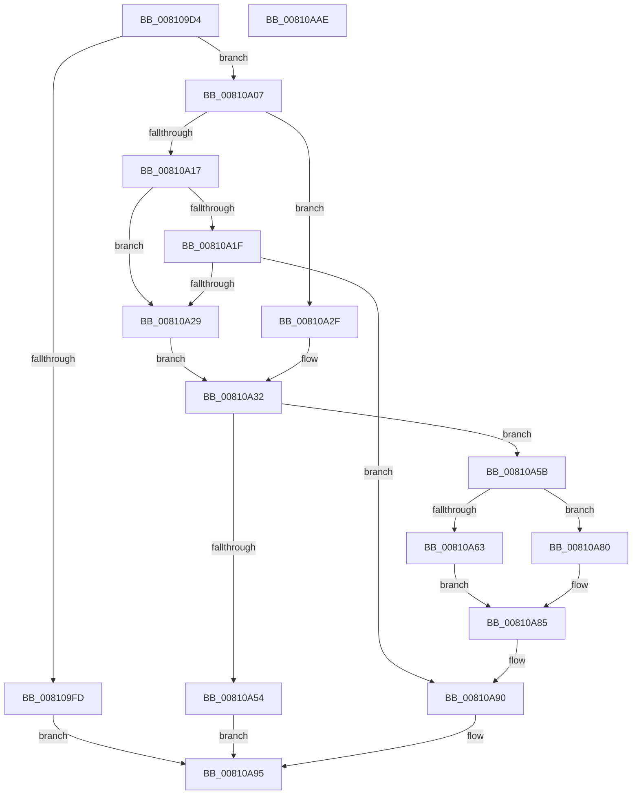

# MiMakeSpaceForConductorListZeroThread

- RVA: `0x008109D4`–`0x00810AAF` (길이 `219` bytes)
- VA: `0x00000001408109D4`
- 실행 섹션: `PAGE`
- PDB 이름 있음: `예`; PDB Function 태그: `아니요`
- unwind 정보 RVA: `0x00060300`
- 디코드: `67`개 명령, `219/219` bytes 표시
- 미해석 바이트: `0` (있으면 어셈블리에 `.byte`로 보존)

> 이 문서는 커널 이미지의 기계어와 PDB 기호를 분석해 생성했습니다. 4번과 5번은 함수 원형과 자료형을 바이너리 사용 방식에서 추정한 C 해석이며 원본 소스 복구 결과는 아닙니다.

## 1. Dependencies

- 직접 호출 지점: **3**; 고유 호출 대상: **3**
- 직접 호출자로 확인된 함수: **1**
- RIP 상대 이미지 참조: **0**

### Outgoing calls
- `0x00810A47` → [MiAllocatePool](../../text/35/MiAllocatePool_function_0035B540.md) (function, `0x0035B540`)
- `0x00810A6F` → [memcpy](../../text/6C/memcpy_function_006C6840.md) (function, `0x006C6840`)
- `0x00810A79` → [ExFreePoolWithTag](../../poolcode/B8/ExFreePoolWithTag_function_00B82870.md) (function, `0x00B82870`)

### Direct callers
- [MiInsertNewZeroThread](../../text/69/MiInsertNewZeroThread_function_00696140.md) at `0x006961AA`

### Static image references
- 디코드된 RIP-relative 메모리 참조가 없습니다.

## 2. Other-region calls and transfers

- 다른 실행 섹션으로 향하는 call: **3**
  - `0x00810A47` → [MiAllocatePool](../../text/35/MiAllocatePool_function_0035B540.md) (`PAGE` → `.text`)
  - `0x00810A6F` → [memcpy](../../text/6C/memcpy_function_006C6840.md) (`PAGE` → `.text`)
  - `0x00810A79` → [ExFreePoolWithTag](../../poolcode/B8/ExFreePoolWithTag_function_00B82870.md) (`PAGE` → `POOLCODE`)
- 별도 외부 분기/꼬리 이동을 확인하지 못했습니다.

## 3. Assembly (complete function range)

```asm
008109D4  48 89 5C 24 08                  mov qword ptr [rsp + 8], rbx
008109D9  48 89 6C 24 10                  mov qword ptr [rsp + 0x10], rbp
008109DE  48 89 74 24 18                  mov qword ptr [rsp + 0x18], rsi
008109E3  57                              push rdi
008109E4  41 56                           push r14
008109E6  41 57                           push r15
008109E8  48 83 EC 20                     sub rsp, 0x20
008109EC  48 83 22 00                     and qword ptr [rdx], 0
008109F0  4C 8B FA                        mov r15, rdx
008109F3  44 8B 41 3C                     mov r8d, dword ptr [rcx + 0x3c]
008109F7  41 83 F8 3D                     cmp r8d, 0x3d
008109FB  72 0A                           jb 0x140810a07
008109FD  B8 29 01 00 C0                  mov eax, 0xc0000129
00810A02  E9 8E 00 00 00                  jmp 0x140810a95
00810A07  48 8D 71 48                     lea rsi, [rcx + 0x48]
00810A0B  48 8B 16                        mov rdx, qword ptr [rsi]
00810A0E  48 8D 59 40                     lea rbx, [rcx + 0x40]
00810A12  48 85 D2                        test rdx, rdx
00810A15  74 18                           je 0x140810a2f
00810A17  41 8D 40 03                     lea eax, [r8 + 3]
00810A1B  3B 03                           cmp eax, dword ptr [rbx]
00810A1D  73 0A                           jae 0x140810a29
00810A1F  4A 8D 14 C2                     lea rdx, [rdx + r8*8]
00810A23  48 83 C2 18                     add rdx, 0x18
00810A27  75 67                           jne 0x140810a90
00810A29  48 8D 79 48                     lea rdi, [rcx + 0x48]
00810A2D  EB 03                           jmp 0x140810a32
00810A2F  48 8B FE                        mov rdi, rsi
00810A32  41 8D 68 04                     lea ebp, [r8 + 4]
00810A36  B9 40 00 00 00                  mov ecx, 0x40
00810A3B  8B C5                           mov eax, ebp
00810A3D  41 B8 4D 69 5A 62               mov r8d, 0x625a694d
00810A43  48 6B D0 38                     imul rdx, rax, 0x38
00810A47  E8 F4 AA B4 FF                  call 0x14035b540
00810A4C  4C 8B F0                        mov r14, rax
00810A4F  48 85 C0                        test rax, rax
00810A52  75 07                           jne 0x140810a5b
00810A54  B8 2D 01 00 C0                  mov eax, 0xc000012d
00810A59  EB 3A                           jmp 0x140810a95
00810A5B  48 8B 16                        mov rdx, qword ptr [rsi]
00810A5E  48 85 D2                        test rdx, rdx
00810A61  74 1D                           je 0x140810a80
00810A63  8B 33                           mov esi, dword ptr [rbx]
00810A65  49 8B CE                        mov rcx, r14
00810A68  44 8B C6                        mov r8d, esi
00810A6B  49 C1 E0 03                     shl r8, 3
00810A6F  E8 CC 5D EB FF                  call 0x1406c6840
00810A74  48 8B 0F                        mov rcx, qword ptr [rdi]
00810A77  33 D2                           xor edx, edx
00810A79  E8 F2 1D 37 00                  call 0x140b82870
00810A7E  EB 05                           jmp 0x140810a85
00810A80  BE 03 00 00 00                  mov esi, 3
00810A85  8B C6                           mov eax, esi
00810A87  4C 89 37                        mov qword ptr [rdi], r14
00810A8A  89 2B                           mov dword ptr [rbx], ebp
00810A8C  49 8D 14 C6                     lea rdx, [r14 + rax*8]
00810A90  49 89 17                        mov qword ptr [r15], rdx
00810A93  33 C0                           xor eax, eax
00810A95  48 8B 5C 24 40                  mov rbx, qword ptr [rsp + 0x40]
00810A9A  48 8B 6C 24 48                  mov rbp, qword ptr [rsp + 0x48]
00810A9F  48 8B 74 24 50                  mov rsi, qword ptr [rsp + 0x50]
00810AA4  48 83 C4 20                     add rsp, 0x20
00810AA8  41 5F                           pop r15
00810AAA  41 5E                           pop r14
00810AAC  5F                              pop rdi
00810AAD  C3                              ret
00810AAE  CC                              int3
```

## 4. C-style interpretation (structured pseudocode)

```c
__int64 __fastcall MiMakeSpaceForConductorListZeroThread(__int64 a1, __int64 a2)
{
    __int64 result;
    __int64 v_rsp;
    unsigned __int64 v_stack_p10;
    unsigned __int64 v_stack_p18;
    unsigned __int64 v_stack_p8;

    v_stack_p8 = v_rbx;
    v_stack_p10 = v_rbp;
    v_stack_p18 = v_rsi;
    v_rsp = (v_rsp) - (32);
    if (((unsigned int)((unsigned int)(*(unsigned int *)(a1 + 60)))) < 61) goto loc_00810A07;
    goto loc_00810A95;
loc_00810A07:
    if (*(unsigned __int64 *)(a1 + 72) == 0) goto loc_00810A2F;
    if (((unsigned int)((unsigned int)(*(unsigned int *)(a1 + 60)) + 3)) >= (*(unsigned int *)(a1 + 64))) goto loc_00810A29;
    a2 = (*(unsigned __int64 *)(a1 + 72) + (unsigned int)(*(unsigned int *)(a1 + 60)) * 8) + (24);
    if (condition_is_not_equal) goto loc_00810A90;
loc_00810A29:
    goto loc_00810A32;
loc_00810A2F:
loc_00810A32:
    a2 = (a2) * ((unsigned int)((unsigned int)((unsigned int)(*(unsigned int *)(a1 + 60)) + 4)));
    result = MiAllocatePool(64, a2, (unsigned int)(0x625A694DULL), a4);
    if (result != 0) goto loc_00810A5B;
    goto loc_00810A95;
loc_00810A5B:
    if (*(unsigned __int64 *)(a1 + 72) == 0) goto loc_00810A80;
    a3 = ((unsigned int)((unsigned int)((unsigned int)(*(unsigned int *)(a1 + 64))))) << (3);
    result = memcpy(result, *(unsigned __int64 *)(a1 + 72), a3, a4);
    a2 = 0;
    result = ExFreePoolWithTag(*(unsigned __int64 *)(a1 + 72), a2, a3, a4);
    goto loc_00810A85;
loc_00810A80:
loc_00810A85:
    *(unsigned __int64 *)(a1 + 72) = result;
    *(unsigned int *)(a1 + 64) = (unsigned int)((unsigned int)(*(unsigned int *)(a1 + 60)) + 4);
loc_00810A90:
    *(unsigned __int64 *)(a2) = result + 3 * 8;
    result = 0;
loc_00810A95:
    v_rsp = (v_rsp) + (32);
    return result;
}
```

## 5. (Beta) C Style

```c
int64_t MiMakeSpaceForConductorListZeroThread(void *Arg1, void *Arg2)
{
    uint8_t *arg1 = (uint8_t *)Arg1;
    uint8_t *arg2 = (uint8_t *)Arg2;

    int64_t result;
    int64_t local_rsp;
    uint64_t v_stack_p10;
    uint64_t v_stack_p18;
    uint64_t v_stack_p8;

    v_stack_p8 = local_rbx;
    v_stack_p10 = local_rbp;
    v_stack_p18 = local_rsi;
    local_rsp = (local_rsp) - (32);
    if (((uint32_t)((uint32_t)(*(uint32_t *)(arg1 + 0x3C)))) < 61) goto loc_00810A07;
    goto loc_00810A95;
loc_00810A07:
    if (*(uint64_t *)(arg1 + 0x48) == 0) goto loc_00810A2F;
    if (((uint32_t)((uint32_t)(*(uint32_t *)(arg1 + 0x3C)) + 3)) >= (*(uint32_t *)(arg1 + 0x40))) goto loc_00810A29;
    Arg2 = (*(uint64_t *)(arg1 + 0x48) + (uint32_t)(*(uint32_t *)(arg1 + 0x3C)) * 8) + (24);
    if (condition_is_not_equal) goto loc_00810A90;
loc_00810A29:
    goto loc_00810A32;
loc_00810A2F:
loc_00810A32:
    Arg2 = (Arg2) * ((uint32_t)((uint32_t)((uint32_t)(*(uint32_t *)(arg1 + 0x3C)) + 4)));
    result = MiAllocatePool(64, Arg2, (uint32_t)(0x625A694DULL), a4);
    if (result != 0) goto loc_00810A5B;
    goto loc_00810A95;
loc_00810A5B:
    if (*(uint64_t *)(arg1 + 0x48) == 0) goto loc_00810A80;
    a3 = ((uint32_t)((uint32_t)((uint32_t)(*(uint32_t *)(arg1 + 0x40))))) << (3);
    result = memcpy(result, *(uint64_t *)(arg1 + 0x48), a3, a4);
    Arg2 = 0;
    result = ExFreePoolWithTag(*(uint64_t *)(arg1 + 0x48), Arg2, a3, a4);
    goto loc_00810A85;
loc_00810A80:
loc_00810A85:
    *(uint64_t *)(arg1 + 0x48) = result;
    *(uint32_t *)(arg1 + 0x40) = (uint32_t)((uint32_t)(*(uint32_t *)(arg1 + 0x3C)) + 4);
loc_00810A90:
    *(uint64_t *)(arg2) = result + 3 * 8;
    result = 0;
loc_00810A95:
    local_rsp = (local_rsp) + (32);
    return result;
}
```

### 관측된 메모리 오프셋

구조체 형식이 확인되지 않은 접근은 인자 기준의 오프셋으로만 기록했습니다.

| 기준 인자 | 오프셋 표현 | 폭 (bit) | 접근 |
|---|---:|---:|---|
| `Arg1` | `+ 0x0` | `32` | `R` |
| `Arg1` | `+ 0x0` | `32` | `W` |
| `Arg1` | `+ 0x0` | `64` | `R` |
| `Arg1` | `+ 0x0` | `64` | `W` |
| `Arg1` | `+ 0x3C` | `32` | `R` |
| `Arg1` | `+ 0x40` | `64` | `R` |
| `Arg1` | `+ 0x48` | `64` | `R` |
| `Arg2` | `+ 0x0` | `64` | `R/W` |
| `Arg2` | `+ 0x0` | `64` | `W` |

## 6. Execution-region graph

[열기: 2D/3D 그래프와 함수 탐색 컨트롤 패널](../../../control-panel.html?section=page&rva=0x008109D4&view=graph)

- 2D 그래프는 위에서 아래로 흐르고, 3D 그래프는 빈 공간을 드래그해 회전합니다. Shift+드래그는 이동, 휠은 확대·축소, 함수 노드 선택은 대상 보고서 이동입니다.

### Static fallback


