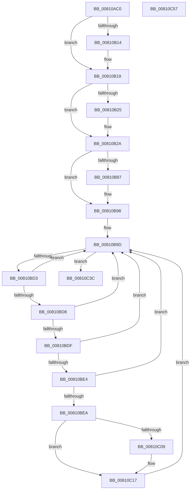

# MiNodeZeroConductor

- RVA: `0x00810AC0`–`0x00810C58` (길이 `408` bytes)
- VA: `0x0000000140810AC0`
- 실행 섹션: `PAGE`
- PDB 이름 있음: `예`; PDB Function 태그: `아니요`
- unwind 정보 RVA: `0x000A44D8`
- 디코드: `104`개 명령, `408/408` bytes 표시
- 미해석 바이트: `0` (있으면 어셈블리에 `.byte`로 보존)

> 이 문서는 커널 이미지의 기계어와 PDB 기호를 분석해 생성했습니다. 4번과 5번은 함수 원형과 자료형을 바이너리 사용 방식에서 추정한 C 해석이며 원본 소스 복구 결과는 아닙니다.

## 1. Dependencies

- 직접 호출 지점: **14**; 고유 호출 대상: **12**
- 직접 호출자로 확인된 함수: **0**
- RIP 상대 이미지 참조: **2**

### Outgoing calls
- `0x00810AE6` → [KeSetActualBasePriorityThread](../../text/3C/KeSetActualBasePriorityThread_function_003C4370.md) (function, `0x003C4370`)
- `0x00810B03` → [MiLockDynamicMemoryExclusive](../../text/67/MiLockDynamicMemoryExclusive_function_006730F8.md) (function, `0x006730F8`)
- `0x00810B14` → [MiLockDynamicMemoryNestedExclusive](../../text/67/MiLockDynamicMemoryNestedExclusive_function_00673154.md) (function, `0x00673154`)
- `0x00810B25` → [MiUnlockDynamicMemoryNestedExclusive](../../text/67/MiUnlockDynamicMemoryNestedExclusive_function_00673CC0.md) (function, `0x00673CC0`)
- `0x00810B30` → [MiUnlockDynamicMemoryExclusive](../../text/67/MiUnlockDynamicMemoryExclusive_function_00673C5C.md) (function, `0x00673C5C`)
- `0x00810B4A` → [KeInitializeEvent](../../text/40/KeInitializeEvent_function_0040DD10.md) (function, `0x0040DD10`)
- `0x00810B5A` → [KeInitializeEvent](../../text/40/KeInitializeEvent_function_0040DD10.md) (function, `0x0040DD10`)
- `0x00810B74` → [KeQueryPerformanceCounter](../../text/37/KeQueryPerformanceCounter_function_0037E7E0.md) (function, `0x0037E7E0`)
- `0x00810BA0` → [MiInitializeZeroEngines](MiInitializeZeroEngines_function_008106F4.md) (function, `0x008106F4`)
- `0x00810BB5` → [MiStartZeroEngineThreads](MiStartZeroEngineThreads_function_00810CCC.md) (function, `0x00810CCC`)
- `0x00810BCA` → [MiZeroNodeConductorWait](../../text/69/MiZeroNodeConductorWait_function_006968E8.md) (function, `0x006968E8`)
- `0x00810BF9` → [KeQueryPerformanceCounter](../../text/37/KeQueryPerformanceCounter_function_0037E7E0.md) (function, `0x0037E7E0`)
- `0x00810C32` → [MiPreserveBootDecisions](../../text/69/MiPreserveBootDecisions_function_00696388.md) (function, `0x00696388`)
- `0x00810C3F` → [MiZeroNodeExiting](../../text/69/MiZeroNodeExiting_function_00696A04.md) (function, `0x00696A04`)

### Direct callers
- 이 함수 시작 RVA로 연결되는 직접 call은 확인되지 않았습니다. 간접 호출은 완전히 역산할 수 없습니다.

### Static image references
- `0x00810B08` → RVA `0x00E38D00` (`.data`; read)
- `0x00810BA7` → RVA `0x00010AA0` (`.rdata`; read)

## 2. Other-region calls and transfers

- 다른 실행 섹션으로 향하는 call: **12**
  - `0x00810AE6` → [KeSetActualBasePriorityThread](../../text/3C/KeSetActualBasePriorityThread_function_003C4370.md) (`PAGE` → `.text`)
  - `0x00810B03` → [MiLockDynamicMemoryExclusive](../../text/67/MiLockDynamicMemoryExclusive_function_006730F8.md) (`PAGE` → `.text`)
  - `0x00810B14` → [MiLockDynamicMemoryNestedExclusive](../../text/67/MiLockDynamicMemoryNestedExclusive_function_00673154.md) (`PAGE` → `.text`)
  - `0x00810B25` → [MiUnlockDynamicMemoryNestedExclusive](../../text/67/MiUnlockDynamicMemoryNestedExclusive_function_00673CC0.md) (`PAGE` → `.text`)
  - `0x00810B30` → [MiUnlockDynamicMemoryExclusive](../../text/67/MiUnlockDynamicMemoryExclusive_function_00673C5C.md) (`PAGE` → `.text`)
  - `0x00810B4A` → [KeInitializeEvent](../../text/40/KeInitializeEvent_function_0040DD10.md) (`PAGE` → `.text`)
  - `0x00810B5A` → [KeInitializeEvent](../../text/40/KeInitializeEvent_function_0040DD10.md) (`PAGE` → `.text`)
  - `0x00810B74` → [KeQueryPerformanceCounter](../../text/37/KeQueryPerformanceCounter_function_0037E7E0.md) (`PAGE` → `.text`)
  - `0x00810BCA` → [MiZeroNodeConductorWait](../../text/69/MiZeroNodeConductorWait_function_006968E8.md) (`PAGE` → `.text`)
  - `0x00810BF9` → [KeQueryPerformanceCounter](../../text/37/KeQueryPerformanceCounter_function_0037E7E0.md) (`PAGE` → `.text`)
  - `0x00810C32` → [MiPreserveBootDecisions](../../text/69/MiPreserveBootDecisions_function_00696388.md) (`PAGE` → `.text`)
  - `0x00810C3F` → [MiZeroNodeExiting](../../text/69/MiZeroNodeExiting_function_00696A04.md) (`PAGE` → `.text`)
- 별도 외부 분기/꼬리 이동을 확인하지 못했습니다.

## 3. Assembly (complete function range)

```asm
00810AC0  48 89 5C 24 18                  mov qword ptr [rsp + 0x18], rbx
00810AC5  48 89 6C 24 20                  mov qword ptr [rsp + 0x20], rbp
00810ACA  56                              push rsi
00810ACB  57                              push rdi
00810ACC  41 56                           push r14
00810ACE  48 83 EC 20                     sub rsp, 0x20
00810AD2  65 48 8B 3C 25 88 01 00 00      mov rdi, qword ptr gs:[0x188]
00810ADB  48 8B F1                        mov rsi, rcx
00810ADE  48 8B CF                        mov rcx, rdi
00810AE1  BA 0C 00 00 00                  mov edx, 0xc
00810AE6  E8 85 38 BB FF                  call 0x1403c4370
00810AEB  48 8B 5E 30                     mov rbx, qword ptr [rsi + 0x30]
00810AEF  48 8B D7                        mov rdx, rdi
00810AF2  8B 46 38                        mov eax, dword ptr [rsi + 0x38]
00810AF5  48 8B CB                        mov rcx, rbx
00810AF8  48 69 E8 80 DF 00 00            imul rbp, rax, 0xdf80
00810AFF  48 03 6B 10                     add rbp, qword ptr [rbx + 0x10]
00810B03  E8 F0 25 E6 FF                  call 0x1406730f8
00810B08  4C 8D 35 F1 81 62 00            lea r14, [rip + 0x6281f1]
00810B0F  49 3B DE                        cmp rbx, r14
00810B12  74 05                           je 0x140810b19
00810B14  E8 3B 26 E6 FF                  call 0x140673154
00810B19  48 89 B5 A8 3B 00 00            mov qword ptr [rbp + 0x3ba8], rsi
00810B20  49 3B DE                        cmp rbx, r14
00810B23  74 05                           je 0x140810b2a
00810B25  E8 96 31 E6 FF                  call 0x140673cc0
00810B2A  48 8B D7                        mov rdx, rdi
00810B2D  48 8B CB                        mov rcx, rbx
00810B30  E8 27 31 E6 FF                  call 0x140673c5c
00810B35  48 8D 46 20                     lea rax, [rsi + 0x20]
00810B39  45 33 C0                        xor r8d, r8d
00810B3C  48 8B CE                        mov rcx, rsi
00810B3F  48 89 40 08                     mov qword ptr [rax + 8], rax
00810B43  48 89 00                        mov qword ptr [rax], rax
00810B46  41 8D 50 01                     lea edx, [r8 + 1]
00810B4A  E8 C1 D1 BF FF                  call 0x14040dd10
00810B4F  45 33 C0                        xor r8d, r8d
00810B52  48 8D 4E 58                     lea rcx, [rsi + 0x58]
00810B56  41 8D 50 01                     lea edx, [r8 + 1]
00810B5A  E8 B1 D1 BF FF                  call 0x14040dd10
00810B5F  F0 83 86 80 00 00 00 03         lock add dword ptr [rsi + 0x80], 3
00810B67  45 33 F6                        xor r14d, r14d
00810B6A  48 8D 4C 24 40                  lea rcx, [rsp + 0x40]
00810B6F  4C 89 74 24 40                  mov qword ptr [rsp + 0x40], r14
00810B74  E8 67 DC B6 FF                  call 0x14037e7e0
00810B79  48 81 7C 24 40 80 96 98 00      cmp qword ptr [rsp + 0x40], 0x989680
00810B82  48 8B D8                        mov rbx, rax
00810B85  74 11                           je 0x140810b98
00810B87  48 69 C3 80 96 98 00            imul rax, rbx, 0x989680
00810B8E  48 99                           cqo
00810B90  48 F7 7C 24 40                  idiv qword ptr [rsp + 0x40]
00810B95  48 8B D8                        mov rbx, rax
00810B98  F0 44 09 34 24                  lock or dword ptr [rsp], r14d
00810B9D  48 8B CE                        mov rcx, rsi
00810BA0  E8 4F FB FF FF                  call 0x1408106f4
00810BA5  85 C0                           test eax, eax
00810BA7  48 8D 3D F2 FE 7F FF            lea rdi, [rip - 0x80010e]
00810BAE  48 8B CE                        mov rcx, rsi
00810BB1  49 0F 45 FE                     cmovne rdi, r14
00810BB5  E8 12 01 00 00                  call 0x140810ccc
00810BBA  85 C0                           test eax, eax
00810BBC  48 8D 15 DD FE 7F FF            lea rdx, [rip - 0x800123]
00810BC3  48 8B CE                        mov rcx, rsi
00810BC6  48 0F 45 D7                     cmovne rdx, rdi
00810BCA  E8 19 5D E8 FF                  call 0x1406968e8
00810BCF  85 C0                           test eax, eax
00810BD1  74 69                           je 0x140810c3c
00810BD3  83 F8 01                        cmp eax, 1
00810BD6  74 C5                           je 0x140810b9d
00810BD8  3D 02 01 00 00                  cmp eax, 0x102
00810BDD  74 BE                           je 0x140810b9d
00810BDF  83 F8 02                        cmp eax, 2
00810BE2  75 B9                           jne 0x140810b9d
00810BE4  44 38 76 50                     cmp byte ptr [rsi + 0x50], r14b
00810BE8  74 B3                           je 0x140810b9d
00810BEA  F0 44 09 34 24                  lock or dword ptr [rsp], r14d
00810BEF  48 8D 4C 24 48                  lea rcx, [rsp + 0x48]
00810BF4  4C 89 74 24 48                  mov qword ptr [rsp + 0x48], r14
00810BF9  E8 E2 DB B6 FF                  call 0x14037e7e0
00810BFE  48 81 7C 24 48 80 96 98 00      cmp qword ptr [rsp + 0x48], 0x989680
00810C07  74 0E                           je 0x140810c17
00810C09  48 69 C0 80 96 98 00            imul rax, rax, 0x989680
00810C10  48 99                           cqo
00810C12  48 F7 7C 24 48                  idiv qword ptr [rsp + 0x48]
00810C17  48 3B C3                        cmp rax, rbx
00810C1A  44 88 76 50                     mov byte ptr [rsi + 0x50], r14b
00810C1E  48 8B CB                        mov rcx, rbx
00810C21  48 8B D6                        mov rdx, rsi
00810C24  48 0F 43 C8                     cmovae rcx, rax
00810C28  48 2B CB                        sub rcx, rbx
00810C2B  48 89 4E 18                     mov qword ptr [rsi + 0x18], rcx
00810C2F  48 8B CD                        mov rcx, rbp
00810C32  E8 51 57 E8 FF                  call 0x140696388
00810C37  E9 61 FF FF FF                  jmp 0x140810b9d
00810C3C  48 8B CE                        mov rcx, rsi
00810C3F  E8 C0 5D E8 FF                  call 0x140696a04
00810C44  48 8B 5C 24 50                  mov rbx, qword ptr [rsp + 0x50]
00810C49  48 8B 6C 24 58                  mov rbp, qword ptr [rsp + 0x58]
00810C4E  48 83 C4 20                     add rsp, 0x20
00810C52  41 5E                           pop r14
00810C54  5F                              pop rdi
00810C55  5E                              pop rsi
00810C56  C3                              ret
00810C57  CC                              int3
```

## 4. C-style interpretation (structured pseudocode)

```c
__int64 __fastcall MiNodeZeroConductor(__int64 a1, __int64 a2, int a3)
{
    __int64 result;
    __int64 v_r14;
    __int64 v_rbp;
    __int64 v_rbx;
    __int64 v_rdi;
    __int64 v_rsp;
    unsigned int v_stack_m38;
    unsigned __int64 v_stack_p10;
    unsigned __int64 v_stack_p18;
    unsigned __int64 v_stack_p20;
    unsigned __int64 v_stack_p8;

    v_stack_p18 = v_rbx;
    v_stack_p20 = v_rbp;
    v_rsp = (v_rsp) - (32);
    result = KeSetActualBasePriorityThread(*(unsigned __int64 *)(gs_base + (0 + 392)), 12, a3, a4);
    v_rbp = (v_rbp) * ((unsigned int)(*(unsigned int *)(a1 + 56)));
    v_rbp = (v_rbp) + (*(unsigned __int64 *)(*(unsigned __int64 *)(a1 + 48) + 16));
    result = MiLockDynamicMemoryExclusive(*(unsigned __int64 *)(a1 + 48), *(unsigned __int64 *)(gs_base + (0 + 392)), a3, a4);
    if ((*(unsigned __int64 *)(a1 + 48)) != (v_rip + 6455793)) {
        result = MiLockDynamicMemoryNestedExclusive(*(unsigned __int64 *)(a1 + 48), *(unsigned __int64 *)(gs_base + (0 + 392)), a3, a4);
    }
    *(unsigned __int64 *)(v_rbp + 15272) = a1;
    if ((*(unsigned __int64 *)(a1 + 48)) != (v_rip + 6455793)) {
        result = MiUnlockDynamicMemoryNestedExclusive(*(unsigned __int64 *)(a1 + 48), *(unsigned __int64 *)(gs_base + (0 + 392)), a3, a4);
    }
    result = MiUnlockDynamicMemoryExclusive(*(unsigned __int64 *)(a1 + 48), *(unsigned __int64 *)(gs_base + (0 + 392)), a3, a4);
    a3 = 0;
    *(unsigned __int64 *)(a1 + 32 + 8) = a1 + 32;
    *(unsigned __int64 *)(a1 + 32) = a1 + 32;
    result = KeInitializeEvent(a1, a3 + 1, a3, a4);
    a3 = 0;
    result = KeInitializeEvent(a1 + 88, a3 + 1, a3, a4);
    v_r14 = 0;
    v_stack_p8 = 0;
    result = KeQueryPerformanceCounter(v_stack_p8, a3 + 1, a3, a4);
    v_rbx = result;
    if (v_stack_p8 != 0x989680ULL) {
        result = (result) * (result);
        v_rbx = result;
    }
loc_00810B9D:
    result = MiInitializeZeroEngines(a1, a3 + 1, a3, a4);
    v_rdi = v_rip - 8388878;
    if ((unsigned int)(result) != 0) { v_rdi = 0; }
    result = MiStartZeroEngineThreads(a1, a3 + 1, a3, a4);
    a2 = v_rip - 8388899;
    if ((unsigned int)(result) != 0) { a2 = v_rdi; }
    result = MiZeroNodeConductorWait(a1, a2, a3, a4);
    if ((unsigned int)(result) == 0) goto loc_00810C3C;
    if (((unsigned int)(result)) == 1) goto loc_00810B9D;
    if (((unsigned int)(result)) == 258) goto loc_00810B9D;
    if (((unsigned int)(result)) != 2) goto loc_00810B9D;
    if ((*(unsigned __int8 *)(a1 + 80)) == 0) goto loc_00810B9D;
    v_stack_p10 = 0;
    result = KeQueryPerformanceCounter(v_stack_p10, a2, a3, a4);
    if (v_stack_p10 != 0x989680ULL) {
        result = (result) * (result);
    }
    *(unsigned __int8 *)(a1 + 80) = 0;
    a1 = v_rbx;
    if (result >= v_rbx) { a1 = result; }
    a1 = (a1) - (v_rbx);
    *(unsigned __int64 *)(a1 + 24) = a1;
    result = MiPreserveBootDecisions(v_rbp, a1, a3, a4);
    goto loc_00810B9D;
loc_00810C3C:
    result = MiZeroNodeExiting(a1, a1, a3, a4);
    v_rsp = (v_rsp) + (32);
    return result;
}
```

## 5. (Beta) C Style

```c
int64_t MiNodeZeroConductor(void *Arg1, int64_t Arg2, int32_t Arg3)
{
    uint8_t *arg1 = (uint8_t *)Arg1;

    int64_t result;
    int64_t local_r14;
    int64_t local_rbp;
    int64_t local_rbx;
    int64_t local_rdi;
    int64_t local_rsp;
    uint32_t v_stack_m38;
    uint64_t v_stack_p10;
    uint64_t v_stack_p18;
    uint64_t v_stack_p20;
    uint64_t v_stack_p8;

    v_stack_p18 = local_rbx;
    v_stack_p20 = local_rbp;
    local_rsp = (local_rsp) - (32);
    result = KeSetActualBasePriorityThread(*(uint64_t *)(gs_base + (0 + 0x188)), 12, Arg3, a4);
    local_rbp = (local_rbp) * ((uint32_t)(*(uint32_t *)(arg1 + 0x38)));
    local_rbp = (local_rbp) + (*(uint64_t *)(*(uint64_t *)(arg1 + 0x30) + 0x10));
    result = MiLockDynamicMemoryExclusive(*(uint64_t *)(arg1 + 0x30), *(uint64_t *)(gs_base + (0 + 0x188)), Arg3, a4);
    if ((*(uint64_t *)(arg1 + 0x30)) != (v_rip + 6455793)) {
        result = MiLockDynamicMemoryNestedExclusive(*(uint64_t *)(arg1 + 0x30), *(uint64_t *)(gs_base + (0 + 0x188)), Arg3, a4);
    }
    *(void **)(local_rbp + 0x3BA8) = Arg1;
    if ((*(uint64_t *)(arg1 + 0x30)) != (v_rip + 6455793)) {
        result = MiUnlockDynamicMemoryNestedExclusive(*(uint64_t *)(arg1 + 0x30), *(uint64_t *)(gs_base + (0 + 0x188)), Arg3, a4);
    }
    result = MiUnlockDynamicMemoryExclusive(*(uint64_t *)(arg1 + 0x30), *(uint64_t *)(gs_base + (0 + 0x188)), Arg3, a4);
    Arg3 = 0;
    *(void **)(arg1 + 0x20 + 0x8) = Arg1 + 32;
    *(void **)(arg1 + 0x20) = Arg1 + 32;
    result = KeInitializeEvent(Arg1, Arg3 + 1, Arg3, a4);
    Arg3 = 0;
    result = KeInitializeEvent(Arg1 + 88, Arg3 + 1, Arg3, a4);
    local_r14 = 0;
    v_stack_p8 = 0;
    result = KeQueryPerformanceCounter(v_stack_p8, Arg3 + 1, Arg3, a4);
    local_rbx = result;
    if (v_stack_p8 != 0x989680ULL) {
        result = (result) * (result);
        local_rbx = result;
    }
loc_00810B9D:
    result = MiInitializeZeroEngines(Arg1, Arg3 + 1, Arg3, a4);
    local_rdi = v_rip - 8388878;
    if ((uint32_t)(result) != 0) { local_rdi = 0; }
    result = MiStartZeroEngineThreads(Arg1, Arg3 + 1, Arg3, a4);
    Arg2 = v_rip - 8388899;
    if ((uint32_t)(result) != 0) { Arg2 = local_rdi; }
    result = MiZeroNodeConductorWait(Arg1, Arg2, Arg3, a4);
    if ((uint32_t)(result) == 0) goto loc_00810C3C;
    if (((uint32_t)(result)) == 1) goto loc_00810B9D;
    if (((uint32_t)(result)) == 258) goto loc_00810B9D;
    if (((uint32_t)(result)) != 2) goto loc_00810B9D;
    if ((*(uint8_t *)(arg1 + 0x50)) == 0) goto loc_00810B9D;
    v_stack_p10 = 0;
    result = KeQueryPerformanceCounter(v_stack_p10, Arg2, Arg3, a4);
    if (v_stack_p10 != 0x989680ULL) {
        result = (result) * (result);
    }
    *(uint8_t *)(arg1 + 0x50) = 0;
    Arg1 = local_rbx;
    if (result >= local_rbx) { Arg1 = result; }
    Arg1 = (Arg1) - (local_rbx);
    *(void **)(arg1 + 0x18) = Arg1;
    result = MiPreserveBootDecisions(local_rbp, Arg1, Arg3, a4);
    goto loc_00810B9D;
loc_00810C3C:
    result = MiZeroNodeExiting(Arg1, Arg1, Arg3, a4);
    local_rsp = (local_rsp) + (32);
    return result;
}
```

### 관측된 메모리 오프셋

구조체 형식이 확인되지 않은 접근은 인자 기준의 오프셋으로만 기록했습니다.

| 기준 인자 | 오프셋 표현 | 폭 (bit) | 접근 |
|---|---:|---:|---|
| `Arg1` | `+ 0x0` | `64` | `W` |
| `Arg1` | `+ 0x8` | `64` | `W` |
| `Arg1` | `+ 0x18` | `64` | `W` |
| `Arg1` | `+ 0x20` | `64` | `R` |
| `Arg1` | `+ 0x30` | `64` | `R` |
| `Arg1` | `+ 0x38` | `32` | `R` |
| `Arg1` | `+ 0x50` | `8` | `R` |
| `Arg1` | `+ 0x50` | `8` | `W` |
| `Arg1` | `+ 0x58` | `64` | `R` |
| `Arg1` | `+ 0x80` | `32` | `R/W` |

## 6. Execution-region graph

[열기: 2D/3D 그래프와 함수 탐색 컨트롤 패널](../../../control-panel.html?section=page&rva=0x00810AC0&view=graph)

- 2D 그래프는 위에서 아래로 흐르고, 3D 그래프는 빈 공간을 드래그해 회전합니다. Shift+드래그는 이동, 휠은 확대·축소, 함수 노드 선택은 대상 보고서 이동입니다.

### Static fallback


