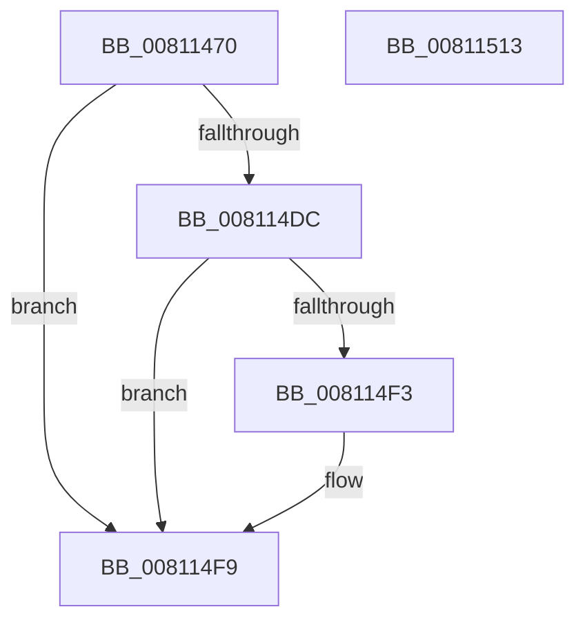

# MiQueryAcceleratorHandle

- RVA: `0x00811470`–`0x00811514` (길이 `164` bytes)
- VA: `0x0000000140811470`
- 실행 섹션: `PAGE`
- PDB 이름 있음: `예`; PDB Function 태그: `아니요`
- unwind 정보 RVA: `0x000D95A0`
- 디코드: `47`개 명령, `164/164` bytes 표시
- 미해석 바이트: `0` (있으면 어셈블리에 `.byte`로 보존)

> 이 문서는 커널 이미지의 기계어와 PDB 기호를 분석해 생성했습니다. 4번과 5번은 함수 원형과 자료형을 바이너리 사용 방식에서 추정한 C 해석이며 원본 소스 복구 결과는 아닙니다.

## 1. Dependencies

- 직접 호출 지점: **3**; 고유 호출 대상: **3**
- 직접 호출자로 확인된 함수: **1**
- RIP 상대 이미지 참조: **1**

### Outgoing calls
- `0x008114B6` → [memset](../../text/6C/memset_function_006C6C40.md) (function, `0x006C6C40`)
- `0x008114CA` → `ext-ms-win-accel-api-km-l1-1-0.dll!AccelQueryResourceInformation` (import, 간접 대상; import `ext-ms-win-accel-api-km-l1-1-0.dll!AccelQueryResourceInformation`)
- `0x008114E8` → [AccelQueryDescriptorSize](../../text/66/AccelQueryDescriptorSize_function_00668750.md) (function, `0x00668750`)

### Direct callers
- [MiAcceptNewAccelerators](MiAcceptNewAccelerators_function_00811364.md) at `0x008113CE`

### Static image references
- `0x008114CA` → RVA `0x001511B0` (`ext-ms-win-accel-api-km-l1-1-0.dll!AccelQueryResourceInformation (IAT)`; read)

## 2. Other-region calls and transfers

- 다른 실행 섹션으로 향하는 call: **2**
  - `0x008114B6` → [memset](../../text/6C/memset_function_006C6C40.md) (`PAGE` → `.text`)
  - `0x008114E8` → [AccelQueryDescriptorSize](../../text/66/AccelQueryDescriptorSize_function_00668750.md) (`PAGE` → `.text`)
- 별도 외부 분기/꼬리 이동을 확인하지 못했습니다.

## 3. Assembly (complete function range)

```asm
00811470  48 89 5C 24 10                  mov qword ptr [rsp + 0x10], rbx
00811475  48 89 74 24 18                  mov qword ptr [rsp + 0x18], rsi
0081147A  55                              push rbp
0081147B  57                              push rdi
0081147C  41 56                           push r14
0081147E  48 8D 6C 24 B9                  lea rbp, [rsp - 0x47]
00811483  48 81 EC A0 00 00 00            sub rsp, 0xa0
0081148A  83 65 67 00                     and dword ptr [rbp + 0x67], 0
0081148E  41 BE 01 00 00 00               mov r14d, 1
00811494  49 8B D8                        mov rbx, r8
00811497  48 89 4D CF                     mov qword ptr [rbp - 0x31], rcx
0081149B  48 8B F2                        mov rsi, rdx
0081149E  C7 45 C7 01 00 10 00            mov dword ptr [rbp - 0x39], 0x100001
008114A5  48 8B F9                        mov rdi, rcx
008114A8  44 89 75 CB                     mov dword ptr [rbp - 0x35], r14d
008114AC  45 8D 46 63                     lea r8d, [r14 + 0x63]
008114B0  33 D2                           xor edx, edx
008114B2  48 8D 4D DB                     lea rcx, [rbp - 0x25]
008114B6  E8 85 57 EB FF                  call 0x1406c6c40
008114BB  48 8D 55 D7                     lea rdx, [rbp - 0x29]
008114BF  C7 45 D7 01 00 68 00            mov dword ptr [rbp - 0x29], 0x680001
008114C6  48 8D 4D C7                     lea rcx, [rbp - 0x39]
008114CA  48 FF 15 DF FC 93 FF            call qword ptr [rip - 0x6c0321]
008114D1  0F 1F 44 00 00                  nop dword ptr [rax + rax]
008114D6  8B C8                           mov ecx, eax
008114D8  85 C0                           test eax, eax
008114DA  78 1D                           js 0x1408114f9
008114DC  8B 45 E7                        mov eax, dword ptr [rbp - 0x19]
008114DF  48 8D 55 67                     lea rdx, [rbp + 0x67]
008114E3  48 8B CF                        mov rcx, rdi
008114E6  89 06                           mov dword ptr [rsi], eax
008114E8  E8 63 72 E5 FF                  call 0x140668750
008114ED  8B C8                           mov ecx, eax
008114EF  85 C0                           test eax, eax
008114F1  78 06                           js 0x1408114f9
008114F3  8B 45 67                        mov eax, dword ptr [rbp + 0x67]
008114F6  48 89 03                        mov qword ptr [rbx], rax
008114F9  4C 8D 9C 24 A0 00 00 00         lea r11, [rsp + 0xa0]
00811501  8B C1                           mov eax, ecx
00811503  49 8B 5B 28                     mov rbx, qword ptr [r11 + 0x28]
00811507  49 8B 73 30                     mov rsi, qword ptr [r11 + 0x30]
0081150B  49 8B E3                        mov rsp, r11
0081150E  41 5E                           pop r14
00811510  5F                              pop rdi
00811511  5D                              pop rbp
00811512  C3                              ret
00811513  CC                              int3
```

## 4. C-style interpretation (structured pseudocode)

```c
__int64 __fastcall MiQueryAcceleratorHandle(__int64 a1, __int64 a2, __int64 a3)
{
    __int64 result;
    __int64 v_rsp;
    unsigned __int64 v_stack_m18;
    unsigned __int64 v_stack_m5F;
    unsigned int v_stack_m78;
    unsigned __int64 v_stack_m84;
    unsigned __int64 v_stack_m88;
    unsigned __int64 v_stack_m90;
    unsigned int v_stack_m94;
    unsigned int v_stack_m98;
    unsigned __int64 v_stack_p10;
    unsigned __int64 v_stack_p18;
    unsigned int v_stack_p8;

    v_stack_p10 = v_rbx;
    v_stack_p18 = v_rsi;
    v_rsp = (v_rsp) - (160);
    v_stack_m90 = a1;
    v_stack_m98 = 0x100001ULL;
    v_stack_m94 = 1;
    a2 = 0;
    result = memset(v_stack_m84, a2, 1 + 99, a4);
    v_stack_m88 = 0x680001ULL;
    result = ext_ms_win_accel_api_km_l1_1_0_dll_AccelQueryResourceInformation(v_stack_m98, v_stack_m88, 1 + 99, a4);
    if (sign_flag) goto loc_008114F9;
    *(unsigned int *)(a2) = (unsigned int)((unsigned int)(v_stack_m78));
    result = AccelQueryDescriptorSize(a1, v_stack_p8, 1 + 99, a4);
    if (!(sign_flag)) {
        result = v_stack_p8;
        *(unsigned __int64 *)(a3) = result;
    }
    return (unsigned int)((unsigned int)((unsigned int)((unsigned int)(result))));
}
```

## 5. (Beta) C Style

```c
int64_t MiQueryAcceleratorHandle(int64_t Arg1, void *Arg2, void *Arg3)
{
    uint8_t *arg2 = (uint8_t *)Arg2;
    uint8_t *arg3 = (uint8_t *)Arg3;

    int64_t result;
    int64_t local_rsp;
    uint64_t v_stack_m18;
    uint64_t v_stack_m5F;
    uint32_t v_stack_m78;
    uint64_t v_stack_m84;
    uint64_t v_stack_m88;
    uint64_t v_stack_m90;
    uint32_t v_stack_m94;
    uint32_t v_stack_m98;
    uint64_t v_stack_p10;
    uint64_t v_stack_p18;
    uint32_t v_stack_p8;

    v_stack_p10 = local_rbx;
    v_stack_p18 = local_rsi;
    local_rsp = (local_rsp) - (160);
    v_stack_m90 = Arg1;
    v_stack_m98 = 0x100001ULL;
    v_stack_m94 = 1;
    Arg2 = 0;
    result = memset(v_stack_m84, Arg2, 1 + 99, a4);
    v_stack_m88 = 0x680001ULL;
    result = kernel_indirect_call(v_stack_m98, v_stack_m88, 1 + 99, a4);
    if (sign_flag) goto loc_008114F9;
    *(uint32_t *)(arg2) = (uint32_t)((uint32_t)(v_stack_m78));
    result = AccelQueryDescriptorSize(Arg1, v_stack_p8, 1 + 99, a4);
    if (!(sign_flag)) {
        result = v_stack_p8;
        *(uint64_t *)(arg3) = result;
    }
    return (uint32_t)((uint32_t)((uint32_t)((uint32_t)(result))));
}
```

### 관측된 메모리 오프셋

구조체 형식이 확인되지 않은 접근은 인자 기준의 오프셋으로만 기록했습니다.

| 기준 인자 | 오프셋 표현 | 폭 (bit) | 접근 |
|---|---:|---:|---|
| `Arg2` | `+ 0x0` | `32` | `W` |
| `Arg3` | `+ 0x0` | `64` | `W` |

## 6. Execution-region graph

[열기: 2D/3D 그래프와 함수 탐색 컨트롤 패널](../../../control-panel.html?section=page&rva=0x00811470&view=graph)

- 2D 그래프는 위에서 아래로 흐르고, 3D 그래프는 빈 공간을 드래그해 회전합니다. Shift+드래그는 이동, 휠은 확대·축소, 함수 노드 선택은 대상 보고서 이동입니다.

### Static fallback


