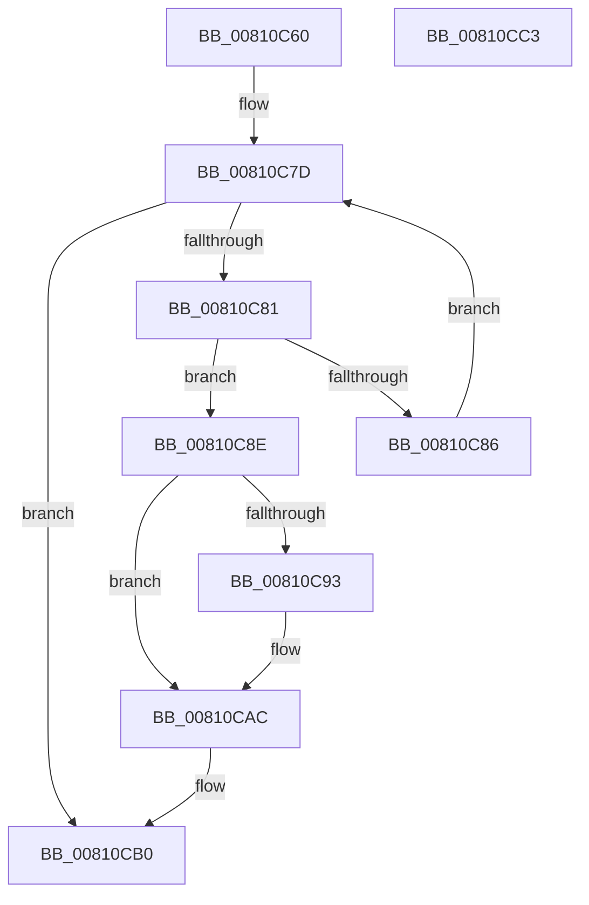

# MiRemoveConductorListZeroThread

- RVA: `0x00810C60`–`0x00810CC4` (길이 `100` bytes)
- VA: `0x0000000140810C60`
- 실행 섹션: `PAGE`
- PDB 이름 있음: `예`; PDB Function 태그: `아니요`
- unwind 정보 RVA: `0x00060BC4`
- 디코드: `32`개 명령, `100/100` bytes 표시
- 미해석 바이트: `0` (있으면 어셈블리에 `.byte`로 보존)

> 이 문서는 커널 이미지의 기계어와 PDB 기호를 분석해 생성했습니다. 4번과 5번은 함수 원형과 자료형을 바이너리 사용 방식에서 추정한 C 해석이며 원본 소스 복구 결과는 아닙니다.

## 1. Dependencies

- 직접 호출 지점: **1**; 고유 호출 대상: **1**
- 직접 호출자로 확인된 함수: **1**
- RIP 상대 이미지 참조: **0**

### Outgoing calls
- `0x00810CA4` → [memcpy](../../text/6C/memcpy_function_006C6840.md) (function, `0x006C6840`)

### Direct callers
- [MiDeleteThreadContext](../../text/69/MiDeleteThreadContext_function_00695E54.md) at `0x00695EE0`

### Static image references
- 디코드된 RIP-relative 메모리 참조가 없습니다.

## 2. Other-region calls and transfers

- 다른 실행 섹션으로 향하는 call: **1**
  - `0x00810CA4` → [memcpy](../../text/6C/memcpy_function_006C6840.md) (`PAGE` → `.text`)
- 별도 외부 분기/꼬리 이동을 확인하지 못했습니다.

## 3. Assembly (complete function range)

```asm
00810C60  48 89 5C 24 08                  mov qword ptr [rsp + 8], rbx
00810C65  48 89 74 24 10                  mov qword ptr [rsp + 0x10], rsi
00810C6A  57                              push rdi
00810C6B  48 83 EC 20                     sub rsp, 0x20
00810C6F  48 8B 79 48                     mov rdi, qword ptr [rcx + 0x48]
00810C73  48 8B F1                        mov rsi, rcx
00810C76  8B 41 3C                        mov eax, dword ptr [rcx + 0x3c]
00810C79  48 83 C7 18                     add rdi, 0x18
00810C7D  85 C0                           test eax, eax
00810C7F  74 2F                           je 0x140810cb0
00810C81  48 39 17                        cmp qword ptr [rdi], rdx
00810C84  74 08                           je 0x140810c8e
00810C86  48 83 C7 08                     add rdi, 8
00810C8A  FF C8                           dec eax
00810C8C  EB EF                           jmp 0x140810c7d
00810C8E  83 F8 01                        cmp eax, 1
00810C91  74 19                           je 0x140810cac
00810C93  8D 58 FF                        lea ebx, [rax - 1]
00810C96  48 8B CF                        mov rcx, rdi
00810C99  48 C1 E3 03                     shl rbx, 3
00810C9D  48 8D 57 08                     lea rdx, [rdi + 8]
00810CA1  4C 8B C3                        mov r8, rbx
00810CA4  E8 97 5B EB FF                  call 0x1406c6840
00810CA9  48 03 FB                        add rdi, rbx
00810CAC  48 83 27 00                     and qword ptr [rdi], 0
00810CB0  FF 4E 3C                        dec dword ptr [rsi + 0x3c]
00810CB3  48 8B 74 24 38                  mov rsi, qword ptr [rsp + 0x38]
00810CB8  48 8B 5C 24 30                  mov rbx, qword ptr [rsp + 0x30]
00810CBD  48 83 C4 20                     add rsp, 0x20
00810CC1  5F                              pop rdi
00810CC2  C3                              ret
00810CC3  CC                              int3
```

## 4. C-style interpretation (structured pseudocode)

```c
__int64 __fastcall MiRemoveConductorListZeroThread(__int64 a1, __int64 a2)
{
    __int64 result;
    __int64 v_rbx;
    __int64 v_rdi;
    __int64 v_rsp;
    unsigned __int64 v_stack_p10;
    unsigned __int64 v_stack_p8;

    v_stack_p8 = v_rbx;
    v_stack_p10 = v_rsi;
    v_rsp = (v_rsp) - (32);
    v_rdi = (*(unsigned __int64 *)(a1 + 72)) + (24);
loc_00810C7D:
    if ((unsigned int)((unsigned int)(*(unsigned int *)(a1 + 60))) == 0) goto loc_00810CB0;
    if ((*(unsigned __int64 *)(v_rdi)) == a2) goto loc_00810C8E;
    v_rdi = (v_rdi) + (8);
    result = (unsigned int)(((unsigned int)(*(unsigned int *)(a1 + 60))) - 1);
    goto loc_00810C7D;
loc_00810C8E:
    if (((unsigned int)(result)) != 1) {
        v_rbx = result - 1;
        a1 = v_rdi;
        v_rbx = (v_rbx) << (3);
        a2 = v_rdi + 8;
        a3 = v_rbx;
        result = memcpy(a1, a2, a3, a4);
        v_rdi = (v_rdi) + (v_rbx);
    }
loc_00810CB0:
    v_rsp = (v_rsp) + (32);
    return result;
}
```

## 5. (Beta) C Style

```c
int64_t MiRemoveConductorListZeroThread(void *Arg1, int64_t Arg2)
{
    uint8_t *arg1 = (uint8_t *)Arg1;

    int64_t result;
    int64_t local_rbx;
    int64_t local_rdi;
    int64_t local_rsp;
    uint64_t v_stack_p10;
    uint64_t v_stack_p8;

    v_stack_p8 = local_rbx;
    v_stack_p10 = local_rsi;
    local_rsp = (local_rsp) - (32);
    local_rdi = (*(uint64_t *)(arg1 + 0x48)) + (24);
loc_00810C7D:
    if ((uint32_t)((uint32_t)(*(uint32_t *)(arg1 + 0x3C))) == 0) goto loc_00810CB0;
    if ((*(uint64_t *)(local_rdi)) == Arg2) goto loc_00810C8E;
    local_rdi = (local_rdi) + (8);
    result = (uint32_t)(((uint32_t)(*(uint32_t *)(arg1 + 0x3C))) - 1);
    goto loc_00810C7D;
loc_00810C8E:
    if (((uint32_t)(result)) != 1) {
        local_rbx = result - 1;
        Arg1 = local_rdi;
        local_rbx = (local_rbx) << (3);
        Arg2 = local_rdi + 8;
        a3 = local_rbx;
        result = memcpy(Arg1, Arg2, a3, a4);
        local_rdi = (local_rdi) + (local_rbx);
    }
loc_00810CB0:
    local_rsp = (local_rsp) + (32);
    return result;
}
```

### 관측된 메모리 오프셋

구조체 형식이 확인되지 않은 접근은 인자 기준의 오프셋으로만 기록했습니다.

| 기준 인자 | 오프셋 표현 | 폭 (bit) | 접근 |
|---|---:|---:|---|
| `Arg1` | `+ 0x3C` | `32` | `R` |
| `Arg1` | `+ 0x3C` | `32` | `R/W` |
| `Arg1` | `+ 0x48` | `64` | `R` |

## 6. Execution-region graph

[열기: 2D/3D 그래프와 함수 탐색 컨트롤 패널](../../../control-panel.html?section=page&rva=0x00810C60&view=graph)

- 2D 그래프는 위에서 아래로 흐르고, 3D 그래프는 빈 공간을 드래그해 회전합니다. Shift+드래그는 이동, 휠은 확대·축소, 함수 노드 선택은 대상 보고서 이동입니다.

### Static fallback


