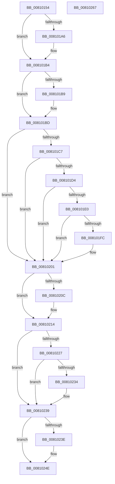

# MiSpecialPurposeMemoryTypeDereference

- RVA: `0x00810154`–`0x00810268` (길이 `276` bytes)
- VA: `0x0000000140810154`
- 실행 섹션: `PAGE`
- PDB 이름 있음: `예`; PDB Function 태그: `아니요`
- unwind 정보 RVA: `0x00060300`
- 디코드: `77`개 명령, `276/276` bytes 표시
- 미해석 바이트: `0` (있으면 어셈블리에 `.byte`로 보존)

> 이 문서는 커널 이미지의 기계어와 PDB 기호를 분석해 생성했습니다. 4번과 5번은 함수 원형과 자료형을 바이너리 사용 방식에서 추정한 C 해석이며 원본 소스 복구 결과는 아닙니다.

## 1. Dependencies

- 직접 호출 지점: **7**; 고유 호출 대상: **7**
- 직접 호출자로 확인된 함수: **4**
- RIP 상대 이미지 참조: **0**

### Outgoing calls
- `0x00810196` → [KeAbPreAcquire](../../text/21/KeAbPreAcquire_function_00210230.md) (function, `0x00210230`)
- `0x008101AF` → [ExfAcquirePushLockExclusiveEx](../../text/20/ExfAcquirePushLockExclusiveEx_function_0020FC90.md) (function, `0x0020FC90`)
- `0x0081020F` → [ExfTryToWakePushLock](../../text/26/ExfTryToWakePushLock_function_00265DD0.md) (function, `0x00265DD0`)
- `0x00810217` → [KeAbPostRelease](../../text/2E/KeAbPostRelease_function_002E1600.md) (function, `0x002E1600`)
- `0x00810234` → [KiCheckForKernelApcDelivery](../../text/2E/KiCheckForKernelApcDelivery_function_002E2C80.md) (function, `0x002E2C80`)
- `0x00810241` → [MiSpecialPurposeMemoryRemoved](../80/MiSpecialPurposeMemoryRemoved_function_0080FFD8.md) (function, `0x0080FFD8`)
- `0x00810249` → [PsDereferencePartition](../../text/34/PsDereferencePartition_function_00342E70.md) (function, `0x00342E70`)

### Direct callers
- [MmManagePartitionInitialAddMemory](../80/MmManagePartitionInitialAddMemory_function_0080E144.md) at `0x0080E1CB`
- [MmManagePartitionMoveMemory](../80/MmManagePartitionMoveMemory_function_0080E1F4.md) at `0x0080E466`
- [MiCreatePagefileMemoryExtents](../80/MiCreatePagefileMemoryExtents_function_0080F1BC.md) at `0x0080F3A2`
- [MiOpenSpecialPurposeMemory](../80/MiOpenSpecialPurposeMemory_function_0080FA28.md) at `0x0080FB97`

### Static image references
- 디코드된 RIP-relative 메모리 참조가 없습니다.

## 2. Other-region calls and transfers

- 다른 실행 섹션으로 향하는 call: **6**
  - `0x00810196` → [KeAbPreAcquire](../../text/21/KeAbPreAcquire_function_00210230.md) (`PAGE` → `.text`)
  - `0x008101AF` → [ExfAcquirePushLockExclusiveEx](../../text/20/ExfAcquirePushLockExclusiveEx_function_0020FC90.md) (`PAGE` → `.text`)
  - `0x0081020F` → [ExfTryToWakePushLock](../../text/26/ExfTryToWakePushLock_function_00265DD0.md) (`PAGE` → `.text`)
  - `0x00810217` → [KeAbPostRelease](../../text/2E/KeAbPostRelease_function_002E1600.md) (`PAGE` → `.text`)
  - `0x00810234` → [KiCheckForKernelApcDelivery](../../text/2E/KiCheckForKernelApcDelivery_function_002E2C80.md) (`PAGE` → `.text`)
  - `0x00810249` → [PsDereferencePartition](../../text/34/PsDereferencePartition_function_00342E70.md) (`PAGE` → `.text`)
- 별도 외부 분기/꼬리 이동을 확인하지 못했습니다.

## 3. Assembly (complete function range)

```asm
00810154  48 89 5C 24 08                  mov qword ptr [rsp + 8], rbx
00810159  48 89 6C 24 10                  mov qword ptr [rsp + 0x10], rbp
0081015E  48 89 74 24 18                  mov qword ptr [rsp + 0x18], rsi
00810163  57                              push rdi
00810164  41 56                           push r14
00810166  41 57                           push r15
00810168  48 83 EC 20                     sub rsp, 0x20
0081016C  65 48 8B 2C 25 88 01 00 00      mov rbp, qword ptr gs:[0x188]
00810175  48 8D B9 08 45 00 00            lea rdi, [rcx + 0x4508]
0081017C  48 8B F2                        mov rsi, rdx
0081017F  33 DB                           xor ebx, ebx
00810181  45 33 C0                        xor r8d, r8d
00810184  33 D2                           xor edx, edx
00810186  48 8B CF                        mov rcx, rdi
00810189  44 8D 7B 01                     lea r15d, [rbx + 1]
0081018D  66 44 29 BD E6 01 00 00         sub word ptr [rbp + 0x1e6], r15w
00810195  90                              nop
00810196  E8 95 00 A0 FF                  call 0x140210230
0081019B  F0 48 0F BA 2F 00               lock bts qword ptr [rdi], 0
008101A1  4C 8B F0                        mov r14, rax
008101A4  73 0E                           jae 0x1408101b4
008101A6  4C 8B C7                        mov r8, rdi
008101A9  48 8B D0                        mov rdx, rax
008101AC  48 8B CF                        mov rcx, rdi
008101AF  E8 DC FA 9F FF                  call 0x14020fc90
008101B4  4D 85 F6                        test r14, r14
008101B7  74 04                           je 0x1408101bd
008101B9  45 88 7E 0A                     mov byte ptr [r14 + 0xa], r15b
008101BD  48 83 C8 FF                     or rax, 0xffffffffffffffff
008101C1  48 01 46 58                     add qword ptr [rsi + 0x58], rax
008101C5  75 3A                           jne 0x140810201
008101C7  48 8B 4E 40                     mov rcx, qword ptr [rsi + 0x40]
008101CB  48 39 99 50 48 00 00            cmp qword ptr [rcx + 0x4850], rbx
008101D2  75 2D                           jne 0x140810201
008101D4  48 8B 89 A8 01 00 00            mov rcx, qword ptr [rcx + 0x1a8]
008101DB  48 85 C9                        test rcx, rcx
008101DE  75 21                           jne 0x140810201
008101E0  48 8B 4E 40                     mov rcx, qword ptr [rsi + 0x40]
008101E4  48 8B 99 B8 00 00 00            mov rbx, qword ptr [rcx + 0xb8]
008101EB  49 8B CF                        mov rcx, r15
008101EE  F0 48 0F C1 4B 28               lock xadd qword ptr [rbx + 0x28], rcx
008101F4  49 03 CF                        add rcx, r15
008101F7  49 3B CF                        cmp rcx, r15
008101FA  7F 05                           jg 0x140810201
008101FC  8D 48 0F                        lea ecx, [rax + 0xf]
008101FF  CD 29                           int 0x29
00810201  F0 48 0F C1 07                  lock xadd qword ptr [rdi], rax
00810206  24 06                           and al, 6
00810208  3C 02                           cmp al, 2
0081020A  75 08                           jne 0x140810214
0081020C  48 8B CF                        mov rcx, rdi
0081020F  E8 BC 5B A5 FF                  call 0x140265dd0
00810214  48 8B CF                        mov rcx, rdi
00810217  E8 E4 13 AD FF                  call 0x1402e1600
0081021C  90                              nop
0081021D  66 44 01 BD E6 01 00 00         add word ptr [rbp + 0x1e6], r15w
00810225  75 12                           jne 0x140810239
00810227  48 8D 85 98 00 00 00            lea rax, [rbp + 0x98]
0081022E  90                              nop
0081022F  48 39 00                        cmp qword ptr [rax], rax
00810232  74 05                           je 0x140810239
00810234  E8 47 2A AD FF                  call 0x1402e2c80
00810239  48 85 DB                        test rbx, rbx
0081023C  74 10                           je 0x14081024e
0081023E  48 8B 0B                        mov rcx, qword ptr [rbx]
00810241  E8 92 FD FF FF                  call 0x14080ffd8
00810246  48 8B CB                        mov rcx, rbx
00810249  E8 22 2C B3 FF                  call 0x140342e70
0081024E  48 8B 5C 24 40                  mov rbx, qword ptr [rsp + 0x40]
00810253  48 8B 6C 24 48                  mov rbp, qword ptr [rsp + 0x48]
00810258  48 8B 74 24 50                  mov rsi, qword ptr [rsp + 0x50]
0081025D  48 83 C4 20                     add rsp, 0x20
00810261  41 5F                           pop r15
00810263  41 5E                           pop r14
00810265  5F                              pop rdi
00810266  C3                              ret
00810267  CC                              int3
```

## 4. C-style interpretation (structured pseudocode)

```c
__int64 __fastcall MiSpecialPurposeMemoryTypeDereference(__int64 a1, __int64 a2, int a3)
{
    __int64 result;
    __int64 v_rbx;
    __int64 v_rsp;
    unsigned __int64 v_stack_p10;
    unsigned __int64 v_stack_p18;
    unsigned __int64 v_stack_p8;

    v_stack_p8 = v_rbx;
    v_stack_p10 = v_rbp;
    v_stack_p18 = v_rsi;
    v_rsp = (v_rsp) - (32);
    v_rbx = 0;
    a3 = 0;
    a2 = 0;
    result = KeAbPreAcquire(a1 + 17672, a2, a3, a4);
    if (!(condition_is_above_or_equal)) {
        a3 = a1 + 17672;
        a2 = result;
        a1 = a1 + 17672;
        result = ExfAcquirePushLockExclusiveEx(a1, a2, a3, a4);
    }
    if (result != 0) {
        *(unsigned __int8 *)(result + 10) = (unsigned __int8)(v_rbx + 1);
    }
    result = (result) | (-1);
    if (condition_is_not_equal) goto loc_00810201;
    if ((*(unsigned __int64 *)(*(unsigned __int64 *)(a2 + 64) + 18512)) != 0) goto loc_00810201;
    if (*(unsigned __int64 *)(*(unsigned __int64 *)(a2 + 64) + 424) != 0) goto loc_00810201;
    a1 = (v_rbx + 1) + (v_rbx + 1);
    if (a1 <= (v_rbx + 1)) {
        a1 = result + 15;
    }
    result = (unsigned __int8)((result) & (6));
    if (((unsigned __int8)(result)) == 2) {
        a1 = a1 + 17672;
        result = ExfTryToWakePushLock(a1, a2, a3, a4);
    }
    result = KeAbPostRelease(a1 + 17672, a2, a3, a4);
    if (((unsigned __int8)(result)) != 2) goto loc_00810239;
    result = *(unsigned __int64 *)(gs_base + (0 + 392)) + 152;
    if ((*(unsigned __int64 *)(*(unsigned __int64 *)(gs_base + (0 + 392)) + 152)) != (*(unsigned __int64 *)(gs_base + (0 + 392)) + 152)) {
        result = KiCheckForKernelApcDelivery(a1 + 17672, a2, a3, a4);
    }
    if (*(unsigned __int64 *)(*(unsigned __int64 *)(a2 + 64) + 184) != 0) {
        a1 = *(unsigned __int64 *)(*(unsigned __int64 *)(*(unsigned __int64 *)(a2 + 64) + 184));
        result = MiSpecialPurposeMemoryRemoved(a1, a2, a3, a4);
        a1 = *(unsigned __int64 *)(*(unsigned __int64 *)(a2 + 64) + 184);
        result = PsDereferencePartition(a1, a2, a3, a4);
    }
    v_rsp = (v_rsp) + (32);
    return result;
}
```

## 5. (Beta) C Style

```c
int64_t MiSpecialPurposeMemoryTypeDereference(void *Arg1, void *Arg2, int32_t Arg3)
{
    uint8_t *arg1 = (uint8_t *)Arg1;
    uint8_t *arg2 = (uint8_t *)Arg2;

    int64_t result;
    int64_t local_rbx;
    int64_t local_rsp;
    uint64_t v_stack_p10;
    uint64_t v_stack_p18;
    uint64_t v_stack_p8;

    v_stack_p8 = local_rbx;
    v_stack_p10 = local_rbp;
    v_stack_p18 = local_rsi;
    local_rsp = (local_rsp) - (32);
    local_rbx = 0;
    Arg3 = 0;
    Arg2 = 0;
    result = KeAbPreAcquire(Arg1 + 17672, Arg2, Arg3, a4);
    if (!(condition_is_above_or_equal)) {
        Arg3 = Arg1 + 17672;
        Arg2 = result;
        Arg1 = Arg1 + 17672;
        result = ExfAcquirePushLockExclusiveEx(Arg1, Arg2, Arg3, a4);
    }
    if (result != 0) {
        *(uint8_t *)(result + 0xA) = (uint8_t)(local_rbx + 1);
    }
    result = (result) | (-1);
    if (condition_is_not_equal) goto loc_00810201;
    if ((*(uint64_t *)(*(uint64_t *)(arg2 + 0x40) + 0x4850)) != 0) goto loc_00810201;
    if (*(uint64_t *)(*(uint64_t *)(arg2 + 0x40) + 0x1A8) != 0) goto loc_00810201;
    Arg1 = (local_rbx + 1) + (local_rbx + 1);
    if (Arg1 <= (local_rbx + 1)) {
        Arg1 = result + 15;
    }
    result = (uint8_t)((result) & (6));
    if (((uint8_t)(result)) == 2) {
        Arg1 = Arg1 + 17672;
        result = ExfTryToWakePushLock(Arg1, Arg2, Arg3, a4);
    }
    result = KeAbPostRelease(Arg1 + 17672, Arg2, Arg3, a4);
    if (((uint8_t)(result)) != 2) goto loc_00810239;
    result = *(uint64_t *)(gs_base + (0 + 0x188)) + 152;
    if ((*(uint64_t *)(*(uint64_t *)(gs_base + (0 + 0x188)) + 0x98)) != (*(uint64_t *)(gs_base + (0 + 0x188)) + 152)) {
        result = KiCheckForKernelApcDelivery(Arg1 + 17672, Arg2, Arg3, a4);
    }
    if (*(uint64_t *)(*(uint64_t *)(arg2 + 0x40) + 0xB8) != 0) {
        Arg1 = *(uint64_t *)(*(uint64_t *)(*(uint64_t *)(arg2 + 0x40) + 0xB8));
        result = MiSpecialPurposeMemoryRemoved(Arg1, Arg2, Arg3, a4);
        Arg1 = *(uint64_t *)(*(uint64_t *)(arg2 + 0x40) + 0xB8);
        result = PsDereferencePartition(Arg1, Arg2, Arg3, a4);
    }
    local_rsp = (local_rsp) + (32);
    return result;
}
```

### 관측된 메모리 오프셋

구조체 형식이 확인되지 않은 접근은 인자 기준의 오프셋으로만 기록했습니다.

| 기준 인자 | 오프셋 표현 | 폭 (bit) | 접근 |
|---|---:|---:|---|
| `Arg1` | `+ 0x0` | `64` | `R/W` |
| `Arg1` | `+ 0x4508` | `64` | `R` |
| `Arg2` | `+ 0x40` | `64` | `R` |
| `Arg2` | `+ 0x58` | `64` | `R/W` |

## 6. Execution-region graph

[열기: 2D/3D 그래프와 함수 탐색 컨트롤 패널](../../../control-panel.html?section=page&rva=0x00810154&view=graph)

- 2D 그래프는 위에서 아래로 흐르고, 3D 그래프는 빈 공간을 드래그해 회전합니다. Shift+드래그는 이동, 휠은 확대·축소, 함수 노드 선택은 대상 보고서 이동입니다.

### Static fallback


