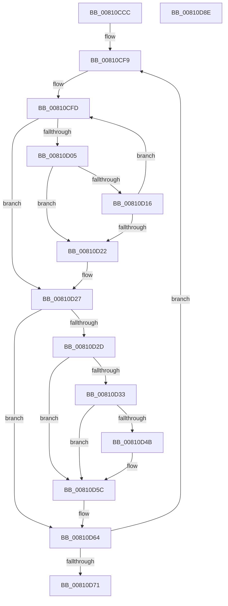

# MiStartZeroEngineThreads

- RVA: `0x00810CCC`–`0x00810D8F` (길이 `195` bytes)
- VA: `0x0000000140810CCC`
- 실행 섹션: `PAGE`
- PDB 이름 있음: `예`; PDB Function 태그: `아니요`
- unwind 정보 RVA: `0x0005E6B4`
- 디코드: `54`개 명령, `195/195` bytes 표시
- 미해석 바이트: `0` (있으면 어셈블리에 `.byte`로 보존)

> 이 문서는 커널 이미지의 기계어와 PDB 기호를 분석해 생성했습니다. 4번과 5번은 함수 원형과 자료형을 바이너리 사용 방식에서 추정한 C 해석이며 원본 소스 복구 결과는 아닙니다.

## 1. Dependencies

- 직접 호출 지점: **5**; 고유 호출 대상: **5**
- 직접 호출자로 확인된 함수: **1**
- RIP 상대 이미지 참조: **0**

### Outgoing calls
- `0x00810D0C` → [MiCreateZeroThreadContext](MiCreateZeroThreadContext_function_008105B4.md) (function, `0x008105B4`)
- `0x00810D19` → [MiInsertNewZeroThread](../../text/69/MiInsertNewZeroThread_function_00696140.md) (function, `0x00696140`)
- `0x00810D36` → [MiZeroBootCalibratorStarted](../../text/69/MiZeroBootCalibratorStarted_function_006967E8.md) (function, `0x006967E8`)
- `0x00810D57` → [KeSetEvent](../../text/33/KeSetEvent_function_0033F310.md) (function, `0x0033F310`)
- `0x00810D5F` → [MiSignalZeroingPassComplete](../../text/69/MiSignalZeroingPassComplete_function_00696690.md) (function, `0x00696690`)

### Direct callers
- [MiNodeZeroConductor](MiNodeZeroConductor_function_00810AC0.md) at `0x00810BB5`

### Static image references
- 디코드된 RIP-relative 메모리 참조가 없습니다.

## 2. Other-region calls and transfers

- 다른 실행 섹션으로 향하는 call: **4**
  - `0x00810D19` → [MiInsertNewZeroThread](../../text/69/MiInsertNewZeroThread_function_00696140.md) (`PAGE` → `.text`)
  - `0x00810D36` → [MiZeroBootCalibratorStarted](../../text/69/MiZeroBootCalibratorStarted_function_006967E8.md) (`PAGE` → `.text`)
  - `0x00810D57` → [KeSetEvent](../../text/33/KeSetEvent_function_0033F310.md) (`PAGE` → `.text`)
  - `0x00810D5F` → [MiSignalZeroingPassComplete](../../text/69/MiSignalZeroingPassComplete_function_00696690.md) (`PAGE` → `.text`)
- 별도 외부 분기/꼬리 이동을 확인하지 못했습니다.

## 3. Assembly (complete function range)

```asm
00810CCC  48 8B C4                        mov rax, rsp
00810CCF  48 89 58 08                     mov qword ptr [rax + 8], rbx
00810CD3  48 89 68 10                     mov qword ptr [rax + 0x10], rbp
00810CD7  48 89 70 18                     mov qword ptr [rax + 0x18], rsi
00810CDB  48 89 78 20                     mov qword ptr [rax + 0x20], rdi
00810CDF  41 56                           push r14
00810CE1  48 83 EC 20                     sub rsp, 0x20
00810CE5  48 8B 69 30                     mov rbp, qword ptr [rcx + 0x30]
00810CE9  48 8D 99 AA 00 00 00            lea rbx, [rcx + 0xaa]
00810CF0  BE 01 00 00 00                  mov esi, 1
00810CF5  44 8D 76 02                     lea r14d, [rsi + 2]
00810CF9  48 8D 7B DE                     lea rdi, [rbx - 0x22]
00810CFD  8B 43 E6                        mov eax, dword ptr [rbx - 0x1a]
00810D00  39 43 E2                        cmp dword ptr [rbx - 0x1e], eax
00810D03  73 22                           jae 0x140810d27
00810D05  48 8D 7B DE                     lea rdi, [rbx - 0x22]
00810D09  48 8B CF                        mov rcx, rdi
00810D0C  E8 A3 F8 FF FF                  call 0x1408105b4
00810D11  48 85 C0                        test rax, rax
00810D14  74 0C                           je 0x140810d22
00810D16  48 8B C8                        mov rcx, rax
00810D19  E8 22 54 E8 FF                  call 0x140696140
00810D1E  85 C0                           test eax, eax
00810D20  79 DB                           jns 0x140810cfd
00810D22  33 F6                           xor esi, esi
00810D24  C6 03 01                        mov byte ptr [rbx], 1
00810D27  80 7B FD 00                     cmp byte ptr [rbx - 3], 0
00810D2B  75 37                           jne 0x140810d64
00810D2D  80 7B FB 00                     cmp byte ptr [rbx - 5], 0
00810D31  74 29                           je 0x140810d5c
00810D33  48 8B CF                        mov rcx, rdi
00810D36  E8 AD 5A E8 FF                  call 0x1406967e8
00810D3B  83 C8 FF                        or eax, 0xffffffff
00810D3E  F0 0F C1 85 34 42 00 00         lock xadd dword ptr [rbp + 0x4234], eax
00810D46  83 F8 01                        cmp eax, 1
00810D49  75 11                           jne 0x140810d5c
00810D4B  48 8D 8D 38 42 00 00            lea rcx, [rbp + 0x4238]
00810D52  45 33 C0                        xor r8d, r8d
00810D55  33 D2                           xor edx, edx
00810D57  E8 B4 E5 B2 FF                  call 0x14033f310
00810D5C  48 8B CF                        mov rcx, rdi
00810D5F  E8 2C 59 E8 FF                  call 0x140696690
00810D64  48 81 C3 30 01 00 00            add rbx, 0x130
00810D6B  49 83 EE 01                     sub r14, 1
00810D6F  75 88                           jne 0x140810cf9
00810D71  48 8B 5C 24 30                  mov rbx, qword ptr [rsp + 0x30]
00810D76  8B C6                           mov eax, esi
00810D78  48 8B 74 24 40                  mov rsi, qword ptr [rsp + 0x40]
00810D7D  48 8B 6C 24 38                  mov rbp, qword ptr [rsp + 0x38]
00810D82  48 8B 7C 24 48                  mov rdi, qword ptr [rsp + 0x48]
00810D87  48 83 C4 20                     add rsp, 0x20
00810D8B  41 5E                           pop r14
00810D8D  C3                              ret
00810D8E  CC                              int3
```

## 4. C-style interpretation (structured pseudocode)

```c
__int64 __fastcall MiStartZeroEngineThreads(__int64 a1, int a2, int a3)
{
    __int64 result;
    __int64 v_r14;
    __int64 v_rbx;
    __int64 v_rsi;
    __int64 v_rsp;
    unsigned __int64 v_stack_p10;
    unsigned __int64 v_stack_p18;
    unsigned __int64 v_stack_p20;
    unsigned __int64 v_stack_p8;

    *(unsigned __int64 *)(v_rsp + 8) = v_rbx;
    *(unsigned __int64 *)(v_rsp + 16) = v_rbp;
    *(unsigned __int64 *)(v_rsp + 24) = v_rsi;
    *(unsigned __int64 *)(v_rsp + 32) = v_rdi;
    v_rsp = (v_rsp) - (32);
loc_00810CF9:
loc_00810CFD:
    if ((*(unsigned int *)(a1 + 170 - 30)) >= ((unsigned int)((unsigned int)(*(unsigned int *)(a1 + 170 - 26))))) goto loc_00810D27;
    result = MiCreateZeroThreadContext(a1 + 170 - 34, a2, a3, a4);
    if (result == 0) goto loc_00810D22;
    result = MiInsertNewZeroThread(result, a2, a3, a4);
    if (!sign_flag) goto loc_00810CFD;
loc_00810D22:
    v_rsi = 0;
    *(unsigned __int8 *)(a1 + 170) = 1;
loc_00810D27:
    if ((*(unsigned __int8 *)(a1 + 170 - 3)) != 0) goto loc_00810D64;
    if ((*(unsigned __int8 *)(a1 + 170 - 5)) == 0) goto loc_00810D5C;
    result = MiZeroBootCalibratorStarted(a1 + 170 - 34, a2, a3, a4);
    result = (unsigned int)((result) | (0xFFFFFFFFULL));
    if (((unsigned int)(result)) == 1) {
        a1 = *(unsigned __int64 *)(a1 + 48) + 16952;
        a3 = 0;
        a2 = 0;
        result = KeSetEvent(a1, a2, a3, a4);
    }
    result = MiSignalZeroingPassComplete(a1 + 170 - 34, a2, a3, a4);
loc_00810D64:
    v_rbx = (a1 + 170) + (304);
    v_r14 = (1 + 2) - (1);
    if (condition_is_not_equal) goto loc_00810CF9;
    v_rsp = (v_rsp) + (32);
    return 0;
}
```

## 5. (Beta) C Style

```c
int64_t MiStartZeroEngineThreads(void *Arg1, int32_t Arg2, int32_t Arg3)
{
    uint8_t *arg1 = (uint8_t *)Arg1;

    int64_t result;
    int64_t local_r14;
    int64_t local_rbx;
    int64_t local_rsi;
    int64_t local_rsp;
    uint64_t v_stack_p10;
    uint64_t v_stack_p18;
    uint64_t v_stack_p20;
    uint64_t v_stack_p8;

    *(uint64_t *)(local_rsp + 0x8) = local_rbx;
    *(uint64_t *)(local_rsp + 0x10) = local_rbp;
    *(uint64_t *)(local_rsp + 0x18) = local_rsi;
    *(uint64_t *)(local_rsp + 0x20) = local_rdi;
    local_rsp = (local_rsp) - (32);
loc_00810CF9:
loc_00810CFD:
    if ((*(uint32_t *)(arg1 + 0xAA - 0x1E)) >= ((uint32_t)((uint32_t)(*(uint32_t *)(arg1 + 0xAA - 0x1A))))) goto loc_00810D27;
    result = MiCreateZeroThreadContext(Arg1 + 170 - 34, Arg2, Arg3, a4);
    if (result == 0) goto loc_00810D22;
    result = MiInsertNewZeroThread(result, Arg2, Arg3, a4);
    if (!sign_flag) goto loc_00810CFD;
loc_00810D22:
    local_rsi = 0;
    *(uint8_t *)(arg1 + 0xAA) = 1;
loc_00810D27:
    if ((*(uint8_t *)(arg1 + 0xAA - 0x3)) != 0) goto loc_00810D64;
    if ((*(uint8_t *)(arg1 + 0xAA - 0x5)) == 0) goto loc_00810D5C;
    result = MiZeroBootCalibratorStarted(Arg1 + 170 - 34, Arg2, Arg3, a4);
    result = (uint32_t)((result) | (0xFFFFFFFFULL));
    if (((uint32_t)(result)) == 1) {
        Arg1 = *(uint64_t *)(arg1 + 0x30) + 16952;
        Arg3 = 0;
        Arg2 = 0;
        result = KeSetEvent(Arg1, Arg2, Arg3, a4);
    }
    result = MiSignalZeroingPassComplete(Arg1 + 170 - 34, Arg2, Arg3, a4);
loc_00810D64:
    local_rbx = (Arg1 + 170) + (304);
    local_r14 = (1 + 2) - (1);
    if (condition_is_not_equal) goto loc_00810CF9;
    local_rsp = (local_rsp) + (32);
    return 0;
}
```

### 관측된 메모리 오프셋

구조체 형식이 확인되지 않은 접근은 인자 기준의 오프셋으로만 기록했습니다.

| 기준 인자 | 오프셋 표현 | 폭 (bit) | 접근 |
|---|---:|---:|---|
| `Arg1` | `- 0x22` | `64` | `R` |
| `Arg1` | `- 0x1E` | `32` | `R` |
| `Arg1` | `- 0x1A` | `32` | `R` |
| `Arg1` | `- 0x5` | `8` | `R` |
| `Arg1` | `- 0x3` | `8` | `R` |
| `Arg1` | `+ 0x0` | `8` | `W` |
| `Arg1` | `+ 0x30` | `64` | `R` |
| `Arg1` | `+ 0xAA` | `64` | `R` |

## 6. Execution-region graph

[열기: 2D/3D 그래프와 함수 탐색 컨트롤 패널](../../../control-panel.html?section=page&rva=0x00810CCC&view=graph)

- 2D 그래프는 위에서 아래로 흐르고, 3D 그래프는 빈 공간을 드래그해 회전합니다. Shift+드래그는 이동, 휠은 확대·축소, 함수 노드 선택은 대상 보고서 이동입니다.

### Static fallback


