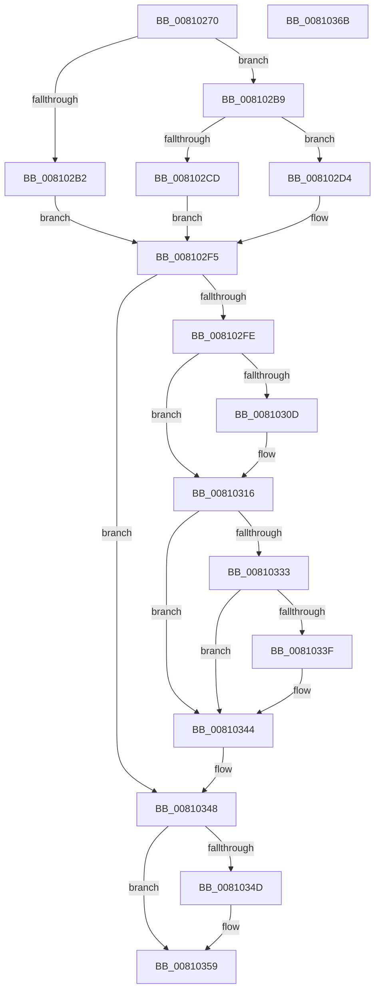

# MiUpdateSpecialPurposeMemoryCacheEligibility

- RVA: `0x00810270`–`0x0081036C` (길이 `252` bytes)
- VA: `0x0000000140810270`
- 실행 섹션: `PAGE`
- PDB 이름 있음: `예`; PDB Function 태그: `아니요`
- unwind 정보 RVA: `0x00091FE0`
- 디코드: `72`개 명령, `252/252` bytes 표시
- 미해석 바이트: `0` (있으면 어셈블리에 `.byte`로 보존)

> 이 문서는 커널 이미지의 기계어와 PDB 기호를 분석해 생성했습니다. 4번과 5번은 함수 원형과 자료형을 바이너리 사용 방식에서 추정한 C 해석이며 원본 소스 복구 결과는 아닙니다.

## 1. Dependencies

- 직접 호출 지점: **6**; 고유 호출 대상: **6**
- 직접 호출자로 확인된 함수: **1**
- RIP 상대 이미지 참조: **1**

### Outgoing calls
- `0x008102A1` → [MiFindSpecialPurposeMemoryTypeByPartition](../80/MiFindSpecialPurposeMemoryTypeByPartition_function_0080F5D8.md) (function, `0x0080F5D8`)
- `0x008102EE` → [KeGenericCallDpcEx](../../text/2C/KeGenericCallDpcEx_function_002C99F4.md) (function, `0x002C99F4`)
- `0x00810311` → [ExfTryToWakePushLock](../../text/26/ExfTryToWakePushLock_function_00265DD0.md) (function, `0x00265DD0`)
- `0x0081031A` → [KeAbPostRelease](../../text/2E/KeAbPostRelease_function_002E1600.md) (function, `0x002E1600`)
- `0x0081033F` → [KiCheckForKernelApcDelivery](../../text/2E/KiCheckForKernelApcDelivery_function_002E2C80.md) (function, `0x002E2C80`)
- `0x00810354` → [PsDereferencePartition](../../text/34/PsDereferencePartition_function_00342E70.md) (function, `0x00342E70`)

### Direct callers
- [MmManagePartitionUpdateAttributes](../80/MmManagePartitionUpdateAttributes_function_0080E5A4.md) at `0x0080E5F8`

### Static image references
- `0x008102D8` → RVA `0x00695240` (`MiSpecialPurposeMemoryCacheUpdateDpc`; read)

## 2. Other-region calls and transfers

- 다른 실행 섹션으로 향하는 call: **5**
  - `0x008102EE` → [KeGenericCallDpcEx](../../text/2C/KeGenericCallDpcEx_function_002C99F4.md) (`PAGE` → `.text`)
  - `0x00810311` → [ExfTryToWakePushLock](../../text/26/ExfTryToWakePushLock_function_00265DD0.md) (`PAGE` → `.text`)
  - `0x0081031A` → [KeAbPostRelease](../../text/2E/KeAbPostRelease_function_002E1600.md) (`PAGE` → `.text`)
  - `0x0081033F` → [KiCheckForKernelApcDelivery](../../text/2E/KiCheckForKernelApcDelivery_function_002E2C80.md) (`PAGE` → `.text`)
  - `0x00810354` → [PsDereferencePartition](../../text/34/PsDereferencePartition_function_00342E70.md) (`PAGE` → `.text`)
- 별도 외부 분기/꼬리 이동을 확인하지 못했습니다.

## 3. Assembly (complete function range)

```asm
00810270  48 89 5C 24 08                  mov qword ptr [rsp + 8], rbx
00810275  48 89 7C 24 10                  mov qword ptr [rsp + 0x10], rdi
0081027A  55                              push rbp
0081027B  48 8B EC                        mov rbp, rsp
0081027E  48 83 EC 40                     sub rsp, 0x40
00810282  33 C0                           xor eax, eax
00810284  4C 8D 45 20                     lea r8, [rbp + 0x20]
00810288  48 21 45 20                     and qword ptr [rbp + 0x20], rax
0081028C  8B FA                           mov edi, edx
0081028E  48 21 45 28                     and qword ptr [rbp + 0x28], rax
00810292  48 8D 55 28                     lea rdx, [rbp + 0x28]
00810296  0F 57 C0                        xorps xmm0, xmm0
00810299  48 89 45 F0                     mov qword ptr [rbp - 0x10], rax
0081029D  0F 11 45 E0                     movups xmmword ptr [rbp - 0x20], xmm0
008102A1  E8 32 F3 FF FF                  call 0x14080f5d8
008102A6  48 8B 5D 28                     mov rbx, qword ptr [rbp + 0x28]
008102AA  48 8B D0                        mov rdx, rax
008102AD  48 85 C0                        test rax, rax
008102B0  75 07                           jne 0x1408102b9
008102B2  BF A0 04 00 C0                  mov edi, 0xc00004a0
008102B7  EB 3C                           jmp 0x1408102f5
008102B9  33 C9                           xor ecx, ecx
008102BB  48 39 48 48                     cmp qword ptr [rax + 0x48], rcx
008102BF  0F 94 C1                        sete cl
008102C2  33 C0                           xor eax, eax
008102C4  85 FF                           test edi, edi
008102C6  0F 94 C0                        sete al
008102C9  3B C1                           cmp eax, ecx
008102CB  75 07                           jne 0x1408102d4
008102CD  BF FF 00 00 00                  mov edi, 0xff
008102D2  EB 21                           jmp 0x1408102f5
008102D4  83 65 F4 00                     and dword ptr [rbp - 0xc], 0
008102D8  48 8D 0D 61 4F E8 FF            lea rcx, [rip - 0x17b09f]
008102DF  48 89 55 E0                     mov qword ptr [rbp - 0x20], rdx
008102E3  48 8D 55 E0                     lea rdx, [rbp - 0x20]
008102E7  89 7D F0                        mov dword ptr [rbp - 0x10], edi
008102EA  48 89 5D E8                     mov qword ptr [rbp - 0x18], rbx
008102EE  E8 01 97 AB FF                  call 0x1402c99f4
008102F3  33 FF                           xor edi, edi
008102F5  48 8B 4D 20                     mov rcx, qword ptr [rbp + 0x20]
008102F9  48 85 C9                        test rcx, rcx
008102FC  74 4A                           je 0x140810348
008102FE  48 83 C8 FF                     or rax, 0xffffffffffffffff
00810302  F0 48 0F C1 01                  lock xadd qword ptr [rcx], rax
00810307  24 06                           and al, 6
00810309  3C 02                           cmp al, 2
0081030B  75 09                           jne 0x140810316
0081030D  48 8B 4D 20                     mov rcx, qword ptr [rbp + 0x20]
00810311  E8 BA 5A A5 FF                  call 0x140265dd0
00810316  48 8B 4D 20                     mov rcx, qword ptr [rbp + 0x20]
0081031A  E8 E1 12 AD FF                  call 0x1402e1600
0081031F  65 48 8B 04 25 88 01 00 00      mov rax, qword ptr gs:[0x188]
00810328  90                              nop
00810329  66 83 80 E6 01 00 00 01         add word ptr [rax + 0x1e6], 1
00810331  75 11                           jne 0x140810344
00810333  48 05 98 00 00 00               add rax, 0x98
00810339  90                              nop
0081033A  48 39 00                        cmp qword ptr [rax], rax
0081033D  74 05                           je 0x140810344
0081033F  E8 3C 29 AD FF                  call 0x1402e2c80
00810344  48 8B 5D 28                     mov rbx, qword ptr [rbp + 0x28]
00810348  48 85 DB                        test rbx, rbx
0081034B  74 0C                           je 0x140810359
0081034D  48 8B 8B B8 00 00 00            mov rcx, qword ptr [rbx + 0xb8]
00810354  E8 17 2B B3 FF                  call 0x140342e70
00810359  48 8B 5C 24 50                  mov rbx, qword ptr [rsp + 0x50]
0081035E  8B C7                           mov eax, edi
00810360  48 8B 7C 24 58                  mov rdi, qword ptr [rsp + 0x58]
00810365  48 83 C4 40                     add rsp, 0x40
00810369  5D                              pop rbp
0081036A  C3                              ret
0081036B  CC                              int3
```

## 4. C-style interpretation (structured pseudocode)

```c
__int64 __fastcall MiUpdateSpecialPurposeMemoryCacheEligibility(int a1, int a2)
{
    __int64 result;
    __int64 v_rdi;
    __int64 v_rsp;
    unsigned int v_stack_m14;
    unsigned __int64 v_stack_m18;
    unsigned __int64 v_stack_m20;
    unsigned __int64 v_stack_m28;
    unsigned __int64 v_stack_p10;
    unsigned __int64 v_stack_p18;
    unsigned __int64 v_stack_p20;
    unsigned __int64 v_stack_p8;

    v_stack_p8 = v_rbx;
    v_stack_p10 = v_rdi;
    v_rsp = (v_rsp) - (64);
    result = 0;
    v_stack_m18 = 0;
    v_stack_m28 = v_xmm0;
    result = MiFindSpecialPurposeMemoryTypeByPartition(a1, v_stack_p20, v_stack_p18, a4);
    if (result != 0) goto loc_008102B9;
    goto loc_008102F5;
loc_008102B9:
    a1 = 0;
    a1 = ((*(unsigned __int64 *)(result + 72)) == 0) ? 1 : 0;
    result = 0;
    result = ((unsigned int)((unsigned int)(0xC00004A0ULL)) == 0) ? 1 : 0;
    if (((unsigned int)(result)) != a1) goto loc_008102D4;
    goto loc_008102F5;
loc_008102D4:
    v_stack_m28 = result;
    v_stack_m18 = 255;
    v_stack_m20 = v_stack_p20;
    result = KeGenericCallDpcEx(v_rip - 1552543, v_stack_m28, v_stack_p18, a4);
    v_rdi = 0;
loc_008102F5:
    if (v_stack_p18 == 0) goto loc_00810348;
    result = (result) | (-1);
    result = (unsigned __int8)((result) & (6));
    if (((unsigned __int8)(result)) == 2) {
        a1 = v_stack_p18;
        result = ExfTryToWakePushLock(a1, v_stack_m28, v_stack_p18, a4);
    }
    result = KeAbPostRelease(v_stack_p18, v_stack_m28, v_stack_p18, a4);
    if (((unsigned __int8)(result)) != 2) goto loc_00810344;
    result = (*(unsigned __int64 *)(gs_base + (0 + 392))) + (152);
    if ((*(unsigned __int64 *)(result)) != result) {
        result = KiCheckForKernelApcDelivery(v_stack_p18, v_stack_m28, v_stack_p18, a4);
    }
loc_00810348:
    if (v_stack_p20 != 0) {
        a1 = *(unsigned __int64 *)(v_stack_p20 + 184);
        result = PsDereferencePartition(a1, v_stack_m28, v_stack_p18, a4);
    }
    v_rsp = (v_rsp) + (64);
    return 0;
}
```

## 5. (Beta) C Style

```c
int64_t MiUpdateSpecialPurposeMemoryCacheEligibility(int32_t Arg1, int32_t Arg2)
{
    int64_t result;
    int64_t local_rdi;
    int64_t local_rsp;
    uint32_t v_stack_m14;
    uint64_t v_stack_m18;
    uint64_t v_stack_m20;
    uint64_t v_stack_m28;
    uint64_t v_stack_p10;
    uint64_t v_stack_p18;
    uint64_t v_stack_p20;
    uint64_t v_stack_p8;

    v_stack_p8 = local_rbx;
    v_stack_p10 = local_rdi;
    local_rsp = (local_rsp) - (64);
    result = 0;
    v_stack_m18 = 0;
    v_stack_m28 = v_xmm0;
    result = MiFindSpecialPurposeMemoryTypeByPartition(Arg1, v_stack_p20, v_stack_p18, a4);
    if (result != 0) goto loc_008102B9;
    goto loc_008102F5;
loc_008102B9:
    Arg1 = 0;
    Arg1 = ((*(uint64_t *)(result + 0x48)) == 0) ? 1 : 0;
    result = 0;
    result = ((uint32_t)((uint32_t)(0xC00004A0ULL)) == 0) ? 1 : 0;
    if (((uint32_t)(result)) != Arg1) goto loc_008102D4;
    goto loc_008102F5;
loc_008102D4:
    v_stack_m28 = result;
    v_stack_m18 = 255;
    v_stack_m20 = v_stack_p20;
    result = KeGenericCallDpcEx(v_rip - 1552543, v_stack_m28, v_stack_p18, a4);
    local_rdi = 0;
loc_008102F5:
    if (v_stack_p18 == 0) goto loc_00810348;
    result = (result) | (-1);
    result = (uint8_t)((result) & (6));
    if (((uint8_t)(result)) == 2) {
        Arg1 = v_stack_p18;
        result = ExfTryToWakePushLock(Arg1, v_stack_m28, v_stack_p18, a4);
    }
    result = KeAbPostRelease(v_stack_p18, v_stack_m28, v_stack_p18, a4);
    if (((uint8_t)(result)) != 2) goto loc_00810344;
    result = (*(uint64_t *)(gs_base + (0 + 0x188))) + (152);
    if ((*(uint64_t *)(result)) != result) {
        result = KiCheckForKernelApcDelivery(v_stack_p18, v_stack_m28, v_stack_p18, a4);
    }
loc_00810348:
    if (v_stack_p20 != 0) {
        Arg1 = *(uint64_t *)(v_stack_p20 + 0xB8);
        result = PsDereferencePartition(Arg1, v_stack_m28, v_stack_p18, a4);
    }
    local_rsp = (local_rsp) + (64);
    return 0;
}
```

## 6. Execution-region graph

[열기: 2D/3D 그래프와 함수 탐색 컨트롤 패널](../../../control-panel.html?section=page&rva=0x00810270&view=graph)

- 2D 그래프는 위에서 아래로 흐르고, 3D 그래프는 빈 공간을 드래그해 회전합니다. Shift+드래그는 이동, 휠은 확대·축소, 함수 노드 선택은 대상 보고서 이동입니다.

### Static fallback


