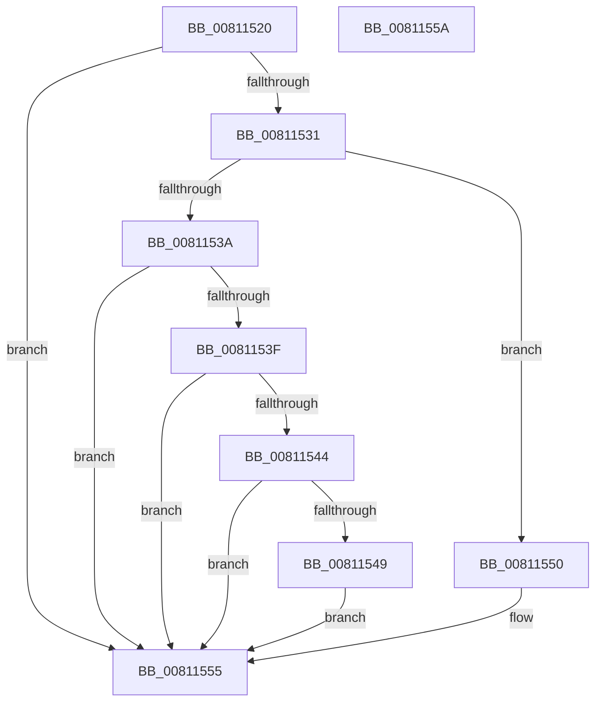

# MmAcceleratorCallbackRoutine

- RVA: `0x00811520`–`0x0081155B` (길이 `59` bytes)
- VA: `0x0000000140811520`
- 실행 섹션: `PAGE`
- PDB 이름 있음: `예`; PDB Function 태그: `아니요`
- unwind 정보 RVA: `0x0005C788`
- 디코드: `20`개 명령, `59/59` bytes 표시
- 미해석 바이트: `0` (있으면 어셈블리에 `.byte`로 보존)

> 이 문서는 커널 이미지의 기계어와 PDB 기호를 분석해 생성했습니다. 4번과 5번은 함수 원형과 자료형을 바이너리 사용 방식에서 추정한 C 해석이며 원본 소스 복구 결과는 아닙니다.

## 1. Dependencies

- 직접 호출 지점: **2**; 고유 호출 대상: **2**
- 직접 호출자로 확인된 함수: **0**
- RIP 상대 이미지 참조: **1**

### Outgoing calls
- `0x00811549` → [MiAcceptNewAccelerators](MiAcceptNewAccelerators_function_00811364.md) (function, `0x00811364`)
- `0x00811550` → [MiDeleteHardwareAccelerators](../../text/69/MiDeleteHardwareAccelerators_function_006972DC.md) (function, `0x006972DC`)

### Direct callers
- 이 함수 시작 RVA로 연결되는 직접 call은 확인되지 않았습니다. 간접 호출은 완전히 역산할 수 없습니다.

### Static image references
- `0x00811529` → RVA `0x00E37554` (`.data`; read)

## 2. Other-region calls and transfers

- 다른 실행 섹션으로 향하는 call: **1**
  - `0x00811550` → [MiDeleteHardwareAccelerators](../../text/69/MiDeleteHardwareAccelerators_function_006972DC.md) (`PAGE` → `.text`)
- 별도 외부 분기/꼬리 이동을 확인하지 못했습니다.

## 3. Assembly (complete function range)

```asm
00811520  48 83 EC 28                     sub rsp, 0x28
00811524  33 D2                           xor edx, edx
00811526  48 8B C1                        mov rax, rcx
00811529  38 15 25 60 62 00               cmp byte ptr [rip + 0x626025], dl
0081152F  75 24                           jne 0x140811555
00811531  48 8B 49 10                     mov rcx, qword ptr [rcx + 0x10]
00811535  39 50 04                        cmp dword ptr [rax + 4], edx
00811538  75 16                           jne 0x140811550
0081153A  39 51 04                        cmp dword ptr [rcx + 4], edx
0081153D  7C 16                           jl 0x140811555
0081153F  39 51 08                        cmp dword ptr [rcx + 8], edx
00811542  74 11                           je 0x140811555
00811544  39 51 18                        cmp dword ptr [rcx + 0x18], edx
00811547  74 0C                           je 0x140811555
00811549  E8 16 FE FF FF                  call 0x140811364
0081154E  EB 05                           jmp 0x140811555
00811550  E8 87 5D E8 FF                  call 0x1406972dc
00811555  48 83 C4 28                     add rsp, 0x28
00811559  C3                              ret
0081155A  CC                              int3
```

## 4. C-style interpretation (structured pseudocode)

```c
__int64 __fastcall MmAcceleratorCallbackRoutine(__int64 a1, int a2)
{
    __int64 result;
    __int64 v_rsp;

    v_rsp = (v_rsp) - (40);
    a2 = 0;
    if ((*(unsigned __int8 *)(v_rip + 6447141)) != 0) goto loc_00811555;
    if ((*(unsigned int *)(a1 + 4)) != 0) goto loc_00811550;
    if ((*(unsigned int *)(*(unsigned __int64 *)(a1 + 16) + 4)) < 0) goto loc_00811555;
    if ((*(unsigned int *)(*(unsigned __int64 *)(a1 + 16) + 8)) == 0) goto loc_00811555;
    if ((*(unsigned int *)(*(unsigned __int64 *)(a1 + 16) + 24)) == 0) goto loc_00811555;
    result = MiAcceptNewAccelerators(*(unsigned __int64 *)(a1 + 16), a2, a3, a4);
    goto loc_00811555;
loc_00811550:
    result = MiDeleteHardwareAccelerators(*(unsigned __int64 *)(a1 + 16), a2, a3, a4);
loc_00811555:
    v_rsp = (v_rsp) + (40);
    return result;
}
```

## 5. (Beta) C Style

```c
int64_t MmAcceleratorCallbackRoutine(void *Arg1, int32_t Arg2)
{
    uint8_t *arg1 = (uint8_t *)Arg1;

    int64_t result;
    int64_t local_rsp;

    local_rsp = (local_rsp) - (40);
    Arg2 = 0;
    if ((*(uint8_t *)(v_rip + 0x626025)) != 0) goto loc_00811555;
    if ((*(uint32_t *)(arg1 + 0x4)) != 0) goto loc_00811550;
    if ((*(uint32_t *)(*(uint64_t *)(arg1 + 0x10) + 0x4)) < 0) goto loc_00811555;
    if ((*(uint32_t *)(*(uint64_t *)(arg1 + 0x10) + 0x8)) == 0) goto loc_00811555;
    if ((*(uint32_t *)(*(uint64_t *)(arg1 + 0x10) + 0x18)) == 0) goto loc_00811555;
    result = MiAcceptNewAccelerators(*(uint64_t *)(arg1 + 0x10), Arg2, a3, a4);
    goto loc_00811555;
loc_00811550:
    result = MiDeleteHardwareAccelerators(*(uint64_t *)(arg1 + 0x10), Arg2, a3, a4);
loc_00811555:
    local_rsp = (local_rsp) + (40);
    return result;
}
```

### 관측된 메모리 오프셋

구조체 형식이 확인되지 않은 접근은 인자 기준의 오프셋으로만 기록했습니다.

| 기준 인자 | 오프셋 표현 | 폭 (bit) | 접근 |
|---|---:|---:|---|
| `Arg1` | `+ 0x4` | `32` | `R` |
| `Arg1` | `+ 0x10` | `64` | `R` |

## 6. Execution-region graph

[열기: 2D/3D 그래프와 함수 탐색 컨트롤 패널](../../../control-panel.html?section=page&rva=0x00811520&view=graph)

- 2D 그래프는 위에서 아래로 흐르고, 3D 그래프는 빈 공간을 드래그해 회전합니다. Shift+드래그는 이동, 휠은 확대·축소, 함수 노드 선택은 대상 보고서 이동입니다.

### Static fallback


