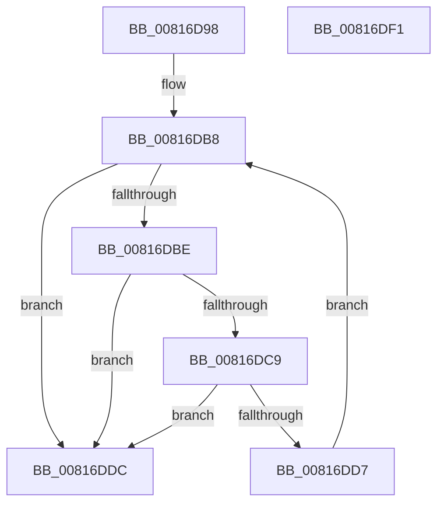

# SdbFindParentTagFromAncestors

- RVA: `0x00816D98`–`0x00816DF2` (길이 `90` bytes)
- VA: `0x0000000140816D98`
- 실행 섹션: `PAGE`
- PDB 이름 있음: `예`; PDB Function 태그: `아니요`
- unwind 정보 RVA: `0x0005C954`
- 디코드: `29`개 명령, `90/90` bytes 표시
- 미해석 바이트: `0` (있으면 어셈블리에 `.byte`로 보존)

> 이 문서는 커널 이미지의 기계어와 PDB 기호를 분석해 생성했습니다. 4번과 5번은 함수 원형과 자료형을 바이너리 사용 방식에서 추정한 C 해석이며 원본 소스 복구 결과는 아닙니다.

## 1. Dependencies

- 직접 호출 지점: **1**; 고유 호출 대상: **1**
- 직접 호출자로 확인된 함수: **1**
- RIP 상대 이미지 참조: **0**

### Outgoing calls
- `0x00816DCE` → [SdbFindFirstTag](../95/SdbFindFirstTag_function_0095E34C.md) (function, `0x0095E34C`)

### Direct callers
- [SdbMergeIsEntryUpdated](SdbMergeIsEntryUpdated_function_00819158.md) at `0x0081928D`

### Static image references
- 디코드된 RIP-relative 메모리 참조가 없습니다.

## 2. Other-region calls and transfers

- 다른 실행 섹션으로 향하는 call: **0**
- 별도 외부 분기/꼬리 이동을 확인하지 못했습니다.

## 3. Assembly (complete function range)

```asm
00816D98  48 89 5C 24 08                  mov qword ptr [rsp + 8], rbx
00816D9D  48 89 6C 24 10                  mov qword ptr [rsp + 0x10], rbp
00816DA2  48 89 74 24 18                  mov qword ptr [rsp + 0x18], rsi
00816DA7  57                              push rdi
00816DA8  48 83 EC 20                     sub rsp, 0x20
00816DAC  33 ED                           xor ebp, ebp
00816DAE  48 8B FA                        mov rdi, rdx
00816DB1  8B C5                           mov eax, ebp
00816DB3  8B DD                           mov ebx, ebp
00816DB5  48 8B F1                        mov rsi, rcx
00816DB8  48 83 FB 02                     cmp rbx, 2
00816DBC  73 1E                           jae 0x140816ddc
00816DBE  44 0F B7 04 5F                  movzx r8d, word ptr [rdi + rbx*2]
00816DC3  66 45 85 C0                     test r8w, r8w
00816DC7  74 13                           je 0x140816ddc
00816DC9  8B D0                           mov edx, eax
00816DCB  48 8B CE                        mov rcx, rsi
00816DCE  E8 79 75 14 00                  call 0x14095e34c
00816DD3  85 C0                           test eax, eax
00816DD5  74 05                           je 0x140816ddc
00816DD7  48 FF C3                        inc rbx
00816DDA  EB DC                           jmp 0x140816db8
00816DDC  48 8B 5C 24 30                  mov rbx, qword ptr [rsp + 0x30]
00816DE1  48 8B 6C 24 38                  mov rbp, qword ptr [rsp + 0x38]
00816DE6  48 8B 74 24 40                  mov rsi, qword ptr [rsp + 0x40]
00816DEB  48 83 C4 20                     add rsp, 0x20
00816DEF  5F                              pop rdi
00816DF0  C3                              ret
00816DF1  CC                              int3
```

## 4. C-style interpretation (structured pseudocode)

```c
__int64 __fastcall SdbFindParentTagFromAncestors(__int64 a1, __int64 a2)
{
    __int64 result;
    __int64 v_rbp;
    __int64 v_rbx;
    __int64 v_rsp;
    unsigned __int64 v_stack_p10;
    unsigned __int64 v_stack_p18;
    unsigned __int64 v_stack_p8;

    v_stack_p8 = v_rbx;
    v_stack_p10 = v_rbp;
    v_stack_p18 = v_rsi;
    v_rsp = (v_rsp) - (32);
    v_rbp = 0;
loc_00816DB8:
    if (0 >= 2) goto loc_00816DDC;
    if ((unsigned __int16)(*(unsigned __int16 *)(a2 + 0 * 2)) == 0) goto loc_00816DDC;
    result = SdbFindFirstTag(a1, 0, *(unsigned __int16 *)(a2 + 0 * 2), a4);
    if ((unsigned int)(result) == 0) goto loc_00816DDC;
    v_rbx = (0) + 1;
    goto loc_00816DB8;
loc_00816DDC:
    v_rsp = (v_rsp) + (32);
    return result;
}
```

## 5. (Beta) C Style

```c
int64_t SdbFindParentTagFromAncestors(int64_t Arg1, void *Arg2)
{
    uint8_t *arg2 = (uint8_t *)Arg2;

    int64_t result;
    int64_t local_rbp;
    int64_t local_rbx;
    int64_t local_rsp;
    uint64_t v_stack_p10;
    uint64_t v_stack_p18;
    uint64_t v_stack_p8;

    v_stack_p8 = local_rbx;
    v_stack_p10 = local_rbp;
    v_stack_p18 = local_rsi;
    local_rsp = (local_rsp) - (32);
    local_rbp = 0;
loc_00816DB8:
    if (0 >= 2) goto loc_00816DDC;
    if ((uint16_t)(*(uint16_t *)(arg2 + 0x0 * 2)) == 0) goto loc_00816DDC;
    result = SdbFindFirstTag(Arg1, 0, *(uint16_t *)(arg2 + 0x0 * 2), a4);
    if ((uint32_t)(result) == 0) goto loc_00816DDC;
    local_rbx = (0) + 1;
    goto loc_00816DB8;
loc_00816DDC:
    local_rsp = (local_rsp) + (32);
    return result;
}
```

### 관측된 메모리 오프셋

구조체 형식이 확인되지 않은 접근은 인자 기준의 오프셋으로만 기록했습니다.

| 기준 인자 | 오프셋 표현 | 폭 (bit) | 접근 |
|---|---:|---:|---|
| `Arg2` | `+ 0x0 + rbx*2` | `16` | `R` |

## 6. Execution-region graph

[열기: 2D/3D 그래프와 함수 탐색 컨트롤 패널](../../../control-panel.html?section=page&rva=0x00816D98&view=graph)

- 2D 그래프는 위에서 아래로 흐르고, 3D 그래프는 빈 공간을 드래그해 회전합니다. Shift+드래그는 이동, 휠은 확대·축소, 함수 노드 선택은 대상 보고서 이동입니다.

### Static fallback


