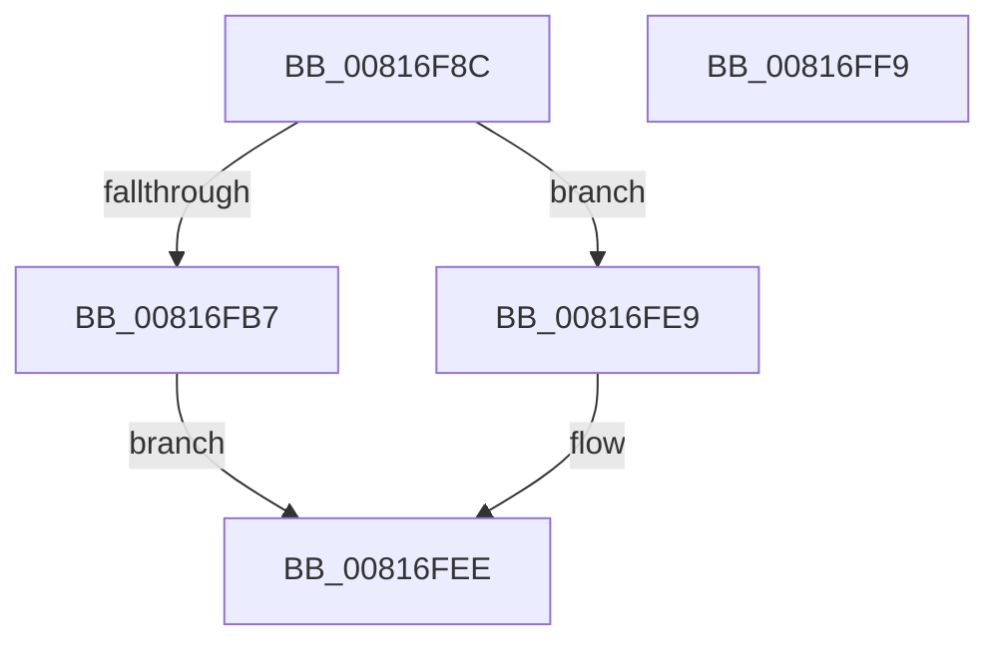

# SdbGetBinaryTagData

- RVA: `0x00816F8C`–`0x00816FFA` (길이 `110` bytes)
- VA: `0x0000000140816F8C`
- 실행 섹션: `PAGE`
- PDB 이름 있음: `예`; PDB Function 태그: `아니요`
- unwind 정보 RVA: `0x0006E5F8`
- 디코드: `30`개 명령, `110/110` bytes 표시
- 미해석 바이트: `0` (있으면 어셈블리에 `.byte`로 보존)

> 이 문서는 커널 이미지의 기계어와 PDB 기호를 분석해 생성했습니다. 4번과 5번은 함수 원형과 자료형을 바이너리 사용 방식에서 추정한 C 해석이며 원본 소스 복구 결과는 아닙니다.

## 1. Dependencies

- 직접 호출 지점: **4**; 고유 호출 대상: **3**
- 직접 호출자로 확인된 함수: **1**
- RIP 상대 이미지 참조: **2**

### Outgoing calls
- `0x00816F9B` → [SdbGetTagFromTagID](../95/SdbGetTagFromTagID_function_0095E3C0.md) (function, `0x0095E3C0`)
- `0x00816FB7` → [SdbGetTagFromTagID](../95/SdbGetTagFromTagID_function_0095E3C0.md) (function, `0x0095E3C0`)
- `0x00816FE0` → [AslLogCallPrintf](../95/AslLogCallPrintf_function_0095E4EC.md) (function, `0x0095E4EC`)
- `0x00816FE9` → [SdbpGetMappedTagData](../95/SdbpGetMappedTagData_function_0095DD24.md) (function, `0x0095DD24`)

### Direct callers
- [SdbpGetRegistryMatchingAttributes](SdbpGetRegistryMatchingAttributes_function_00815D5C.md) at `0x00815FD0`

### Static image references
- `0x00816FBF` → RVA `0x0001BB40` (`.rdata`; read)
- `0x00816FCA` → RVA `0x0003D3A0` (`.rdata`; read)

## 2. Other-region calls and transfers

- 다른 실행 섹션으로 향하는 call: **0**
- 별도 외부 분기/꼬리 이동을 확인하지 못했습니다.

## 3. Assembly (complete function range)

```asm
00816F8C  48 89 5C 24 08                  mov qword ptr [rsp + 8], rbx
00816F91  57                              push rdi
00816F92  48 83 EC 30                     sub rsp, 0x30
00816F96  8B DA                           mov ebx, edx
00816F98  48 8B F9                        mov rdi, rcx
00816F9B  E8 20 74 14 00                  call 0x14095e3c0
00816FA0  B9 00 F0 00 00                  mov ecx, 0xf000
00816FA5  8B D3                           mov edx, ebx
00816FA7  66 23 C1                        and ax, cx
00816FAA  B9 00 90 00 00                  mov ecx, 0x9000
00816FAF  66 3B C1                        cmp ax, cx
00816FB2  48 8B CF                        mov rcx, rdi
00816FB5  74 32                           je 0x140816fe9
00816FB7  E8 04 74 14 00                  call 0x14095e3c0
00816FBC  0F B7 C0                        movzx eax, ax
00816FBF  4C 8D 0D 7A 4B 80 FF            lea r9, [rip - 0x7fb486]
00816FC6  89 44 24 28                     mov dword ptr [rsp + 0x28], eax
00816FCA  48 8D 15 CF 63 82 FF            lea rdx, [rip - 0x7d9c31]
00816FD1  41 B8 0B 04 00 00               mov r8d, 0x40b
00816FD7  89 5C 24 20                     mov dword ptr [rsp + 0x20], ebx
00816FDB  B9 01 00 00 00                  mov ecx, 1
00816FE0  E8 07 75 14 00                  call 0x14095e4ec
00816FE5  33 C0                           xor eax, eax
00816FE7  EB 05                           jmp 0x140816fee
00816FE9  E8 36 6D 14 00                  call 0x14095dd24
00816FEE  48 8B 5C 24 40                  mov rbx, qword ptr [rsp + 0x40]
00816FF3  48 83 C4 30                     add rsp, 0x30
00816FF7  5F                              pop rdi
00816FF8  C3                              ret
00816FF9  CC                              int3
```

## 4. C-style interpretation (structured pseudocode)

```c
__int64 __fastcall SdbGetBinaryTagData(__int64 a1, int a2)
{
    __int64 result;
    __int64 v_rsp;
    unsigned int v_stack_m10;
    unsigned int v_stack_m18;
    unsigned __int64 v_stack_p8;

    v_stack_p8 = v_rbx;
    v_rsp = (v_rsp) - (48);
    result = SdbGetTagFromTagID(a1, a2, a3, a4);
    result = (unsigned __int16)((result) & ((unsigned __int16)((unsigned int)(0xF000ULL))));
    if (((unsigned __int16)(result)) == ((unsigned __int16)((unsigned int)(0x9000ULL)))) goto loc_00816FE9;
    result = SdbGetTagFromTagID(a1, (unsigned int)((unsigned int)((unsigned int)(a2))), a3, a4);
    v_stack_m10 = (unsigned int)((unsigned __int16)(result));
    v_stack_m18 = (unsigned int)((unsigned int)(a2));
    result = AslLogCallPrintf(1, v_rip - 8231985, (unsigned int)(0x40BULL), v_rip - 8369286);
    result = 0;
    goto loc_00816FEE;
loc_00816FE9:
    result = SdbpGetMappedTagData(1, v_rip - 8231985, (unsigned int)(0x40BULL), v_rip - 8369286);
loc_00816FEE:
    v_rsp = (v_rsp) + (48);
    return result;
}
```

## 5. (Beta) C Style

```c
int64_t SdbGetBinaryTagData(int64_t Arg1, int32_t Arg2)
{
    int64_t result;
    int64_t local_rsp;
    uint32_t v_stack_m10;
    uint32_t v_stack_m18;
    uint64_t v_stack_p8;

    v_stack_p8 = local_rbx;
    local_rsp = (local_rsp) - (48);
    result = SdbGetTagFromTagID(Arg1, Arg2, a3, a4);
    result = (uint16_t)((result) & ((uint16_t)((uint32_t)(0xF000ULL))));
    if (((uint16_t)(result)) == ((uint16_t)((uint32_t)(0x9000ULL)))) goto loc_00816FE9;
    result = SdbGetTagFromTagID(Arg1, (uint32_t)((uint32_t)((uint32_t)(Arg2))), a3, a4);
    v_stack_m10 = (uint32_t)((uint16_t)(result));
    v_stack_m18 = (uint32_t)((uint32_t)(Arg2));
    result = AslLogCallPrintf(1, v_rip - 8231985, (uint32_t)(0x40BULL), v_rip - 8369286);
    result = 0;
    goto loc_00816FEE;
loc_00816FE9:
    result = SdbpGetMappedTagData(1, v_rip - 8231985, (uint32_t)(0x40BULL), v_rip - 8369286);
loc_00816FEE:
    local_rsp = (local_rsp) + (48);
    return result;
}
```

## 6. Execution-region graph

[열기: 2D/3D 그래프와 함수 탐색 컨트롤 패널](../../../control-panel.html?section=page&rva=0x00816F8C&view=graph)

- 2D 그래프는 위에서 아래로 흐르고, 3D 그래프는 빈 공간을 드래그해 회전합니다. Shift+드래그는 이동, 휠은 확대·축소, 함수 노드 선택은 대상 보고서 이동입니다.

### Static fallback


