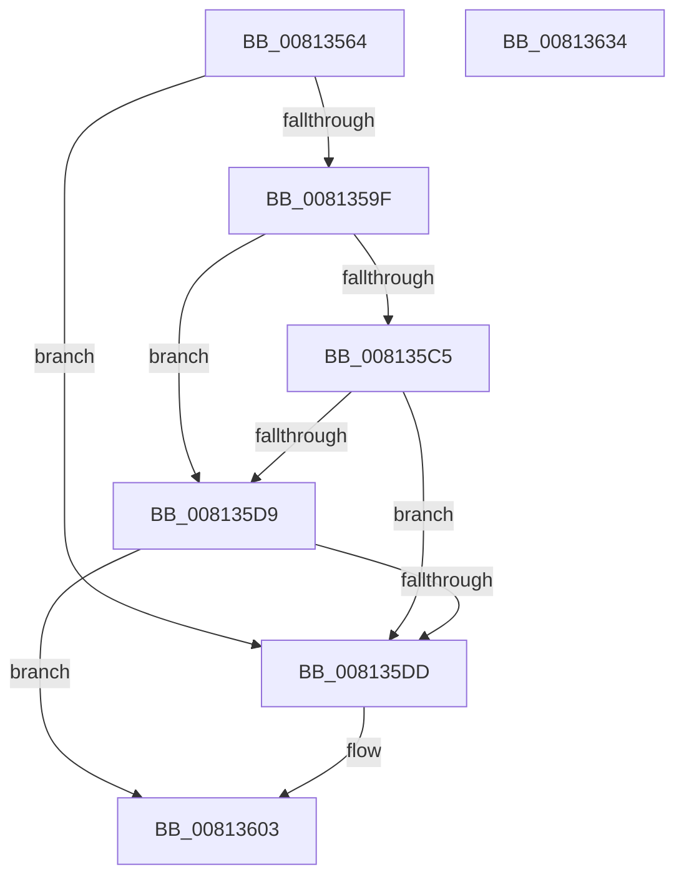

# SdbGetKShimTagRef

- RVA: `0x00813564`–`0x00813635` (길이 `209` bytes)
- VA: `0x0000000140813564`
- 실행 섹션: `PAGE`
- PDB 이름 있음: `예`; PDB Function 태그: `아니요`
- unwind 정보 RVA: `0x000D3D10`
- 디코드: `60`개 명령, `209/209` bytes 표시
- 미해석 바이트: `0` (있으면 어셈블리에 `.byte`로 보존)

> 이 문서는 커널 이미지의 기계어와 PDB 기호를 분석해 생성했습니다. 4번과 5번은 함수 원형과 자료형을 바이너리 사용 방식에서 추정한 C 해석이며 원본 소스 복구 결과는 아닙니다.

## 1. Dependencies

- 직접 호출 지점: **4**; 고유 호출 대상: **3**
- 직접 호출자로 확인된 함수: **1**
- RIP 상대 이미지 참조: **0**

### Outgoing calls
- `0x008135B8` → [SdbFindFirstStringIndexedTag](../95/SdbFindFirstStringIndexedTag_function_0095C1D8.md) (function, `0x0095C1D8`)
- `0x008135D0` → [SdbFindFirstTag](../95/SdbFindFirstTag_function_0095E34C.md) (function, `0x0095E34C`)
- `0x008135FC` → [SdbFindFirstStringIndexedTag](../95/SdbFindFirstStringIndexedTag_function_0095C1D8.md) (function, `0x0095C1D8`)
- `0x00813611` → [SdbTagIDToTagRef](SdbTagIDToTagRef_function_0081710C.md) (function, `0x0081710C`)

### Direct callers
- [KsepDbGetShimInfo](../74/KsepDbGetShimInfo_function_00748E94.md) at `0x00748F33`

### Static image references
- 디코드된 RIP-relative 메모리 참조가 없습니다.

## 2. Other-region calls and transfers

- 다른 실행 섹션으로 향하는 call: **0**
- 별도 외부 분기/꼬리 이동을 확인하지 못했습니다.

## 3. Assembly (complete function range)

```asm
00813564  4C 8B DC                        mov r11, rsp
00813567  49 89 5B 10                     mov qword ptr [r11 + 0x10], rbx
0081356B  49 89 6B 18                     mov qword ptr [r11 + 0x18], rbp
0081356F  49 89 73 20                     mov qword ptr [r11 + 0x20], rsi
00813573  57                              push rdi
00813574  48 83 EC 60                     sub rsp, 0x60
00813578  83 64 24 70 00                  and dword ptr [rsp + 0x70], 0
0081357D  0F 57 C0                        xorps xmm0, xmm0
00813580  48 8B 59 10                     mov rbx, qword ptr [rcx + 0x10]
00813584  33 C0                           xor eax, eax
00813586  48 8B EA                        mov rbp, rdx
00813589  48 8B F1                        mov rsi, rcx
0081358C  0F 11 44 24 30                  movups xmmword ptr [rsp + 0x30], xmm0
00813591  0F 11 44 24 40                  movups xmmword ptr [rsp + 0x40], xmm0
00813596  49 89 43 E8                     mov qword ptr [r11 - 0x18], rax
0081359A  48 85 DB                        test rbx, rbx
0081359D  74 3E                           je 0x1408135dd
0081359F  49 8D 43 C8                     lea rax, [r11 - 0x38]
008135A3  BA 25 70 00 00                  mov edx, 0x7025
008135A8  41 B8 01 60 00 00               mov r8d, 0x6001
008135AE  49 89 43 B8                     mov qword ptr [r11 - 0x48], rax
008135B2  4C 8B CD                        mov r9, rbp
008135B5  48 8B CB                        mov rcx, rbx
008135B8  E8 1B 8C 14 00                  call 0x14095c1d8
008135BD  8B F8                           mov edi, eax
008135BF  48 39 5E 10                     cmp qword ptr [rsi + 0x10], rbx
008135C3  75 14                           jne 0x1408135d9
008135C5  41 B8 18 10 00 00               mov r8d, 0x1018
008135CB  8B D0                           mov edx, eax
008135CD  48 8B CB                        mov rcx, rbx
008135D0  E8 77 AD 14 00                  call 0x14095e34c
008135D5  85 C0                           test eax, eax
008135D7  75 04                           jne 0x1408135dd
008135D9  85 FF                           test edi, edi
008135DB  75 26                           jne 0x140813603
008135DD  48 8B 5E 08                     mov rbx, qword ptr [rsi + 8]
008135E1  48 8D 44 24 30                  lea rax, [rsp + 0x30]
008135E6  48 8B CB                        mov rcx, rbx
008135E9  48 89 44 24 20                  mov qword ptr [rsp + 0x20], rax
008135EE  BA 25 70 00 00                  mov edx, 0x7025
008135F3  41 B8 01 60 00 00               mov r8d, 0x6001
008135F9  4C 8B CD                        mov r9, rbp
008135FC  E8 D7 8B 14 00                  call 0x14095c1d8
00813601  8B F8                           mov edi, eax
00813603  4C 8D 4C 24 70                  lea r9, [rsp + 0x70]
00813608  44 8B C7                        mov r8d, edi
0081360B  48 8B D3                        mov rdx, rbx
0081360E  48 8B CE                        mov rcx, rsi
00813611  E8 F6 3A 00 00                  call 0x14081710c
00813616  4C 8D 5C 24 60                  lea r11, [rsp + 0x60]
0081361B  F7 D8                           neg eax
0081361D  49 8B 5B 18                     mov rbx, qword ptr [r11 + 0x18]
00813621  49 8B 6B 20                     mov rbp, qword ptr [r11 + 0x20]
00813625  1B C0                           sbb eax, eax
00813627  23 44 24 70                     and eax, dword ptr [rsp + 0x70]
0081362B  49 8B 73 28                     mov rsi, qword ptr [r11 + 0x28]
0081362F  49 8B E3                        mov rsp, r11
00813632  5F                              pop rdi
00813633  C3                              ret
00813634  CC                              int3
```

## 4. C-style interpretation (structured pseudocode)

```c
__int64 __fastcall SdbGetKShimTagRef(__int64 a1, __int64 a2)
{
    __int64 result;
    __int64 v_rbx;
    __int64 v_rdi;
    __int64 v_rsp;
    unsigned __int64 v_stack_m28;
    unsigned __int64 v_stack_m38;
    unsigned __int64 v_stack_m48;
    unsigned __int64 v_stack_m8;
    unsigned int v_stack_p8;

    *(unsigned __int64 *)(v_rsp + 16) = v_rbx;
    *(unsigned __int64 *)(v_rsp + 24) = v_rbp;
    *(unsigned __int64 *)(v_rsp + 32) = v_rsi;
    v_rsp = (v_rsp) - (96);
    result = 0;
    v_stack_m38 = v_xmm0;
    v_stack_m28 = v_xmm0;
    *(unsigned __int64 *)(v_rsp - 24) = 0;
    if (*(unsigned __int64 *)(a1 + 16) == 0) goto loc_008135DD;
    *(unsigned __int64 *)(v_rsp - 72) = v_rsp - 56;
    result = SdbFindFirstStringIndexedTag(*(unsigned __int64 *)(a1 + 16), (unsigned int)(0x7025ULL), (unsigned int)(0x6001ULL), a2);
    if ((*(unsigned __int64 *)(a1 + 16)) != (*(unsigned __int64 *)(a1 + 16))) goto loc_008135D9;
    result = SdbFindFirstTag(*(unsigned __int64 *)(a1 + 16), (unsigned int)((unsigned int)(result)), (unsigned int)(0x1018ULL), a2);
    if ((unsigned int)(result) != 0) goto loc_008135DD;
loc_008135D9:
    v_rbx = *(unsigned __int64 *)(a1 + 16);
    v_rdi = (unsigned int)((unsigned int)(result));
    if ((unsigned int)((unsigned int)((unsigned int)(result))) == 0) {
        v_rbx = *(unsigned __int64 *)(a1 + 8);
        result = v_stack_m38;
        a1 = v_rbx;
        v_stack_m48 = result;
        a2 = 0x7025ULL;
        a3 = 0x6001ULL;
        a4 = a2;
        result = SdbFindFirstStringIndexedTag(a1, a2, a3, a4);
        v_rdi = (unsigned int)(result);
    }
    result = SdbTagIDToTagRef(a1, v_rbx, (unsigned int)((unsigned int)(v_rdi)), v_stack_p8);
    result = (unsigned int)(-(result));
    result = (unsigned int)((result) & (v_stack_p8));
    return result;
}
```

## 5. (Beta) C Style

```c
int64_t SdbGetKShimTagRef(void *Arg1, int64_t Arg2)
{
    uint8_t *arg1 = (uint8_t *)Arg1;

    int64_t result;
    int64_t local_rbx;
    int64_t local_rdi;
    int64_t local_rsp;
    uint64_t v_stack_m28;
    uint64_t v_stack_m38;
    uint64_t v_stack_m48;
    uint64_t v_stack_m8;
    uint32_t v_stack_p8;

    *(uint64_t *)(local_rsp + 0x10) = local_rbx;
    *(uint64_t *)(local_rsp + 0x18) = local_rbp;
    *(uint64_t *)(local_rsp + 0x20) = local_rsi;
    local_rsp = (local_rsp) - (96);
    result = 0;
    v_stack_m38 = v_xmm0;
    v_stack_m28 = v_xmm0;
    *(uint64_t *)(local_rsp - 0x18) = 0;
    if (*(uint64_t *)(arg1 + 0x10) == 0) goto loc_008135DD;
    *(uint64_t *)(local_rsp - 0x48) = local_rsp - 56;
    result = SdbFindFirstStringIndexedTag(*(uint64_t *)(arg1 + 0x10), (uint32_t)(0x7025ULL), (uint32_t)(0x6001ULL), Arg2);
    if ((*(uint64_t *)(arg1 + 0x10)) != (*(uint64_t *)(arg1 + 0x10))) goto loc_008135D9;
    result = SdbFindFirstTag(*(uint64_t *)(arg1 + 0x10), (uint32_t)((uint32_t)(result)), (uint32_t)(0x1018ULL), Arg2);
    if ((uint32_t)(result) != 0) goto loc_008135DD;
loc_008135D9:
    local_rbx = *(uint64_t *)(arg1 + 0x10);
    local_rdi = (uint32_t)((uint32_t)(result));
    if ((uint32_t)((uint32_t)((uint32_t)(result))) == 0) {
        local_rbx = *(uint64_t *)(arg1 + 0x8);
        result = v_stack_m38;
        Arg1 = local_rbx;
        v_stack_m48 = result;
        Arg2 = 0x7025ULL;
        a3 = 0x6001ULL;
        a4 = Arg2;
        result = SdbFindFirstStringIndexedTag(Arg1, Arg2, a3, a4);
        local_rdi = (uint32_t)(result);
    }
    result = SdbTagIDToTagRef(Arg1, local_rbx, (uint32_t)((uint32_t)(local_rdi)), v_stack_p8);
    result = (uint32_t)(-(result));
    result = (uint32_t)((result) & (v_stack_p8));
    return result;
}
```

### 관측된 메모리 오프셋

구조체 형식이 확인되지 않은 접근은 인자 기준의 오프셋으로만 기록했습니다.

| 기준 인자 | 오프셋 표현 | 폭 (bit) | 접근 |
|---|---:|---:|---|
| `Arg1` | `+ 0x8` | `64` | `R` |
| `Arg1` | `+ 0x10` | `64` | `R` |

## 6. Execution-region graph

[열기: 2D/3D 그래프와 함수 탐색 컨트롤 패널](../../../control-panel.html?section=page&rva=0x00813564&view=graph)

- 2D 그래프는 위에서 아래로 흐르고, 3D 그래프는 빈 공간을 드래그해 회전합니다. Shift+드래그는 이동, 휠은 확대·축소, 함수 노드 선택은 대상 보고서 이동입니다.

### Static fallback


