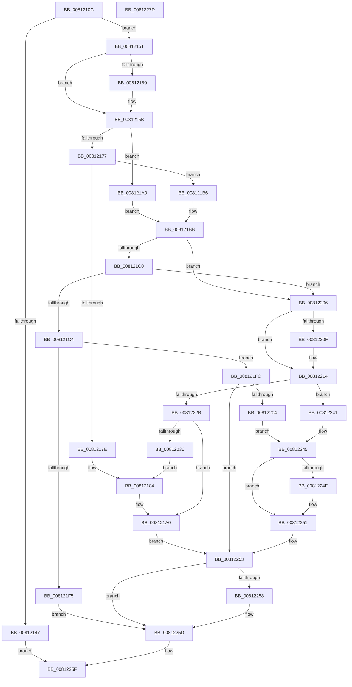

# SdbGetMergeRedirectPath

- RVA: `0x0081210C`–`0x0081227E` (길이 `370` bytes)
- VA: `0x000000014081210C`
- 실행 섹션: `PAGE`
- PDB 이름 있음: `예`; PDB Function 태그: `아니요`
- unwind 정보 RVA: `0x000CA900`
- 디코드: `109`개 명령, `370/370` bytes 표시
- 미해석 바이트: `0` (있으면 어셈블리에 `.byte`로 보존)

> 이 문서는 커널 이미지의 기계어와 PDB 기호를 분석해 생성했습니다. 4번과 5번은 함수 원형과 자료형을 바이너리 사용 방식에서 추정한 C 해석이며 원본 소스 복구 결과는 아닙니다.

## 1. Dependencies

- 직접 호출 지점: **7**; 고유 호출 대상: **4**
- 직접 호출자로 확인된 함수: **1**
- RIP 상대 이미지 참조: **3**

### Outgoing calls
- `0x00812169` → [SdbpGetMergeRedirectPathInternal](SdbpGetMergeRedirectPathInternal_function_00812B00.md) (function, `0x00812B00`)
- `0x0081219B` → [AslLogCallPrintf](../95/AslLogCallPrintf_function_0095E4EC.md) (function, `0x0095E4EC`)
- `0x008121C7` → [AslPathGetFileNamePart](AslPathGetFileNamePart_function_0081B274.md) (function, `0x0081B274`)
- `0x008121E7` → [AslLogCallPrintf](../95/AslLogCallPrintf_function_0095E4EC.md) (function, `0x0095E4EC`)
- `0x0081220F` → [AslFree](../95/AslFree_function_0095B674.md) (function, `0x0095B674`)
- `0x00812220` → [SdbpGetMergeRedirectPathInternal](SdbpGetMergeRedirectPathInternal_function_00812B00.md) (function, `0x00812B00`)
- `0x00812258` → [AslFree](../95/AslFree_function_0095B674.md) (function, `0x0095B674`)

### Direct callers
- [SdbOpenDatabaseEx](SdbOpenDatabaseEx_function_00812284.md) at `0x00812343`

### Static image references
- `0x00812184` → RVA `0x0003BE50` (`.rdata`; read)
- `0x0081218F` → RVA `0x0003BE38` (`.rdata`; read)
- `0x008121CC` → RVA `0x0003BDC0` (`.rdata`; read)

## 2. Other-region calls and transfers

- 다른 실행 섹션으로 향하는 call: **0**
- 별도 외부 분기/꼬리 이동을 확인하지 못했습니다.

## 3. Assembly (complete function range)

```asm
0081210C  48 89 5C 24 10                  mov qword ptr [rsp + 0x10], rbx
00812111  48 89 74 24 18                  mov qword ptr [rsp + 0x18], rsi
00812116  48 89 7C 24 20                  mov qword ptr [rsp + 0x20], rdi
0081211B  55                              push rbp
0081211C  41 54                           push r12
0081211E  41 55                           push r13
00812120  41 56                           push r14
00812122  41 57                           push r15
00812124  48 8B EC                        mov rbp, rsp
00812127  48 83 EC 40                     sub rsp, 0x40
0081212B  33 C0                           xor eax, eax
0081212D  4D 8B E1                        mov r12, r9
00812130  89 45 30                        mov dword ptr [rbp + 0x30], eax
00812133  45 8B E8                        mov r13d, r8d
00812136  48 89 45 F0                     mov qword ptr [rbp - 0x10], rax
0081213A  48 8B F2                        mov rsi, rdx
0081213D  4C 8B F1                        mov r14, rcx
00812140  8B F8                           mov edi, eax
00812142  48 85 C9                        test rcx, rcx
00812145  75 0A                           jne 0x140812151
00812147  B8 EF 00 00 C0                  mov eax, 0xc00000ef
0081214C  E9 0E 01 00 00                  jmp 0x14081225f
00812151  48 89 01                        mov qword ptr [rcx], rax
00812154  48 85 F6                        test rsi, rsi
00812157  74 02                           je 0x14081215b
00812159  89 02                           mov dword ptr [rdx], eax
0081215B  41 B8 01 00 00 00               mov r8d, 1
00812161  48 8D 55 30                     lea rdx, [rbp + 0x30]
00812165  48 8D 4D F0                     lea rcx, [rbp - 0x10]
00812169  E8 92 09 00 00                  call 0x140812b00
0081216E  8B D8                           mov ebx, eax
00812170  44 8B F8                        mov r15d, eax
00812173  85 C0                           test eax, eax
00812175  79 32                           jns 0x1408121a9
00812177  3D 34 00 00 C0                  cmp eax, 0xc0000034
0081217C  74 38                           je 0x1408121b6
0081217E  41 B8 37 08 00 00               mov r8d, 0x837
00812184  4C 8D 0D C5 9C 82 FF            lea r9, [rip - 0x7d633b]
0081218B  89 44 24 20                     mov dword ptr [rsp + 0x20], eax
0081218F  48 8D 15 A2 9C 82 FF            lea rdx, [rip - 0x7d635e]
00812196  B9 01 00 00 00                  mov ecx, 1
0081219B  E8 4C C3 14 00                  call 0x14095e4ec
008121A0  48 8B 55 F0                     mov rdx, qword ptr [rbp - 0x10]
008121A4  E9 AA 00 00 00                  jmp 0x140812253
008121A9  39 7D 30                        cmp dword ptr [rbp + 0x30], edi
008121AC  BB 01 00 00 00                  mov ebx, 1
008121B1  0F 45 FB                        cmovne edi, ebx
008121B4  EB 05                           jmp 0x1408121bb
008121B6  BB 01 00 00 00                  mov ebx, 1
008121BB  45 85 ED                        test r13d, r13d
008121BE  74 46                           je 0x140812206
008121C0  85 FF                           test edi, edi
008121C2  74 42                           je 0x140812206
008121C4  49 8B CC                        mov rcx, r12
008121C7  E8 A8 90 00 00                  call 0x14081b274
008121CC  4C 8D 0D ED 9B 82 FF            lea r9, [rip - 0x7d6413]
008121D3  48 89 44 24 20                  mov qword ptr [rsp + 0x20], rax
008121D8  41 B8 4F 08 00 00               mov r8d, 0x84f
008121DE  48 8D 15 53 9C 82 FF            lea rdx, [rip - 0x7d63ad]
008121E5  8B CB                           mov ecx, ebx
008121E7  E8 00 C3 14 00                  call 0x14095e4ec
008121EC  48 8B 55 F0                     mov rdx, qword ptr [rbp - 0x10]
008121F0  48 85 D2                        test rdx, rdx
008121F3  75 07                           jne 0x1408121fc
008121F5  BB 34 00 00 C0                  mov ebx, 0xc0000034
008121FA  EB 61                           jmp 0x14081225d
008121FC  41 8B DF                        mov ebx, r15d
008121FF  45 85 FF                        test r15d, r15d
00812202  78 4F                           js 0x140812253
00812204  EB 3F                           jmp 0x140812245
00812206  48 8B 55 F0                     mov rdx, qword ptr [rbp - 0x10]
0081220A  48 85 D2                        test rdx, rdx
0081220D  74 05                           je 0x140812214
0081220F  E8 60 94 14 00                  call 0x14095b674
00812214  4D 8B CC                        mov r9, r12
00812217  48 8D 4D F0                     lea rcx, [rbp - 0x10]
0081221B  45 33 C0                        xor r8d, r8d
0081221E  33 D2                           xor edx, edx
00812220  E8 DB 08 00 00                  call 0x140812b00
00812225  8B D8                           mov ebx, eax
00812227  85 C0                           test eax, eax
00812229  79 16                           jns 0x140812241
0081222B  3D 34 00 00 C0                  cmp eax, 0xc0000034
00812230  0F 84 6A FF FF FF               je 0x1408121a0
00812236  41 B8 46 08 00 00               mov r8d, 0x846
0081223C  E9 43 FF FF FF                  jmp 0x140812184
00812241  48 8B 55 F0                     mov rdx, qword ptr [rbp - 0x10]
00812245  49 89 16                        mov qword ptr [r14], rdx
00812248  33 D2                           xor edx, edx
0081224A  48 85 F6                        test rsi, rsi
0081224D  74 02                           je 0x140812251
0081224F  89 3E                           mov dword ptr [rsi], edi
00812251  33 DB                           xor ebx, ebx
00812253  48 85 D2                        test rdx, rdx
00812256  74 05                           je 0x14081225d
00812258  E8 17 94 14 00                  call 0x14095b674
0081225D  8B C3                           mov eax, ebx
0081225F  4C 8D 5C 24 40                  lea r11, [rsp + 0x40]
00812264  49 8B 5B 38                     mov rbx, qword ptr [r11 + 0x38]
00812268  49 8B 73 40                     mov rsi, qword ptr [r11 + 0x40]
0081226C  49 8B 7B 48                     mov rdi, qword ptr [r11 + 0x48]
00812270  49 8B E3                        mov rsp, r11
00812273  41 5F                           pop r15
00812275  41 5E                           pop r14
00812277  41 5D                           pop r13
00812279  41 5C                           pop r12
0081227B  5D                              pop rbp
0081227C  C3                              ret
0081227D  CC                              int3
```

## 4. C-style interpretation (structured pseudocode)

```c
__int64 __fastcall SdbGetMergeRedirectPath(__int64 a1, __int64 a2, int a3, __int64 a4)
{
    __int64 result;
    __int64 v_rbx;
    __int64 v_rdi;
    __int64 v_rsp;
    unsigned __int64 v_stack_m28;
    unsigned __int64 v_stack_m38;
    unsigned int v_stack_m48;
    unsigned __int64 v_stack_p10;
    unsigned __int64 v_stack_p18;
    unsigned __int64 v_stack_p20;
    unsigned int v_stack_p8;

    v_stack_p10 = v_rbx;
    v_stack_p18 = v_rsi;
    v_stack_p20 = v_rdi;
    v_rsp = (v_rsp) - (64);
    result = 0;
    v_stack_p8 = 0;
    v_stack_m38 = 0;
    if (a1 != 0) goto loc_00812151;
    goto loc_0081225F;
loc_00812151:
    *(unsigned __int64 *)(a1) = (unsigned int)(0xC00000EFULL);
    if (a2 != 0) {
        *(unsigned int *)(a2) = (unsigned int)((unsigned int)(0xC00000EFULL));
    }
    result = SdbpGetMergeRedirectPathInternal(v_stack_m38, v_stack_p8, 1, a4);
    if (!sign_flag) goto loc_008121A9;
    if (((unsigned int)(result)) == 0xC0000034ULL) goto loc_008121B6;
loc_00812184:
    v_stack_m48 = (unsigned int)(result);
    result = AslLogCallPrintf(1, v_rip - 8217438, (unsigned int)(0x837ULL), v_rip - 8217403);
loc_008121A0:
    goto loc_00812253;
loc_008121A9:
    v_rdi = 0;
    if (v_stack_p8 != 0) { v_rdi = 1; }
    goto loc_008121BB;
loc_008121B6:
loc_008121BB:
    if ((unsigned int)((unsigned int)(a3)) == 0) goto loc_00812206;
    if ((unsigned int)(v_rdi) == 0) goto loc_00812206;
    result = AslPathGetFileNamePart(a4, v_stack_m38, (unsigned int)(0x837ULL), v_rip - 8217403);
    v_stack_m48 = result;
    result = AslLogCallPrintf(1, v_rip - 8217517, (unsigned int)(0x84FULL), v_rip - 8217619);
    if (v_stack_m38 != 0) goto loc_008121FC;
    goto loc_0081225D;
loc_008121FC:
    if (sign_flag) goto loc_00812253;
    goto loc_00812245;
loc_00812206:
    if (v_stack_m38 != 0) {
        result = AslFree(1, v_stack_m38, (unsigned int)(0x84FULL), v_rip - 8217619);
    }
    a3 = 0;
    a2 = 0;
    result = SdbpGetMergeRedirectPathInternal(v_stack_m38, a2, a3, a4);
    if (!sign_flag) goto loc_00812241;
    if (((unsigned int)(result)) == 0xC0000034ULL) goto loc_008121A0;
    goto loc_00812184;
loc_00812241:
loc_00812245:
    *(unsigned __int64 *)(a1) = v_stack_m38;
    a2 = 0;
    if (0 != 0) {
        *(unsigned int *)(a2) = (unsigned int)(v_rdi);
    }
    v_rbx = 0;
loc_00812253:
    if (0 != 0) {
        result = AslFree(v_stack_m38, a2, (unsigned int)(0x846ULL), a4);
    }
loc_0081225F:
    return 0;
}
```

## 5. (Beta) C Style

```c
int64_t SdbGetMergeRedirectPath(void *Arg1, void *Arg2, int32_t Arg3, int64_t Arg4)
{
    uint8_t *arg1 = (uint8_t *)Arg1;
    uint8_t *arg2 = (uint8_t *)Arg2;

    int64_t result;
    int64_t local_rbx;
    int64_t local_rdi;
    int64_t local_rsp;
    uint64_t v_stack_m28;
    uint64_t v_stack_m38;
    uint32_t v_stack_m48;
    uint64_t v_stack_p10;
    uint64_t v_stack_p18;
    uint64_t v_stack_p20;
    uint32_t v_stack_p8;

    v_stack_p10 = local_rbx;
    v_stack_p18 = local_rsi;
    v_stack_p20 = local_rdi;
    local_rsp = (local_rsp) - (64);
    result = 0;
    v_stack_p8 = 0;
    v_stack_m38 = 0;
    if (Arg1 != NULL) goto loc_00812151;
    goto loc_0081225F;
loc_00812151:
    *(uint64_t *)(arg1) = (uint32_t)(0xC00000EFULL);
    if (Arg2 != NULL) {
        *(uint32_t *)(arg2) = (uint32_t)((uint32_t)(0xC00000EFULL));
    }
    result = SdbpGetMergeRedirectPathInternal(v_stack_m38, v_stack_p8, 1, Arg4);
    if (!sign_flag) goto loc_008121A9;
    if (((uint32_t)(result)) == 0xC0000034ULL) goto loc_008121B6;
loc_00812184:
    v_stack_m48 = (uint32_t)(result);
    result = AslLogCallPrintf(1, v_rip - 8217438, (uint32_t)(0x837ULL), v_rip - 8217403);
loc_008121A0:
    goto loc_00812253;
loc_008121A9:
    local_rdi = 0;
    if (v_stack_p8 != 0) { local_rdi = 1; }
    goto loc_008121BB;
loc_008121B6:
loc_008121BB:
    if ((uint32_t)((uint32_t)(Arg3)) == 0) goto loc_00812206;
    if ((uint32_t)(local_rdi) == 0) goto loc_00812206;
    result = AslPathGetFileNamePart(Arg4, v_stack_m38, (uint32_t)(0x837ULL), v_rip - 8217403);
    v_stack_m48 = result;
    result = AslLogCallPrintf(1, v_rip - 8217517, (uint32_t)(0x84FULL), v_rip - 8217619);
    if (v_stack_m38 != 0) goto loc_008121FC;
    goto loc_0081225D;
loc_008121FC:
    if (sign_flag) goto loc_00812253;
    goto loc_00812245;
loc_00812206:
    if (v_stack_m38 != 0) {
        result = AslFree(1, v_stack_m38, (uint32_t)(0x84FULL), v_rip - 8217619);
    }
    Arg3 = 0;
    Arg2 = 0;
    result = SdbpGetMergeRedirectPathInternal(v_stack_m38, Arg2, Arg3, Arg4);
    if (!sign_flag) goto loc_00812241;
    if (((uint32_t)(result)) == 0xC0000034ULL) goto loc_008121A0;
    goto loc_00812184;
loc_00812241:
loc_00812245:
    *(uint64_t *)(arg1) = v_stack_m38;
    Arg2 = 0;
    if (0 != 0) {
        *(uint32_t *)(arg2) = (uint32_t)(local_rdi);
    }
    local_rbx = 0;
loc_00812253:
    if (0 != 0) {
        result = AslFree(v_stack_m38, Arg2, (uint32_t)(0x846ULL), Arg4);
    }
loc_0081225F:
    return 0;
}
```

### 관측된 메모리 오프셋

구조체 형식이 확인되지 않은 접근은 인자 기준의 오프셋으로만 기록했습니다.

| 기준 인자 | 오프셋 표현 | 폭 (bit) | 접근 |
|---|---:|---:|---|
| `Arg1` | `+ 0x0` | `64` | `W` |
| `Arg2` | `+ 0x0` | `32` | `W` |

## 6. Execution-region graph

[열기: 2D/3D 그래프와 함수 탐색 컨트롤 패널](../../../control-panel.html?section=page&rva=0x0081210C&view=graph)

- 2D 그래프는 위에서 아래로 흐르고, 3D 그래프는 빈 공간을 드래그해 회전합니다. Shift+드래그는 이동, 휠은 확대·축소, 함수 노드 선택은 대상 보고서 이동입니다.

### Static fallback


