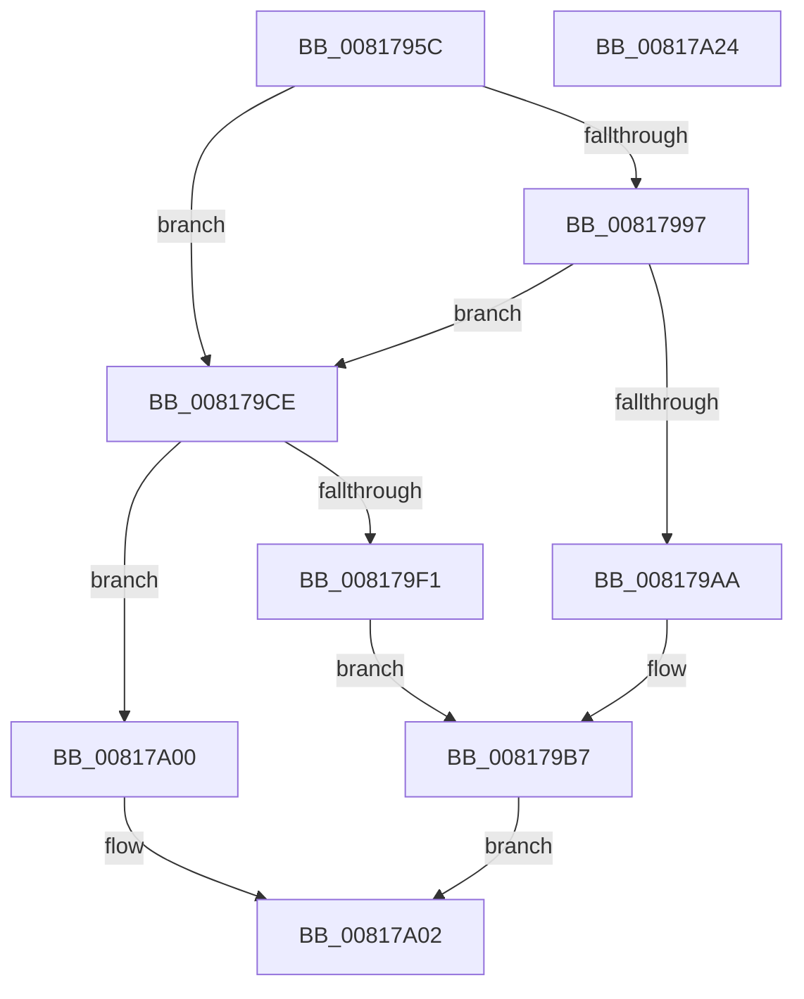

# SdbGetPathCustomSdb

- RVA: `0x0081795C`–`0x00817A25` (길이 `201` bytes)
- VA: `0x000000014081795C`
- 실행 섹션: `PAGE`
- PDB 이름 있음: `예`; PDB Function 태그: `아니요`
- unwind 정보 RVA: `0x0009A96C`
- 디코드: `54`개 명령, `201/201` bytes 표시
- 미해석 바이트: `0` (있으면 어셈블리에 `.byte`로 보존)

> 이 문서는 커널 이미지의 기계어와 PDB 기호를 분석해 생성했습니다. 4번과 5번은 함수 원형과 자료형을 바이너리 사용 방식에서 추정한 C 해석이며 원본 소스 복구 결과는 아닙니다.

## 1. Dependencies

- 직접 호출 지점: **5**; 고유 호출 대상: **5**
- 직접 호출자로 확인된 함수: **1**
- RIP 상대 이미지 참조: **4**

### Outgoing calls
- `0x0081798D` → [memset](../../text/6C/memset_function_006C6C40.md) (function, `0x006C6C40`)
- `0x0081799F` → [SdbpGetCustomSdbFileName](SdbpGetCustomSdbFileName_function_00817DA0.md) (function, `0x00817DA0`)
- `0x008179C7` → [AslLogCallPrintf](../95/AslLogCallPrintf_function_0095E4EC.md) (function, `0x0095E4EC`)
- `0x008179E6` → [SdbpGetSystemSdbFilePath](SdbpGetSystemSdbFilePath_function_008183F4.md) (function, `0x008183F4`)
- `0x00817A14` → [_security_check_cookie](../../text/6A/_security_check_cookie_function_006AC640.md) (function, `0x006AC640`)

### Direct callers
- [SdbResolveDatabaseEx](SdbResolveDatabaseEx_function_00817A54.md) at `0x00817D11`

### Static image references
- `0x00817967` → RVA `0x00E0A740` (`.data`; read)
- `0x008179AA` → RVA `0x0003DBA0` (`.rdata`; read)
- `0x008179B7` → RVA `0x0003DBC8` (`.rdata`; read)
- `0x008179F1` → RVA `0x0003DB58` (`.rdata`; read)

## 2. Other-region calls and transfers

- 다른 실행 섹션으로 향하는 call: **2**
  - `0x0081798D` → [memset](../../text/6C/memset_function_006C6C40.md) (`PAGE` → `.text`)
  - `0x00817A14` → [_security_check_cookie](../../text/6A/_security_check_cookie_function_006AC640.md) (`PAGE` → `.text`)
- 별도 외부 분기/꼬리 이동을 확인하지 못했습니다.

## 3. Assembly (complete function range)

```asm
0081795C  40 53                           push rbx
0081795E  56                              push rsi
0081795F  57                              push rdi
00817960  48 81 EC A0 00 00 00            sub rsp, 0xa0
00817967  48 8B 05 D2 2D 5F 00            mov rax, qword ptr [rip + 0x5f2dd2]
0081796E  48 33 C4                        xor rax, rsp
00817971  48 89 84 24 90 00 00 00         mov qword ptr [rsp + 0x90], rax
00817979  33 D2                           xor edx, edx
0081797B  49 8B D8                        mov rbx, r8
0081797E  48 8B F9                        mov rdi, rcx
00817981  49 8B F1                        mov rsi, r9
00817984  48 8D 4C 24 30                  lea rcx, [rsp + 0x30]
00817989  44 8D 42 56                     lea r8d, [rdx + 0x56]
0081798D  E8 AE F2 EA FF                  call 0x1406c6c40
00817992  48 85 DB                        test rbx, rbx
00817995  74 37                           je 0x1408179ce
00817997  4C 8B C3                        mov r8, rbx
0081799A  48 8D 4C 24 30                  lea rcx, [rsp + 0x30]
0081799F  E8 FC 03 00 00                  call 0x140817da0
008179A4  8B D8                           mov ebx, eax
008179A6  85 C0                           test eax, eax
008179A8  79 24                           jns 0x1408179ce
008179AA  4C 8D 0D EF 61 82 FF            lea r9, [rip - 0x7d9e11]
008179B1  41 B8 60 06 00 00               mov r8d, 0x660
008179B7  48 8D 15 0A 62 82 FF            lea rdx, [rip - 0x7d9df6]
008179BE  89 44 24 20                     mov dword ptr [rsp + 0x20], eax
008179C2  B9 01 00 00 00                  mov ecx, 1
008179C7  E8 20 6B 14 00                  call 0x14095e4ec
008179CC  EB 34                           jmp 0x140817a02
008179CE  48 8D 44 24 30                  lea rax, [rsp + 0x30]
008179D3  48 89 74 24 28                  mov qword ptr [rsp + 0x28], rsi
008179D8  41 B8 0A 00 00 00               mov r8d, 0xa
008179DE  48 89 44 24 20                  mov qword ptr [rsp + 0x20], rax
008179E3  48 8B CF                        mov rcx, rdi
008179E6  E8 09 0A 00 00                  call 0x1408183f4
008179EB  8B D8                           mov ebx, eax
008179ED  85 C0                           test eax, eax
008179EF  79 0F                           jns 0x140817a00
008179F1  4C 8D 0D 60 61 82 FF            lea r9, [rip - 0x7d9ea0]
008179F8  41 B8 6C 06 00 00               mov r8d, 0x66c
008179FE  EB B7                           jmp 0x1408179b7
00817A00  33 DB                           xor ebx, ebx
00817A02  F7 D3                           not ebx
00817A04  C1 EB 1F                        shr ebx, 0x1f
00817A07  8B C3                           mov eax, ebx
00817A09  48 8B 8C 24 90 00 00 00         mov rcx, qword ptr [rsp + 0x90]
00817A11  48 33 CC                        xor rcx, rsp
00817A14  E8 27 4C E9 FF                  call 0x1406ac640
00817A19  48 81 C4 A0 00 00 00            add rsp, 0xa0
00817A20  5F                              pop rdi
00817A21  5E                              pop rsi
00817A22  5B                              pop rbx
00817A23  C3                              ret
00817A24  CC                              int3
```

## 4. C-style interpretation (structured pseudocode)

```c
__int64 __fastcall SdbGetPathCustomSdb(__int64 a1, int a2, __int64 a3, __int64 a4)
{
    __int64 result;
    __int64 v_rbx;
    __int64 v_rsp;
    unsigned __int64 v_stack_m28;
    unsigned __int64 v_stack_m88;
    unsigned __int64 v_stack_m90;
    unsigned int v_stack_m98;

    v_rsp = (v_rsp) - (160);
    result = (*(unsigned __int64 *)(v_rip + 6237650)) ^ (v_rsp);
    v_stack_m28 = result;
    a2 = 0;
    result = memset(v_stack_m88, a2, a2 + 86, a4);
    if (a3 == 0) goto loc_008179CE;
    result = SdbpGetCustomSdbFileName(v_stack_m88, a2, a3, a4);
    if (!sign_flag) goto loc_008179CE;
loc_008179B7:
    v_stack_m98 = (unsigned int)(result);
    result = AslLogCallPrintf(1, v_rip - 8232438, (unsigned int)(0x660ULL), v_rip - 8232465);
    goto loc_00817A02;
loc_008179CE:
    v_stack_m90 = a4;
    v_stack_m98 = v_stack_m88;
    result = SdbpGetSystemSdbFilePath(a1, v_rip - 8232438, 10, v_rip - 8232465);
    if (!sign_flag) goto loc_00817A00;
    goto loc_008179B7;
loc_00817A00:
    v_rbx = 0;
loc_00817A02:
    v_rbx = (unsigned int)(~(v_rbx));
    v_rbx = (unsigned int)((v_rbx) >> (31));
    a1 = (v_stack_m28) ^ (v_rsp);
    result = _security_check_cookie(a1, v_rip - 8232438, (unsigned int)(0x66CULL), v_rip - 8232608);
    v_rsp = (v_rsp) + (160);
    return result;
}
```

## 5. (Beta) C Style

```c
int64_t SdbGetPathCustomSdb(int64_t Arg1, int32_t Arg2, int64_t Arg3, int64_t Arg4)
{
    int64_t result;
    int64_t local_rbx;
    int64_t local_rsp;
    uint64_t v_stack_m28;
    uint64_t v_stack_m88;
    uint64_t v_stack_m90;
    uint32_t v_stack_m98;

    local_rsp = (local_rsp) - (160);
    result = (*(uint64_t *)(v_rip + 0x5F2DD2)) ^ (local_rsp);
    v_stack_m28 = result;
    Arg2 = 0;
    result = memset(v_stack_m88, Arg2, Arg2 + 86, Arg4);
    if (Arg3 == 0) goto loc_008179CE;
    result = SdbpGetCustomSdbFileName(v_stack_m88, Arg2, Arg3, Arg4);
    if (!sign_flag) goto loc_008179CE;
loc_008179B7:
    v_stack_m98 = (uint32_t)(result);
    result = AslLogCallPrintf(1, v_rip - 8232438, (uint32_t)(0x660ULL), v_rip - 8232465);
    goto loc_00817A02;
loc_008179CE:
    v_stack_m90 = Arg4;
    v_stack_m98 = v_stack_m88;
    result = SdbpGetSystemSdbFilePath(Arg1, v_rip - 8232438, 10, v_rip - 8232465);
    if (!sign_flag) goto loc_00817A00;
    goto loc_008179B7;
loc_00817A00:
    local_rbx = 0;
loc_00817A02:
    local_rbx = (uint32_t)(~(local_rbx));
    local_rbx = (uint32_t)((local_rbx) >> (31));
    Arg1 = (v_stack_m28) ^ (local_rsp);
    result = _security_check_cookie(Arg1, v_rip - 8232438, (uint32_t)(0x66CULL), v_rip - 8232608);
    local_rsp = (local_rsp) + (160);
    return result;
}
```

## 6. Execution-region graph

[열기: 2D/3D 그래프와 함수 탐색 컨트롤 패널](../../../control-panel.html?section=page&rva=0x0081795C&view=graph)

- 2D 그래프는 위에서 아래로 흐르고, 3D 그래프는 빈 공간을 드래그해 회전합니다. Shift+드래그는 이동, 휠은 확대·축소, 함수 노드 선택은 대상 보고서 이동입니다.

### Static fallback


