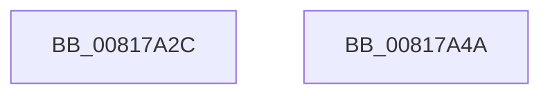

# SdbGetPathSystemSdb

- RVA: `0x00817A2C`–`0x00817A4B` (길이 `31` bytes)
- VA: `0x0000000140817A2C`
- 실행 섹션: `PAGE`
- PDB 이름 있음: `예`; PDB Function 태그: `아니요`
- unwind 정보 RVA: `0x0005D2F4`
- 디코드: `9`개 명령, `31/31` bytes 표시
- 미해석 바이트: `0` (있으면 어셈블리에 `.byte`로 보존)

> 이 문서는 커널 이미지의 기계어와 PDB 기호를 분석해 생성했습니다. 4번과 5번은 함수 원형과 자료형을 바이너리 사용 방식에서 추정한 C 해석이며 원본 소스 복구 결과는 아닙니다.

## 1. Dependencies

- 직접 호출 지점: **1**; 고유 호출 대상: **1**
- 직접 호출자로 확인된 함수: **1**
- RIP 상대 이미지 참조: **0**

### Outgoing calls
- `0x00817A3B` → [SdbpGetSystemSdbFilePath](SdbpGetSystemSdbFilePath_function_008183F4.md) (function, `0x008183F4`)

### Direct callers
- [SdbResolveDatabaseEx](SdbResolveDatabaseEx_function_00817A54.md) at `0x00817B17`

### Static image references
- 디코드된 RIP-relative 메모리 참조가 없습니다.

## 2. Other-region calls and transfers

- 다른 실행 섹션으로 향하는 call: **0**
- 별도 외부 분기/꼬리 이동을 확인하지 못했습니다.

## 3. Assembly (complete function range)

```asm
00817A2C  48 83 EC 38                     sub rsp, 0x38
00817A30  4C 89 4C 24 28                  mov qword ptr [rsp + 0x28], r9
00817A35  48 83 64 24 20 00               and qword ptr [rsp + 0x20], 0
00817A3B  E8 B4 09 00 00                  call 0x1408183f4
00817A40  F7 D0                           not eax
00817A42  C1 E8 1F                        shr eax, 0x1f
00817A45  48 83 C4 38                     add rsp, 0x38
00817A49  C3                              ret
00817A4A  CC                              int3
```

## 4. C-style interpretation (structured pseudocode)

```c
__int64 __fastcall SdbGetPathSystemSdb(__int64 a1, __int64 a2, __int64 a3, __int64 a4)
{
    __int64 result;
    __int64 v_rsp;
    unsigned __int64 v_stack_m10;
    unsigned __int64 v_stack_m18;

    v_rsp = (v_rsp) - (56);
    v_stack_m10 = a4;
    result = SdbpGetSystemSdbFilePath(a1, a2, a3, a4);
    result = (unsigned int)(~(result));
    result = (unsigned int)((result) >> (31));
    v_rsp = (v_rsp) + (56);
    return result;
}
```

## 5. (Beta) C Style

```c
int64_t SdbGetPathSystemSdb(int64_t Arg1, int64_t Arg2, int64_t Arg3, int64_t Arg4)
{
    int64_t result;
    int64_t local_rsp;
    uint64_t v_stack_m10;
    uint64_t v_stack_m18;

    local_rsp = (local_rsp) - (56);
    v_stack_m10 = Arg4;
    result = SdbpGetSystemSdbFilePath(Arg1, Arg2, Arg3, Arg4);
    result = (uint32_t)(~(result));
    result = (uint32_t)((result) >> (31));
    local_rsp = (local_rsp) + (56);
    return result;
}
```

## 6. Execution-region graph

[열기: 2D/3D 그래프와 함수 탐색 컨트롤 패널](../../../control-panel.html?section=page&rva=0x00817A2C&view=graph)

- 2D 그래프는 위에서 아래로 흐르고, 3D 그래프는 빈 공간을 드래그해 회전합니다. Shift+드래그는 이동, 휠은 확대·축소, 함수 노드 선택은 대상 보고서 이동입니다.

### Static fallback


