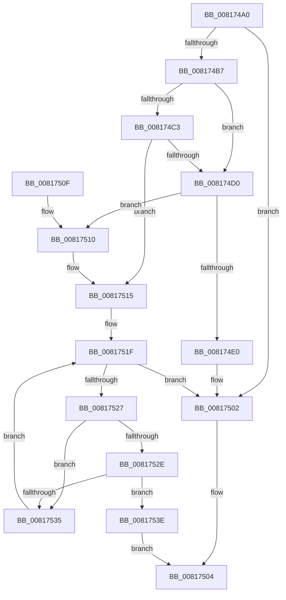

# SdbGuestHostArchsToRuntimePlatformFlag

- RVA: `0x008174A0`–`0x00817547` (길이 `167` bytes)
- VA: `0x00000001408174A0`
- 실행 섹션: `PAGE`
- PDB 이름 있음: `예`; PDB Function 태그: `아니요`
- unwind 정보 RVA: `0x000D9AE8`
- 디코드: `47`개 명령, `167/167` bytes 표시
- 미해석 바이트: `0` (있으면 어셈블리에 `.byte`로 보존)

> 이 문서는 커널 이미지의 기계어와 PDB 기호를 분석해 생성했습니다. 4번과 5번은 함수 원형과 자료형을 바이너리 사용 방식에서 추정한 C 해석이며 원본 소스 복구 결과는 아닙니다.

## 1. Dependencies

- 직접 호출 지점: **2**; 고유 호출 대상: **2**
- 직접 호출자로 확인된 함수: **1**
- RIP 상대 이미지 참조: **3**

### Outgoing calls
- `0x008174D7` → [AslEnvGetProcessWowInfo](AslEnvGetProcessWowInfo_function_0081D0A8.md) (function, `0x0081D0A8`)
- `0x008174FD` → [AslLogCallPrintf](../95/AslLogCallPrintf_function_0095E4EC.md) (function, `0x0095E4EC`)

### Direct callers
- [SdbGuestTargetPlatformFlagsToRuntimePlatformFlags](SdbGuestTargetPlatformFlagsToRuntimePlatformFlags_function_00817550.md) at `0x008175F6`

### Static image references
- `0x008174E0` → RVA `0x0003D680` (`.rdata`; read)
- `0x008174F1` → RVA `0x0003D6C0` (`.rdata`; read)
- `0x00817518` → RVA `0x0003D880` (`.rdata`; read)

## 2. Other-region calls and transfers

- 다른 실행 섹션으로 향하는 call: **0**
- 별도 외부 분기/꼬리 이동을 확인하지 못했습니다.

## 3. Assembly (complete function range)

```asm
008174A0  48 89 5C 24 10                  mov qword ptr [rsp + 0x10], rbx
008174A5  57                              push rdi
008174A6  48 83 EC 30                     sub rsp, 0x30
008174AA  B8 FF FF 00 00                  mov eax, 0xffff
008174AF  0F B7 F9                        movzx edi, cx
008174B2  66 3B C8                        cmp cx, ax
008174B5  74 4B                           je 0x140817502
008174B7  33 DB                           xor ebx, ebx
008174B9  66 89 44 24 40                  mov word ptr [rsp + 0x40], ax
008174BE  48 85 D2                        test rdx, rdx
008174C1  74 0D                           je 0x1408174d0
008174C3  0F B7 12                        movzx edx, word ptr [rdx]
008174C6  66 89 54 24 40                  mov word ptr [rsp + 0x40], dx
008174CB  66 3B D0                        cmp dx, ax
008174CE  75 45                           jne 0x140817515
008174D0  33 D2                           xor edx, edx
008174D2  48 8D 4C 24 40                  lea rcx, [rsp + 0x40]
008174D7  E8 CC 5B 00 00                  call 0x14081d0a8
008174DC  85 C0                           test eax, eax
008174DE  79 30                           jns 0x140817510
008174E0  4C 8D 0D 99 61 82 FF            lea r9, [rip - 0x7d9e67]
008174E7  89 44 24 20                     mov dword ptr [rsp + 0x20], eax
008174EB  41 B8 F8 00 00 00               mov r8d, 0xf8
008174F1  48 8D 15 C8 61 82 FF            lea rdx, [rip - 0x7d9e38]
008174F8  B9 01 00 00 00                  mov ecx, 1
008174FD  E8 EA 6F 14 00                  call 0x14095e4ec
00817502  33 C0                           xor eax, eax
00817504  48 8B 5C 24 48                  mov rbx, qword ptr [rsp + 0x48]
00817509  48 83 C4 30                     add rsp, 0x30
0081750D  5F                              pop rdi
0081750E  C3                              ret
0081750F  CC                              int3
00817510  0F B7 54 24 40                  movzx edx, word ptr [rsp + 0x40]
00817515  48 8B C3                        mov rax, rbx
00817518  48 8D 0D 61 63 82 FF            lea rcx, [rip - 0x7d9c9f]
0081751F  48 3D 80 00 00 00               cmp rax, 0x80
00817525  73 DB                           jae 0x140817502
00817527  66 3B 7C 08 04                  cmp di, word ptr [rax + rcx + 4]
0081752C  75 07                           jne 0x140817535
0081752E  66 3B 54 08 06                  cmp dx, word ptr [rax + rcx + 6]
00817533  74 09                           je 0x14081753e
00817535  48 FF C3                        inc rbx
00817538  48 83 C0 10                     add rax, 0x10
0081753C  EB E1                           jmp 0x14081751f
0081753E  48 03 DB                        add rbx, rbx
00817541  8B 44 D9 08                     mov eax, dword ptr [rcx + rbx*8 + 8]
00817545  EB BD                           jmp 0x140817504
```

## 4. C-style interpretation (structured pseudocode)

```c
__int64 __fastcall SdbGuestHostArchsToRuntimePlatformFlag(unsigned __int16 a1, __int64 a2)
{
    __int64 result;
    __int64 v_rbx;
    __int64 v_rsp;
    unsigned int v_stack_m18;
    unsigned __int64 v_stack_p10;
    unsigned __int16 v_stack_p40;
    unsigned __int16 v_stack_p8;

    v_stack_p10 = v_rbx;
    v_rsp = (v_rsp) - (48);
    if (a1 == ((unsigned __int16)((unsigned int)(0xFFFFULL)))) goto loc_00817502;
    v_rbx = 0;
    v_stack_p8 = (unsigned __int16)((unsigned int)(0xFFFFULL));
    if (a2 == 0) goto loc_008174D0;
    v_stack_p8 = (unsigned __int16)(*(unsigned __int16 *)(a2));
    if (((unsigned __int16)(*(unsigned __int16 *)(a2))) != ((unsigned __int16)((unsigned int)(0xFFFFULL)))) goto loc_00817515;
loc_008174D0:
    a2 = 0;
    result = AslEnvGetProcessWowInfo(v_stack_p8, a2, a3, a4);
    if (!sign_flag) goto loc_00817510;
    v_stack_m18 = (unsigned int)(result);
    result = AslLogCallPrintf(1, v_rip - 8232504, 248, v_rip - 8232551);
loc_00817502:
    result = 0;
loc_00817504:
    v_rsp = (v_rsp) + (48);
    return result;
loc_00817510:
loc_00817515:
loc_0081751F:
    if (v_stack_p10 >= 128) goto loc_00817502;
    if (a1 != (*(unsigned __int16 *)(v_stack_p10 + v_rip - 8232095 * 1 + 4))) goto loc_00817535;
    if (((unsigned __int16)(v_stack_p40)) == (*(unsigned __int16 *)(v_stack_p10 + v_rip - 8232095 * 1 + 6))) goto loc_0081753E;
loc_00817535:
    v_rbx = (v_stack_p10) + 1;
    result = (v_stack_p10) + (16);
    goto loc_0081751F;
loc_0081753E:
    v_rbx = (v_rbx) + (v_rbx);
    goto loc_00817504;
}
```

## 5. (Beta) C Style

```c
int64_t SdbGuestHostArchsToRuntimePlatformFlag(uint16_t Arg1, int64_t Arg2)
{
    int64_t result;
    int64_t local_rbx;
    int64_t local_rsp;
    uint32_t v_stack_m18;
    uint64_t v_stack_p10;
    uint16_t v_stack_p40;
    uint16_t v_stack_p8;

    v_stack_p10 = local_rbx;
    local_rsp = (local_rsp) - (48);
    if (Arg1 == ((uint16_t)((uint32_t)(0xFFFFULL)))) goto loc_00817502;
    local_rbx = 0;
    v_stack_p8 = (uint16_t)((uint32_t)(0xFFFFULL));
    if (Arg2 == 0) goto loc_008174D0;
    v_stack_p8 = (uint16_t)(*(uint16_t *)(Arg2));
    if (((uint16_t)(*(uint16_t *)(Arg2))) != ((uint16_t)((uint32_t)(0xFFFFULL)))) goto loc_00817515;
loc_008174D0:
    Arg2 = 0;
    result = AslEnvGetProcessWowInfo(v_stack_p8, Arg2, a3, a4);
    if (!sign_flag) goto loc_00817510;
    v_stack_m18 = (uint32_t)(result);
    result = AslLogCallPrintf(1, v_rip - 8232504, 248, v_rip - 8232551);
loc_00817502:
    result = 0;
loc_00817504:
    local_rsp = (local_rsp) + (48);
    return result;
loc_00817510:
loc_00817515:
loc_0081751F:
    if (v_stack_p10 >= 128) goto loc_00817502;
    if (Arg1 != (*(uint16_t *)(v_stack_p10 + v_rip - 0x7D9C9F * 1 + 0x4))) goto loc_00817535;
    if (((uint16_t)(v_stack_p40)) == (*(uint16_t *)(v_stack_p10 + v_rip - 0x7D9C9F * 1 + 0x6))) goto loc_0081753E;
loc_00817535:
    local_rbx = (v_stack_p10) + 1;
    result = (v_stack_p10) + (16);
    goto loc_0081751F;
loc_0081753E:
    local_rbx = (local_rbx) + (local_rbx);
    goto loc_00817504;
}
```

## 6. Execution-region graph

[열기: 2D/3D 그래프와 함수 탐색 컨트롤 패널](../../../control-panel.html?section=page&rva=0x008174A0&view=graph)

- 2D 그래프는 위에서 아래로 흐르고, 3D 그래프는 빈 공간을 드래그해 회전합니다. Shift+드래그는 이동, 휠은 확대·축소, 함수 노드 선택은 대상 보고서 이동입니다.

### Static fallback


