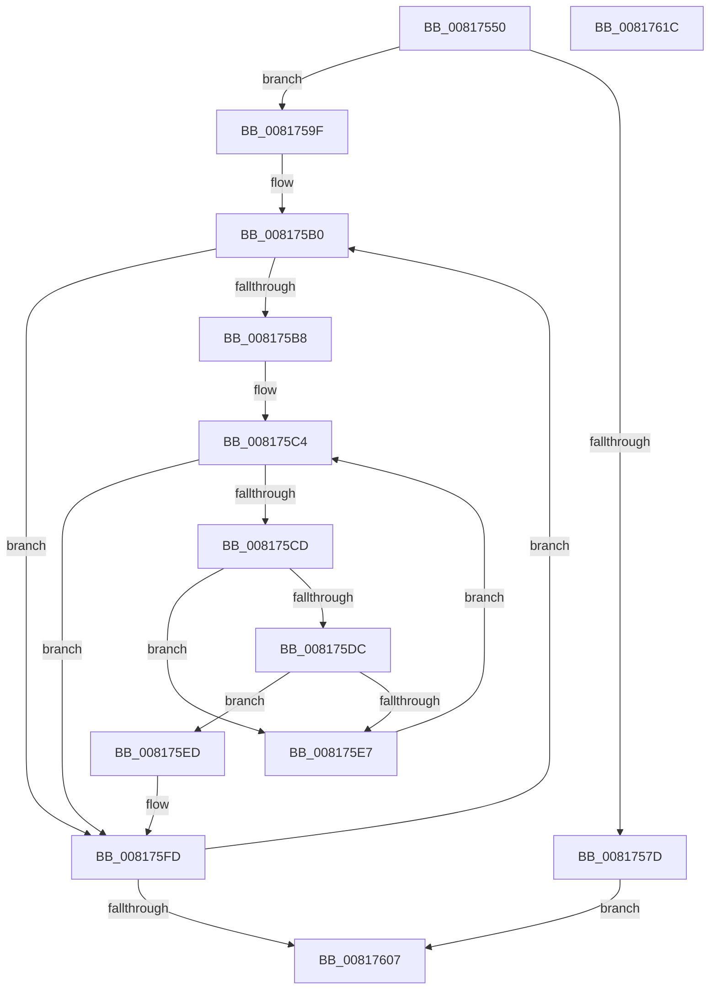

# SdbGuestTargetPlatformFlagsToRuntimePlatformFlags

- RVA: `0x00817550`–`0x0081761D` (길이 `205` bytes)
- VA: `0x0000000140817550`
- 실행 섹션: `PAGE`
- PDB 이름 있음: `예`; PDB Function 태그: `아니요`
- unwind 정보 RVA: `0x000D9B20`
- 디코드: `56`개 명령, `205/205` bytes 표시
- 미해석 바이트: `0` (있으면 어셈블리에 `.byte`로 보존)

> 이 문서는 커널 이미지의 기계어와 PDB 기호를 분석해 생성했습니다. 4번과 5번은 함수 원형과 자료형을 바이너리 사용 방식에서 추정한 C 해석이며 원본 소스 복구 결과는 아닙니다.

## 1. Dependencies

- 직접 호출 지점: **3**; 고유 호출 대상: **3**
- 직접 호출자로 확인된 함수: **1**
- RIP 상대 이미지 참조: **4**

### Outgoing calls
- `0x00817574` → [AslEnvGetProcessWowInfo](AslEnvGetProcessWowInfo_function_0081D0A8.md) (function, `0x0081D0A8`)
- `0x00817598` → [AslLogCallPrintf](../95/AslLogCallPrintf_function_0095E4EC.md) (function, `0x0095E4EC`)
- `0x008175F6` → [SdbGuestHostArchsToRuntimePlatformFlag](SdbGuestHostArchsToRuntimePlatformFlag_function_008174A0.md) (function, `0x008174A0`)

### Direct callers
- [SdbResolveDatabaseEx](SdbResolveDatabaseEx_function_00817A54.md) at `0x00817B5B`

### Static image references
- `0x0081757D` → RVA `0x0003D680` (`.rdata`; read)
- `0x0081758E` → RVA `0x0003D6E8` (`.rdata`; read)
- `0x008175A2` → RVA `0x0003D840` (`.rdata`; read)
- `0x008175A9` → RVA `0x00000000` (`image boundary/outside`; read)

## 2. Other-region calls and transfers

- 다른 실행 섹션으로 향하는 call: **0**
- 별도 외부 분기/꼬리 이동을 확인하지 못했습니다.

## 3. Assembly (complete function range)

```asm
00817550  48 8B C4                        mov rax, rsp
00817553  48 89 58 10                     mov qword ptr [rax + 0x10], rbx
00817557  48 89 68 18                     mov qword ptr [rax + 0x18], rbp
0081755B  89 48 08                        mov dword ptr [rax + 8], ecx
0081755E  56                              push rsi
0081755F  57                              push rdi
00817560  41 56                           push r14
00817562  48 83 EC 30                     sub rsp, 0x30
00817566  33 F6                           xor esi, esi
00817568  48 8D 48 08                     lea rcx, [rax + 8]
0081756C  33 D2                           xor edx, edx
0081756E  66 89 70 08                     mov word ptr [rax + 8], si
00817572  8B FE                           mov edi, esi
00817574  E8 2F 5B 00 00                  call 0x14081d0a8
00817579  85 C0                           test eax, eax
0081757B  79 22                           jns 0x14081759f
0081757D  4C 8D 0D FC 60 82 FF            lea r9, [rip - 0x7d9f04]
00817584  89 44 24 20                     mov dword ptr [rsp + 0x20], eax
00817588  41 B8 45 01 00 00               mov r8d, 0x145
0081758E  48 8D 15 53 61 82 FF            lea rdx, [rip - 0x7d9ead]
00817595  8D 4E 01                        lea ecx, [rsi + 1]
00817598  E8 4F 6F 14 00                  call 0x14095e4ec
0081759D  EB 68                           jmp 0x140817607
0081759F  48 8B DE                        mov rbx, rsi
008175A2  4C 8D 35 97 62 82 FF            lea r14, [rip - 0x7d9d69]
008175A9  48 8D 2D 50 8A 7E FF            lea rbp, [rip - 0x8175b0]
008175B0  41 8B 04 1E                     mov eax, dword ptr [r14 + rbx]
008175B4  A8 1F                           test al, 0x1f
008175B6  74 45                           je 0x1408175fd
008175B8  44 0F B7 84 2B 3C D8 03 00      movzx r8d, word ptr [rbx + rbp + 0x3d83c]
008175C1  48 8B CE                        mov rcx, rsi
008175C4  48 81 F9 80 00 00 00            cmp rcx, 0x80
008175CB  73 30                           jae 0x1408175fd
008175CD  0F B7 44 24 50                  movzx eax, word ptr [rsp + 0x50]
008175D2  66 39 84 29 80 A1 E0 00         cmp word ptr [rcx + rbp + 0xe0a180], ax
008175DA  75 0B                           jne 0x1408175e7
008175DC  66 44 39 84 29 82 A1 E0 00      cmp word ptr [rcx + rbp + 0xe0a182], r8w
008175E5  74 06                           je 0x1408175ed
008175E7  48 83 C1 10                     add rcx, 0x10
008175EB  EB D7                           jmp 0x1408175c4
008175ED  48 8D 54 24 50                  lea rdx, [rsp + 0x50]
008175F2  41 0F B7 C8                     movzx ecx, r8w
008175F6  E8 A5 FE FF FF                  call 0x1408174a0
008175FB  0B F8                           or edi, eax
008175FD  48 83 C3 0C                     add rbx, 0xc
00817601  48 83 FB 3C                     cmp rbx, 0x3c
00817605  72 A9                           jb 0x1408175b0
00817607  48 8B 5C 24 58                  mov rbx, qword ptr [rsp + 0x58]
0081760C  8B C7                           mov eax, edi
0081760E  48 8B 6C 24 60                  mov rbp, qword ptr [rsp + 0x60]
00817613  48 83 C4 30                     add rsp, 0x30
00817617  41 5E                           pop r14
00817619  5F                              pop rdi
0081761A  5E                              pop rsi
0081761B  C3                              ret
0081761C  CC                              int3
```

## 4. C-style interpretation (structured pseudocode)

```c
__int64 __fastcall SdbGuestTargetPlatformFlagsToRuntimePlatformFlags(int a1, int a2)
{
    __int64 result;
    __int64 v_rbx;
    __int64 v_rdi;
    __int64 v_rsi;
    __int64 v_rsp;
    unsigned int v_stack_m28;
    unsigned __int64 v_stack_p10;
    unsigned __int64 v_stack_p18;
    unsigned __int16 v_stack_p8;

    *(unsigned __int64 *)(v_rsp + 16) = v_rbx;
    *(unsigned __int64 *)(v_rsp + 24) = v_rbp;
    *(unsigned int *)(v_rsp + 8) = a1;
    v_rsp = (v_rsp) - (48);
    v_rsi = 0;
    a2 = 0;
    *(unsigned __int16 *)(v_rsp + 8) = 0;
    result = AslEnvGetProcessWowInfo(v_rsp + 8, a2, a3, a4);
    if (!sign_flag) goto loc_0081759F;
    v_stack_m28 = (unsigned int)(result);
    result = AslLogCallPrintf(v_rsi + 1, v_rip - 8232621, 325, v_rip - 8232708);
    goto loc_00817607;
loc_0081759F:
loc_008175B0:
    if ((((unsigned __int8)((unsigned int)(*(unsigned int *)(v_rip - 8232297 + 0 * 1)))) & (31)) == 0) goto loc_008175FD;
loc_008175C4:
    if (0 >= 128) goto loc_008175FD;
    if ((*(unsigned __int16 *)(0 + v_rip - 8484272 * 1 + 14721408)) != ((unsigned __int16)(v_stack_p8))) goto loc_008175E7;
    if ((*(unsigned __int16 *)(0 + v_rip - 8484272 * 1 + 14721410)) == ((unsigned __int16)(*(unsigned __int16 *)(0 + v_rip - 8484272 * 1 + 251964)))) goto loc_008175ED;
loc_008175E7:
    a1 = (0) + (16);
    goto loc_008175C4;
loc_008175ED:
    result = SdbGuestHostArchsToRuntimePlatformFlag((unsigned __int16)(*(unsigned __int16 *)(0 + v_rip - 8484272 * 1 + 251964)), v_stack_p8, *(unsigned __int16 *)(0 + v_rip - 8484272 * 1 + 251964), v_rip - 8232708);
    v_rdi = (unsigned int)((0) | ((unsigned int)(result)));
loc_008175FD:
    v_rbx = (0) + (12);
    if (v_rbx < 60) goto loc_008175B0;
loc_00817607:
    v_rsp = (v_rsp) + (48);
    return (unsigned int)((unsigned int)(v_rdi));
}
```

## 5. (Beta) C Style

```c
int64_t SdbGuestTargetPlatformFlagsToRuntimePlatformFlags(int32_t Arg1, int32_t Arg2)
{
    int64_t result;
    int64_t local_rbx;
    int64_t local_rdi;
    int64_t local_rsi;
    int64_t local_rsp;
    uint32_t v_stack_m28;
    uint64_t v_stack_p10;
    uint64_t v_stack_p18;
    uint16_t v_stack_p8;

    *(uint64_t *)(local_rsp + 0x10) = local_rbx;
    *(uint64_t *)(local_rsp + 0x18) = local_rbp;
    *(uint32_t *)(local_rsp + 0x8) = Arg1;
    local_rsp = (local_rsp) - (48);
    local_rsi = 0;
    Arg2 = 0;
    *(uint16_t *)(local_rsp + 0x8) = 0;
    result = AslEnvGetProcessWowInfo(local_rsp + 8, Arg2, a3, a4);
    if (!sign_flag) goto loc_0081759F;
    v_stack_m28 = (uint32_t)(result);
    result = AslLogCallPrintf(local_rsi + 1, v_rip - 8232621, 325, v_rip - 8232708);
    goto loc_00817607;
loc_0081759F:
loc_008175B0:
    if ((((uint8_t)((uint32_t)(*(uint32_t *)(v_rip - 0x7D9D69 + 0x0 * 1)))) & (31)) == 0) goto loc_008175FD;
loc_008175C4:
    if (0 >= 128) goto loc_008175FD;
    if ((*(uint16_t *)(0 + v_rip - 0x8175B0 * 1 + 0xE0A180)) != ((uint16_t)(v_stack_p8))) goto loc_008175E7;
    if ((*(uint16_t *)(0 + v_rip - 0x8175B0 * 1 + 0xE0A182)) == ((uint16_t)(*(uint16_t *)(0 + v_rip - 0x8175B0 * 1 + 0x3D83C)))) goto loc_008175ED;
loc_008175E7:
    Arg1 = (0) + (16);
    goto loc_008175C4;
loc_008175ED:
    result = SdbGuestHostArchsToRuntimePlatformFlag((uint16_t)(*(uint16_t *)(0 + v_rip - 0x8175B0 * 1 + 0x3D83C)), v_stack_p8, *(uint16_t *)(0 + v_rip - 0x8175B0 * 1 + 0x3D83C), v_rip - 8232708);
    local_rdi = (uint32_t)((0) | ((uint32_t)(result)));
loc_008175FD:
    local_rbx = (0) + (12);
    if (local_rbx < 60) goto loc_008175B0;
loc_00817607:
    local_rsp = (local_rsp) + (48);
    return (uint32_t)((uint32_t)(local_rdi));
}
```

## 6. Execution-region graph

[열기: 2D/3D 그래프와 함수 탐색 컨트롤 패널](../../../control-panel.html?section=page&rva=0x00817550&view=graph)

- 2D 그래프는 위에서 아래로 흐르고, 3D 그래프는 빈 공간을 드래그해 회전합니다. Shift+드래그는 이동, 휠은 확대·축소, 함수 노드 선택은 대상 보고서 이동입니다.

### Static fallback


