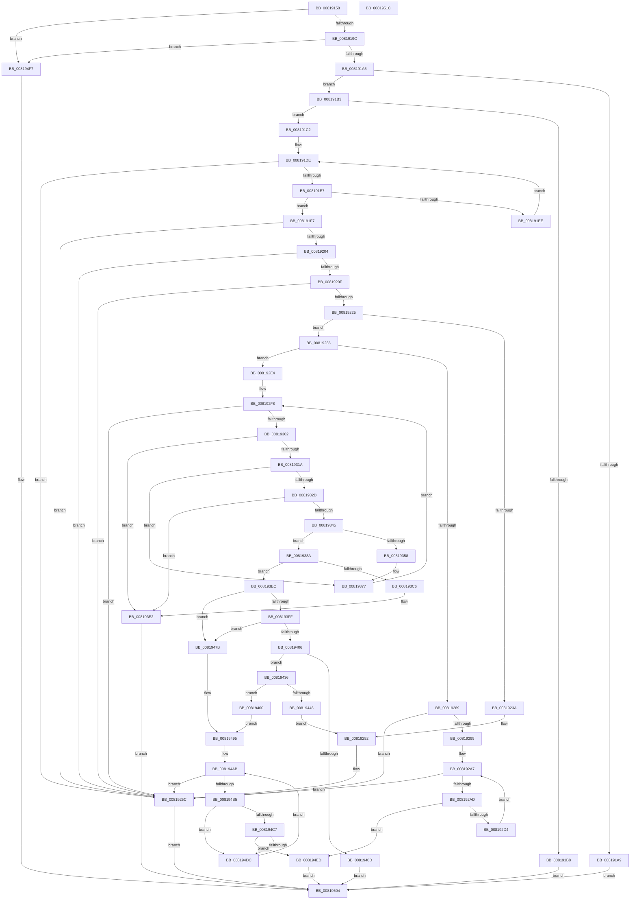

# SdbMergeIsEntryUpdated

- RVA: `0x00819158`–`0x0081951D` (길이 `965` bytes)
- VA: `0x0000000140819158`
- 실행 섹션: `PAGE`
- PDB 이름 있음: `예`; PDB Function 태그: `아니요`
- unwind 정보 RVA: `0x000A3904`
- 디코드: `267`개 명령, `965/965` bytes 표시
- 미해석 바이트: `0` (있으면 어셈블리에 `.byte`로 보존)

> 이 문서는 커널 이미지의 기계어와 PDB 기호를 분석해 생성했습니다. 4번과 5번은 함수 원형과 자료형을 바이너리 사용 방식에서 추정한 C 해석이며 원본 소스 복구 결과는 아닙니다.

## 1. Dependencies

- 직접 호출 지점: **29**; 고유 호출 대상: **15**
- 직접 호출자로 확인된 함수: **1**
- RIP 상대 이미지 참조: **7**

### Outgoing calls
- `0x008191C8` → [SdbGetTagFromTagID](../95/SdbGetTagFromTagID_function_0095E3C0.md) (function, `0x0095E3C0`)
- `0x0081922E` → [SdbFindFirstTag](../95/SdbFindFirstTag_function_0095E34C.md) (function, `0x0095E34C`)
- `0x00819257` → [AslLogCallPrintf](../95/AslLogCallPrintf_function_0095E4EC.md) (function, `0x0095E4EC`)
- `0x0081927A` → [_SdbpFindTagFromAncestors](_SdbpFindTagFromAncestors_function_00816F20.md) (function, `0x00816F20`)
- `0x0081928D` → [SdbFindParentTagFromAncestors](SdbFindParentTagFromAncestors_function_00816D98.md) (function, `0x00816D98`)
- `0x008192A2` → [SdbFindFirstTag](../95/SdbFindFirstTag_function_0095E34C.md) (function, `0x0095E34C`)
- `0x008192B6` → [SdbFindFirstTag](../95/SdbFindFirstTag_function_0095E34C.md) (function, `0x0095E34C`)
- `0x008192C7` → [SdbpMergeAreTagValuesEqual](SdbpMergeAreTagValuesEqual_function_00819524.md) (function, `0x00819524`)
- `0x008192DD` → [SdbFindNextTag](../95/SdbFindNextTag_function_0095D7F4.md) (function, `0x0095D7F4`)
- `0x008192EC` → [SdbFindFirstTag](../95/SdbFindFirstTag_function_0095E34C.md) (function, `0x0095E34C`)
- `0x0081930D` → [SdbFindFirstTag](../95/SdbFindFirstTag_function_0095E34C.md) (function, `0x0095E34C`)
- `0x00819322` → [SdbReadWORDTag](../95/SdbReadWORDTag_function_0095D898.md) (function, `0x0095D898`)
- `0x00819338` → [SdbFindFirstTag](../95/SdbFindFirstTag_function_0095E34C.md) (function, `0x0095E34C`)
- `0x0081934D` → [SdbReadWORDTag](../95/SdbReadWORDTag_function_0095D898.md) (function, `0x0095D898`)
- `0x00819372` → [AslLogCallPrintf](../95/AslLogCallPrintf_function_0095E4EC.md) (function, `0x0095E4EC`)
- `0x00819380` → [SdbFindNextTag](../95/SdbFindNextTag_function_0095D7F4.md) (function, `0x0095D7F4`)
- `0x0081939A` → [SdbFindFirstTag](../95/SdbFindFirstTag_function_0095E34C.md) (function, `0x0095E34C`)
- `0x008193A7` → [SdbReadDWORDTag](../95/SdbReadDWORDTag_function_0095D408.md) (function, `0x0095D408`)
- `0x008193BA` → [SdbFindFirstTag](../95/SdbFindFirstTag_function_0095E34C.md) (function, `0x0095E34C`)
- `0x008193DD` → [AslLogCallPrintf](../95/AslLogCallPrintf_function_0095E4EC.md) (function, `0x0095E4EC`)
- `0x00819427` → [AslLogCallPrintf](../95/AslLogCallPrintf_function_0095E4EC.md) (function, `0x0095E4EC`)
- `0x0081943C` → [SdbGetTagDataSize](../95/SdbGetTagDataSize_function_0095E230.md) (function, `0x0095E230`)
- `0x00819466` → [SdbpGetMappedTagData](../95/SdbpGetMappedTagData_function_0095DD24.md) (function, `0x0095DD24`)
- `0x00819481` → [SdbGetStringTagPtr](../95/SdbGetStringTagPtr_function_0095DDA8.md) (function, `0x0095DDA8`)
- `0x00819490` → [SdbMakeIndexKeyFromStringEx](../95/SdbMakeIndexKeyFromStringEx_function_0095E9F4.md) (function, `0x0095E9F4`)
- `0x008194A6` → [SdbpGetFirstIndexedRecord](../95/SdbpGetFirstIndexedRecord_function_0095C0C4.md) (function, `0x0095C0C4`)
- `0x008194BE` → [SdbFindFirstTag](../95/SdbFindFirstTag_function_0095E34C.md) (function, `0x0095E34C`)
- `0x008194D3` → [SdbpMergeAreTagValuesEqual](SdbpMergeAreTagValuesEqual_function_00819524.md) (function, `0x00819524`)
- `0x008194E6` → [SdbpGetNextIndexedRecord](../A9/SdbpGetNextIndexedRecord_function_00A91608.md) (function, `0x00A91608`)

### Direct callers
- [SdbpIsEntryIdAvailableInOtherDb](SdbpIsEntryIdAvailableInOtherDb_function_008173D4.md) at `0x00817449`

### Static image references
- `0x008191D1` → RVA `0x0003D4A0` (`.rdata`; read)
- `0x0081923E` → RVA `0x0003E4B0` (`.rdata`; read)
- `0x0081924B` → RVA `0x0003E4E0` (`.rdata`; read)
- `0x00819358` → RVA `0x0003E4F8` (`.rdata`; read)
- `0x008193C6` → RVA `0x0003E530` (`.rdata`; read)
- `0x0081940D` → RVA `0x0003E598` (`.rdata`; read)
- `0x0081944B` → RVA `0x0003E570` (`.rdata`; read)

## 2. Other-region calls and transfers

- 다른 실행 섹션으로 향하는 call: **0**
- 별도 외부 분기/꼬리 이동을 확인하지 못했습니다.

## 3. Assembly (complete function range)

```asm
00819158  48 89 5C 24 10                  mov qword ptr [rsp + 0x10], rbx
0081915D  4C 89 4C 24 20                  mov qword ptr [rsp + 0x20], r9
00819162  55                              push rbp
00819163  56                              push rsi
00819164  57                              push rdi
00819165  41 54                           push r12
00819167  41 55                           push r13
00819169  41 56                           push r14
0081916B  41 57                           push r15
0081916D  48 8B EC                        mov rbp, rsp
00819170  48 83 EC 60                     sub rsp, 0x60
00819174  4C 8B F1                        mov r14, rcx
00819177  0F 57 C0                        xorps xmm0, xmm0
0081917A  33 C9                           xor ecx, ecx
0081917C  45 33 ED                        xor r13d, r13d
0081917F  48 89 4D F0                     mov qword ptr [rbp - 0x10], rcx
00819183  49 8B C1                        mov rax, r9
00819186  49 8B D8                        mov rbx, r8
00819189  8B FA                           mov edi, edx
0081918B  0F 11 45 D0                     movups xmmword ptr [rbp - 0x30], xmm0
0081918F  0F 11 45 E0                     movups xmmword ptr [rbp - 0x20], xmm0
00819193  4D 85 F6                        test r14, r14
00819196  0F 84 5B 03 00 00               je 0x1408194f7
0081919C  48 85 DB                        test rbx, rbx
0081919F  0F 84 52 03 00 00               je 0x1408194f7
008191A5  85 D2                           test edx, edx
008191A7  75 0A                           jne 0x1408191b3
008191A9  B8 F0 00 00 C0                  mov eax, 0xc00000f0
008191AE  E9 51 03 00 00                  jmp 0x140819504
008191B3  48 85 C0                        test rax, rax
008191B6  75 0A                           jne 0x1408191c2
008191B8  B8 F2 00 00 C0                  mov eax, 0xc00000f2
008191BD  E9 42 03 00 00                  jmp 0x140819504
008191C2  49 8B CE                        mov rcx, r14
008191C5  45 89 29                        mov dword ptr [r9], r13d
008191C8  E8 F3 51 14 00                  call 0x14095e3c0
008191CD  44 0F B7 E0                     movzx r12d, ax
008191D1  4C 8D 05 C8 42 82 FF            lea r8, [rip - 0x7dbd38]
008191D8  49 8B D5                        mov rdx, r13
008191DB  49 8B CD                        mov rcx, r13
008191DE  48 81 F9 5E 01 00 00            cmp rcx, 0x15e
008191E5  73 75                           jae 0x14081925c
008191E7  66 46 39 24 01                  cmp word ptr [rcx + r8], r12w
008191EC  74 09                           je 0x1408191f7
008191EE  48 FF C2                        inc rdx
008191F1  48 83 C1 0A                     add rcx, 0xa
008191F5  EB E7                           jmp 0x1408191de
008191F7  48 8D 04 92                     lea rax, [rdx + rdx*4]
008191FB  49 8D 34 40                     lea rsi, [r8 + rax*2]
008191FF  48 85 F6                        test rsi, rsi
00819202  74 58                           je 0x14081925c
00819204  44 0F B7 7E 02                  movzx r15d, word ptr [rsi + 2]
00819209  66 45 85 FF                     test r15w, r15w
0081920D  74 4D                           je 0x14081925c
0081920F  B9 00 F0 00 00                  mov ecx, 0xf000
00819214  41 0F B7 C4                     movzx eax, r12w
00819218  66 23 C1                        and ax, cx
0081921B  B9 00 70 00 00                  mov ecx, 0x7000
00819220  66 3B C1                        cmp ax, cx
00819223  75 37                           jne 0x14081925c
00819225  45 0F B7 C7                     movzx r8d, r15w
00819229  8B D7                           mov edx, edi
0081922B  49 8B CE                        mov rcx, r14
0081922E  E8 19 51 14 00                  call 0x14095e34c
00819233  44 8B E8                        mov r13d, eax
00819236  85 C0                           test eax, eax
00819238  75 2C                           jne 0x140819266
0081923A  89 7C 24 20                     mov dword ptr [rsp + 0x20], edi
0081923E  4C 8D 0D 6B 52 82 FF            lea r9, [rip - 0x7dad95]
00819245  41 B8 F9 0B 00 00               mov r8d, 0xbf9
0081924B  48 8D 15 8E 52 82 FF            lea rdx, [rip - 0x7dad72]
00819252  B9 03 00 00 00                  mov ecx, 3
00819257  E8 90 52 14 00                  call 0x14095e4ec
0081925C  B8 25 02 00 C0                  mov eax, 0xc0000225
00819261  E9 9E 02 00 00                  jmp 0x140819504
00819266  BA 02 00 00 00                  mov edx, 2
0081926B  41 B9 04 78 00 00               mov r9d, 0x7804
00819271  41 B8 4F 70 00 00               mov r8d, 0x704f
00819277  48 8B CB                        mov rcx, rbx
0081927A  E8 A1 DC FF FF                  call 0x140816f20
0081927F  89 45 40                        mov dword ptr [rbp + 0x40], eax
00819282  48 8B CB                        mov rcx, rbx
00819285  85 C0                           test eax, eax
00819287  75 5B                           jne 0x1408192e4
00819289  48 8D 56 04                     lea rdx, [rsi + 4]
0081928D  E8 06 DB FF FF                  call 0x140816d98
00819292  44 8B E0                        mov r12d, eax
00819295  85 C0                           test eax, eax
00819297  74 C3                           je 0x14081925c
00819299  44 0F B7 06                     movzx r8d, word ptr [rsi]
0081929D  8B D0                           mov edx, eax
0081929F  48 8B CB                        mov rcx, rbx
008192A2  E8 A5 50 14 00                  call 0x14095e34c
008192A7  8B F8                           mov edi, eax
008192A9  85 C0                           test eax, eax
008192AB  74 AF                           je 0x14081925c
008192AD  45 0F B7 C7                     movzx r8d, r15w
008192B1  8B D0                           mov edx, eax
008192B3  48 8B CB                        mov rcx, rbx
008192B6  E8 91 50 14 00                  call 0x14095e34c
008192BB  44 8B C8                        mov r9d, eax
008192BE  4C 8B C3                        mov r8, rbx
008192C1  41 8B D5                        mov edx, r13d
008192C4  49 8B CE                        mov rcx, r14
008192C7  E8 58 02 00 00                  call 0x140819524
008192CC  85 C0                           test eax, eax
008192CE  0F 85 19 02 00 00               jne 0x1408194ed
008192D4  44 8B C7                        mov r8d, edi
008192D7  41 8B D4                        mov edx, r12d
008192DA  48 8B CB                        mov rcx, rbx
008192DD  E8 12 45 14 00                  call 0x14095d7f4
008192E2  EB C3                           jmp 0x1408192a7
008192E4  41 B8 03 78 00 00               mov r8d, 0x7803
008192EA  8B D0                           mov edx, eax
008192EC  E8 5B 50 14 00                  call 0x14095e34c
008192F1  48 8D 3D E8 51 82 FF            lea rdi, [rip - 0x7dae18]
008192F8  8B F0                           mov esi, eax
008192FA  85 C0                           test eax, eax
008192FC  0F 84 5A FF FF FF               je 0x14081925c
00819302  41 B8 02 38 00 00               mov r8d, 0x3802
00819308  8B D0                           mov edx, eax
0081930A  48 8B CB                        mov rcx, rbx
0081930D  E8 3A 50 14 00                  call 0x14095e34c
00819312  85 C0                           test eax, eax
00819314  0F 84 C8 00 00 00               je 0x1408193e2
0081931A  45 33 C0                        xor r8d, r8d
0081931D  8B D0                           mov edx, eax
0081931F  48 8B CB                        mov rcx, rbx
00819322  E8 71 45 14 00                  call 0x14095d898
00819327  66 44 3B E0                     cmp r12w, ax
0081932B  75 4A                           jne 0x140819377
0081932D  41 B8 03 38 00 00               mov r8d, 0x3803
00819333  8B D6                           mov edx, esi
00819335  48 8B CB                        mov rcx, rbx
00819338  E8 0F 50 14 00                  call 0x14095e34c
0081933D  85 C0                           test eax, eax
0081933F  0F 84 9D 00 00 00               je 0x1408193e2
00819345  45 33 C0                        xor r8d, r8d
00819348  8B D0                           mov edx, eax
0081934A  48 8B CB                        mov rcx, rbx
0081934D  E8 46 45 14 00                  call 0x14095d898
00819352  66 44 3B F8                     cmp r15w, ax
00819356  74 32                           je 0x14081938a
00819358  4C 8D 0D 99 51 82 FF            lea r9, [rip - 0x7dae67]
0081935F  44 89 64 24 20                  mov dword ptr [rsp + 0x20], r12d
00819364  41 B8 1B 0C 00 00               mov r8d, 0xc1b
0081936A  48 8B D7                        mov rdx, rdi
0081936D  B9 01 00 00 00                  mov ecx, 1
00819372  E8 75 51 14 00                  call 0x14095e4ec
00819377  8B 55 40                        mov edx, dword ptr [rbp + 0x40]
0081937A  44 8B C6                        mov r8d, esi
0081937D  48 8B CB                        mov rcx, rbx
00819380  E8 6F 44 14 00                  call 0x14095d7f4
00819385  E9 6E FF FF FF                  jmp 0x1408192f8
0081938A  41 B8 16 40 00 00               mov r8d, 0x4016
00819390  66 44 89 7D DC                  mov word ptr [rbp - 0x24], r15w
00819395  8B D6                           mov edx, esi
00819397  48 8B CB                        mov rcx, rbx
0081939A  E8 AD 4F 14 00                  call 0x14095e34c
0081939F  45 33 C0                        xor r8d, r8d
008193A2  8B D0                           mov edx, eax
008193A4  48 8B CB                        mov rcx, rbx
008193A7  E8 5C 40 14 00                  call 0x14095d408
008193AC  41 B8 01 98 00 00               mov r8d, 0x9801
008193B2  89 45 E4                        mov dword ptr [rbp - 0x1c], eax
008193B5  8B D6                           mov edx, esi
008193B7  48 8B CB                        mov rcx, rbx
008193BA  E8 8D 4F 14 00                  call 0x14095e34c
008193BF  44 8B E0                        mov r12d, eax
008193C2  85 C0                           test eax, eax
008193C4  75 26                           jne 0x1408193ec
008193C6  4C 8D 0D 63 51 82 FF            lea r9, [rip - 0x7dae9d]
008193CD  89 74 24 20                     mov dword ptr [rsp + 0x20], esi
008193D1  41 B8 26 0C 00 00               mov r8d, 0xc26
008193D7  8D 48 01                        lea ecx, [rax + 1]
008193DA  48 8B D7                        mov rdx, rdi
008193DD  E8 0A 51 14 00                  call 0x14095e4ec
008193E2  B8 58 01 00 C0                  mov eax, 0xc0000158
008193E7  E9 18 01 00 00                  jmp 0x140819504
008193EC  41 8B C7                        mov eax, r15d
008193EF  44 89 65 D0                     mov dword ptr [rbp - 0x30], r12d
008193F3  25 00 F0 00 00                  and eax, 0xf000
008193F8  3D 00 60 00 00                  cmp eax, 0x6000
008193FD  74 7C                           je 0x14081947b
008193FF  3D 00 80 00 00                  cmp eax, 0x8000
00819404  74 75                           je 0x14081947b
00819406  3D 00 90 00 00                  cmp eax, 0x9000
0081940B  74 29                           je 0x140819436
0081940D  4C 8D 0D 84 51 82 FF            lea r9, [rip - 0x7dae7c]
00819414  44 89 7C 24 20                  mov dword ptr [rsp + 0x20], r15d
00819419  41 B8 41 0C 00 00               mov r8d, 0xc41
0081941F  48 8B D7                        mov rdx, rdi
00819422  B9 01 00 00 00                  mov ecx, 1
00819427  E8 C0 50 14 00                  call 0x14095e4ec
0081942C  B8 E5 00 00 C0                  mov eax, 0xc00000e5
00819431  E9 CE 00 00 00                  jmp 0x140819504
00819436  41 8B D5                        mov edx, r13d
00819439  49 8B CE                        mov rcx, r14
0081943C  E8 EF 4D 14 00                  call 0x14095e230
00819441  83 F8 10                        cmp eax, 0x10
00819444  74 1A                           je 0x140819460
00819446  44 89 64 24 20                  mov dword ptr [rsp + 0x20], r12d
0081944B  4C 8D 0D 1E 51 82 FF            lea r9, [rip - 0x7daee2]
00819452  41 B8 2E 0C 00 00               mov r8d, 0xc2e
00819458  48 8B D7                        mov rdx, rdi
0081945B  E9 F2 FD FF FF                  jmp 0x140819252
00819460  41 8B D5                        mov edx, r13d
00819463  49 8B CE                        mov rcx, r14
00819466  E8 B9 48 14 00                  call 0x14095dd24
0081946B  48 89 45 F0                     mov qword ptr [rbp - 0x10], rax
0081946F  48 8B 08                        mov rcx, qword ptr [rax]
00819472  48 8B 40 08                     mov rax, qword ptr [rax + 8]
00819476  48 33 C1                        xor rax, rcx
00819479  EB 1A                           jmp 0x140819495
0081947B  41 8B D5                        mov edx, r13d
0081947E  49 8B CE                        mov rcx, r14
00819481  E8 22 49 14 00                  call 0x14095dda8
00819486  8B 55 E4                        mov edx, dword ptr [rbp - 0x1c]
00819489  48 8B C8                        mov rcx, rax
0081948C  48 89 45 F0                     mov qword ptr [rbp - 0x10], rax
00819490  E8 5F 55 14 00                  call 0x14095e9f4
00819495  4C 8D 4D D0                     lea r9, [rbp - 0x30]
00819499  48 89 45 E8                     mov qword ptr [rbp - 0x18], rax
0081949D  4C 8B C0                        mov r8, rax
008194A0  41 8B D4                        mov edx, r12d
008194A3  48 8B CB                        mov rcx, rbx
008194A6  E8 19 2C 14 00                  call 0x14095c0c4
008194AB  8B F8                           mov edi, eax
008194AD  85 C0                           test eax, eax
008194AF  0F 84 A7 FD FF FF               je 0x14081925c
008194B5  45 0F B7 C7                     movzx r8d, r15w
008194B9  8B D0                           mov edx, eax
008194BB  48 8B CB                        mov rcx, rbx
008194BE  E8 89 4E 14 00                  call 0x14095e34c
008194C3  85 C0                           test eax, eax
008194C5  74 15                           je 0x1408194dc
008194C7  44 8B C8                        mov r9d, eax
008194CA  4C 8B C3                        mov r8, rbx
008194CD  41 8B D5                        mov edx, r13d
008194D0  49 8B CE                        mov rcx, r14
008194D3  E8 4C 00 00 00                  call 0x140819524
008194D8  85 C0                           test eax, eax
008194DA  75 11                           jne 0x1408194ed
008194DC  8B 55 D0                        mov edx, dword ptr [rbp - 0x30]
008194DF  4C 8D 45 D0                     lea r8, [rbp - 0x30]
008194E3  48 8B CB                        mov rcx, rbx
008194E6  E8 1D 81 27 00                  call 0x140a91608
008194EB  EB BE                           jmp 0x1408194ab
008194ED  48 8B 45 58                     mov rax, qword ptr [rbp + 0x58]
008194F1  89 38                           mov dword ptr [rax], edi
008194F3  33 C0                           xor eax, eax
008194F5  EB 0D                           jmp 0x140819504
008194F7  48 F7 DB                        neg rbx
008194FA  1B C0                           sbb eax, eax
008194FC  83 E0 FE                        and eax, 0xfffffffe
008194FF  05 F1 00 00 C0                  add eax, 0xc00000f1
00819504  48 8B 9C 24 A8 00 00 00         mov rbx, qword ptr [rsp + 0xa8]
0081950C  48 83 C4 60                     add rsp, 0x60
00819510  41 5F                           pop r15
00819512  41 5E                           pop r14
00819514  41 5D                           pop r13
00819516  41 5C                           pop r12
00819518  5F                              pop rdi
00819519  5E                              pop rsi
0081951A  5D                              pop rbp
0081951B  C3                              ret
0081951C  CC                              int3
```

## 4. C-style interpretation (structured pseudocode)

```c
__int64 __fastcall SdbMergeIsEntryUpdated(__int64 a1, int a2, __int64 a3, __int64 a4)
{
    __int64 result;
    __int64 v_r13;
    __int64 v_rbx;
    __int64 v_rsp;
    unsigned __int64 v_stack_m48;
    unsigned __int64 v_stack_m50;
    unsigned int v_stack_m54;
    unsigned __int64 v_stack_m58;
    unsigned __int16 v_stack_m5C;
    unsigned __int64 v_stack_m68;
    unsigned int v_stack_m78;
    unsigned __int64 v_stack_p10;
    unsigned __int64 v_stack_p20;
    unsigned int v_stack_p8;

    v_stack_p10 = v_rbx;
    v_stack_p20 = a4;
    v_rsp = (v_rsp) - (96);
    a1 = 0;
    v_r13 = 0;
    v_stack_m48 = 0;
    v_stack_m68 = v_xmm0;
    v_stack_m58 = v_xmm0;
    if (0 == 0) goto loc_008194F7;
    if (a3 == 0) goto loc_008194F7;
    if (a2 != 0) goto loc_008191B3;
    goto loc_00819504;
loc_008191B3:
    if ((unsigned int)(0xC00000F0ULL) != 0) goto loc_008191C2;
    goto loc_00819504;
loc_008191C2:
    *(unsigned int *)(a4) = 0;
    result = SdbGetTagFromTagID(0, a2, a3, a4);
loc_008191DE:
    if (0 >= 350) goto loc_0081925C;
    if ((*(unsigned __int16 *)(0 + v_rip - 8240440 * 1)) == ((unsigned __int16)((unsigned __int16)(result)))) goto loc_008191F7;
    a2 = (0) + 1;
    a1 = (0) + (10);
    goto loc_008191DE;
loc_008191F7:
    if (v_rip - 8240440 + a2 + a2 * 4 * 2 == 0) goto loc_0081925C;
    if ((unsigned __int16)(*(unsigned __int16 *)(v_rip - 8240440 + a2 + a2 * 4 * 2 + 2)) == 0) goto loc_0081925C;
    result = (unsigned __int16)(((unsigned __int16)((unsigned __int16)(result))) & ((unsigned __int16)((unsigned int)(0xF000ULL))));
    if (((unsigned __int16)(result)) != ((unsigned __int16)((unsigned int)(0x7000ULL)))) goto loc_0081925C;
    result = SdbFindFirstTag(a1, (unsigned int)((unsigned int)((unsigned int)(a2))), (unsigned __int16)(*(unsigned __int16 *)(v_rip - 8240440 + a2 + a2 * 4 * 2 + 2)), a4);
    if ((unsigned int)(result) != 0) goto loc_00819266;
    v_stack_m78 = (unsigned int)((unsigned int)(a2));
loc_00819252:
    result = AslLogCallPrintf(3, v_rip - 8236402, (unsigned int)(0xBF9ULL), v_rip - 8236437);
loc_0081925C:
    goto loc_00819504;
loc_00819266:
    result = _SdbpFindTagFromAncestors(a3, 2, (unsigned int)(0x704FULL), (unsigned int)(0x7804ULL));
    v_stack_p8 = (unsigned int)(result);
    if ((unsigned int)(result) != 0) goto loc_008192E4;
    result = SdbFindParentTagFromAncestors(a3, v_rip - 8240440 + a2 + a2 * 4 * 2 + 4, (unsigned int)(0x704FULL), (unsigned int)(0x7804ULL));
    if ((unsigned int)(result) == 0) goto loc_0081925C;
    result = SdbFindFirstTag(a3, (unsigned int)((unsigned int)(result)), *(unsigned __int16 *)(v_rip - 8240440 + a2 + a2 * 4 * 2), (unsigned int)(0x7804ULL));
loc_008192A7:
    if ((unsigned int)(result) == 0) goto loc_0081925C;
    result = SdbFindFirstTag(a3, (unsigned int)((unsigned int)(result)), (unsigned __int16)(*(unsigned __int16 *)(v_rip - 8240440 + a2 + a2 * 4 * 2 + 2)), (unsigned int)(0x7804ULL));
    result = SdbpMergeAreTagValuesEqual(a1, (unsigned int)((unsigned int)((unsigned int)((unsigned int)(result)))), a3, (unsigned int)((unsigned int)(result)));
    if ((unsigned int)(result) != 0) goto loc_008194ED;
    result = SdbFindNextTag(a3, (unsigned int)((unsigned int)((unsigned int)((unsigned int)(result)))), (unsigned int)((unsigned int)((unsigned int)((unsigned int)(result)))), (unsigned int)((unsigned int)(result)));
    goto loc_008192A7;
loc_008192E4:
    result = SdbFindFirstTag(a3, (unsigned int)((unsigned int)(result)), (unsigned int)(0x7803ULL), (unsigned int)((unsigned int)(result)));
loc_008192F8:
    if ((unsigned int)(result) == 0) goto loc_0081925C;
    result = SdbFindFirstTag(a3, (unsigned int)((unsigned int)(result)), (unsigned int)(0x3802ULL), (unsigned int)((unsigned int)(result)));
    if ((unsigned int)(result) == 0) goto loc_008193E2;
    a3 = 0;
    result = SdbReadWORDTag(0, (unsigned int)((unsigned int)(result)), a3, (unsigned int)((unsigned int)(result)));
    if (((unsigned __int16)((unsigned int)((unsigned int)(result)))) != ((unsigned __int16)(result))) goto loc_00819377;
    result = SdbFindFirstTag(0, (unsigned int)((unsigned int)((unsigned int)((unsigned int)(result)))), (unsigned int)(0x3803ULL), (unsigned int)((unsigned int)(result)));
    if ((unsigned int)(result) == 0) goto loc_008193E2;
    a3 = 0;
    result = SdbReadWORDTag(0, (unsigned int)((unsigned int)(result)), a3, (unsigned int)((unsigned int)(result)));
    if (((unsigned __int16)(*(unsigned __int16 *)(v_rip - 8240440 + a2 + a2 * 4 * 2 + 2))) == ((unsigned __int16)(result))) goto loc_0081938A;
    v_stack_m78 = (unsigned int)((unsigned int)((unsigned int)(result)));
    result = AslLogCallPrintf(1, v_rip - 8236568, (unsigned int)(0xC1BULL), v_rip - 8236647);
loc_00819377:
    result = SdbFindNextTag(0, (unsigned int)(v_stack_p8), (unsigned int)((unsigned int)((unsigned int)((unsigned int)(result)))), v_rip - 8236647);
    goto loc_008192F8;
loc_0081938A:
    v_stack_m5C = (unsigned __int16)(*(unsigned __int16 *)(v_rip - 8240440 + a2 + a2 * 4 * 2 + 2));
    result = SdbFindFirstTag(0, (unsigned int)((unsigned int)((unsigned int)((unsigned int)(result)))), (unsigned int)(0x4016ULL), v_rip - 8236647);
    a3 = 0;
    result = SdbReadDWORDTag(0, (unsigned int)((unsigned int)(result)), a3, v_rip - 8236647);
    v_stack_m54 = (unsigned int)(result);
    result = SdbFindFirstTag(0, (unsigned int)((unsigned int)((unsigned int)((unsigned int)(result)))), (unsigned int)(0x9801ULL), v_rip - 8236647);
    if ((unsigned int)(result) != 0) goto loc_008193EC;
    v_stack_m78 = (unsigned int)((unsigned int)((unsigned int)(result)));
    result = AslLogCallPrintf(result + 1, v_rip - 8236568, (unsigned int)(0xC26ULL), v_rip - 8236701);
loc_008193E2:
    goto loc_00819504;
loc_008193EC:
    v_stack_m68 = (unsigned int)((unsigned int)((unsigned int)(result)));
    result = (unsigned int)(((unsigned int)((unsigned int)(*(unsigned __int16 *)(v_rip - 8240440 + a2 + a2 * 4 * 2 + 2)))) & (0xF000ULL));
    if (((unsigned int)(result)) == 0x6000ULL) goto loc_0081947B;
    if (((unsigned int)(result)) == 0x8000ULL) goto loc_0081947B;
    if (((unsigned int)(result)) == 0x9000ULL) goto loc_00819436;
    v_stack_m78 = (unsigned int)(*(unsigned __int16 *)(v_rip - 8240440 + a2 + a2 * 4 * 2 + 2));
    result = AslLogCallPrintf(1, v_rip - 8236568, (unsigned int)(0xC41ULL), v_rip - 8236668);
    goto loc_00819504;
loc_00819436:
    result = SdbGetTagDataSize(a1, (unsigned int)((unsigned int)((unsigned int)((unsigned int)(result)))), (unsigned int)(0xC41ULL), v_rip - 8236668);
    if (((unsigned int)(result)) == 16) goto loc_00819460;
    v_stack_m78 = (unsigned int)((unsigned int)((unsigned int)(result)));
    goto loc_00819252;
loc_00819460:
    result = SdbpGetMappedTagData(a1, (unsigned int)((unsigned int)((unsigned int)((unsigned int)(result)))), (unsigned int)(0xC2EULL), v_rip - 8236770);
    v_stack_m48 = result;
    result = (*(unsigned __int64 *)(result + 8)) ^ (*(unsigned __int64 *)(result));
    goto loc_00819495;
loc_0081947B:
    result = SdbGetStringTagPtr(a1, (unsigned int)((unsigned int)((unsigned int)((unsigned int)(result)))), (unsigned int)(0xC2EULL), v_rip - 8236770);
    v_stack_m48 = result;
    result = SdbMakeIndexKeyFromStringEx(result, (unsigned int)(v_stack_m54), (unsigned int)(0xC2EULL), v_rip - 8236770);
loc_00819495:
    v_stack_m50 = result;
    result = SdbpGetFirstIndexedRecord(0, (unsigned int)((unsigned int)((unsigned int)((unsigned int)(result)))), result, v_stack_m68);
loc_008194AB:
    if ((unsigned int)(result) == 0) goto loc_0081925C;
    result = SdbFindFirstTag(0, (unsigned int)((unsigned int)(result)), (unsigned __int16)(*(unsigned __int16 *)(v_rip - 8240440 + a2 + a2 * 4 * 2 + 2)), v_stack_m68);
    if ((unsigned int)(result) == 0) goto loc_008194DC;
    result = SdbpMergeAreTagValuesEqual(a1, (unsigned int)((unsigned int)((unsigned int)((unsigned int)(result)))), 0, (unsigned int)((unsigned int)(result)));
    if ((unsigned int)(result) != 0) goto loc_008194ED;
loc_008194DC:
    result = SdbpGetNextIndexedRecord(0, (unsigned int)(v_stack_m68), v_stack_m68, (unsigned int)((unsigned int)(result)));
    goto loc_008194AB;
loc_008194ED:
    *(unsigned int *)(v_stack_p20) = (unsigned int)((unsigned int)((unsigned int)(result)));
    result = 0;
    goto loc_00819504;
loc_008194F7:
    v_rbx = -(a3);
    result = (unsigned int)((result) & (0xFFFFFFFEULL));
    result = (unsigned int)((result) + (0xC00000F1ULL));
loc_00819504:
    v_rsp = (v_rsp) + (96);
    return result;
}
```

## 5. (Beta) C Style

```c
int64_t SdbMergeIsEntryUpdated(int64_t Arg1, int32_t Arg2, int64_t Arg3, void *Arg4)
{
    uint8_t *arg4 = (uint8_t *)Arg4;

    int64_t result;
    int64_t local_r13;
    int64_t local_rbx;
    int64_t local_rsp;
    uint64_t v_stack_m48;
    uint64_t v_stack_m50;
    uint32_t v_stack_m54;
    uint64_t v_stack_m58;
    uint16_t v_stack_m5C;
    uint64_t v_stack_m68;
    uint32_t v_stack_m78;
    uint64_t v_stack_p10;
    uint64_t v_stack_p20;
    uint32_t v_stack_p8;

    v_stack_p10 = local_rbx;
    v_stack_p20 = Arg4;
    local_rsp = (local_rsp) - (96);
    Arg1 = 0;
    local_r13 = 0;
    v_stack_m48 = 0;
    v_stack_m68 = v_xmm0;
    v_stack_m58 = v_xmm0;
    if (0 == 0) goto loc_008194F7;
    if (Arg3 == 0) goto loc_008194F7;
    if (Arg2 != 0) goto loc_008191B3;
    goto loc_00819504;
loc_008191B3:
    if ((uint32_t)(0xC00000F0ULL) != 0) goto loc_008191C2;
    goto loc_00819504;
loc_008191C2:
    *(uint32_t *)(arg4) = 0;
    result = SdbGetTagFromTagID(0, Arg2, Arg3, Arg4);
loc_008191DE:
    if (0 >= 350) goto loc_0081925C;
    if ((*(uint16_t *)(0 + v_rip - 0x7DBD38 * 1)) == ((uint16_t)((uint16_t)(result)))) goto loc_008191F7;
    Arg2 = (0) + 1;
    Arg1 = (0) + (10);
    goto loc_008191DE;
loc_008191F7:
    if (v_rip - 8240440 + Arg2 + Arg2 * 4 * 2 == 0) goto loc_0081925C;
    if ((uint16_t)(*(uint16_t *)(v_rip - 0x7DBD38 + Arg2 + Arg2 * 4 * 2 + 0x2)) == 0) goto loc_0081925C;
    result = (uint16_t)(((uint16_t)((uint16_t)(result))) & ((uint16_t)((uint32_t)(0xF000ULL))));
    if (((uint16_t)(result)) != ((uint16_t)((uint32_t)(0x7000ULL)))) goto loc_0081925C;
    result = SdbFindFirstTag(Arg1, (uint32_t)((uint32_t)((uint32_t)(Arg2))), (uint16_t)(*(uint16_t *)(v_rip - 0x7DBD38 + Arg2 + Arg2 * 4 * 2 + 0x2)), Arg4);
    if ((uint32_t)(result) != 0) goto loc_00819266;
    v_stack_m78 = (uint32_t)((uint32_t)(Arg2));
loc_00819252:
    result = AslLogCallPrintf(3, v_rip - 8236402, (uint32_t)(0xBF9ULL), v_rip - 8236437);
loc_0081925C:
    goto loc_00819504;
loc_00819266:
    result = _SdbpFindTagFromAncestors(Arg3, 2, (uint32_t)(0x704FULL), (uint32_t)(0x7804ULL));
    v_stack_p8 = (uint32_t)(result);
    if ((uint32_t)(result) != 0) goto loc_008192E4;
    result = SdbFindParentTagFromAncestors(Arg3, v_rip - 8240440 + Arg2 + Arg2 * 4 * 2 + 4, (uint32_t)(0x704FULL), (uint32_t)(0x7804ULL));
    if ((uint32_t)(result) == 0) goto loc_0081925C;
    result = SdbFindFirstTag(Arg3, (uint32_t)((uint32_t)(result)), *(uint16_t *)(v_rip - 0x7DBD38 + Arg2 + Arg2 * 4 * 2), (uint32_t)(0x7804ULL));
loc_008192A7:
    if ((uint32_t)(result) == 0) goto loc_0081925C;
    result = SdbFindFirstTag(Arg3, (uint32_t)((uint32_t)(result)), (uint16_t)(*(uint16_t *)(v_rip - 0x7DBD38 + Arg2 + Arg2 * 4 * 2 + 0x2)), (uint32_t)(0x7804ULL));
    result = SdbpMergeAreTagValuesEqual(Arg1, (uint32_t)((uint32_t)((uint32_t)((uint32_t)(result)))), Arg3, (uint32_t)((uint32_t)(result)));
    if ((uint32_t)(result) != 0) goto loc_008194ED;
    result = SdbFindNextTag(Arg3, (uint32_t)((uint32_t)((uint32_t)((uint32_t)(result)))), (uint32_t)((uint32_t)((uint32_t)((uint32_t)(result)))), (uint32_t)((uint32_t)(result)));
    goto loc_008192A7;
loc_008192E4:
    result = SdbFindFirstTag(Arg3, (uint32_t)((uint32_t)(result)), (uint32_t)(0x7803ULL), (uint32_t)((uint32_t)(result)));
loc_008192F8:
    if ((uint32_t)(result) == 0) goto loc_0081925C;
    result = SdbFindFirstTag(Arg3, (uint32_t)((uint32_t)(result)), (uint32_t)(0x3802ULL), (uint32_t)((uint32_t)(result)));
    if ((uint32_t)(result) == 0) goto loc_008193E2;
    Arg3 = 0;
    result = SdbReadWORDTag(0, (uint32_t)((uint32_t)(result)), Arg3, (uint32_t)((uint32_t)(result)));
    if (((uint16_t)((uint32_t)((uint32_t)(result)))) != ((uint16_t)(result))) goto loc_00819377;
    result = SdbFindFirstTag(0, (uint32_t)((uint32_t)((uint32_t)((uint32_t)(result)))), (uint32_t)(0x3803ULL), (uint32_t)((uint32_t)(result)));
    if ((uint32_t)(result) == 0) goto loc_008193E2;
    Arg3 = 0;
    result = SdbReadWORDTag(0, (uint32_t)((uint32_t)(result)), Arg3, (uint32_t)((uint32_t)(result)));
    if (((uint16_t)(*(uint16_t *)(v_rip - 0x7DBD38 + Arg2 + Arg2 * 4 * 2 + 0x2))) == ((uint16_t)(result))) goto loc_0081938A;
    v_stack_m78 = (uint32_t)((uint32_t)((uint32_t)(result)));
    result = AslLogCallPrintf(1, v_rip - 8236568, (uint32_t)(0xC1BULL), v_rip - 8236647);
loc_00819377:
    result = SdbFindNextTag(0, (uint32_t)(v_stack_p8), (uint32_t)((uint32_t)((uint32_t)((uint32_t)(result)))), v_rip - 8236647);
    goto loc_008192F8;
loc_0081938A:
    v_stack_m5C = (uint16_t)(*(uint16_t *)(v_rip - 0x7DBD38 + Arg2 + Arg2 * 4 * 2 + 0x2));
    result = SdbFindFirstTag(0, (uint32_t)((uint32_t)((uint32_t)((uint32_t)(result)))), (uint32_t)(0x4016ULL), v_rip - 8236647);
    Arg3 = 0;
    result = SdbReadDWORDTag(0, (uint32_t)((uint32_t)(result)), Arg3, v_rip - 8236647);
    v_stack_m54 = (uint32_t)(result);
    result = SdbFindFirstTag(0, (uint32_t)((uint32_t)((uint32_t)((uint32_t)(result)))), (uint32_t)(0x9801ULL), v_rip - 8236647);
    if ((uint32_t)(result) != 0) goto loc_008193EC;
    v_stack_m78 = (uint32_t)((uint32_t)((uint32_t)(result)));
    result = AslLogCallPrintf(result + 1, v_rip - 8236568, (uint32_t)(0xC26ULL), v_rip - 8236701);
loc_008193E2:
    goto loc_00819504;
loc_008193EC:
    v_stack_m68 = (uint32_t)((uint32_t)((uint32_t)(result)));
    result = (uint32_t)(((uint32_t)((uint32_t)(*(uint16_t *)(v_rip - 0x7DBD38 + Arg2 + Arg2 * 4 * 2 + 0x2)))) & (0xF000ULL));
    if (((uint32_t)(result)) == 0x6000ULL) goto loc_0081947B;
    if (((uint32_t)(result)) == 0x8000ULL) goto loc_0081947B;
    if (((uint32_t)(result)) == 0x9000ULL) goto loc_00819436;
    v_stack_m78 = (uint32_t)(*(uint16_t *)(v_rip - 0x7DBD38 + Arg2 + Arg2 * 4 * 2 + 0x2));
    result = AslLogCallPrintf(1, v_rip - 8236568, (uint32_t)(0xC41ULL), v_rip - 8236668);
    goto loc_00819504;
loc_00819436:
    result = SdbGetTagDataSize(Arg1, (uint32_t)((uint32_t)((uint32_t)((uint32_t)(result)))), (uint32_t)(0xC41ULL), v_rip - 8236668);
    if (((uint32_t)(result)) == 16) goto loc_00819460;
    v_stack_m78 = (uint32_t)((uint32_t)((uint32_t)(result)));
    goto loc_00819252;
loc_00819460:
    result = SdbpGetMappedTagData(Arg1, (uint32_t)((uint32_t)((uint32_t)((uint32_t)(result)))), (uint32_t)(0xC2EULL), v_rip - 8236770);
    v_stack_m48 = result;
    result = (*(uint64_t *)(result + 0x8)) ^ (*(uint64_t *)(result));
    goto loc_00819495;
loc_0081947B:
    result = SdbGetStringTagPtr(Arg1, (uint32_t)((uint32_t)((uint32_t)((uint32_t)(result)))), (uint32_t)(0xC2EULL), v_rip - 8236770);
    v_stack_m48 = result;
    result = SdbMakeIndexKeyFromStringEx(result, (uint32_t)(v_stack_m54), (uint32_t)(0xC2EULL), v_rip - 8236770);
loc_00819495:
    v_stack_m50 = result;
    result = SdbpGetFirstIndexedRecord(0, (uint32_t)((uint32_t)((uint32_t)((uint32_t)(result)))), result, v_stack_m68);
loc_008194AB:
    if ((uint32_t)(result) == 0) goto loc_0081925C;
    result = SdbFindFirstTag(0, (uint32_t)((uint32_t)(result)), (uint16_t)(*(uint16_t *)(v_rip - 0x7DBD38 + Arg2 + Arg2 * 4 * 2 + 0x2)), v_stack_m68);
    if ((uint32_t)(result) == 0) goto loc_008194DC;
    result = SdbpMergeAreTagValuesEqual(Arg1, (uint32_t)((uint32_t)((uint32_t)((uint32_t)(result)))), 0, (uint32_t)((uint32_t)(result)));
    if ((uint32_t)(result) != 0) goto loc_008194ED;
loc_008194DC:
    result = SdbpGetNextIndexedRecord(0, (uint32_t)(v_stack_m68), v_stack_m68, (uint32_t)((uint32_t)(result)));
    goto loc_008194AB;
loc_008194ED:
    *(uint32_t *)(v_stack_p20) = (uint32_t)((uint32_t)((uint32_t)(result)));
    result = 0;
    goto loc_00819504;
loc_008194F7:
    local_rbx = -(Arg3);
    result = (uint32_t)((result) & (0xFFFFFFFEULL));
    result = (uint32_t)((result) + (0xC00000F1ULL));
loc_00819504:
    local_rsp = (local_rsp) + (96);
    return result;
}
```

### 관측된 메모리 오프셋

구조체 형식이 확인되지 않은 접근은 인자 기준의 오프셋으로만 기록했습니다.

| 기준 인자 | 오프셋 표현 | 폭 (bit) | 접근 |
|---|---:|---:|---|
| `Arg4` | `+ 0x0` | `32` | `W` |

## 6. Execution-region graph

[열기: 2D/3D 그래프와 함수 탐색 컨트롤 패널](../../../control-panel.html?section=page&rva=0x00819158&view=graph)

- 2D 그래프는 위에서 아래로 흐르고, 3D 그래프는 빈 공간을 드래그해 회전합니다. Shift+드래그는 이동, 휠은 확대·축소, 함수 노드 선택은 대상 보고서 이동입니다.

### Static fallback


