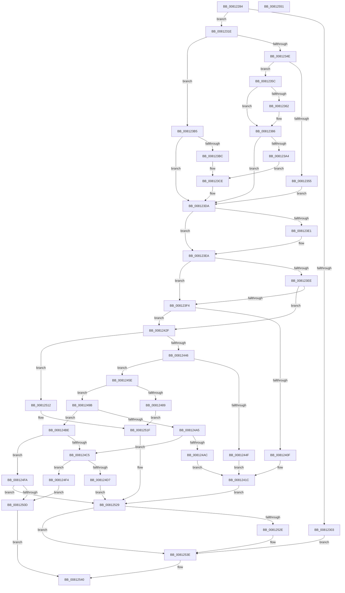

# SdbOpenDatabaseEx

- RVA: `0x00812284`–`0x00812552` (길이 `718` bytes)
- VA: `0x0000000140812284`
- 실행 섹션: `PAGE`
- PDB 이름 있음: `예`; PDB Function 태그: `아니요`
- unwind 정보 RVA: `0x000D9894`
- 디코드: `193`개 명령, `718/718` bytes 표시
- 미해석 바이트: `0` (있으면 어셈블리에 `.byte`로 보존)

> 이 문서는 커널 이미지의 기계어와 PDB 기호를 분석해 생성했습니다. 4번과 5번은 함수 원형과 자료형을 바이너리 사용 방식에서 추정한 C 해석이며 원본 소스 복구 결과는 아닙니다.

## 1. Dependencies

- 직접 호출 지점: **21**; 고유 호출 대상: **13**
- 직접 호출자로 확인된 함수: **1**
- RIP 상대 이미지 참조: **13**

### Outgoing calls
- `0x008122E6` → [AslLogCallPrintf](../95/AslLogCallPrintf_function_0095E4EC.md) (function, `0x0095E4EC`)
- `0x008122F2` → [AslAlloc](../95/AslAlloc_function_0095BD34.md) (function, `0x0095BD34`)
- `0x00812314` → [AslLogCallPrintf](../95/AslLogCallPrintf_function_0095E4EC.md) (function, `0x0095E4EC`)
- `0x00812326` → [memset](../../text/6C/memset_function_006C6C40.md) (function, `0x006C6C40`)
- `0x00812343` → [SdbGetMergeRedirectPath](SdbGetMergeRedirectPath_function_0081210C.md) (function, `0x0081210C`)
- `0x00812365` → [AslPathGetFileNamePart](AslPathGetFileNamePart_function_0081B274.md) (function, `0x0081B274`)
- `0x00812381` → [AslLogCallPrintf](../95/AslLogCallPrintf_function_0095E4EC.md) (function, `0x0095E4EC`)
- `0x00812399` → [AslFileMappingCreate](../95/AslFileMappingCreate_function_00958448.md) (function, `0x00958448`)
- `0x008123D5` → [AslLogCallPrintf](../95/AslLogCallPrintf_function_0095E4EC.md) (function, `0x0095E4EC`)
- `0x008123E5` → [AslFree](../95/AslFree_function_0095B674.md) (function, `0x0095B674`)
- `0x00812406` → [AslFileMappingCreate](../95/AslFileMappingCreate_function_00958448.md) (function, `0x00958448`)
- `0x00812425` → [AslLogCallPrintf](../95/AslLogCallPrintf_function_0095E4EC.md) (function, `0x0095E4EC`)
- `0x00812446` → [AslFileMappingEnsureMappedAs](AslFileMappingEnsureMappedAs_function_0081A6BC.md) (function, `0x0081A6BC`)
- `0x00812468` → [AslFileMappingGetViewBase](AslFileMappingGetViewBase_function_0081AB84.md) (function, `0x0081AB84`)
- `0x00812480` → [SdbpReadMappedData](../95/SdbpReadMappedData_function_0095E460.md) (function, `0x0095E460`)
- `0x008124CE` → [SdbpOpenCompressedDatabase](SdbpOpenCompressedDatabase_function_00818524.md) (function, `0x00818524`)
- `0x008124E9` → [AslLogCallPrintf](../95/AslLogCallPrintf_function_0095E4EC.md) (function, `0x0095E4EC`)
- `0x00812504` → [SdbpValidateAndApplyCompatFlags](../AF/SdbpValidateAndApplyCompatFlags_function_00AF93D8.md) (function, `0x00AF93D8`)
- `0x00812524` → [AslLogCallPrintf](../95/AslLogCallPrintf_function_0095E4EC.md) (function, `0x0095E4EC`)
- `0x00812531` → [AslFileMappingDelete](../95/AslFileMappingDelete_function_0095B728.md) (function, `0x0095B728`)
- `0x00812539` → [AslFree](../95/AslFree_function_0095B674.md) (function, `0x0095B674`)

### Direct callers
- [SdbpOpenLocalDatabaseEx](SdbpOpenLocalDatabaseEx_function_0081770C.md) at `0x00817885`

### Static image references
- `0x008122A3` → RVA `0x0003BD28` (`.rdata`; read)
- `0x008122AD` → RVA `0x0003BD40` (`.rdata`; read)
- `0x008122BE` → RVA `0x00013F90` (`.rdata`; read)
- `0x00812303` → RVA `0x0003BD08` (`.rdata`; read)
- `0x0081236A` → RVA `0x0003BC50` (`.rdata`; read)
- `0x008123A4` → RVA `0x0003BC10` (`.rdata`; read)
- `0x008123BC` → RVA `0x0003BCC0` (`.rdata`; read)
- `0x0081240F` → RVA `0x0003BBE8` (`.rdata`; read)
- `0x0081244F` → RVA `0x0003BB98` (`.rdata`; read)
- `0x00812489` → RVA `0x0003BB78` (`.rdata`; read)
- `0x008124AC` → RVA `0x0003BB48` (`.rdata`; read)
- `0x008124D7` → RVA `0x0003BB08` (`.rdata`; read)
- `0x00812512` → RVA `0x0003BBB0` (`.rdata`; read)

## 2. Other-region calls and transfers

- 다른 실행 섹션으로 향하는 call: **1**
  - `0x00812326` → [memset](../../text/6C/memset_function_006C6C40.md) (`PAGE` → `.text`)
- 별도 외부 분기/꼬리 이동을 확인하지 못했습니다.

## 3. Assembly (complete function range)

```asm
00812284  4C 8B DC                        mov r11, rsp
00812287  49 89 5B 10                     mov qword ptr [r11 + 0x10], rbx
0081228B  4D 89 4B 20                     mov qword ptr [r11 + 0x20], r9
0081228F  45 89 43 18                     mov dword ptr [r11 + 0x18], r8d
00812293  55                              push rbp
00812294  56                              push rsi
00812295  57                              push rdi
00812296  41 55                           push r13
00812298  41 57                           push r15
0081229A  48 8B EC                        mov rbp, rsp
0081229D  48 83 EC 40                     sub rsp, 0x40
008122A1  33 C0                           xor eax, eax
008122A3  4C 8D 2D 7E 9A 82 FF            lea r13, [rip - 0x7d6582]
008122AA  21 45 40                        and dword ptr [rbp + 0x40], eax
008122AD  4C 8D 0D 8C 9A 82 FF            lea r9, [rip - 0x7d6574]
008122B4  4C 8B F9                        mov r15, rcx
008122B7  48 89 45 F0                     mov qword ptr [rbp - 0x10], rax
008122BB  89 45 F8                        mov dword ptr [rbp - 8], eax
008122BE  48 8D 0D CB 1C 80 FF            lea rcx, [rip - 0x7fe335]
008122C5  4D 85 FF                        test r15, r15
008122C8  49 8B C7                        mov rax, r15
008122CB  41 B8 3A 0A 00 00               mov r8d, 0xa3a
008122D1  49 8B D5                        mov rdx, r13
008122D4  48 0F 44 C1                     cmove rax, rcx
008122D8  B9 03 00 00 00                  mov ecx, 3
008122DD  49 89 43 C0                     mov qword ptr [r11 - 0x40], rax
008122E1  83 64 24 20 00                  and dword ptr [rsp + 0x20], 0
008122E6  E8 01 C2 14 00                  call 0x14095e4ec
008122EB  BF 80 0A 00 00                  mov edi, 0xa80
008122F0  8B D7                           mov edx, edi
008122F2  E8 3D 9A 14 00                  call 0x14095bd34
008122F7  48 89 45 30                     mov qword ptr [rbp + 0x30], rax
008122FB  48 8B D8                        mov rbx, rax
008122FE  48 85 C0                        test rax, rax
00812301  75 1B                           jne 0x14081231e
00812303  4C 8D 0D FE 99 82 FF            lea r9, [rip - 0x7d6602]
0081230A  49 8B D5                        mov rdx, r13
0081230D  44 8D 47 C2                     lea r8d, [rdi - 0x3e]
00812311  8D 48 01                        lea ecx, [rax + 1]
00812314  E8 D3 C1 14 00                  call 0x14095e4ec
00812319  E9 20 02 00 00                  jmp 0x14081253e
0081231E  4C 8B C7                        mov r8, rdi
00812321  33 D2                           xor edx, edx
00812323  48 8B CB                        mov rcx, rbx
00812326  E8 15 49 EB FF                  call 0x1406c6c40
0081232B  48 83 65 48 00                  and qword ptr [rbp + 0x48], 0
00812330  48 8D 55 40                     lea rdx, [rbp + 0x40]
00812334  BF 01 00 00 00                  mov edi, 1
00812339  48 8D 4D 48                     lea rcx, [rbp + 0x48]
0081233D  44 8B C7                        mov r8d, edi
00812340  4D 8B CF                        mov r9, r15
00812343  E8 C4 FD FF FF                  call 0x14081210c
00812348  8B F0                           mov esi, eax
0081234A  85 C0                           test eax, eax
0081234C  78 67                           js 0x1408123b5
0081234E  48 83 7D 48 00                  cmp qword ptr [rbp + 0x48], 0
00812353  75 07                           jne 0x14081235c
00812355  BE 34 00 00 C0                  mov esi, 0xc0000034
0081235A  EB 7E                           jmp 0x1408123da
0081235C  83 7D 40 00                     cmp dword ptr [rbp + 0x40], 0
00812360  74 24                           je 0x140812386
00812362  49 8B CF                        mov rcx, r15
00812365  E8 0A 8F 00 00                  call 0x14081b274
0081236A  4C 8D 0D DF 98 82 FF            lea r9, [rip - 0x7d6721]
00812371  48 89 44 24 20                  mov qword ptr [rsp + 0x20], rax
00812376  41 B8 60 0A 00 00               mov r8d, 0xa60
0081237C  49 8B D5                        mov rdx, r13
0081237F  8B CF                           mov ecx, edi
00812381  E8 66 C1 14 00                  call 0x14095e4ec
00812386  48 8B 55 48                     mov rdx, qword ptr [rbp + 0x48]
0081238A  45 33 C9                        xor r9d, r9d
0081238D  48 83 64 24 20 00               and qword ptr [rsp + 0x20], 0
00812393  45 33 C0                        xor r8d, r8d
00812396  48 8B CB                        mov rcx, rbx
00812399  E8 AA 60 14 00                  call 0x140958448
0081239E  8B F0                           mov esi, eax
008123A0  85 C0                           test eax, eax
008123A2  79 36                           jns 0x1408123da
008123A4  4C 8D 0D 65 98 82 FF            lea r9, [rip - 0x7d679b]
008123AB  41 B8 73 0A 00 00               mov r8d, 0xa73
008123B1  8B CF                           mov ecx, edi
008123B3  EB 19                           jmp 0x1408123ce
008123B5  3D 34 00 00 C0                  cmp eax, 0xc0000034
008123BA  74 1E                           je 0x1408123da
008123BC  4C 8D 0D FD 98 82 FF            lea r9, [rip - 0x7d6703]
008123C3  41 B8 54 0A 00 00               mov r8d, 0xa54
008123C9  B9 03 00 00 00                  mov ecx, 3
008123CE  49 8B D5                        mov rdx, r13
008123D1  89 44 24 20                     mov dword ptr [rsp + 0x20], eax
008123D5  E8 12 C1 14 00                  call 0x14095e4ec
008123DA  48 83 7D 48 00                  cmp qword ptr [rbp + 0x48], 0
008123DF  74 09                           je 0x1408123ea
008123E1  48 8B 55 48                     mov rdx, qword ptr [rbp + 0x48]
008123E5  E8 8A 92 14 00                  call 0x14095b674
008123EA  85 F6                           test esi, esi
008123EC  78 06                           js 0x1408123f4
008123EE  48 83 3B 00                     cmp qword ptr [rbx], 0
008123F2  75 3B                           jne 0x14081242f
008123F4  48 83 64 24 20 00               and qword ptr [rsp + 0x20], 0
008123FA  45 33 C9                        xor r9d, r9d
008123FD  45 33 C0                        xor r8d, r8d
00812400  49 8B D7                        mov rdx, r15
00812403  48 8B CB                        mov rcx, rbx
00812406  E8 3D 60 14 00                  call 0x140958448
0081240B  85 C0                           test eax, eax
0081240D  79 20                           jns 0x14081242f
0081240F  4C 8D 0D D2 97 82 FF            lea r9, [rip - 0x7d682e]
00812416  41 B8 89 0A 00 00               mov r8d, 0xa89
0081241C  49 8B D5                        mov rdx, r13
0081241F  89 44 24 20                     mov dword ptr [rsp + 0x20], eax
00812423  8B CF                           mov ecx, edi
00812425  E8 C2 C0 14 00                  call 0x14095e4ec
0081242A  E9 FA 00 00 00                  jmp 0x140812529
0081242F  48 8B 0B                        mov rcx, qword ptr [rbx]
00812432  48 8B 71 18                     mov rsi, qword ptr [rcx + 0x18]
00812436  48 8D 46 D6                     lea rax, [rsi - 0x2a]
0081243A  48 3D D5 FF FF 0F               cmp rax, 0xfffffd5
00812440  0F 87 CC 00 00 00               ja 0x140812512
00812446  E8 71 82 00 00                  call 0x14081a6bc
0081244B  85 C0                           test eax, eax
0081244D  79 0F                           jns 0x14081245e
0081244F  4C 8D 0D 42 97 82 FF            lea r9, [rip - 0x7d68be]
00812456  41 B8 98 0A 00 00               mov r8d, 0xa98
0081245C  EB BE                           jmp 0x14081241c
0081245E  83 63 10 00                     and dword ptr [rbx + 0x10], 0
00812462  89 73 14                        mov dword ptr [rbx + 0x14], esi
00812465  48 8B 0B                        mov rcx, qword ptr [rbx]
00812468  E8 17 87 00 00                  call 0x14081ab84
0081246D  41 B9 0C 00 00 00               mov r9d, 0xc
00812473  48 89 43 08                     mov qword ptr [rbx + 8], rax
00812477  4C 8D 45 F0                     lea r8, [rbp - 0x10]
0081247B  33 D2                           xor edx, edx
0081247D  48 8B CB                        mov rcx, rbx
00812480  E8 DB BF 14 00                  call 0x14095e460
00812485  85 C0                           test eax, eax
00812487  75 12                           jne 0x14081249b
00812489  4C 8D 0D E8 96 82 FF            lea r9, [rip - 0x7d6918]
00812490  41 B8 A5 0A 00 00               mov r8d, 0xaa5
00812496  E9 84 00 00 00                  jmp 0x14081251f
0081249B  8B 45 F8                        mov eax, dword ptr [rbp - 8]
0081249E  3D 73 64 62 66                  cmp eax, 0x66626473
008124A3  74 19                           je 0x1408124be
008124A5  3D 7A 64 62 66                  cmp eax, 0x6662647a
008124AA  74 19                           je 0x1408124c5
008124AC  4C 8D 0D 95 96 82 FF            lea r9, [rip - 0x7d696b]
008124B3  41 B8 B2 0A 00 00               mov r8d, 0xab2
008124B9  E9 5E FF FF FF                  jmp 0x14081241c
008124BE  3D 7A 64 62 66                  cmp eax, 0x6662647a
008124C3  75 35                           jne 0x1408124fa
008124C5  45 33 C0                        xor r8d, r8d
008124C8  48 8D 4D 30                     lea rcx, [rbp + 0x30]
008124CC  33 D2                           xor edx, edx
008124CE  E8 51 60 00 00                  call 0x140818524
008124D3  85 C0                           test eax, eax
008124D5  75 1D                           jne 0x1408124f4
008124D7  4C 8D 0D 2A 96 82 FF            lea r9, [rip - 0x7d69d6]
008124DE  41 B8 B8 0A 00 00               mov r8d, 0xab8
008124E4  49 8B D5                        mov rdx, r13
008124E7  8B CF                           mov ecx, edi
008124E9  E8 FE BF 14 00                  call 0x14095e4ec
008124EE  48 8B 5D 30                     mov rbx, qword ptr [rbp + 0x30]
008124F2  EB 35                           jmp 0x140812529
008124F4  48 8B 5D 30                     mov rbx, qword ptr [rbp + 0x30]
008124F8  EB 13                           jmp 0x14081250d
008124FA  45 33 C0                        xor r8d, r8d
008124FD  48 8D 55 F0                     lea rdx, [rbp - 0x10]
00812501  48 8B CB                        mov rcx, rbx
00812504  E8 CF 6E 2E 00                  call 0x140af93d8
00812509  85 C0                           test eax, eax
0081250B  74 1C                           je 0x140812529
0081250D  48 8B C3                        mov rax, rbx
00812510  EB 2E                           jmp 0x140812540
00812512  4C 8D 0D 97 96 82 FF            lea r9, [rip - 0x7d6969]
00812519  41 B8 92 0A 00 00               mov r8d, 0xa92
0081251F  49 8B D5                        mov rdx, r13
00812522  8B CF                           mov ecx, edi
00812524  E8 C3 BF 14 00                  call 0x14095e4ec
00812529  48 85 DB                        test rbx, rbx
0081252C  74 10                           je 0x14081253e
0081252E  48 8B 0B                        mov rcx, qword ptr [rbx]
00812531  E8 F2 91 14 00                  call 0x14095b728
00812536  48 8B D3                        mov rdx, rbx
00812539  E8 36 91 14 00                  call 0x14095b674
0081253E  33 C0                           xor eax, eax
00812540  48 8B 5C 24 78                  mov rbx, qword ptr [rsp + 0x78]
00812545  48 83 C4 40                     add rsp, 0x40
00812549  41 5F                           pop r15
0081254B  41 5D                           pop r13
0081254D  5F                              pop rdi
0081254E  5E                              pop rsi
0081254F  5D                              pop rbp
00812550  C3                              ret
00812551  CC                              int3
```

## 4. C-style interpretation (structured pseudocode)

```c
__int64 __fastcall SdbOpenDatabaseEx(__int64 a1, __int64 a2, int a3, __int64 a4)
{
    __int64 result;
    __int64 v_rsp;
    unsigned int v_stack_m30;
    unsigned __int64 v_stack_m38;
    unsigned int v_stack_m48;
    unsigned __int64 v_stack_p10;
    unsigned int v_stack_p18;
    unsigned __int64 v_stack_p20;
    unsigned __int64 v_stack_p8;

    *(unsigned __int64 *)(v_rsp + 16) = v_rbx;
    *(unsigned __int64 *)(v_rsp + 32) = a4;
    *(unsigned int *)(v_rsp + 24) = a3;
    v_rsp = (v_rsp) - (64);
    result = 0;
    v_stack_m38 = 0;
    v_stack_m30 = 0;
    if (a1 == 0) { a1 = v_rip - 8381237; }
    *(unsigned __int64 *)(v_rsp - 64) = a1;
    result = AslLogCallPrintf(3, v_rip - 8217986, (unsigned int)(0xA3AULL), v_rip - 8217972);
    result = AslAlloc(3, (unsigned int)((unsigned int)((unsigned int)(0xA80ULL))), (unsigned int)(0xA3AULL), v_rip - 8217972);
    v_stack_p8 = result;
    if (result != 0) goto loc_0081231E;
    result = AslLogCallPrintf(result + 1, v_rip - 8217986, (unsigned int)(0xA80ULL) - 62, v_rip - 8218114);
    goto loc_0081253E;
loc_0081231E:
    a2 = 0;
    result = memset(result, a2, (unsigned int)(0xA80ULL), v_rip - 8218114);
    result = SdbGetMergeRedirectPath(v_stack_p20, v_stack_p18, 1, a1);
    if (sign_flag) goto loc_008123B5;
    if (v_stack_p20 != 0) goto loc_0081235C;
    goto loc_008123DA;
loc_0081235C:
    if (v_stack_p18 != 0) {
        a1 = a1;
        result = AslPathGetFileNamePart(a1, v_stack_p18, 1, a1);
        a4 = v_rip - 8218401;
        v_stack_m48 = result;
        a3 = 0xA60ULL;
        a2 = v_rip - 8217986;
        a1 = 1;
        result = AslLogCallPrintf(a1, a2, a3, a4);
    }
    a4 = 0;
    a3 = 0;
    result = AslFileMappingCreate(result, v_stack_p20, a3, a4);
    if (!sign_flag) goto loc_008123DA;
    goto loc_008123CE;
loc_008123B5:
    if (((unsigned int)(result)) == 0xC0000034ULL) goto loc_008123DA;
loc_008123CE:
    v_stack_m48 = (unsigned int)(result);
    result = AslLogCallPrintf(3, v_rip - 8217986, (unsigned int)(0xA54ULL), v_rip - 8218371);
loc_008123DA:
    if (v_stack_p20 != 0) {
        a2 = v_stack_p20;
        result = AslFree(3, a2, (unsigned int)(0xA54ULL), v_rip - 8218371);
    }
    if (sign_flag) goto loc_008123F4;
    if ((*(unsigned __int64 *)(result)) != 0) goto loc_0081242F;
loc_008123F4:
    a4 = 0;
    a3 = 0;
    result = AslFileMappingCreate(result, a1, a3, a4);
    if (!sign_flag) goto loc_0081242F;
loc_0081241C:
    v_stack_m48 = (unsigned int)(result);
    result = AslLogCallPrintf(1, v_rip - 8217986, (unsigned int)(0xA89ULL), v_rip - 8218670);
    goto loc_00812529;
loc_0081242F:
    if ((*(unsigned __int64 *)(*(unsigned __int64 *)(result) + 24) - 42) > 0xFFFFFD5ULL) goto loc_00812512;
    result = AslFileMappingEnsureMappedAs(*(unsigned __int64 *)(result), v_rip - 8217986, (unsigned int)(0xA89ULL), v_rip - 8218670);
    if (!sign_flag) goto loc_0081245E;
    goto loc_0081241C;
loc_0081245E:
    *(unsigned int *)(result + 20) = (unsigned int)(*(unsigned __int64 *)(*(unsigned __int64 *)(result) + 24));
    result = AslFileMappingGetViewBase(*(unsigned __int64 *)(result), v_rip - 8217986, (unsigned int)(0xA98ULL), v_rip - 8218814);
    *(unsigned __int64 *)(result + 8) = result;
    a2 = 0;
    result = SdbpReadMappedData(result, a2, v_stack_m38, 12);
    if ((unsigned int)(result) != 0) goto loc_0081249B;
    goto loc_0081251F;
loc_0081249B:
    if (((unsigned int)((unsigned int)(v_stack_m30))) == 0x66626473ULL) goto loc_008124BE;
    if (((unsigned int)((unsigned int)(v_stack_m30))) == 0x6662647AULL) goto loc_008124C5;
    goto loc_0081241C;
loc_008124BE:
    if (((unsigned int)((unsigned int)(v_stack_m30))) != 0x6662647AULL) goto loc_008124FA;
loc_008124C5:
    a3 = 0;
    a2 = 0;
    result = SdbpOpenCompressedDatabase(v_stack_p8, a2, a3, v_rip - 8218987);
    if ((unsigned int)(result) != 0) goto loc_008124F4;
    result = AslLogCallPrintf(1, v_rip - 8217986, (unsigned int)(0xAB8ULL), v_rip - 8219094);
    goto loc_00812529;
loc_008124F4:
    goto loc_0081250D;
loc_008124FA:
    a3 = 0;
    result = SdbpValidateAndApplyCompatFlags(v_stack_p8, v_stack_m38, a3, v_rip - 8219094);
    if ((unsigned int)(result) == 0) goto loc_00812529;
loc_0081250D:
    goto loc_00812540;
loc_00812512:
loc_0081251F:
    result = AslLogCallPrintf(1, v_rip - 8217986, (unsigned int)(0xA92ULL), v_rip - 8218985);
loc_00812529:
    if (v_stack_p8 != 0) {
        a1 = *(unsigned __int64 *)(v_stack_p8);
        result = AslFileMappingDelete(a1, v_rip - 8217986, (unsigned int)(0xA92ULL), v_rip - 8218985);
        a2 = v_stack_p8;
        result = AslFree(a1, a2, (unsigned int)(0xA92ULL), v_rip - 8218985);
    }
    result = 0;
loc_00812540:
    v_rsp = (v_rsp) + (64);
    return result;
}
```

## 5. (Beta) C Style

```c
int64_t SdbOpenDatabaseEx(int64_t Arg1, int64_t Arg2, int32_t Arg3, int64_t Arg4)
{
    int64_t result;
    int64_t local_rsp;
    uint32_t v_stack_m30;
    uint64_t v_stack_m38;
    uint32_t v_stack_m48;
    uint64_t v_stack_p10;
    uint32_t v_stack_p18;
    uint64_t v_stack_p20;
    uint64_t v_stack_p8;

    *(uint64_t *)(local_rsp + 0x10) = local_rbx;
    *(uint64_t *)(local_rsp + 0x20) = Arg4;
    *(uint32_t *)(local_rsp + 0x18) = Arg3;
    local_rsp = (local_rsp) - (64);
    result = 0;
    v_stack_m38 = 0;
    v_stack_m30 = 0;
    if (Arg1 == 0) { Arg1 = v_rip - 8381237; }
    *(uint64_t *)(local_rsp - 0x40) = Arg1;
    result = AslLogCallPrintf(3, v_rip - 8217986, (uint32_t)(0xA3AULL), v_rip - 8217972);
    result = AslAlloc(3, (uint32_t)((uint32_t)((uint32_t)(0xA80ULL))), (uint32_t)(0xA3AULL), v_rip - 8217972);
    v_stack_p8 = result;
    if (result != 0) goto loc_0081231E;
    result = AslLogCallPrintf(result + 1, v_rip - 8217986, (uint32_t)(0xA80ULL) - 62, v_rip - 8218114);
    goto loc_0081253E;
loc_0081231E:
    Arg2 = 0;
    result = memset(result, Arg2, (uint32_t)(0xA80ULL), v_rip - 8218114);
    result = SdbGetMergeRedirectPath(v_stack_p20, v_stack_p18, 1, Arg1);
    if (sign_flag) goto loc_008123B5;
    if (v_stack_p20 != 0) goto loc_0081235C;
    goto loc_008123DA;
loc_0081235C:
    if (v_stack_p18 != 0) {
        Arg1 = Arg1;
        result = AslPathGetFileNamePart(Arg1, v_stack_p18, 1, Arg1);
        Arg4 = v_rip - 8218401;
        v_stack_m48 = result;
        Arg3 = 0xA60ULL;
        Arg2 = v_rip - 8217986;
        Arg1 = 1;
        result = AslLogCallPrintf(Arg1, Arg2, Arg3, Arg4);
    }
    Arg4 = 0;
    Arg3 = 0;
    result = AslFileMappingCreate(result, v_stack_p20, Arg3, Arg4);
    if (!sign_flag) goto loc_008123DA;
    goto loc_008123CE;
loc_008123B5:
    if (((uint32_t)(result)) == 0xC0000034ULL) goto loc_008123DA;
loc_008123CE:
    v_stack_m48 = (uint32_t)(result);
    result = AslLogCallPrintf(3, v_rip - 8217986, (uint32_t)(0xA54ULL), v_rip - 8218371);
loc_008123DA:
    if (v_stack_p20 != 0) {
        Arg2 = v_stack_p20;
        result = AslFree(3, Arg2, (uint32_t)(0xA54ULL), v_rip - 8218371);
    }
    if (sign_flag) goto loc_008123F4;
    if ((*(uint64_t *)(result)) != 0) goto loc_0081242F;
loc_008123F4:
    Arg4 = 0;
    Arg3 = 0;
    result = AslFileMappingCreate(result, Arg1, Arg3, Arg4);
    if (!sign_flag) goto loc_0081242F;
loc_0081241C:
    v_stack_m48 = (uint32_t)(result);
    result = AslLogCallPrintf(1, v_rip - 8217986, (uint32_t)(0xA89ULL), v_rip - 8218670);
    goto loc_00812529;
loc_0081242F:
    if ((*(uint64_t *)(*(uint64_t *)(result) + 0x18) - 42) > 0xFFFFFD5ULL) goto loc_00812512;
    result = AslFileMappingEnsureMappedAs(*(uint64_t *)(result), v_rip - 8217986, (uint32_t)(0xA89ULL), v_rip - 8218670);
    if (!sign_flag) goto loc_0081245E;
    goto loc_0081241C;
loc_0081245E:
    *(uint32_t *)(result + 0x14) = (uint32_t)(*(uint64_t *)(*(uint64_t *)(result) + 0x18));
    result = AslFileMappingGetViewBase(*(uint64_t *)(result), v_rip - 8217986, (uint32_t)(0xA98ULL), v_rip - 8218814);
    *(uint64_t *)(result + 0x8) = result;
    Arg2 = 0;
    result = SdbpReadMappedData(result, Arg2, v_stack_m38, 12);
    if ((uint32_t)(result) != 0) goto loc_0081249B;
    goto loc_0081251F;
loc_0081249B:
    if (((uint32_t)((uint32_t)(v_stack_m30))) == 0x66626473ULL) goto loc_008124BE;
    if (((uint32_t)((uint32_t)(v_stack_m30))) == 0x6662647AULL) goto loc_008124C5;
    goto loc_0081241C;
loc_008124BE:
    if (((uint32_t)((uint32_t)(v_stack_m30))) != 0x6662647AULL) goto loc_008124FA;
loc_008124C5:
    Arg3 = 0;
    Arg2 = 0;
    result = SdbpOpenCompressedDatabase(v_stack_p8, Arg2, Arg3, v_rip - 8218987);
    if ((uint32_t)(result) != 0) goto loc_008124F4;
    result = AslLogCallPrintf(1, v_rip - 8217986, (uint32_t)(0xAB8ULL), v_rip - 8219094);
    goto loc_00812529;
loc_008124F4:
    goto loc_0081250D;
loc_008124FA:
    Arg3 = 0;
    result = SdbpValidateAndApplyCompatFlags(v_stack_p8, v_stack_m38, Arg3, v_rip - 8219094);
    if ((uint32_t)(result) == 0) goto loc_00812529;
loc_0081250D:
    goto loc_00812540;
loc_00812512:
loc_0081251F:
    result = AslLogCallPrintf(1, v_rip - 8217986, (uint32_t)(0xA92ULL), v_rip - 8218985);
loc_00812529:
    if (v_stack_p8 != 0) {
        Arg1 = *(uint64_t *)(v_stack_p8);
        result = AslFileMappingDelete(Arg1, v_rip - 8217986, (uint32_t)(0xA92ULL), v_rip - 8218985);
        Arg2 = v_stack_p8;
        result = AslFree(Arg1, Arg2, (uint32_t)(0xA92ULL), v_rip - 8218985);
    }
    result = 0;
loc_00812540:
    local_rsp = (local_rsp) + (64);
    return result;
}
```

## 6. Execution-region graph

[열기: 2D/3D 그래프와 함수 탐색 컨트롤 패널](../../../control-panel.html?section=page&rva=0x00812284&view=graph)

- 2D 그래프는 위에서 아래로 흐르고, 3D 그래프는 빈 공간을 드래그해 회전합니다. Shift+드래그는 이동, 휠은 확대·축소, 함수 노드 선택은 대상 보고서 이동입니다.

### Static fallback


