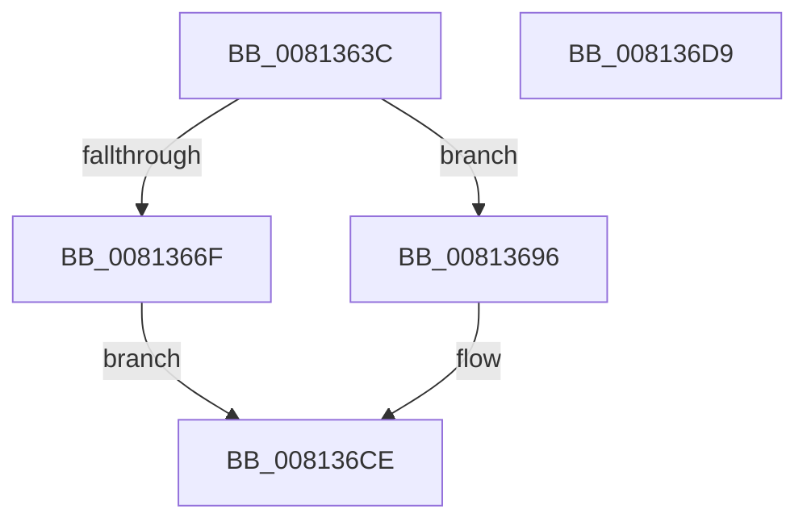

# SdbQueryDataEx

- RVA: `0x0081363C`–`0x008136DA` (길이 `158` bytes)
- VA: `0x000000014081363C`
- 실행 섹션: `PAGE`
- PDB 이름 있음: `예`; PDB Function 태그: `아니요`
- unwind 정보 RVA: `0x000D9910`
- 디코드: `38`개 명령, `158/158` bytes 표시
- 미해석 바이트: `0` (있으면 어셈블리에 `.byte`로 보존)

> 이 문서는 커널 이미지의 기계어와 PDB 기호를 분석해 생성했습니다. 4번과 5번은 함수 원형과 자료형을 바이너리 사용 방식에서 추정한 C 해석이며 원본 소스 복구 결과는 아닙니다.

## 1. Dependencies

- 직접 호출 지점: **3**; 고유 호출 대상: **3**
- 직접 호출자로 확인된 함수: **1**
- RIP 상대 이미지 참조: **2**

### Outgoing calls
- `0x00813666` → [SdbTagRefToTagID](SdbTagRefToTagID_function_0081717C.md) (function, `0x0081717C`)
- `0x0081368A` → [AslLogCallPrintf](../95/AslLogCallPrintf_function_0095E4EC.md) (function, `0x0095E4EC`)
- `0x008136C9` → [SdbQueryDataExTagID](SdbQueryDataExTagID_function_008136E0.md) (function, `0x008136E0`)

### Direct callers
- [PiIsDriverBlocked](../99/PiIsDriverBlocked_function_0099C254.md) at `0x0099C2E3`

### Static image references
- `0x0081366F` → RVA `0x0003CDF0` (`.rdata`; read)
- `0x00813680` → RVA `0x0003CDE0` (`.rdata`; read)

## 2. Other-region calls and transfers

- 다른 실행 섹션으로 향하는 call: **0**
- 별도 외부 분기/꼬리 이동을 확인하지 못했습니다.

## 3. Assembly (complete function range)

```asm
0081363C  48 8B C4                        mov rax, rsp
0081363F  48 89 58 08                     mov qword ptr [rax + 8], rbx
00813643  4C 89 40 18                     mov qword ptr [rax + 0x18], r8
00813647  57                              push rdi
00813648  48 83 EC 50                     sub rsp, 0x50
0081364C  48 83 60 E8 00                  and qword ptr [rax - 0x18], 0
00813651  4C 8D 40 E8                     lea r8, [rax - 0x18]
00813655  83 60 18 00                     and dword ptr [rax + 0x18], 0
00813659  49 8B F9                        mov rdi, r9
0081365C  83 60 38 00                     and dword ptr [rax + 0x38], 0
00813660  4C 8D 48 18                     lea r9, [rax + 0x18]
00813664  8B DA                           mov ebx, edx
00813666  E8 11 3B 00 00                  call 0x14081717c
0081366B  85 C0                           test eax, eax
0081366D  75 27                           jne 0x140813696
0081366F  4C 8D 0D 7A 97 82 FF            lea r9, [rip - 0x7d6886]
00813676  89 5C 24 20                     mov dword ptr [rsp + 0x20], ebx
0081367A  41 B8 74 1C 00 00               mov r8d, 0x1c74
00813680  48 8D 15 59 97 82 FF            lea rdx, [rip - 0x7d68a7]
00813687  8D 48 01                        lea ecx, [rax + 1]
0081368A  E8 5D AE 14 00                  call 0x14095e4ec
0081368F  B8 57 00 00 00                  mov eax, 0x57
00813694  EB 38                           jmp 0x1408136ce
00813696  8B 54 24 70                     mov edx, dword ptr [rsp + 0x70]
0081369A  48 8D 84 24 90 00 00 00         lea rax, [rsp + 0x90]
008136A2  48 8B 4C 24 40                  mov rcx, qword ptr [rsp + 0x40]
008136A7  4C 8B CF                        mov r9, rdi
008136AA  48 89 44 24 30                  mov qword ptr [rsp + 0x30], rax
008136AF  48 8B 84 24 88 00 00 00         mov rax, qword ptr [rsp + 0x88]
008136B7  48 89 44 24 28                  mov qword ptr [rsp + 0x28], rax
008136BC  48 8B 84 24 80 00 00 00         mov rax, qword ptr [rsp + 0x80]
008136C4  48 89 44 24 20                  mov qword ptr [rsp + 0x20], rax
008136C9  E8 12 00 00 00                  call 0x1408136e0
008136CE  48 8B 5C 24 60                  mov rbx, qword ptr [rsp + 0x60]
008136D3  48 83 C4 50                     add rsp, 0x50
008136D7  5F                              pop rdi
008136D8  C3                              ret
008136D9  CC                              int3
```

## 4. C-style interpretation (structured pseudocode)

```c
__int64 __fastcall SdbQueryDataEx(__int64 a1, int a2, __int64 a3, __int64 a4, __int64 a5, __int64 a6, __int64 a7)
{
    __int64 result;
    __int64 v_rsp;
    unsigned __int64 v_stack_m18;
    unsigned __int64 v_stack_m28;
    unsigned __int64 v_stack_m30;
    unsigned int v_stack_m38;
    unsigned int v_stack_p18;
    unsigned __int64 v_stack_p8;

    *(unsigned __int64 *)(v_rsp + 8) = v_rbx;
    *(unsigned __int64 *)(v_rsp + 24) = a3;
    v_rsp = (v_rsp) - (80);
    result = SdbTagRefToTagID(a1, a2, v_rsp - 24, v_rsp + 24);
    if ((unsigned int)(result) != 0) goto loc_00813696;
    v_stack_m38 = (unsigned int)((unsigned int)(a2));
    result = AslLogCallPrintf(result + 1, v_rip - 8218791, (unsigned int)(0x1C74ULL), v_rip - 8218758);
    goto loc_008136CE;
loc_00813696:
    v_stack_m28 = a7;
    v_stack_m30 = a6;
    v_stack_m38 = a5;
    result = SdbQueryDataExTagID(v_stack_m18, (unsigned int)(v_stack_p18), (unsigned int)(0x1C74ULL), a4);
loc_008136CE:
    v_rsp = (v_rsp) + (80);
    return result;
}
```

## 5. (Beta) C Style

```c
int64_t SdbQueryDataEx(int64_t Arg1, int32_t Arg2, int64_t Arg3, int64_t Arg4, int64_t Arg5, int64_t Arg6, int64_t Arg7)
{
    int64_t result;
    int64_t local_rsp;
    uint64_t v_stack_m18;
    uint64_t v_stack_m28;
    uint64_t v_stack_m30;
    uint32_t v_stack_m38;
    uint32_t v_stack_p18;
    uint64_t v_stack_p8;

    *(uint64_t *)(local_rsp + 0x8) = local_rbx;
    *(uint64_t *)(local_rsp + 0x18) = Arg3;
    local_rsp = (local_rsp) - (80);
    result = SdbTagRefToTagID(Arg1, Arg2, local_rsp - 24, local_rsp + 24);
    if ((uint32_t)(result) != 0) goto loc_00813696;
    v_stack_m38 = (uint32_t)((uint32_t)(Arg2));
    result = AslLogCallPrintf(result + 1, v_rip - 8218791, (uint32_t)(0x1C74ULL), v_rip - 8218758);
    goto loc_008136CE;
loc_00813696:
    v_stack_m28 = Arg7;
    v_stack_m30 = Arg6;
    v_stack_m38 = Arg5;
    result = SdbQueryDataExTagID(v_stack_m18, (uint32_t)(v_stack_p18), (uint32_t)(0x1C74ULL), Arg4);
loc_008136CE:
    local_rsp = (local_rsp) + (80);
    return result;
}
```

## 6. Execution-region graph

[열기: 2D/3D 그래프와 함수 탐색 컨트롤 패널](../../../control-panel.html?section=page&rva=0x0081363C&view=graph)

- 2D 그래프는 위에서 아래로 흐르고, 3D 그래프는 빈 공간을 드래그해 회전합니다. Shift+드래그는 이동, 휠은 확대·축소, 함수 노드 선택은 대상 보고서 이동입니다.

### Static fallback


