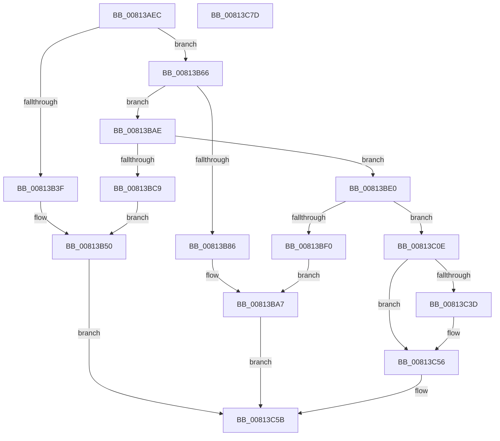

# SdbReadEntryInformation

- RVA: `0x00813AEC`–`0x00813C7E` (길이 `402` bytes)
- VA: `0x0000000140813AEC`
- 실행 섹션: `PAGE`
- PDB 이름 있음: `예`; PDB Function 태그: `아니요`
- unwind 정보 RVA: `0x000D9A84`
- 디코드: `106`개 명령, `402/402` bytes 표시
- 미해석 바이트: `0` (있으면 어셈블리에 `.byte`로 보존)

> 이 문서는 커널 이미지의 기계어와 PDB 기호를 분석해 생성했습니다. 4번과 5번은 함수 원형과 자료형을 바이너리 사용 방식에서 추정한 C 해석이며 원본 소스 복구 결과는 아닙니다.

## 1. Dependencies

- 직접 호출 지점: **10**; 고유 호출 대상: **7**
- 직접 호출자로 확인된 함수: **1**
- RIP 상대 이미지 참조: **6**

### Outgoing calls
- `0x00813B34` → [SdbTagRefToTagID](SdbTagRefToTagID_function_0081717C.md) (function, `0x0081717C`)
- `0x00813B5C` → [AslLogCallPrintf](../95/AslLogCallPrintf_function_0095E4EC.md) (function, `0x0095E4EC`)
- `0x00813B7A` → [SdbFindFirstTag](../95/SdbFindFirstTag_function_0095E34C.md) (function, `0x0095E34C`)
- `0x00813BA2` → [AslLogCallPrintf](../95/AslLogCallPrintf_function_0095E4EC.md) (function, `0x0095E4EC`)
- `0x00813BBE` → [SdbReadBinaryTag](../A7/SdbReadBinaryTag_function_00A7EC28.md) (function, `0x00A7EC28`)
- `0x00813BE7` → [SdbGetDatabaseID](../A7/SdbGetDatabaseID_function_00A7EB20.md) (function, `0x00A7EB20`)
- `0x00813C07` → [AslLogCallPrintf](../95/AslLogCallPrintf_function_0095E4EC.md) (function, `0x0095E4EC`)
- `0x00813C16` → [SdbGetEntryFlags](../AB/SdbGetEntryFlags_function_00ABD3E0.md) (function, `0x00ABD3E0`)
- `0x00813C30` → [SdbFindFirstTag](../95/SdbFindFirstTag_function_0095E34C.md) (function, `0x0095E34C`)
- `0x00813C64` → [_security_check_cookie](../../text/6A/_security_check_cookie_function_006AC640.md) (function, `0x006AC640`)

### Direct callers
- [PiIsDriverBlocked](../99/PiIsDriverBlocked_function_0099C254.md) at `0x0099C3B1`

### Static image references
- `0x00813AFF` → RVA `0x00E0A740` (`.data`; read)
- `0x00813B43` → RVA `0x0003CDF0` (`.rdata`; read)
- `0x00813B50` → RVA `0x0003CDC8` (`.rdata`; read)
- `0x00813B86` → RVA `0x0003C110` (`.rdata`; read)
- `0x00813BCE` → RVA `0x0003CDA0` (`.rdata`; read)
- `0x00813BF0` → RVA `0x0003CD78` (`.rdata`; read)

## 2. Other-region calls and transfers

- 다른 실행 섹션으로 향하는 call: **1**
  - `0x00813C64` → [_security_check_cookie](../../text/6A/_security_check_cookie_function_006AC640.md) (`PAGE` → `.text`)
- 별도 외부 분기/꼬리 이동을 확인하지 못했습니다.

## 3. Assembly (complete function range)

```asm
00813AEC  48 89 5C 24 20                  mov qword ptr [rsp + 0x20], rbx
00813AF1  55                              push rbp
00813AF2  56                              push rsi
00813AF3  57                              push rdi
00813AF4  41 56                           push r14
00813AF6  41 57                           push r15
00813AF8  48 8B EC                        mov rbp, rsp
00813AFB  48 83 EC 70                     sub rsp, 0x70
00813AFF  48 8B 05 3A 6C 5F 00            mov rax, qword ptr [rip + 0x5f6c3a]
00813B06  48 33 C4                        xor rax, rsp
00813B09  48 89 45 F8                     mov qword ptr [rbp - 8], rax
00813B0D  83 65 C0 00                     and dword ptr [rbp - 0x40], 0
00813B11  4C 8D 4D C0                     lea r9, [rbp - 0x40]
00813B15  48 83 65 C8 00                  and qword ptr [rbp - 0x38], 0
00813B1A  0F 57 C0                        xorps xmm0, xmm0
00813B1D  49 8B F8                        mov rdi, r8
00813B20  33 C0                           xor eax, eax
00813B22  4C 8D 45 C8                     lea r8, [rbp - 0x38]
00813B26  48 89 45 F0                     mov qword ptr [rbp - 0x10], rax
00813B2A  0F 11 45 D0                     movups xmmword ptr [rbp - 0x30], xmm0
00813B2E  8B F2                           mov esi, edx
00813B30  0F 11 45 E0                     movups xmmword ptr [rbp - 0x20], xmm0
00813B34  E8 43 36 00 00                  call 0x14081717c
00813B39  8B D8                           mov ebx, eax
00813B3B  85 C0                           test eax, eax
00813B3D  75 27                           jne 0x140813b66
00813B3F  89 74 24 20                     mov dword ptr [rsp + 0x20], esi
00813B43  4C 8D 0D A6 92 82 FF            lea r9, [rip - 0x7d6d5a]
00813B4A  41 B8 AC 1C 00 00               mov r8d, 0x1cac
00813B50  48 8D 15 71 92 82 FF            lea rdx, [rip - 0x7d6d8f]
00813B57  B9 01 00 00 00                  mov ecx, 1
00813B5C  E8 8B A9 14 00                  call 0x14095e4ec
00813B61  E9 F5 00 00 00                  jmp 0x140813c5b
00813B66  48 8B 75 C8                     mov rsi, qword ptr [rbp - 0x38]
00813B6A  41 B8 04 90 00 00               mov r8d, 0x9004
00813B70  44 8B 7D C0                     mov r15d, dword ptr [rbp - 0x40]
00813B74  48 8B CE                        mov rcx, rsi
00813B77  41 8B D7                        mov edx, r15d
00813B7A  E8 CD A7 14 00                  call 0x14095e34c
00813B7F  44 8B F0                        mov r14d, eax
00813B82  85 C0                           test eax, eax
00813B84  75 28                           jne 0x140813bae
00813B86  4C 8D 0D 83 85 82 FF            lea r9, [rip - 0x7d7a7d]
00813B8D  44 89 7C 24 20                  mov dword ptr [rsp + 0x20], r15d
00813B92  41 B8 B6 1C 00 00               mov r8d, 0x1cb6
00813B98  48 8D 15 29 92 82 FF            lea rdx, [rip - 0x7d6dd7]
00813B9F  8D 48 01                        lea ecx, [rax + 1]
00813BA2  E8 45 A9 14 00                  call 0x14095e4ec
00813BA7  33 DB                           xor ebx, ebx
00813BA9  E9 AD 00 00 00                  jmp 0x140813c5b
00813BAE  41 B9 10 00 00 00               mov r9d, 0x10
00813BB4  4C 8D 45 D0                     lea r8, [rbp - 0x30]
00813BB8  41 8B D6                        mov edx, r14d
00813BBB  48 8B CE                        mov rcx, rsi
00813BBE  E8 65 B0 26 00                  call 0x140a7ec28
00813BC3  8B D8                           mov ebx, eax
00813BC5  85 C0                           test eax, eax
00813BC7  75 17                           jne 0x140813be0
00813BC9  44 89 74 24 20                  mov dword ptr [rsp + 0x20], r14d
00813BCE  4C 8D 0D CB 91 82 FF            lea r9, [rip - 0x7d6e35]
00813BD5  41 B8 C0 1C 00 00               mov r8d, 0x1cc0
00813BDB  E9 70 FF FF FF                  jmp 0x140813b50
00813BE0  48 8D 55 E8                     lea rdx, [rbp - 0x18]
00813BE4  48 8B CE                        mov rcx, rsi
00813BE7  E8 34 AF 26 00                  call 0x140a7eb20
00813BEC  85 C0                           test eax, eax
00813BEE  75 1E                           jne 0x140813c0e
00813BF0  4C 8D 0D 81 91 82 FF            lea r9, [rip - 0x7d6e7f]
00813BF7  41 B8 C8 1C 00 00               mov r8d, 0x1cc8
00813BFD  48 8D 15 C4 91 82 FF            lea rdx, [rip - 0x7d6e3c]
00813C04  8D 48 01                        lea ecx, [rax + 1]
00813C07  E8 E0 A8 14 00                  call 0x14095e4ec
00813C0C  EB 99                           jmp 0x140813ba7
00813C0E  48 8D 55 E0                     lea rdx, [rbp - 0x20]
00813C12  48 8D 4D D0                     lea rcx, [rbp - 0x30]
00813C16  E8 C5 97 2A 00                  call 0x140abd3e0
00813C1B  F7 D8                           neg eax
00813C1D  41 8B D7                        mov edx, r15d
00813C20  48 8B CE                        mov rcx, rsi
00813C23  45 1B C0                        sbb r8d, r8d
00813C26  44 21 45 E0                     and dword ptr [rbp - 0x20], r8d
00813C2A  41 B8 0F 70 00 00               mov r8d, 0x700f
00813C30  E8 17 A7 14 00                  call 0x14095e34c
00813C35  89 45 E4                        mov dword ptr [rbp - 0x1c], eax
00813C38  48 85 FF                        test rdi, rdi
00813C3B  74 19                           je 0x140813c56
00813C3D  0F 10 45 D0                     movups xmm0, xmmword ptr [rbp - 0x30]
00813C41  0F 10 4D E0                     movups xmm1, xmmword ptr [rbp - 0x20]
00813C45  0F 11 07                        movups xmmword ptr [rdi], xmm0
00813C48  F2 0F 10 45 F0                  movsd xmm0, qword ptr [rbp - 0x10]
00813C4D  0F 11 4F 10                     movups xmmword ptr [rdi + 0x10], xmm1
00813C51  F2 0F 11 47 20                  movsd qword ptr [rdi + 0x20], xmm0
00813C56  BB 01 00 00 00                  mov ebx, 1
00813C5B  8B C3                           mov eax, ebx
00813C5D  48 8B 4D F8                     mov rcx, qword ptr [rbp - 8]
00813C61  48 33 CC                        xor rcx, rsp
00813C64  E8 D7 89 E9 FF                  call 0x1406ac640
00813C69  48 8B 9C 24 B8 00 00 00         mov rbx, qword ptr [rsp + 0xb8]
00813C71  48 83 C4 70                     add rsp, 0x70
00813C75  41 5F                           pop r15
00813C77  41 5E                           pop r14
00813C79  5F                              pop rdi
00813C7A  5E                              pop rsi
00813C7B  5D                              pop rbp
00813C7C  C3                              ret
00813C7D  CC                              int3
```

## 4. C-style interpretation (structured pseudocode)

```c
__int64 __fastcall SdbReadEntryInformation(__int64 a1, int a2, __int64 a3)
{
    __int64 result;
    __int64 v_rbx;
    __int64 v_rsp;
    unsigned __int64 v_stack_m30;
    unsigned __int64 v_stack_m38;
    unsigned __int64 v_stack_m40;
    unsigned int v_stack_m44;
    unsigned __int64 v_stack_m48;
    unsigned __int64 v_stack_m58;
    unsigned __int64 v_stack_m60;
    unsigned int v_stack_m68;
    unsigned int v_stack_m78;
    unsigned __int64 v_stack_p20;

    v_stack_p20 = v_rbx;
    v_rsp = (v_rsp) - (112);
    result = (*(unsigned __int64 *)(v_rip + 6253626)) ^ (v_rsp);
    v_stack_m30 = result;
    result = 0;
    v_stack_m38 = 0;
    v_stack_m58 = v_xmm0;
    v_stack_m48 = v_xmm0;
    result = SdbTagRefToTagID(a1, a2, v_stack_m60, v_stack_m68);
    if ((unsigned int)(result) != 0) goto loc_00813B66;
    v_stack_m78 = (unsigned int)((unsigned int)(a2));
loc_00813B50:
    result = AslLogCallPrintf(1, v_rip - 8220047, (unsigned int)(0x1CACULL), v_rip - 8219994);
    goto loc_00813C5B;
loc_00813B66:
    result = SdbFindFirstTag(v_stack_m60, (unsigned int)((unsigned int)((unsigned int)(v_stack_m68))), (unsigned int)(0x9004ULL), v_rip - 8219994);
    if ((unsigned int)(result) != 0) goto loc_00813BAE;
    v_stack_m78 = (unsigned int)((unsigned int)(v_stack_m68));
    result = AslLogCallPrintf(result + 1, v_rip - 8220119, (unsigned int)(0x1CB6ULL), v_rip - 8223357);
loc_00813BA7:
    v_rbx = 0;
    goto loc_00813C5B;
loc_00813BAE:
    result = SdbReadBinaryTag(v_stack_m60, (unsigned int)((unsigned int)((unsigned int)((unsigned int)(result)))), v_stack_m58, 16);
    if ((unsigned int)(result) != 0) goto loc_00813BE0;
    v_stack_m78 = (unsigned int)((unsigned int)((unsigned int)(result)));
    goto loc_00813B50;
loc_00813BE0:
    result = SdbGetDatabaseID(v_stack_m60, v_stack_m40, (unsigned int)(0x1CC0ULL), v_rip - 8220213);
    if ((unsigned int)(result) != 0) goto loc_00813C0E;
    result = AslLogCallPrintf(result + 1, v_rip - 8220220, (unsigned int)(0x1CC8ULL), v_rip - 8220287);
    goto loc_00813BA7;
loc_00813C0E:
    result = SdbGetEntryFlags(v_stack_m58, v_stack_m48, (unsigned int)(0x1CC8ULL), v_rip - 8220287);
    result = (unsigned int)(-(result));
    result = SdbFindFirstTag(v_stack_m60, (unsigned int)((unsigned int)((unsigned int)(v_stack_m68))), (unsigned int)(0x700FULL), v_rip - 8220287);
    v_stack_m44 = (unsigned int)(result);
    if (a3 != 0) {
        *(unsigned __int64 *)(a3) = v_xmm0;
        *(unsigned __int64 *)(a3 + 16) = v_xmm1;
        *(unsigned __int64 *)(a3 + 32) = v_xmm0;
    }
loc_00813C5B:
    a1 = (v_stack_m30) ^ (v_rsp);
    result = _security_check_cookie(a1, (unsigned int)((unsigned int)((unsigned int)(v_stack_m68))), (unsigned int)(0x700FULL), v_rip - 8220287);
    v_rsp = (v_rsp) + (112);
    return result;
}
```

## 5. (Beta) C Style

```c
int64_t SdbReadEntryInformation(int64_t Arg1, int32_t Arg2, int64_t Arg3)
{
    int64_t result;
    int64_t local_rbx;
    int64_t local_rsp;
    uint64_t v_stack_m30;
    uint64_t v_stack_m38;
    uint64_t v_stack_m40;
    uint32_t v_stack_m44;
    uint64_t v_stack_m48;
    uint64_t v_stack_m58;
    uint64_t v_stack_m60;
    uint32_t v_stack_m68;
    uint32_t v_stack_m78;
    uint64_t v_stack_p20;

    v_stack_p20 = local_rbx;
    local_rsp = (local_rsp) - (112);
    result = (*(uint64_t *)(v_rip + 0x5F6C3A)) ^ (local_rsp);
    v_stack_m30 = result;
    result = 0;
    v_stack_m38 = 0;
    v_stack_m58 = v_xmm0;
    v_stack_m48 = v_xmm0;
    result = SdbTagRefToTagID(Arg1, Arg2, v_stack_m60, v_stack_m68);
    if ((uint32_t)(result) != 0) goto loc_00813B66;
    v_stack_m78 = (uint32_t)((uint32_t)(Arg2));
loc_00813B50:
    result = AslLogCallPrintf(1, v_rip - 8220047, (uint32_t)(0x1CACULL), v_rip - 8219994);
    goto loc_00813C5B;
loc_00813B66:
    result = SdbFindFirstTag(v_stack_m60, (uint32_t)((uint32_t)((uint32_t)(v_stack_m68))), (uint32_t)(0x9004ULL), v_rip - 8219994);
    if ((uint32_t)(result) != 0) goto loc_00813BAE;
    v_stack_m78 = (uint32_t)((uint32_t)(v_stack_m68));
    result = AslLogCallPrintf(result + 1, v_rip - 8220119, (uint32_t)(0x1CB6ULL), v_rip - 8223357);
loc_00813BA7:
    local_rbx = 0;
    goto loc_00813C5B;
loc_00813BAE:
    result = SdbReadBinaryTag(v_stack_m60, (uint32_t)((uint32_t)((uint32_t)((uint32_t)(result)))), v_stack_m58, 16);
    if ((uint32_t)(result) != 0) goto loc_00813BE0;
    v_stack_m78 = (uint32_t)((uint32_t)((uint32_t)(result)));
    goto loc_00813B50;
loc_00813BE0:
    result = SdbGetDatabaseID(v_stack_m60, v_stack_m40, (uint32_t)(0x1CC0ULL), v_rip - 8220213);
    if ((uint32_t)(result) != 0) goto loc_00813C0E;
    result = AslLogCallPrintf(result + 1, v_rip - 8220220, (uint32_t)(0x1CC8ULL), v_rip - 8220287);
    goto loc_00813BA7;
loc_00813C0E:
    result = SdbGetEntryFlags(v_stack_m58, v_stack_m48, (uint32_t)(0x1CC8ULL), v_rip - 8220287);
    result = (uint32_t)(-(result));
    result = SdbFindFirstTag(v_stack_m60, (uint32_t)((uint32_t)((uint32_t)(v_stack_m68))), (uint32_t)(0x700FULL), v_rip - 8220287);
    v_stack_m44 = (uint32_t)(result);
    if (Arg3 != 0) {
        *(uint64_t *)(Arg3) = v_xmm0;
        *(uint64_t *)(Arg3 + 0x10) = v_xmm1;
        *(uint64_t *)(Arg3 + 0x20) = v_xmm0;
    }
loc_00813C5B:
    Arg1 = (v_stack_m30) ^ (local_rsp);
    result = _security_check_cookie(Arg1, (uint32_t)((uint32_t)((uint32_t)(v_stack_m68))), (uint32_t)(0x700FULL), v_rip - 8220287);
    local_rsp = (local_rsp) + (112);
    return result;
}
```

## 6. Execution-region graph

[열기: 2D/3D 그래프와 함수 탐색 컨트롤 패널](../../../control-panel.html?section=page&rva=0x00813AEC&view=graph)

- 2D 그래프는 위에서 아래로 흐르고, 3D 그래프는 빈 공간을 드래그해 회전합니다. Shift+드래그는 이동, 휠은 확대·축소, 함수 노드 선택은 대상 보고서 이동입니다.

### Static fallback


