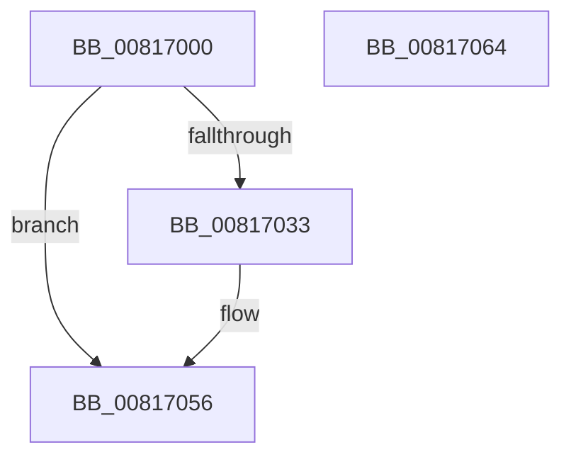

# SdbReadGUIDTag

- RVA: `0x00817000`–`0x00817065` (길이 `101` bytes)
- VA: `0x0000000140817000`
- 실행 섹션: `PAGE`
- PDB 이름 있음: `예`; PDB Function 태그: `아니요`
- unwind 정보 RVA: `0x0005CAAC`
- 디코드: `29`개 명령, `101/101` bytes 표시
- 미해석 바이트: `0` (있으면 어셈블리에 `.byte`로 보존)

> 이 문서는 커널 이미지의 기계어와 PDB 기호를 분석해 생성했습니다. 4번과 5번은 함수 원형과 자료형을 바이너리 사용 방식에서 추정한 C 해석이며 원본 소스 복구 결과는 아닙니다.

## 1. Dependencies

- 직접 호출 지점: **2**; 고유 호출 대상: **2**
- 직접 호출자로 확인된 함수: **2**
- RIP 상대 이미지 참조: **2**

### Outgoing calls
- `0x0081702A` → [SdbReadBinaryTag](../A7/SdbReadBinaryTag_function_00A7EC28.md) (function, `0x00A7EC28`)
- `0x0081704A` → [AslLogCallPrintf](../95/AslLogCallPrintf_function_0095E4EC.md) (function, `0x0095E4EC`)

### Direct callers
- [KsepDbGetShimInfo](../74/KsepDbGetShimInfo_function_00748E94.md) at `0x00748F8A`
- [KsepDbGetDriverShimsInternal](../95/KsepDbGetDriverShimsInternal_function_009597C4.md) at `0x0095990C`

### Static image references
- `0x00817033` → RVA `0x0003D260` (`.rdata`; read)
- `0x00817040` → RVA `0x0003D250` (`.rdata`; read)

## 2. Other-region calls and transfers

- 다른 실행 섹션으로 향하는 call: **0**
- 별도 외부 분기/꼬리 이동을 확인하지 못했습니다.

## 3. Assembly (complete function range)

```asm
00817000  48 89 5C 24 08                  mov qword ptr [rsp + 8], rbx
00817005  57                              push rdi
00817006  48 83 EC 20                     sub rsp, 0x20
0081700A  41 8B C0                        mov eax, r8d
0081700D  4C 8B D2                        mov r10, rdx
00817010  0F 57 C0                        xorps xmm0, xmm0
00817013  49 8B F9                        mov rdi, r9
00817016  0F 11 01                        movups xmmword ptr [rcx], xmm0
00817019  48 8B D9                        mov rbx, rcx
0081701C  4C 8B C1                        mov r8, rcx
0081701F  49 8B CA                        mov rcx, r10
00817022  41 B9 10 00 00 00               mov r9d, 0x10
00817028  8B D0                           mov edx, eax
0081702A  E8 F9 7B 26 00                  call 0x140a7ec28
0081702F  85 C0                           test eax, eax
00817031  75 23                           jne 0x140817056
00817033  4C 8D 0D 26 62 82 FF            lea r9, [rip - 0x7d9dda]
0081703A  41 B8 C4 00 00 00               mov r8d, 0xc4
00817040  48 8D 15 09 62 82 FF            lea rdx, [rip - 0x7d9df7]
00817047  8D 48 01                        lea ecx, [rax + 1]
0081704A  E8 9D 74 14 00                  call 0x14095e4ec
0081704F  0F 28 07                        movaps xmm0, xmmword ptr [rdi]
00817052  F3 0F 7F 03                     movdqu xmmword ptr [rbx], xmm0
00817056  48 8B C3                        mov rax, rbx
00817059  48 8B 5C 24 30                  mov rbx, qword ptr [rsp + 0x30]
0081705E  48 83 C4 20                     add rsp, 0x20
00817062  5F                              pop rdi
00817063  C3                              ret
00817064  CC                              int3
```

## 4. C-style interpretation (structured pseudocode)

```c
__int64 __fastcall SdbReadGUIDTag(__int64 a1, __int64 a2, int a3, __int64 a4)
{
    __int64 result;
    __int64 v_rsp;
    unsigned __int64 v_stack_p8;

    v_stack_p8 = v_rbx;
    v_rsp = (v_rsp) - (32);
    *(unsigned __int64 *)(a1) = v_xmm0;
    result = SdbReadBinaryTag(a2, (unsigned int)((unsigned int)((unsigned int)(a3))), a1, 16);
    if ((unsigned int)(result) == 0) {
        a4 = v_rip - 8232410;
        a3 = 196;
        a2 = v_rip - 8232439;
        a1 = result + 1;
        result = AslLogCallPrintf(a1, a2, a3, a4);
        *(unsigned __int64 *)(a1) = v_xmm0;
    }
    v_rsp = (v_rsp) + (32);
    return a1;
}
```

## 5. (Beta) C Style

```c
void *SdbReadGUIDTag(void *Arg1, int64_t Arg2, int32_t Arg3, void *Arg4)
{
    uint8_t *arg1 = (uint8_t *)Arg1;
    uint8_t *arg4 = (uint8_t *)Arg4;

    int64_t result;
    int64_t local_rsp;
    uint64_t v_stack_p8;

    v_stack_p8 = local_rbx;
    local_rsp = (local_rsp) - (32);
    *(uint64_t *)(arg1) = v_xmm0;
    result = SdbReadBinaryTag(Arg2, (uint32_t)((uint32_t)((uint32_t)(Arg3))), Arg1, 16);
    if ((uint32_t)(result) == 0) {
        Arg4 = v_rip - 8232410;
        Arg3 = 196;
        Arg2 = v_rip - 8232439;
        Arg1 = result + 1;
        result = AslLogCallPrintf(Arg1, Arg2, Arg3, Arg4);
        *(uint64_t *)(arg1) = v_xmm0;
    }
    local_rsp = (local_rsp) + (32);
    return Arg1;
}
```

### 관측된 메모리 오프셋

구조체 형식이 확인되지 않은 접근은 인자 기준의 오프셋으로만 기록했습니다.

| 기준 인자 | 오프셋 표현 | 폭 (bit) | 접근 |
|---|---:|---:|---|
| `Arg1` | `+ 0x0` | `128` | `R` |
| `Arg1` | `+ 0x0` | `128` | `W` |
| `Arg4` | `+ 0x0` | `128` | `R` |

## 6. Execution-region graph

[열기: 2D/3D 그래프와 함수 탐색 컨트롤 패널](../../../control-panel.html?section=page&rva=0x00817000&view=graph)

- 2D 그래프는 위에서 아래로 흐르고, 3D 그래프는 빈 공간을 드래그해 회전합니다. Shift+드래그는 이동, 휠은 확대·축소, 함수 노드 선택은 대상 보고서 이동입니다.

### Static fallback


