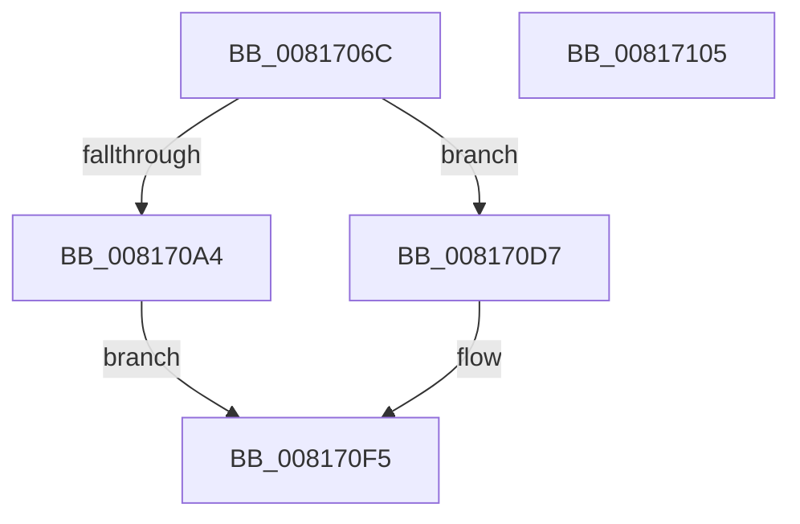

# SdbReadQWORDTag

- RVA: `0x0081706C`–`0x00817106` (길이 `154` bytes)
- VA: `0x000000014081706C`
- 실행 섹션: `PAGE`
- PDB 이름 있음: `예`; PDB Function 태그: `아니요`
- unwind 정보 RVA: `0x000794E0`
- 디코드: `40`개 명령, `154/154` bytes 표시
- 미해석 바이트: `0` (있으면 어셈블리에 `.byte`로 보존)

> 이 문서는 커널 이미지의 기계어와 PDB 기호를 분석해 생성했습니다. 4번과 5번은 함수 원형과 자료형을 바이너리 사용 방식에서 추정한 C 해석이며 원본 소스 복구 결과는 아닙니다.

## 1. Dependencies

- 직접 호출 지점: **4**; 고유 호출 대상: **3**
- 직접 호출자로 확인된 함수: **7**
- RIP 상대 이미지 참조: **2**

### Outgoing calls
- `0x00817088` → [SdbGetTagFromTagID](../95/SdbGetTagFromTagID_function_0095E3C0.md) (function, `0x0095E3C0`)
- `0x008170A4` → [SdbGetTagFromTagID](../95/SdbGetTagFromTagID_function_0095E3C0.md) (function, `0x0095E3C0`)
- `0x008170CD` → [AslLogCallPrintf](../95/AslLogCallPrintf_function_0095E4EC.md) (function, `0x0095E4EC`)
- `0x008170E2` → [SdbpReadTagData](../95/SdbpReadTagData_function_0095E170.md) (function, `0x0095E170`)

### Direct callers
- [SdbpCheckApplicationTypeAttributes](../../text/69/SdbpCheckApplicationTypeAttributes_function_0069C93C.md) at `0x0069CB2F`
- [SdbpCheckApplicationTypeAttributes](../../text/69/SdbpCheckApplicationTypeAttributes_function_0069C93C.md) at `0x0069CB56`
- [SdbpCheckApplicationTypeAttributes](../../text/69/SdbpCheckApplicationTypeAttributes_function_0069C93C.md) at `0x0069CB7D`
- [KsepDbReadKData](../74/KsepDbReadKData_function_0074923C.md) at `0x0074937F`
- [KsepDbReadKFlag](../74/KsepDbReadKFlag_function_00749404.md) at `0x00749471`
- [SdbQueryDataExTagID](SdbQueryDataExTagID_function_008136E0.md) at `0x0081394B`
- [SdbpGetRegistryMatchingAttributes](SdbpGetRegistryMatchingAttributes_function_00815D5C.md) at `0x00815EEE`
- [SdbpCheckAllAttributes](SdbpCheckAllAttributes_function_008187EC.md) at `0x00818916`
- [SdbpMatchOsVersion](../A1/SdbpMatchOsVersion_function_00A18FC0.md) at `0x00A19049`
- [SdbpMatchOsVersion](../A1/SdbpMatchOsVersion_function_00A18FC0.md) at `0x00A1907C`
- [SdbpMatchOsVersion](../A1/SdbpMatchOsVersion_function_00A18FC0.md) at `0x00A190B9`

### Static image references
- `0x008170AC` → RVA `0x000128B0` (`.rdata`; read)
- `0x008170B7` → RVA `0x0003D278` (`.rdata`; read)

## 2. Other-region calls and transfers

- 다른 실행 섹션으로 향하는 call: **0**
- 별도 외부 분기/꼬리 이동을 확인하지 못했습니다.

## 3. Assembly (complete function range)

```asm
0081706C  48 89 5C 24 08                  mov qword ptr [rsp + 8], rbx
00817071  48 89 74 24 10                  mov qword ptr [rsp + 0x10], rsi
00817076  57                              push rdi
00817077  48 83 EC 30                     sub rsp, 0x30
0081707B  49 8B F8                        mov rdi, r8
0081707E  4C 89 44 24 50                  mov qword ptr [rsp + 0x50], r8
00817083  8B DA                           mov ebx, edx
00817085  48 8B F1                        mov rsi, rcx
00817088  E8 33 73 14 00                  call 0x14095e3c0
0081708D  B9 00 F0 00 00                  mov ecx, 0xf000
00817092  8B D3                           mov edx, ebx
00817094  66 23 C1                        and ax, cx
00817097  B9 00 50 00 00                  mov ecx, 0x5000
0081709C  66 3B C1                        cmp ax, cx
0081709F  48 8B CE                        mov rcx, rsi
008170A2  74 33                           je 0x1408170d7
008170A4  E8 17 73 14 00                  call 0x14095e3c0
008170A9  0F B7 C0                        movzx eax, ax
008170AC  4C 8D 0D FD B7 7F FF            lea r9, [rip - 0x804803]
008170B3  89 44 24 28                     mov dword ptr [rsp + 0x28], eax
008170B7  48 8D 15 BA 61 82 FF            lea rdx, [rip - 0x7d9e46]
008170BE  41 B8 BA 00 00 00               mov r8d, 0xba
008170C4  89 5C 24 20                     mov dword ptr [rsp + 0x20], ebx
008170C8  B9 01 00 00 00                  mov ecx, 1
008170CD  E8 1A 74 14 00                  call 0x14095e4ec
008170D2  48 8B C7                        mov rax, rdi
008170D5  EB 1E                           jmp 0x1408170f5
008170D7  41 B9 08 00 00 00               mov r9d, 8
008170DD  4C 8D 44 24 50                  lea r8, [rsp + 0x50]
008170E2  E8 89 70 14 00                  call 0x14095e170
008170E7  48 8B 4C 24 50                  mov rcx, qword ptr [rsp + 0x50]
008170EC  85 C0                           test eax, eax
008170EE  48 0F 44 CF                     cmove rcx, rdi
008170F2  48 8B C1                        mov rax, rcx
008170F5  48 8B 5C 24 40                  mov rbx, qword ptr [rsp + 0x40]
008170FA  48 8B 74 24 48                  mov rsi, qword ptr [rsp + 0x48]
008170FF  48 83 C4 30                     add rsp, 0x30
00817103  5F                              pop rdi
00817104  C3                              ret
00817105  CC                              int3
```

## 4. C-style interpretation (structured pseudocode)

```c
__int64 __fastcall SdbReadQWORDTag(__int64 a1, int a2, __int64 a3)
{
    __int64 result;
    __int64 v_rsp;
    unsigned int v_stack_m10;
    unsigned int v_stack_m18;
    unsigned __int64 v_stack_p10;
    unsigned __int64 v_stack_p18;
    unsigned __int64 v_stack_p8;

    v_stack_p8 = v_rbx;
    v_stack_p10 = v_rsi;
    v_rsp = (v_rsp) - (48);
    v_stack_p18 = a3;
    result = SdbGetTagFromTagID(a1, a2, a3, a4);
    result = (unsigned __int16)((result) & ((unsigned __int16)((unsigned int)(0xF000ULL))));
    if (((unsigned __int16)(result)) == ((unsigned __int16)((unsigned int)(0x5000ULL)))) goto loc_008170D7;
    result = SdbGetTagFromTagID(a1, (unsigned int)((unsigned int)((unsigned int)(a2))), a3, a4);
    v_stack_m10 = (unsigned int)((unsigned __int16)(result));
    v_stack_m18 = (unsigned int)((unsigned int)(a2));
    result = AslLogCallPrintf(1, v_rip - 8232518, 186, v_rip - 8407043);
    goto loc_008170F5;
loc_008170D7:
    result = SdbpReadTagData(1, v_rip - 8232518, v_stack_p18, 8);
    a1 = v_stack_p18;
    if ((unsigned int)(result) == 0) { a1 = a3; }
loc_008170F5:
    v_rsp = (v_rsp) + (48);
    return a1;
}
```

## 5. (Beta) C Style

```c
int64_t SdbReadQWORDTag(int64_t Arg1, int32_t Arg2, int64_t Arg3)
{
    int64_t result;
    int64_t local_rsp;
    uint32_t v_stack_m10;
    uint32_t v_stack_m18;
    uint64_t v_stack_p10;
    uint64_t v_stack_p18;
    uint64_t v_stack_p8;

    v_stack_p8 = local_rbx;
    v_stack_p10 = local_rsi;
    local_rsp = (local_rsp) - (48);
    v_stack_p18 = Arg3;
    result = SdbGetTagFromTagID(Arg1, Arg2, Arg3, a4);
    result = (uint16_t)((result) & ((uint16_t)((uint32_t)(0xF000ULL))));
    if (((uint16_t)(result)) == ((uint16_t)((uint32_t)(0x5000ULL)))) goto loc_008170D7;
    result = SdbGetTagFromTagID(Arg1, (uint32_t)((uint32_t)((uint32_t)(Arg2))), Arg3, a4);
    v_stack_m10 = (uint32_t)((uint16_t)(result));
    v_stack_m18 = (uint32_t)((uint32_t)(Arg2));
    result = AslLogCallPrintf(1, v_rip - 8232518, 186, v_rip - 8407043);
    goto loc_008170F5;
loc_008170D7:
    result = SdbpReadTagData(1, v_rip - 8232518, v_stack_p18, 8);
    Arg1 = v_stack_p18;
    if ((uint32_t)(result) == 0) { Arg1 = Arg3; }
loc_008170F5:
    local_rsp = (local_rsp) + (48);
    return Arg1;
}
```

## 6. Execution-region graph

[열기: 2D/3D 그래프와 함수 탐색 컨트롤 패널](../../../control-panel.html?section=page&rva=0x0081706C&view=graph)

- 2D 그래프는 위에서 아래로 흐르고, 3D 그래프는 빈 공간을 드래그해 회전합니다. Shift+드래그는 이동, 휠은 확대·축소, 함수 노드 선택은 대상 보고서 이동입니다.

### Static fallback


