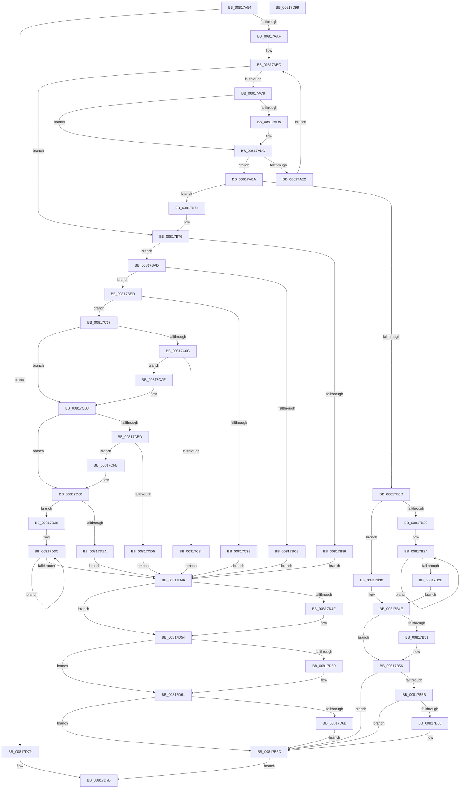

# SdbResolveDatabaseEx

- RVA: `0x00817A54`–`0x00817D9A` (길이 `838` bytes)
- VA: `0x0000000140817A54`
- 실행 섹션: `PAGE`
- PDB 이름 있음: `예`; PDB Function 태그: `아니요`
- unwind 정보 RVA: `0x000D2BBC`
- 디코드: `218`개 명령, `838/838` bytes 표시
- 미해석 바이트: `0` (있으면 어셈블리에 `.byte`로 보존)

> 이 문서는 커널 이미지의 기계어와 PDB 기호를 분석해 생성했습니다. 4번과 5번은 함수 원형과 자료형을 바이너리 사용 방식에서 추정한 C 해석이며 원본 소스 복구 결과는 아닙니다.

## 1. Dependencies

- 직접 호출 지점: **21**; 고유 호출 대상: **13**
- 직접 호출자로 확인된 함수: **1**
- RIP 상대 이미지 참조: **13**

### Outgoing calls
- `0x00817B17` → [SdbGetPathSystemSdb](SdbGetPathSystemSdb_function_00817A2C.md) (function, `0x00817A2C`)
- `0x00817B49` → [AslLogCallPrintf](../95/AslLogCallPrintf_function_0095E4EC.md) (function, `0x0095E4EC`)
- `0x00817B5B` → [SdbGuestTargetPlatformFlagsToRuntimePlatformFlags](SdbGuestTargetPlatformFlagsToRuntimePlatformFlags_function_00817550.md) (function, `0x00817550`)
- `0x00817B7D` → [AslGuidToString_UStr](AslGuidToString_UStr_function_008196DC.md) (function, `0x008196DC`)
- `0x00817BA3` → [AslLogCallPrintf](../95/AslLogCallPrintf_function_0095E4EC.md) (function, `0x0095E4EC`)
- `0x00817BB9` → [AslAlloc](../95/AslAlloc_function_0095BD34.md) (function, `0x0095BD34`)
- `0x00817BE1` → [AslLogCallPrintf](../95/AslLogCallPrintf_function_0095E4EC.md) (function, `0x0095E4EC`)
- `0x00817C06` → [RtlAppendUnicodeToString](../../text/40/RtlAppendUnicodeToString_function_0040F990.md) (function, `0x0040F990`)
- `0x00817C16` → [RtlAppendUnicodeToString](../../text/40/RtlAppendUnicodeToString_function_0040F990.md) (function, `0x0040F990`)
- `0x00817C23` → [RtlAppendUnicodeStringToString](../../text/40/RtlAppendUnicodeStringToString_function_0040FA50.md) (function, `0x0040FA50`)
- `0x00817C30` → [AslRegistryOpenKey_UStr](AslRegistryOpenKey_UStr_function_0081A398.md) (function, `0x0081A398`)
- `0x00817C5D` → [AslLogCallPrintf](../95/AslLogCallPrintf_function_0095E4EC.md) (function, `0x0095E4EC`)
- `0x00817C7B` → [AslRegistryGetUInt32_UStr](AslRegistryGetUInt32_UStr_function_0081A2A8.md) (function, `0x0081A2A8`)
- `0x00817CA1` → [AslLogCallPrintf](../95/AslLogCallPrintf_function_0095E4EC.md) (function, `0x0095E4EC`)
- `0x00817CCC` → [AslRegistryGetUInt32_UStr](AslRegistryGetUInt32_UStr_function_0081A2A8.md) (function, `0x0081A2A8`)
- `0x00817CF2` → [AslLogCallPrintf](../95/AslLogCallPrintf_function_0095E4EC.md) (function, `0x0095E4EC`)
- `0x00817D11` → [SdbGetPathCustomSdb](SdbGetPathCustomSdb_function_0081795C.md) (function, `0x0081795C`)
- `0x00817D31` → [AslLogCallPrintf](../95/AslLogCallPrintf_function_0095E4EC.md) (function, `0x0095E4EC`)
- `0x00817D4F` → [ZwClose](../../text/6A/ZwClose_function_006AD2B0.md) (function, `0x006AD2B0`)
- `0x00817D5C` → [AslFree](../95/AslFree_function_0095B674.md) (function, `0x0095B674`)
- `0x00817D6F` → [AslUnicodeStringFree](AslUnicodeStringFree_function_00819AB8.md) (function, `0x00819AB8`)

### Direct callers
- [SdbpOpenLocalDatabaseEx](SdbpOpenLocalDatabaseEx_function_0081770C.md) at `0x008177C2`

### Static image references
- `0x00817AB3` → RVA `0x00E0A0F0` (`.data`; read)
- `0x00817B30` → RVA `0x0003DE10` (`.rdata`; read)
- `0x00817B3D` → RVA `0x0003DE30` (`.rdata`; read)
- `0x00817B86` → RVA `0x0003DE48` (`.rdata`; read)
- `0x00817BC6` → RVA `0x0003DE70` (`.rdata`; read)
- `0x00817BF1` → RVA `0x0003DEA0` (`.rdata`; read)
- `0x00817C0B` → RVA `0x0001BD80` (`.rdata`; read)
- `0x00817C3D` → RVA `0x0003DF58` (`.rdata`; read)
- `0x00817C70` → RVA `0x0000BFD8` (`.rdata`; read)
- `0x00817C84` → RVA `0x0003DF78` (`.rdata`; read)
- `0x00817CC1` → RVA `0x0000BFC8` (`.rdata`; read)
- `0x00817CD5` → RVA `0x0003DFA0` (`.rdata`; read)
- `0x00817D1A` → RVA `0x0003DFC8` (`.rdata`; read)

## 2. Other-region calls and transfers

- 다른 실행 섹션으로 향하는 call: **4**
  - `0x00817C06` → [RtlAppendUnicodeToString](../../text/40/RtlAppendUnicodeToString_function_0040F990.md) (`PAGE` → `.text`)
  - `0x00817C16` → [RtlAppendUnicodeToString](../../text/40/RtlAppendUnicodeToString_function_0040F990.md) (`PAGE` → `.text`)
  - `0x00817C23` → [RtlAppendUnicodeStringToString](../../text/40/RtlAppendUnicodeStringToString_function_0040FA50.md) (`PAGE` → `.text`)
  - `0x00817D4F` → [ZwClose](../../text/6A/ZwClose_function_006AD2B0.md) (`PAGE` → `.text`)
- 별도 외부 분기/꼬리 이동을 확인하지 못했습니다.

## 3. Assembly (complete function range)

```asm
00817A54  48 8B C4                        mov rax, rsp
00817A57  48 89 58 10                     mov qword ptr [rax + 0x10], rbx
00817A5B  48 89 70 18                     mov qword ptr [rax + 0x18], rsi
00817A5F  48 89 78 20                     mov qword ptr [rax + 0x20], rdi
00817A63  48 89 48 08                     mov qword ptr [rax + 8], rcx
00817A67  55                              push rbp
00817A68  41 54                           push r12
00817A6A  41 55                           push r13
00817A6C  41 56                           push r14
00817A6E  41 57                           push r15
00817A70  48 8B EC                        mov rbp, rsp
00817A73  48 83 EC 60                     sub rsp, 0x60
00817A77  4C 8B 75 50                     mov r14, qword ptr [rbp + 0x50]
00817A7B  33 F6                           xor esi, esi
00817A7D  89 75 58                        mov dword ptr [rbp + 0x58], esi
00817A80  0F 57 C0                        xorps xmm0, xmm0
00817A83  89 75 D0                        mov dword ptr [rbp - 0x30], esi
00817A86  0F 57 C9                        xorps xmm1, xmm1
00817A89  48 89 75 D8                     mov qword ptr [rbp - 0x28], rsi
00817A8D  49 8B F9                        mov rdi, r9
00817A90  4D 8B F8                        mov r15, r8
00817A93  4C 8B EA                        mov r13, rdx
00817A96  4C 8B D9                        mov r11, rcx
00817A99  8B DE                           mov ebx, esi
00817A9B  44 8B E6                        mov r12d, esi
00817A9E  0F 11 45 E0                     movups xmmword ptr [rbp - 0x20], xmm0
00817AA2  0F 11 4D F0                     movups xmmword ptr [rbp - 0x10], xmm1
00817AA6  4D 85 F6                        test r14, r14
00817AA9  0F 84 CA 02 00 00               je 0x140817d79
00817AAF  66 41 89 36                     mov word ptr [r14], si
00817AB3  4C 8D 05 36 26 5F 00            lea r8, [rip + 0x5f2636]
00817ABA  8B D6                           mov edx, esi
00817ABC  4C 63 CA                        movsxd r9, edx
00817ABF  49 83 F9 06                     cmp r9, 6
00817AC3  0F 83 AD 00 00 00               jae 0x140817b76
00817AC9  4D 8B 10                        mov r10, qword ptr [r8]
00817ACC  49 8B 0A                        mov rcx, qword ptr [r10]
00817ACF  49 2B 4D 00                     sub rcx, qword ptr [r13]
00817AD3  75 08                           jne 0x140817add
00817AD5  49 8B 4A 08                     mov rcx, qword ptr [r10 + 8]
00817AD9  49 2B 4D 08                     sub rcx, qword ptr [r13 + 8]
00817ADD  48 85 C9                        test rcx, rcx
00817AE0  74 08                           je 0x140817aea
00817AE2  FF C2                           inc edx
00817AE4  49 83 C0 18                     add r8, 0x18
00817AE8  EB D2                           jmp 0x140817abc
00817AEA  4B 8D 04 49                     lea rax, [r9 + r9*2]
00817AEE  48 8D 0D FB 25 5F 00            lea rcx, [rip + 0x5f25fb]
00817AF5  8B 74 C1 08                     mov esi, dword ptr [rcx + rax*8 + 8]
00817AF9  44 8B 44 C1 10                  mov r8d, dword ptr [rcx + rax*8 + 0x10]
00817AFE  8B 44 C1 0C                     mov eax, dword ptr [rcx + rax*8 + 0xc]
00817B02  89 45 50                        mov dword ptr [rbp + 0x50], eax
00817B05  89 75 58                        mov dword ptr [rbp + 0x58], esi
00817B08  45 85 C0                        test r8d, r8d
00817B0B  74 67                           je 0x140817b74
00817B0D  4D 8D 8B 48 02 00 00            lea r9, [r11 + 0x248]
00817B14  49 8B CE                        mov rcx, r14
00817B17  E8 10 FF FF FF                  call 0x140817a2c
00817B1C  85 C0                           test eax, eax
00817B1E  74 10                           je 0x140817b30
00817B20  48 83 CB FF                     or rbx, 0xffffffffffffffff
00817B24  48 FF C3                        inc rbx
00817B27  66 45 39 24 5E                  cmp word ptr [r14 + rbx*2], r12w
00817B2C  75 F6                           jne 0x140817b24
00817B2E  EB 1E                           jmp 0x140817b4e
00817B30  4C 8D 0D D9 62 82 FF            lea r9, [rip - 0x7d9d27]
00817B37  41 B8 3D 09 00 00               mov r8d, 0x93d
00817B3D  48 8D 15 EC 62 82 FF            lea rdx, [rip - 0x7d9d14]
00817B44  B9 01 00 00 00                  mov ecx, 1
00817B49  E8 9E 69 14 00                  call 0x14095e4ec
00817B4E  4D 85 FF                        test r15, r15
00817B51  74 03                           je 0x140817b56
00817B53  41 89 37                        mov dword ptr [r15], esi
00817B56  48 85 FF                        test rdi, rdi
00817B59  74 12                           je 0x140817b6d
00817B5B  E8 F0 F9 FF FF                  call 0x140817550
00817B60  89 07                           mov dword ptr [rdi], eax
00817B62  44 39 65 50                     cmp dword ptr [rbp + 0x50], r12d
00817B66  74 05                           je 0x140817b6d
00817B68  83 E0 1B                        and eax, 0x1b
00817B6B  89 07                           mov dword ptr [rdi], eax
00817B6D  8B C3                           mov eax, ebx
00817B6F  E9 07 02 00 00                  jmp 0x140817d7b
00817B74  33 F6                           xor esi, esi
00817B76  49 8B D5                        mov rdx, r13
00817B79  48 8D 4D F0                     lea rcx, [rbp - 0x10]
00817B7D  E8 5A 1B 00 00                  call 0x1408196dc
00817B82  85 C0                           test eax, eax
00817B84  79 27                           jns 0x140817bad
00817B86  4C 8D 0D BB 62 82 FF            lea r9, [rip - 0x7d9d45]
00817B8D  89 44 24 20                     mov dword ptr [rsp + 0x20], eax
00817B91  41 B8 54 09 00 00               mov r8d, 0x954
00817B97  48 8D 15 92 62 82 FF            lea rdx, [rip - 0x7d9d6e]
00817B9E  B9 01 00 00 00                  mov ecx, 1
00817BA3  E8 44 69 14 00                  call 0x14095e4ec
00817BA8  E9 99 01 00 00                  jmp 0x140817d46
00817BAD  0F B7 75 F0                     movzx esi, word ptr [rbp - 0x10]
00817BB1  81 C6 B8 00 00 00               add esi, 0xb8
00817BB7  8B D6                           mov edx, esi
00817BB9  E8 76 41 14 00                  call 0x14095bd34
00817BBE  4C 8B E0                        mov r12, rax
00817BC1  48 85 C0                        test rax, rax
00817BC4  75 27                           jne 0x140817bed
00817BC6  4C 8D 0D A3 62 82 FF            lea r9, [rip - 0x7d9d5d]
00817BCD  89 74 24 20                     mov dword ptr [rsp + 0x20], esi
00817BD1  41 B8 69 09 00 00               mov r8d, 0x969
00817BD7  48 8D 15 52 62 82 FF            lea rdx, [rip - 0x7d9dae]
00817BDE  8D 48 01                        lea ecx, [rax + 1]
00817BE1  E8 06 69 14 00                  call 0x14095e4ec
00817BE6  33 F6                           xor esi, esi
00817BE8  E9 59 01 00 00                  jmp 0x140817d46
00817BED  66 89 75 E2                     mov word ptr [rbp - 0x1e], si
00817BF1  48 8D 15 A8 62 82 FF            lea rdx, [rip - 0x7d9d58]
00817BF8  33 F6                           xor esi, esi
00817BFA  48 89 45 E8                     mov qword ptr [rbp - 0x18], rax
00817BFE  48 8D 4D E0                     lea rcx, [rbp - 0x20]
00817C02  66 89 75 E0                     mov word ptr [rbp - 0x20], si
00817C06  E8 85 7D BF FF                  call 0x14040f990
00817C0B  48 8D 15 6E 41 80 FF            lea rdx, [rip - 0x7fbe92]
00817C12  48 8D 4D E0                     lea rcx, [rbp - 0x20]
00817C16  E8 75 7D BF FF                  call 0x14040f990
00817C1B  48 8D 55 F0                     lea rdx, [rbp - 0x10]
00817C1F  48 8D 4D E0                     lea rcx, [rbp - 0x20]
00817C23  E8 28 7E BF FF                  call 0x14040fa50
00817C28  48 8D 55 E0                     lea rdx, [rbp - 0x20]
00817C2C  48 8D 4D D8                     lea rcx, [rbp - 0x28]
00817C30  E8 63 27 00 00                  call 0x14081a398
00817C35  85 C0                           test eax, eax
00817C37  79 2E                           jns 0x140817c67
00817C39  89 44 24 28                     mov dword ptr [rsp + 0x28], eax
00817C3D  4C 8D 0D 14 63 82 FF            lea r9, [rip - 0x7d9cec]
00817C44  48 8B 45 E8                     mov rax, qword ptr [rbp - 0x18]
00817C48  48 8D 15 E1 61 82 FF            lea rdx, [rip - 0x7d9e1f]
00817C4F  41 B8 79 09 00 00               mov r8d, 0x979
00817C55  48 89 44 24 20                  mov qword ptr [rsp + 0x20], rax
00817C5A  8D 4E 01                        lea ecx, [rsi + 1]
00817C5D  E8 8A 68 14 00                  call 0x14095e4ec
00817C62  E9 DF 00 00 00                  jmp 0x140817d46
00817C67  4D 85 FF                        test r15, r15
00817C6A  74 4C                           je 0x140817cb8
00817C6C  48 8B 55 D8                     mov rdx, qword ptr [rbp - 0x28]
00817C70  4C 8D 05 61 43 7F FF            lea r8, [rip - 0x80bc9f]
00817C77  48 8D 4D 58                     lea rcx, [rbp + 0x58]
00817C7B  E8 28 26 00 00                  call 0x14081a2a8
00817C80  85 C0                           test eax, eax
00817C82  79 2A                           jns 0x140817cae
00817C84  4C 8D 0D ED 62 82 FF            lea r9, [rip - 0x7d9d13]
00817C8B  89 44 24 20                     mov dword ptr [rsp + 0x20], eax
00817C8F  41 B8 85 09 00 00               mov r8d, 0x985
00817C95  48 8D 15 94 61 82 FF            lea rdx, [rip - 0x7d9e6c]
00817C9C  B9 01 00 00 00                  mov ecx, 1
00817CA1  E8 46 68 14 00                  call 0x14095e4ec
00817CA6  41 89 37                        mov dword ptr [r15], esi
00817CA9  E9 98 00 00 00                  jmp 0x140817d46
00817CAE  8B 45 58                        mov eax, dword ptr [rbp + 0x58]
00817CB1  0F BA F0 1F                     btr eax, 0x1f
00817CB5  41 89 07                        mov dword ptr [r15], eax
00817CB8  48 85 FF                        test rdi, rdi
00817CBB  74 43                           je 0x140817d00
00817CBD  48 8B 55 D8                     mov rdx, qword ptr [rbp - 0x28]
00817CC1  4C 8D 05 00 43 7F FF            lea r8, [rip - 0x80bd00]
00817CC8  48 8D 4D D0                     lea rcx, [rbp - 0x30]
00817CCC  E8 D7 25 00 00                  call 0x14081a2a8
00817CD1  85 C0                           test eax, eax
00817CD3  79 26                           jns 0x140817cfb
00817CD5  4C 8D 0D C4 62 82 FF            lea r9, [rip - 0x7d9d3c]
00817CDC  89 44 24 20                     mov dword ptr [rsp + 0x20], eax
00817CE0  41 B8 95 09 00 00               mov r8d, 0x995
00817CE6  48 8D 15 43 61 82 FF            lea rdx, [rip - 0x7d9ebd]
00817CED  B9 01 00 00 00                  mov ecx, 1
00817CF2  E8 F5 67 14 00                  call 0x14095e4ec
00817CF7  89 37                           mov dword ptr [rdi], esi
00817CF9  EB 4B                           jmp 0x140817d46
00817CFB  8B 45 D0                        mov eax, dword ptr [rbp - 0x30]
00817CFE  89 07                           mov dword ptr [rdi], eax
00817D00  4C 8B 4D 30                     mov r9, qword ptr [rbp + 0x30]
00817D04  4D 8B C5                        mov r8, r13
00817D07  49 81 C1 48 02 00 00            add r9, 0x248
00817D0E  49 8B CE                        mov rcx, r14
00817D11  E8 46 FC FF FF                  call 0x14081795c
00817D16  85 C0                           test eax, eax
00817D18  75 1E                           jne 0x140817d38
00817D1A  4C 8D 0D A7 62 82 FF            lea r9, [rip - 0x7d9d59]
00817D21  41 B8 9E 09 00 00               mov r8d, 0x99e
00817D27  48 8D 15 02 61 82 FF            lea rdx, [rip - 0x7d9efe]
00817D2E  8D 48 01                        lea ecx, [rax + 1]
00817D31  E8 B6 67 14 00                  call 0x14095e4ec
00817D36  EB 0E                           jmp 0x140817d46
00817D38  48 83 CB FF                     or rbx, 0xffffffffffffffff
00817D3C  48 FF C3                        inc rbx
00817D3F  66 41 39 34 5E                  cmp word ptr [r14 + rbx*2], si
00817D44  75 F6                           jne 0x140817d3c
00817D46  48 8B 4D D8                     mov rcx, qword ptr [rbp - 0x28]
00817D4A  48 85 C9                        test rcx, rcx
00817D4D  74 05                           je 0x140817d54
00817D4F  E8 5C 55 E9 FF                  call 0x1406ad2b0
00817D54  4D 85 E4                        test r12, r12
00817D57  74 08                           je 0x140817d61
00817D59  49 8B D4                        mov rdx, r12
00817D5C  E8 13 39 14 00                  call 0x14095b674
00817D61  48 39 75 F8                     cmp qword ptr [rbp - 8], rsi
00817D65  0F 84 02 FE FF FF               je 0x140817b6d
00817D6B  48 8D 4D F0                     lea rcx, [rbp - 0x10]
00817D6F  E8 44 1D 00 00                  call 0x140819ab8
00817D74  E9 F4 FD FF FF                  jmp 0x140817b6d
00817D79  33 C0                           xor eax, eax
00817D7B  4C 8D 5C 24 60                  lea r11, [rsp + 0x60]
00817D80  49 8B 5B 38                     mov rbx, qword ptr [r11 + 0x38]
00817D84  49 8B 73 40                     mov rsi, qword ptr [r11 + 0x40]
00817D88  49 8B 7B 48                     mov rdi, qword ptr [r11 + 0x48]
00817D8C  49 8B E3                        mov rsp, r11
00817D8F  41 5F                           pop r15
00817D91  41 5E                           pop r14
00817D93  41 5D                           pop r13
00817D95  41 5C                           pop r12
00817D97  5D                              pop rbp
00817D98  C3                              ret
00817D99  CC                              int3
```

## 4. C-style interpretation (structured pseudocode)

```c
__int64 __fastcall SdbResolveDatabaseEx(__int64 a1, __int64 a2, __int64 a3, __int64 a4, unsigned int a5, unsigned int a6)
{
    __int64 result;
    __int64 v_rbx;
    __int64 v_rsi;
    __int64 v_rsp;
    unsigned __int64 v_stack_m28;
    unsigned __int64 v_stack_m30;
    unsigned __int64 v_stack_m38;
    unsigned __int64 v_stack_m40;
    unsigned __int16 v_stack_m46;
    unsigned __int64 v_stack_m48;
    unsigned __int64 v_stack_m50;
    unsigned int v_stack_m58;
    unsigned int v_stack_m60;
    unsigned int v_stack_m68;
    unsigned int v_stack_p28;
    unsigned int v_stack_p30;
    unsigned __int64 v_stack_p8;

    *(unsigned __int64 *)(v_rsp + 16) = v_rbx;
    *(unsigned __int64 *)(v_rsp + 24) = v_rsi;
    *(unsigned __int64 *)(v_rsp + 32) = v_rdi;
    *(unsigned __int64 *)(v_rsp + 8) = a1;
    v_rsp = (v_rsp) - (96);
    v_rsi = 0;
    v_stack_p30 = 0;
    v_stack_m58 = 0;
    v_stack_m50 = 0;
    v_stack_m48 = v_xmm0;
    v_stack_m38 = v_xmm1;
    if (a5 == 0) goto loc_00817D79;
    *(unsigned __int16 *)(a5) = 0;
loc_00817ABC:
    if (((int)(0)) >= 6) goto loc_00817B76;
    a1 = (*(unsigned __int64 *)(*(unsigned __int64 *)(v_rip + 6235702))) - (*(unsigned __int64 *)(a2));
    if (!(condition_is_not_equal)) {
        a1 = *(unsigned __int64 *)(*(unsigned __int64 *)(v_rip + 6235702) + 8);
        a1 = (a1) - (*(unsigned __int64 *)(a2 + 8));
    }
    if (a1 == 0) goto loc_00817AEA;
    a2 = (unsigned int)((0) + 1);
    a3 = (v_rip + 6235702) + (24);
    goto loc_00817ABC;
loc_00817AEA:
    v_stack_p28 = (unsigned int)((unsigned int)(*(unsigned int *)(v_rip + 6235643 + (int)(0) + (int)(0) * 2 * 8 + 12)));
    v_stack_p30 = (unsigned int)((unsigned int)(*(unsigned int *)(v_rip + 6235643 + (int)(0) + (int)(0) * 2 * 8 + 8)));
    if ((unsigned int)((unsigned int)(*(unsigned int *)(v_rip + 6235643 + (int)(0) + (int)(0) * 2 * 8 + 16))) == 0) goto loc_00817B74;
    result = SdbGetPathSystemSdb(a5, a2, (unsigned int)(*(unsigned int *)(v_rip + 6235643 + (int)(0) + (int)(0) * 2 * 8 + 16)), a1 + 584);
    if ((unsigned int)(result) == 0) goto loc_00817B30;
    v_rbx = (0) | (-1);
loc_00817B24:
    v_rbx = (v_rbx) + 1;
    if ((*(unsigned __int16 *)(a5 + v_rbx * 2)) != 0) goto loc_00817B24;
    goto loc_00817B4E;
loc_00817B30:
    result = AslLogCallPrintf(1, v_rip - 8232212, (unsigned int)(0x93DULL), v_rip - 8232231);
loc_00817B4E:
    if (a3 != 0) {
        *(unsigned int *)(a3) = (unsigned int)((unsigned int)(*(unsigned int *)(v_rip + 6235643 + (int)(0) + (int)(0) * 2 * 8 + 8)));
    }
    if (a4 == 0) goto loc_00817B6D;
    result = SdbGuestTargetPlatformFlagsToRuntimePlatformFlags(1, v_rip - 8232212, (unsigned int)(0x93DULL), v_rip - 8232231);
    *(unsigned int *)(a4) = (unsigned int)(result);
    if (a5 != 0) {
        result = (unsigned int)((result) & (27));
        *(unsigned int *)(a4) = (unsigned int)(result);
    }
    goto loc_00817D7B;
loc_00817B74:
    v_rsi = 0;
loc_00817B76:
    result = AslGuidToString_UStr(v_stack_m38, a2, (unsigned int)(0x93DULL), v_rip - 8232231);
    if (!sign_flag) goto loc_00817BAD;
    v_stack_m68 = (unsigned int)(result);
    result = AslLogCallPrintf(1, v_rip - 8232302, (unsigned int)(0x954ULL), v_rip - 8232261);
    goto loc_00817D46;
loc_00817BAD:
    v_rsi = (unsigned int)((v_stack_m38) + (184));
    result = AslAlloc(1, (unsigned int)((unsigned int)(v_rsi)), (unsigned int)(0x954ULL), v_rip - 8232261);
    if (result != 0) goto loc_00817BED;
    v_stack_m68 = (unsigned int)(v_rsi);
    result = AslLogCallPrintf(result + 1, v_rip - 8232366, (unsigned int)(0x969ULL), v_rip - 8232285);
    v_rsi = 0;
    goto loc_00817D46;
loc_00817BED:
    v_stack_m46 = 0;
    v_rsi = 0;
    v_stack_m40 = result;
    v_stack_m48 = 0;
    result = RtlAppendUnicodeToString(v_stack_m48, v_rip - 8232280, (unsigned int)(0x969ULL), v_rip - 8232285);
    result = RtlAppendUnicodeToString(v_stack_m48, v_rip - 8371858, (unsigned int)(0x969ULL), v_rip - 8232285);
    result = RtlAppendUnicodeStringToString(v_stack_m48, v_stack_m38, (unsigned int)(0x969ULL), v_rip - 8232285);
    result = AslRegistryOpenKey_UStr(v_stack_m50, v_stack_m48, (unsigned int)(0x969ULL), v_rip - 8232285);
    if (!sign_flag) goto loc_00817C67;
    v_stack_m60 = (unsigned int)(result);
    v_stack_m68 = v_stack_m40;
    result = AslLogCallPrintf(v_rsi + 1, v_rip - 8232479, (unsigned int)(0x979ULL), v_rip - 8232172);
    goto loc_00817D46;
loc_00817C67:
    if (a3 == 0) goto loc_00817CB8;
    result = AslRegistryGetUInt32_UStr(a6, v_stack_m50, v_rip - 8436895, v_rip - 8232172);
    if (!sign_flag) goto loc_00817CAE;
    v_stack_m68 = (unsigned int)(result);
    result = AslLogCallPrintf(1, v_rip - 8232556, (unsigned int)(0x985ULL), v_rip - 8232211);
    *(unsigned int *)(a3) = 0;
    goto loc_00817D46;
loc_00817CAE:
    *(unsigned int *)(a3) = (unsigned int)((unsigned int)(a6));
loc_00817CB8:
    if (a4 == 0) goto loc_00817D00;
    result = AslRegistryGetUInt32_UStr(v_stack_m58, v_stack_m50, v_rip - 8436992, v_rip - 8232211);
    if (!sign_flag) goto loc_00817CFB;
    v_stack_m68 = (unsigned int)(result);
    result = AslLogCallPrintf(1, v_rip - 8232637, (unsigned int)(0x995ULL), v_rip - 8232252);
    *(unsigned int *)(a4) = 0;
    goto loc_00817D46;
loc_00817CFB:
    *(unsigned int *)(a4) = (unsigned int)((unsigned int)(v_stack_m58));
loc_00817D00:
    a4 = (v_stack_p8) + (584);
    result = SdbGetPathCustomSdb(a5, v_rip - 8232637, a2, a4);
    if ((unsigned int)(result) != 0) goto loc_00817D38;
    result = AslLogCallPrintf(result + 1, v_rip - 8232702, (unsigned int)(0x99EULL), v_rip - 8232281);
    goto loc_00817D46;
loc_00817D38:
    v_rbx = (v_rbx) | (-1);
loc_00817D3C:
    v_rbx = (v_rbx) + 1;
    if ((*(unsigned __int16 *)(a5 + v_rbx * 2)) != 0) goto loc_00817D3C;
loc_00817D46:
    if (v_stack_m50 != 0) {
        result = ZwClose(v_stack_m50, v_rip - 8232702, (unsigned int)(0x99EULL), v_rip - 8232281);
    }
    if (result != 0) {
        a2 = result;
        result = AslFree(v_stack_m50, a2, (unsigned int)(0x99EULL), v_rip - 8232281);
    }
    if (v_stack_m30 == 0) goto loc_00817B6D;
    result = AslUnicodeStringFree(v_stack_m38, a2, (unsigned int)(0x99EULL), v_rip - 8232281);
    goto loc_00817B6D;
loc_00817D79:
    result = 0;
loc_00817D7B:
    return result;
}
```

## 5. (Beta) C Style

```c
int64_t SdbResolveDatabaseEx(void *Arg1, void *Arg2, int64_t Arg3, int64_t Arg4, uint32_t Arg5, uint32_t Arg6)
{
    uint8_t *arg1 = (uint8_t *)Arg1;
    uint8_t *arg2 = (uint8_t *)Arg2;

    int64_t result;
    int64_t local_rbx;
    int64_t local_rsi;
    int64_t local_rsp;
    uint64_t v_stack_m28;
    uint64_t v_stack_m30;
    uint64_t v_stack_m38;
    uint64_t v_stack_m40;
    uint16_t v_stack_m46;
    uint64_t v_stack_m48;
    uint64_t v_stack_m50;
    uint32_t v_stack_m58;
    uint32_t v_stack_m60;
    uint32_t v_stack_m68;
    uint32_t v_stack_p28;
    uint32_t v_stack_p30;
    uint64_t v_stack_p8;

    *(uint64_t *)(local_rsp + 0x10) = local_rbx;
    *(uint64_t *)(local_rsp + 0x18) = local_rsi;
    *(uint64_t *)(local_rsp + 0x20) = local_rdi;
    *(void **)(local_rsp + 0x8) = Arg1;
    local_rsp = (local_rsp) - (96);
    local_rsi = 0;
    v_stack_p30 = 0;
    v_stack_m58 = 0;
    v_stack_m50 = 0;
    v_stack_m48 = v_xmm0;
    v_stack_m38 = v_xmm1;
    if (Arg5 == 0) goto loc_00817D79;
    *(uint16_t *)(Arg5) = 0;
loc_00817ABC:
    if (((int32_t)(0)) >= 6) goto loc_00817B76;
    Arg1 = (*(uint64_t *)(*(uint64_t *)(v_rip + 0x5F2636))) - (*(uint64_t *)(arg2));
    if (!(condition_is_not_equal)) {
        Arg1 = *(uint64_t *)(*(uint64_t *)(v_rip + 0x5F2636) + 0x8);
        Arg1 = (Arg1) - (*(uint64_t *)(arg2 + 0x8));
    }
    if (Arg1 == NULL) goto loc_00817AEA;
    Arg2 = (uint32_t)((0) + 1);
    Arg3 = (v_rip + 6235702) + (24);
    goto loc_00817ABC;
loc_00817AEA:
    v_stack_p28 = (uint32_t)((uint32_t)(*(uint32_t *)(v_rip + 0x5F25FB + (int32_t)(0) + (int32_t)(0) * 2 * 8 + 0xC)));
    v_stack_p30 = (uint32_t)((uint32_t)(*(uint32_t *)(v_rip + 0x5F25FB + (int32_t)(0) + (int32_t)(0) * 2 * 8 + 0x8)));
    if ((uint32_t)((uint32_t)(*(uint32_t *)(v_rip + 0x5F25FB + (int32_t)(0) + (int32_t)(0) * 2 * 8 + 0x10))) == 0) goto loc_00817B74;
    result = SdbGetPathSystemSdb(Arg5, Arg2, (uint32_t)(*(uint32_t *)(v_rip + 0x5F25FB + (int32_t)(0) + (int32_t)(0) * 2 * 8 + 0x10)), Arg1 + 584);
    if ((uint32_t)(result) == 0) goto loc_00817B30;
    local_rbx = (0) | (-1);
loc_00817B24:
    local_rbx = (local_rbx) + 1;
    if ((*(uint16_t *)(Arg5 + local_rbx * 2)) != 0) goto loc_00817B24;
    goto loc_00817B4E;
loc_00817B30:
    result = AslLogCallPrintf(1, v_rip - 8232212, (uint32_t)(0x93DULL), v_rip - 8232231);
loc_00817B4E:
    if (Arg3 != 0) {
        *(uint32_t *)(Arg3) = (uint32_t)((uint32_t)(*(uint32_t *)(v_rip + 0x5F25FB + (int32_t)(0) + (int32_t)(0) * 2 * 8 + 0x8)));
    }
    if (Arg4 == 0) goto loc_00817B6D;
    result = SdbGuestTargetPlatformFlagsToRuntimePlatformFlags(1, v_rip - 8232212, (uint32_t)(0x93DULL), v_rip - 8232231);
    *(uint32_t *)(Arg4) = (uint32_t)(result);
    if (Arg5 != 0) {
        result = (uint32_t)((result) & (27));
        *(uint32_t *)(Arg4) = (uint32_t)(result);
    }
    goto loc_00817D7B;
loc_00817B74:
    local_rsi = 0;
loc_00817B76:
    result = AslGuidToString_UStr(v_stack_m38, Arg2, (uint32_t)(0x93DULL), v_rip - 8232231);
    if (!sign_flag) goto loc_00817BAD;
    v_stack_m68 = (uint32_t)(result);
    result = AslLogCallPrintf(1, v_rip - 8232302, (uint32_t)(0x954ULL), v_rip - 8232261);
    goto loc_00817D46;
loc_00817BAD:
    local_rsi = (uint32_t)((v_stack_m38) + (184));
    result = AslAlloc(1, (uint32_t)((uint32_t)(local_rsi)), (uint32_t)(0x954ULL), v_rip - 8232261);
    if (result != 0) goto loc_00817BED;
    v_stack_m68 = (uint32_t)(local_rsi);
    result = AslLogCallPrintf(result + 1, v_rip - 8232366, (uint32_t)(0x969ULL), v_rip - 8232285);
    local_rsi = 0;
    goto loc_00817D46;
loc_00817BED:
    v_stack_m46 = 0;
    local_rsi = 0;
    v_stack_m40 = result;
    v_stack_m48 = 0;
    result = RtlAppendUnicodeToString(v_stack_m48, v_rip - 8232280, (uint32_t)(0x969ULL), v_rip - 8232285);
    result = RtlAppendUnicodeToString(v_stack_m48, v_rip - 8371858, (uint32_t)(0x969ULL), v_rip - 8232285);
    result = RtlAppendUnicodeStringToString(v_stack_m48, v_stack_m38, (uint32_t)(0x969ULL), v_rip - 8232285);
    result = AslRegistryOpenKey_UStr(v_stack_m50, v_stack_m48, (uint32_t)(0x969ULL), v_rip - 8232285);
    if (!sign_flag) goto loc_00817C67;
    v_stack_m60 = (uint32_t)(result);
    v_stack_m68 = v_stack_m40;
    result = AslLogCallPrintf(local_rsi + 1, v_rip - 8232479, (uint32_t)(0x979ULL), v_rip - 8232172);
    goto loc_00817D46;
loc_00817C67:
    if (Arg3 == 0) goto loc_00817CB8;
    result = AslRegistryGetUInt32_UStr(Arg6, v_stack_m50, v_rip - 8436895, v_rip - 8232172);
    if (!sign_flag) goto loc_00817CAE;
    v_stack_m68 = (uint32_t)(result);
    result = AslLogCallPrintf(1, v_rip - 8232556, (uint32_t)(0x985ULL), v_rip - 8232211);
    *(uint32_t *)(Arg3) = 0;
    goto loc_00817D46;
loc_00817CAE:
    *(uint32_t *)(Arg3) = (uint32_t)((uint32_t)(Arg6));
loc_00817CB8:
    if (Arg4 == 0) goto loc_00817D00;
    result = AslRegistryGetUInt32_UStr(v_stack_m58, v_stack_m50, v_rip - 8436992, v_rip - 8232211);
    if (!sign_flag) goto loc_00817CFB;
    v_stack_m68 = (uint32_t)(result);
    result = AslLogCallPrintf(1, v_rip - 8232637, (uint32_t)(0x995ULL), v_rip - 8232252);
    *(uint32_t *)(Arg4) = 0;
    goto loc_00817D46;
loc_00817CFB:
    *(uint32_t *)(Arg4) = (uint32_t)((uint32_t)(v_stack_m58));
loc_00817D00:
    Arg4 = (v_stack_p8) + (584);
    result = SdbGetPathCustomSdb(Arg5, v_rip - 8232637, Arg2, Arg4);
    if ((uint32_t)(result) != 0) goto loc_00817D38;
    result = AslLogCallPrintf(result + 1, v_rip - 8232702, (uint32_t)(0x99EULL), v_rip - 8232281);
    goto loc_00817D46;
loc_00817D38:
    local_rbx = (local_rbx) | (-1);
loc_00817D3C:
    local_rbx = (local_rbx) + 1;
    if ((*(uint16_t *)(Arg5 + local_rbx * 2)) != 0) goto loc_00817D3C;
loc_00817D46:
    if (v_stack_m50 != 0) {
        result = ZwClose(v_stack_m50, v_rip - 8232702, (uint32_t)(0x99EULL), v_rip - 8232281);
    }
    if (result != 0) {
        Arg2 = result;
        result = AslFree(v_stack_m50, Arg2, (uint32_t)(0x99EULL), v_rip - 8232281);
    }
    if (v_stack_m30 == 0) goto loc_00817B6D;
    result = AslUnicodeStringFree(v_stack_m38, Arg2, (uint32_t)(0x99EULL), v_rip - 8232281);
    goto loc_00817B6D;
loc_00817D79:
    result = 0;
loc_00817D7B:
    return result;
}
```

### 관측된 메모리 오프셋

구조체 형식이 확인되지 않은 접근은 인자 기준의 오프셋으로만 기록했습니다.

| 기준 인자 | 오프셋 표현 | 폭 (bit) | 접근 |
|---|---:|---:|---|
| `Arg1` | `+ 0x248` | `64` | `R` |
| `Arg2` | `+ 0x0` | `64` | `R` |
| `Arg2` | `+ 0x8` | `64` | `R` |

## 6. Execution-region graph

[열기: 2D/3D 그래프와 함수 탐색 컨트롤 패널](../../../control-panel.html?section=page&rva=0x00817A54&view=graph)

- 2D 그래프는 위에서 아래로 흐르고, 3D 그래프는 빈 공간을 드래그해 회전합니다. Shift+드래그는 이동, 휠은 확대·축소, 함수 노드 선택은 대상 보고서 이동입니다.

### Static fallback


