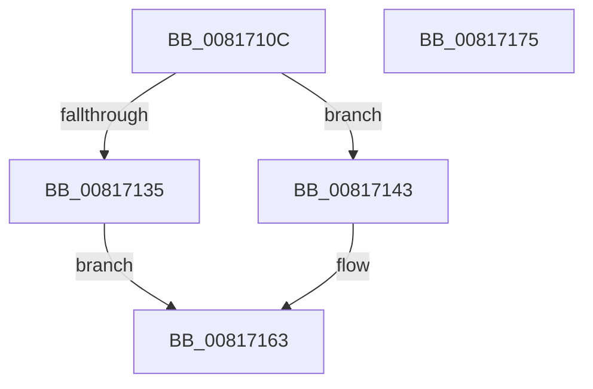

# SdbTagIDToTagRef

- RVA: `0x0081710C`–`0x00817176` (길이 `106` bytes)
- VA: `0x000000014081710C`
- 실행 섹션: `PAGE`
- PDB 이름 있음: `예`; PDB Function 태그: `아니요`
- unwind 정보 RVA: `0x000733E4`
- 디코드: `31`개 명령, `106/106` bytes 표시
- 미해석 바이트: `0` (있으면 어셈블리에 `.byte`로 보존)

> 이 문서는 커널 이미지의 기계어와 PDB 기호를 분석해 생성했습니다. 4번과 5번은 함수 원형과 자료형을 바이너리 사용 방식에서 추정한 C 해석이며 원본 소스 복구 결과는 아닙니다.

## 1. Dependencies

- 직접 호출 지점: **2**; 고유 호출 대상: **2**
- 직접 호출자로 확인된 함수: **4**
- RIP 상대 이미지 참조: **2**

### Outgoing calls
- `0x0081712C` → [SdbpFindLocalDatabaseByPDB](SdbpFindLocalDatabaseByPDB_function_008176BC.md) (function, `0x008176BC`)
- `0x0081715C` → [AslLogCallPrintf](../95/AslLogCallPrintf_function_0095E4EC.md) (function, `0x0095E4EC`)

### Direct callers
- [SdbGetKShimTagRef](SdbGetKShimTagRef_function_00813564.md) at `0x00813611`
- [SdbGetDatabaseMatch](../95/SdbGetDatabaseMatch_function_00958240.md) at `0x009583E3`
- [SdbGetDatabaseMatchEx](../95/SdbGetDatabaseMatchEx_function_0095BD7C.md) at `0x0095BF4F`
- [SdbGetDatabaseMatchEx](../95/SdbGetDatabaseMatchEx_function_0095BD7C.md) at `0x0095BF74`
- [sub_00B27968](../B2/Unknown_function_00B27968.md) at `0x00B279BC`
- [sub_00B27968](../B2/Unknown_function_00B27968.md) at `0x00B27A4A`

### Static image references
- `0x00817143` → RVA `0x0003D428` (`.rdata`; read)
- `0x00817150` → RVA `0x0003D430` (`.rdata`; read)

## 2. Other-region calls and transfers

- 다른 실행 섹션으로 향하는 call: **0**
- 별도 외부 분기/꼬리 이동을 확인하지 못했습니다.

## 3. Assembly (complete function range)

```asm
0081710C  48 8B C4                        mov rax, rsp
0081710F  48 89 58 08                     mov qword ptr [rax + 8], rbx
00817113  48 89 70 10                     mov qword ptr [rax + 0x10], rsi
00817117  57                              push rdi
00817118  48 83 EC 30                     sub rsp, 0x30
0081711C  83 48 E8 FF                     or dword ptr [rax - 0x18], 0xffffffff
00817120  49 8B F9                        mov rdi, r9
00817123  4C 8D 48 E8                     lea r9, [rax - 0x18]
00817127  41 8B F0                        mov esi, r8d
0081712A  33 DB                           xor ebx, ebx
0081712C  E8 8B 05 00 00                  call 0x1408176bc
00817131  85 C0                           test eax, eax
00817133  74 0E                           je 0x140817143
00817135  8D 43 01                        lea eax, [rbx + 1]
00817138  8B 5C 24 20                     mov ebx, dword ptr [rsp + 0x20]
0081713C  C1 E3 1C                        shl ebx, 0x1c
0081713F  0B DE                           or ebx, esi
00817141  EB 20                           jmp 0x140817163
00817143  4C 8D 0D DE 62 82 FF            lea r9, [rip - 0x7d9d22]
0081714A  41 B8 03 01 00 00               mov r8d, 0x103
00817150  48 8D 15 D9 62 82 FF            lea rdx, [rip - 0x7d9d27]
00817157  B9 01 00 00 00                  mov ecx, 1
0081715C  E8 8B 73 14 00                  call 0x14095e4ec
00817161  8B C3                           mov eax, ebx
00817163  89 1F                           mov dword ptr [rdi], ebx
00817165  48 8B 5C 24 40                  mov rbx, qword ptr [rsp + 0x40]
0081716A  48 8B 74 24 48                  mov rsi, qword ptr [rsp + 0x48]
0081716F  48 83 C4 30                     add rsp, 0x30
00817173  5F                              pop rdi
00817174  C3                              ret
00817175  CC                              int3
```

## 4. C-style interpretation (structured pseudocode)

```c
__int64 __fastcall SdbTagIDToTagRef(__int64 a1, __int64 a2, int a3, __int64 a4)
{
    __int64 result;
    __int64 v_rbx;
    __int64 v_rsp;
    unsigned int v_stack_m18;
    unsigned __int64 v_stack_p10;
    unsigned __int64 v_stack_p8;

    *(unsigned __int64 *)(v_rsp + 8) = v_rbx;
    *(unsigned __int64 *)(v_rsp + 16) = v_rsi;
    v_rsp = (v_rsp) - (48);
    v_rbx = 0;
    result = SdbpFindLocalDatabaseByPDB(a1, a2, a3, v_rsp - 24);
    if ((unsigned int)(result) == 0) goto loc_00817143;
    v_rbx = (unsigned int)(((unsigned int)(v_stack_m18)) << (28));
    v_rbx = (unsigned int)((v_rbx) | ((unsigned int)((unsigned int)(a3))));
    goto loc_00817163;
loc_00817143:
    result = AslLogCallPrintf(1, v_rip - 8232231, 259, v_rip - 8232226);
loc_00817163:
    *(unsigned int *)(a4) = (unsigned int)(v_rbx);
    v_rsp = (v_rsp) + (48);
    return (unsigned int)((unsigned int)(v_rbx));
}
```

## 5. (Beta) C Style

```c
int64_t SdbTagIDToTagRef(int64_t Arg1, int64_t Arg2, int32_t Arg3, void *Arg4)
{
    uint8_t *arg4 = (uint8_t *)Arg4;

    int64_t result;
    int64_t local_rbx;
    int64_t local_rsp;
    uint32_t v_stack_m18;
    uint64_t v_stack_p10;
    uint64_t v_stack_p8;

    *(uint64_t *)(local_rsp + 0x8) = local_rbx;
    *(uint64_t *)(local_rsp + 0x10) = local_rsi;
    local_rsp = (local_rsp) - (48);
    local_rbx = 0;
    result = SdbpFindLocalDatabaseByPDB(Arg1, Arg2, Arg3, local_rsp - 24);
    if ((uint32_t)(result) == 0) goto loc_00817143;
    local_rbx = (uint32_t)(((uint32_t)(v_stack_m18)) << (28));
    local_rbx = (uint32_t)((local_rbx) | ((uint32_t)((uint32_t)(Arg3))));
    goto loc_00817163;
loc_00817143:
    result = AslLogCallPrintf(1, v_rip - 8232231, 259, v_rip - 8232226);
loc_00817163:
    *(uint32_t *)(arg4) = (uint32_t)(local_rbx);
    local_rsp = (local_rsp) + (48);
    return (uint32_t)((uint32_t)(local_rbx));
}
```

### 관측된 메모리 오프셋

구조체 형식이 확인되지 않은 접근은 인자 기준의 오프셋으로만 기록했습니다.

| 기준 인자 | 오프셋 표현 | 폭 (bit) | 접근 |
|---|---:|---:|---|
| `Arg4` | `+ 0x0` | `32` | `W` |

## 6. Execution-region graph

[열기: 2D/3D 그래프와 함수 탐색 컨트롤 패널](../../../control-panel.html?section=page&rva=0x0081710C&view=graph)

- 2D 그래프는 위에서 아래로 흐르고, 3D 그래프는 빈 공간을 드래그해 회전합니다. Shift+드래그는 이동, 휠은 확대·축소, 함수 노드 선택은 대상 보고서 이동입니다.

### Static fallback


