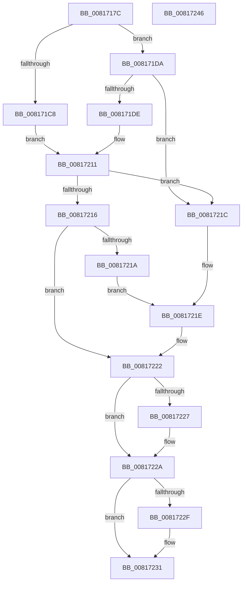

# SdbTagRefToTagID

- RVA: `0x0081717C`–`0x00817247` (길이 `203` bytes)
- VA: `0x000000014081717C`
- 실행 섹션: `PAGE`
- PDB 이름 있음: `예`; PDB Function 태그: `아니요`
- unwind 정보 RVA: `0x000C4B74`
- 디코드: `60`개 명령, `203/203` bytes 표시
- 미해석 바이트: `0` (있으면 어셈블리에 `.byte`로 보존)

> 이 문서는 커널 이미지의 기계어와 PDB 기호를 분석해 생성했습니다. 4번과 5번은 함수 원형과 자료형을 바이너리 사용 방식에서 추정한 C 해석이며 원본 소스 복구 결과는 아닙니다.

## 1. Dependencies

- 직접 호출 지점: **2**; 고유 호출 대상: **2**
- 직접 호출자로 확인된 함수: **5**
- RIP 상대 이미지 참조: **1**

### Outgoing calls
- `0x00817207` → [SdbpOpenLocalDatabaseEx](SdbpOpenLocalDatabaseEx_function_0081770C.md) (function, `0x0081770C`)
- `0x00817239` → [_security_check_cookie](../../text/6A/_security_check_cookie_function_006AC640.md) (function, `0x006AC640`)

### Direct callers
- [KsepDbGetShimInfo](../74/KsepDbGetShimInfo_function_00748E94.md) at `0x00748F4D`
- [SdbQueryDataEx](SdbQueryDataEx_function_0081363C.md) at `0x00813666`
- [SdbReadEntryInformation](SdbReadEntryInformation_function_00813AEC.md) at `0x00813B34`
- [KsepDbGetDriverShimsInternal](../95/KsepDbGetDriverShimsInternal_function_009597C4.md) at `0x00959854`
- [KsepDbCacheReadDeviceInternal](../95/KsepDbCacheReadDeviceInternal_function_0095B774.md) at `0x0095B7F2`

### Static image references
- `0x00817184` → RVA `0x00E0A740` (`.data`; read)

## 2. Other-region calls and transfers

- 다른 실행 섹션으로 향하는 call: **1**
  - `0x00817239` → [_security_check_cookie](../../text/6A/_security_check_cookie_function_006AC640.md) (`PAGE` → `.text`)
- 별도 외부 분기/꼬리 이동을 확인하지 못했습니다.

## 3. Assembly (complete function range)

```asm
0081717C  40 53                           push rbx
0081717E  56                              push rsi
0081717F  57                              push rdi
00817180  48 83 EC 60                     sub rsp, 0x60
00817184  48 8B 05 B5 35 5F 00            mov rax, qword ptr [rip + 0x5f35b5]
0081718B  48 33 C4                        xor rax, rsp
0081718E  48 89 44 24 50                  mov qword ptr [rsp + 0x50], rax
00817193  48 83 64 24 38 00               and qword ptr [rsp + 0x38], 0
00817199  8B DA                           mov ebx, edx
0081719B  C1 EA 1C                        shr edx, 0x1c
0081719E  49 8B F0                        mov rsi, r8
008171A1  44 8B C2                        mov r8d, edx
008171A4  4C 8B D1                        mov r10, rcx
008171A7  44 89 44 24 30                  mov dword ptr [rsp + 0x30], r8d
008171AC  81 E3 FF FF FF 0F               and ebx, 0xfffffff
008171B2  49 C1 E0 05                     shl r8, 5
008171B6  49 8B F9                        mov rdi, r9
008171B9  B8 01 00 00 00                  mov eax, 1
008171BE  41 8B 4C 08 40                  mov ecx, dword ptr [r8 + rcx + 0x40]
008171C3  F6 C1 02                        test cl, 2
008171C6  74 12                           je 0x1408171da
008171C8  4B 8B 4C 10 38                  mov rcx, qword ptr [r8 + r10 + 0x38]
008171CD  43 0F 10 44 10 28               movups xmm0, xmmword ptr [r8 + r10 + 0x28]
008171D3  F3 0F 7F 41 1C                  movdqu xmmword ptr [rcx + 0x1c], xmm0
008171D8  EB 37                           jmp 0x140817211
008171DA  84 C8                           test al, cl
008171DC  74 3E                           je 0x14081721c
008171DE  43 0F 10 44 10 28               movups xmm0, xmmword ptr [r8 + r10 + 0x28]
008171E4  43 83 64 10 40 00               and dword ptr [r8 + r10 + 0x40], 0
008171EA  48 8D 44 24 30                  lea rax, [rsp + 0x30]
008171EF  4C 8D 4C 24 38                  lea r9, [rsp + 0x38]
008171F4  48 89 44 24 20                  mov qword ptr [rsp + 0x20], rax
008171F9  48 8D 54 24 40                  lea rdx, [rsp + 0x40]
008171FE  49 8B CA                        mov rcx, r10
00817201  F3 0F 7F 44 24 40               movdqu xmmword ptr [rsp + 0x40], xmm0
00817207  E8 00 05 00 00                  call 0x14081770c
0081720C  48 8B 4C 24 38                  mov rcx, qword ptr [rsp + 0x38]
00817211  48 85 C9                        test rcx, rcx
00817214  74 06                           je 0x14081721c
00817216  85 C0                           test eax, eax
00817218  75 08                           jne 0x140817222
0081721A  EB 02                           jmp 0x14081721e
0081721C  33 C0                           xor eax, eax
0081721E  33 C9                           xor ecx, ecx
00817220  33 DB                           xor ebx, ebx
00817222  48 85 F6                        test rsi, rsi
00817225  74 03                           je 0x14081722a
00817227  48 89 0E                        mov qword ptr [rsi], rcx
0081722A  48 85 FF                        test rdi, rdi
0081722D  74 02                           je 0x140817231
0081722F  89 1F                           mov dword ptr [rdi], ebx
00817231  48 8B 4C 24 50                  mov rcx, qword ptr [rsp + 0x50]
00817236  48 33 CC                        xor rcx, rsp
00817239  E8 02 54 E9 FF                  call 0x1406ac640
0081723E  48 83 C4 60                     add rsp, 0x60
00817242  5F                              pop rdi
00817243  5E                              pop rsi
00817244  5B                              pop rbx
00817245  C3                              ret
00817246  CC                              int3
```

## 4. C-style interpretation (structured pseudocode)

```c
__int64 __fastcall SdbTagRefToTagID(__int64 a1, int a2, __int64 a3, __int64 a4)
{
    __int64 result;
    __int64 v_rbx;
    __int64 v_rsp;
    unsigned __int64 v_stack_m28;
    unsigned __int64 v_stack_m38;
    unsigned __int64 v_stack_m40;
    unsigned int v_stack_m48;
    unsigned __int64 v_stack_m58;

    v_rsp = (v_rsp) - (96);
    result = (*(unsigned __int64 *)(v_rip + 6239669)) ^ (v_rsp);
    v_stack_m28 = result;
    a2 = (unsigned int)((a2) >> (28));
    v_stack_m48 = (unsigned int)((unsigned int)(a2));
    v_rbx = (unsigned int)(((unsigned int)(a2)) & (0xFFFFFFFULL));
    a3 = ((unsigned int)(a2)) << (5);
    if ((((unsigned __int8)((unsigned int)(*(unsigned int *)(a3 + a1 * 1 + 64)))) & (2)) == 0) goto loc_008171DA;
    *(unsigned __int64 *)(*(unsigned __int64 *)(a3 + a1 * 1 + 56) + 28) = v_xmm0;
    goto loc_00817211;
loc_008171DA:
    if (((1) & ((unsigned __int8)(*(unsigned __int64 *)(a3 + a1 * 1 + 56)))) == 0) goto loc_0081721C;
    v_stack_m58 = v_stack_m48;
    v_stack_m38 = v_xmm0;
    result = SdbpOpenLocalDatabaseEx(a1, v_stack_m38, a3, v_stack_m40);
loc_00817211:
    if (v_stack_m40 == 0) goto loc_0081721C;
    if ((unsigned int)(result) != 0) goto loc_00817222;
    goto loc_0081721E;
loc_0081721C:
    result = 0;
loc_0081721E:
    a1 = 0;
    v_rbx = 0;
loc_00817222:
    if (a3 != 0) {
        *(unsigned __int64 *)(a3) = 0;
    }
    if (a4 != 0) {
        *(unsigned int *)(a4) = 0;
    }
    a1 = (v_stack_m28) ^ (v_rsp);
    result = _security_check_cookie(a1, v_stack_m38, a3, v_stack_m40);
    v_rsp = (v_rsp) + (96);
    return result;
}
```

## 5. (Beta) C Style

```c
int64_t SdbTagRefToTagID(int64_t Arg1, int32_t Arg2, int64_t Arg3, int64_t Arg4)
{
    int64_t result;
    int64_t local_rbx;
    int64_t local_rsp;
    uint64_t v_stack_m28;
    uint64_t v_stack_m38;
    uint64_t v_stack_m40;
    uint32_t v_stack_m48;
    uint64_t v_stack_m58;

    local_rsp = (local_rsp) - (96);
    result = (*(uint64_t *)(v_rip + 0x5F35B5)) ^ (local_rsp);
    v_stack_m28 = result;
    Arg2 = (uint32_t)((Arg2) >> (28));
    v_stack_m48 = (uint32_t)((uint32_t)(Arg2));
    local_rbx = (uint32_t)(((uint32_t)(Arg2)) & (0xFFFFFFFULL));
    Arg3 = ((uint32_t)(Arg2)) << (5);
    if ((((uint8_t)((uint32_t)(*(uint32_t *)(Arg3 + Arg1 * 1 + 0x40)))) & (2)) == 0) goto loc_008171DA;
    *(uint64_t *)(*(uint64_t *)(Arg3 + Arg1 * 1 + 0x38) + 0x1C) = v_xmm0;
    goto loc_00817211;
loc_008171DA:
    if (((1) & ((uint8_t)(*(uint64_t *)(Arg3 + Arg1 * 1 + 0x38)))) == 0) goto loc_0081721C;
    v_stack_m58 = v_stack_m48;
    v_stack_m38 = v_xmm0;
    result = SdbpOpenLocalDatabaseEx(Arg1, v_stack_m38, Arg3, v_stack_m40);
loc_00817211:
    if (v_stack_m40 == 0) goto loc_0081721C;
    if ((uint32_t)(result) != 0) goto loc_00817222;
    goto loc_0081721E;
loc_0081721C:
    result = 0;
loc_0081721E:
    Arg1 = 0;
    local_rbx = 0;
loc_00817222:
    if (Arg3 != 0) {
        *(uint64_t *)(Arg3) = 0;
    }
    if (Arg4 != 0) {
        *(uint32_t *)(Arg4) = 0;
    }
    Arg1 = (v_stack_m28) ^ (local_rsp);
    result = _security_check_cookie(Arg1, v_stack_m38, Arg3, v_stack_m40);
    local_rsp = (local_rsp) + (96);
    return result;
}
```

## 6. Execution-region graph

[열기: 2D/3D 그래프와 함수 탐색 컨트롤 패널](../../../control-panel.html?section=page&rva=0x0081717C&view=graph)

- 2D 그래프는 위에서 아래로 흐르고, 3D 그래프는 빈 공간을 드래그해 회전합니다. Shift+드래그는 이동, 휠은 확대·축소, 함수 노드 선택은 대상 보고서 이동입니다.

### Static fallback


