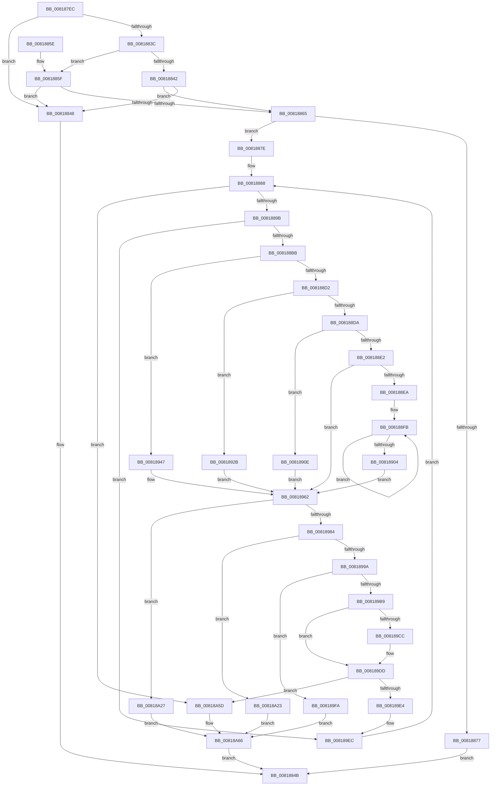

# SdbpCheckAllAttributes

- RVA: `0x008187EC`–`0x00818A7B` (길이 `655` bytes)
- VA: `0x00000001408187EC`
- 실행 섹션: `PAGE`
- PDB 이름 있음: `예`; PDB Function 태그: `아니요`
- unwind 정보 RVA: `0x000D9BE0`
- 디코드: `185`개 명령, `655/655` bytes 표시
- 미해석 바이트: `0` (있으면 어셈블리에 `.byte`로 보존)

> 이 문서는 커널 이미지의 기계어와 PDB 기호를 분석해 생성했습니다. 4번과 5번은 함수 원형과 자료형을 바이너리 사용 방식에서 추정한 C 해석이며 원본 소스 복구 결과는 아닙니다.

## 1. Dependencies

- 직접 호출 지점: **13**; 고유 호출 대상: **12**
- 직접 호출자로 확인된 함수: **2**
- RIP 상대 이미지 참조: **4**

### Outgoing calls
- `0x0081886A` → [AslAlloc](../95/AslAlloc_function_0095BD34.md) (function, `0x0095BD34`)
- `0x008188AE` → [SdbFindFirstTag](../95/SdbFindFirstTag_function_0095E34C.md) (function, `0x0095E34C`)
- `0x008188EF` → [SdbGetStringTagPtr](../95/SdbGetStringTagPtr_function_0095DDA8.md) (function, `0x0095DDA8`)
- `0x00818916` → [SdbReadQWORDTag](SdbReadQWORDTag_function_0081706C.md) (function, `0x0081706C`)
- `0x00818933` → [SdbReadDWORDTag](../95/SdbReadDWORDTag_function_0095D408.md) (function, `0x0095D408`)
- `0x0081894F` → [SdbReadWORDTag](../95/SdbReadWORDTag_function_0095D898.md) (function, `0x0095D898`)
- `0x00818975` → [AslFileAllocAndGetAttributes](AslFileAllocAndGetAttributes_function_0081D8EC.md) (function, `0x0081D8EC`)
- `0x008189B0` → [SdbpCheckAttribute](SdbpCheckAttribute_function_00818A84.md) (function, `0x00818A84`)
- `0x008189D8` → [guard_dispatch_icall](../../text/6B/guard_dispatch_icall_function_006BAAD0.md) (function, `0x006BAAD0`)
- `0x00818A1C` → [AslLogCallPrintf](../95/AslLogCallPrintf_function_0095E4EC.md) (function, `0x0095E4EC`)
- `0x00818A56` → [AslLogCallPrintf](../95/AslLogCallPrintf_function_0095E4EC.md) (function, `0x0095E4EC`)
- `0x00818A69` → [AslFileFreeAttributes](AslFileFreeAttributes_function_0081DE28.md) (function, `0x0081DE28`)
- `0x00818A71` → [AslFree](../95/AslFree_function_0095B674.md) (function, `0x0095B674`)

### Direct callers
- [SdbpCheckMatchingFiles](SdbpCheckMatchingFiles_function_00814080.md) at `0x0081412F`
- [SdbpCheckMatchingFiles](SdbpCheckMatchingFiles_function_00814080.md) at `0x0081425A`
- [SdbpCheckMatchingWildcardFiles](SdbpCheckMatchingWildcardFiles_function_00814E30.md) at `0x0081500F`

### Static image references
- `0x00818881` → RVA `0x00E0ED54` (`.data`; read)
- `0x008189FF` → RVA `0x0003E250` (`.rdata`; read)
- `0x00818A10` → RVA `0x0003E238` (`.rdata`; read)
- `0x00818A36` → RVA `0x0003E218` (`.rdata`; read)

## 2. Other-region calls and transfers

- 다른 실행 섹션으로 향하는 call: **1**
  - `0x008189D8` → [guard_dispatch_icall](../../text/6B/guard_dispatch_icall_function_006BAAD0.md) (`PAGE` → `.text`)
- 별도 외부 분기/꼬리 이동을 확인하지 못했습니다.

## 3. Assembly (complete function range)

```asm
008187EC  48 8B C4                        mov rax, rsp
008187EF  44 89 48 20                     mov dword ptr [rax + 0x20], r9d
008187F3  4C 89 40 18                     mov qword ptr [rax + 0x18], r8
008187F7  48 89 50 10                     mov qword ptr [rax + 0x10], rdx
008187FB  48 89 48 08                     mov qword ptr [rax + 8], rcx
008187FF  55                              push rbp
00818800  53                              push rbx
00818801  56                              push rsi
00818802  57                              push rdi
00818803  41 54                           push r12
00818805  41 55                           push r13
00818807  41 56                           push r14
00818809  41 57                           push r15
0081880B  48 8B EC                        mov rbp, rsp
0081880E  48 83 EC 58                     sub rsp, 0x58
00818812  4C 8B 75 68                     mov r14, qword ptr [rbp + 0x68]
00818816  45 33 E4                        xor r12d, r12d
00818819  44 89 65 DC                     mov dword ptr [rbp - 0x24], r12d
0081881D  45 8B F9                        mov r15d, r9d
00818820  4C 89 65 E8                     mov qword ptr [rbp - 0x18], r12
00818824  49 8B D8                        mov rbx, r8
00818827  44 89 21                        mov dword ptr [rcx], r12d
0081882A  66 44 89 65 D8                  mov word ptr [rbp - 0x28], r12w
0081882F  41 8D 7C 24 01                  lea edi, [r12 + 1]
00818834  89 7D E0                        mov dword ptr [rbp - 0x20], edi
00818837  4D 85 F6                        test r14, r14
0081883A  74 0C                           je 0x140818848
0081883C  45 39 66 50                     cmp dword ptr [r14 + 0x50], r12d
00818840  74 1D                           je 0x14081885f
00818842  4D 39 66 20                     cmp qword ptr [r14 + 0x20], r12
00818846  75 1D                           jne 0x140818865
00818848  41 8B DC                        mov ebx, r12d
0081884B  8B C3                           mov eax, ebx
0081884D  48 83 C4 58                     add rsp, 0x58
00818851  41 5F                           pop r15
00818853  41 5E                           pop r14
00818855  41 5D                           pop r13
00818857  41 5C                           pop r12
00818859  5F                              pop rdi
0081885A  5E                              pop rsi
0081885B  5B                              pop rbx
0081885C  5D                              pop rbp
0081885D  C3                              ret
0081885E  CC                              int3
0081885F  4D 39 66 08                     cmp qword ptr [r14 + 8], r12
00818863  74 E3                           je 0x140818848
00818865  BA 80 04 00 00                  mov edx, 0x480
0081886A  E8 C5 34 14 00                  call 0x14095bd34
0081886F  48 8B F0                        mov rsi, rax
00818872  48 85 C0                        test rax, rax
00818875  75 07                           jne 0x14081887e
00818877  BB 17 00 00 C0                  mov ebx, 0xc0000017
0081887C  EB CD                           jmp 0x14081884b
0081887E  41 8B C4                        mov eax, r12d
00818881  4C 8D 2D CC 64 5F 00            lea r13, [rip + 0x5f64cc]
00818888  89 45 E4                        mov dword ptr [rbp - 0x1c], eax
0081888B  48 98                           cdqe
0081888D  48 89 45 F0                     mov qword ptr [rbp - 0x10], rax
00818891  48 83 F8 29                     cmp rax, 0x29
00818895  0F 83 C2 01 00 00               jae 0x140818a5d
0081889B  41 0F B7 45 FC                  movzx eax, word ptr [r13 - 4]
008188A0  41 8B D7                        mov edx, r15d
008188A3  44 0F B7 C0                     movzx r8d, ax
008188A7  66 89 45 68                     mov word ptr [rbp + 0x68], ax
008188AB  48 8B CB                        mov rcx, rbx
008188AE  E8 99 5A 14 00                  call 0x14095e34c
008188B3  85 C0                           test eax, eax
008188B5  0F 84 31 01 00 00               je 0x1408189ec
008188BB  0F B7 4D 68                     movzx ecx, word ptr [rbp + 0x68]
008188BF  33 FF                           xor edi, edi
008188C1  81 E1 00 F0 00 00               and ecx, 0xf000
008188C7  44 8B FF                        mov r15d, edi
008188CA  81 F9 00 30 00 00               cmp ecx, 0x3000
008188D0  74 75                           je 0x140818947
008188D2  81 F9 00 40 00 00               cmp ecx, 0x4000
008188D8  74 51                           je 0x14081892b
008188DA  81 F9 00 50 00 00               cmp ecx, 0x5000
008188E0  74 2C                           je 0x14081890e
008188E2  81 F9 00 60 00 00               cmp ecx, 0x6000
008188E8  75 78                           jne 0x140818962
008188EA  8B D0                           mov edx, eax
008188EC  48 8B CB                        mov rcx, rbx
008188EF  E8 B4 54 14 00                  call 0x14095dda8
008188F4  4C 8B E0                        mov r12, rax
008188F7  48 83 C9 FF                     or rcx, 0xffffffffffffffff
008188FB  48 FF C1                        inc rcx
008188FE  66 39 3C 48                     cmp word ptr [rax + rcx*2], di
00818902  75 F7                           jne 0x1408188fb
00818904  44 8D 3C 4D 02 00 00 00         lea r15d, [rcx*2 + 2]
0081890C  EB 54                           jmp 0x140818962
0081890E  45 33 C0                        xor r8d, r8d
00818911  8B D0                           mov edx, eax
00818913  48 8B CB                        mov rcx, rbx
00818916  E8 51 E7 FF FF                  call 0x14081706c
0081891B  48 89 45 E8                     mov qword ptr [rbp - 0x18], rax
0081891F  4C 8D 65 E8                     lea r12, [rbp - 0x18]
00818923  41 BF 08 00 00 00               mov r15d, 8
00818929  EB 37                           jmp 0x140818962
0081892B  45 33 C0                        xor r8d, r8d
0081892E  8B D0                           mov edx, eax
00818930  48 8B CB                        mov rcx, rbx
00818933  E8 D0 4A 14 00                  call 0x14095d408
00818938  89 45 DC                        mov dword ptr [rbp - 0x24], eax
0081893B  4C 8D 65 DC                     lea r12, [rbp - 0x24]
0081893F  41 BF 04 00 00 00               mov r15d, 4
00818945  EB 1B                           jmp 0x140818962
00818947  45 33 C0                        xor r8d, r8d
0081894A  8B D0                           mov edx, eax
0081894C  48 8B CB                        mov rcx, rbx
0081894F  E8 44 4F 14 00                  call 0x14095d898
00818954  66 89 45 D8                     mov word ptr [rbp - 0x28], ax
00818958  4C 8D 65 D8                     lea r12, [rbp - 0x28]
0081895C  41 BF 02 00 00 00               mov r15d, 2
00818962  41 8B 4D 00                     mov ecx, dword ptr [r13]
00818966  41 B8 01 00 00 00               mov r8d, 1
0081896C  49 D3 E0                        shl r8, cl
0081896F  49 8B D6                        mov rdx, r14
00818972  48 8B CE                        mov rcx, rsi
00818975  E8 72 4F 00 00                  call 0x14081d8ec
0081897A  8B D8                           mov ebx, eax
0081897C  85 C0                           test eax, eax
0081897E  0F 88 A3 00 00 00               js 0x140818a27
00818984  49 63 4D 00                     movsxd rcx, dword ptr [r13]
00818988  48 C1 E1 05                     shl rcx, 5
0081898C  48 03 CE                        add rcx, rsi
0081898F  8B 41 18                        mov eax, dword ptr [rcx + 0x18]
00818992  A8 01                           test al, 1
00818994  0F 84 89 00 00 00               je 0x140818a23
0081899A  0F B7 5D 68                     movzx ebx, word ptr [rbp + 0x68]
0081899E  45 8B CF                        mov r9d, r15d
008189A1  48 89 4C 24 20                  mov qword ptr [rsp + 0x20], rcx
008189A6  0F B7 D3                        movzx edx, bx
008189A9  4D 8B C4                        mov r8, r12
008189AC  48 8D 4D E0                     lea rcx, [rbp - 0x20]
008189B0  E8 CF 00 00 00                  call 0x140818a84
008189B5  85 C0                           test eax, eax
008189B7  74 41                           je 0x1408189fa
008189B9  48 8B 45 50                     mov rax, qword ptr [rbp + 0x50]
008189BD  8B 7D E0                        mov edi, dword ptr [rbp - 0x20]
008189C0  48 8B 80 D8 06 00 00            mov rax, qword ptr [rax + 0x6d8]
008189C7  48 85 C0                        test rax, rax
008189CA  74 11                           je 0x1408189dd
008189CC  44 8B CF                        mov r9d, edi
008189CF  45 8B C7                        mov r8d, r15d
008189D2  49 8B D4                        mov rdx, r12
008189D5  0F B7 CB                        movzx ecx, bx
008189D8  E8 F3 20 EA FF                  call 0x1406baad0
008189DD  45 33 E4                        xor r12d, r12d
008189E0  85 FF                           test edi, edi
008189E2  74 79                           je 0x140818a5d
008189E4  48 8B 5D 58                     mov rbx, qword ptr [rbp + 0x58]
008189E8  44 8B 7D 60                     mov r15d, dword ptr [rbp + 0x60]
008189EC  8B 45 E4                        mov eax, dword ptr [rbp - 0x1c]
008189EF  FF C0                           inc eax
008189F1  49 83 C5 08                     add r13, 8
008189F5  E9 8E FE FF FF                  jmp 0x140818888
008189FA  BB E5 00 00 C0                  mov ebx, 0xc00000e5
008189FF  4C 8D 0D 4A 58 82 FF            lea r9, [rip - 0x7da7b6]
00818A06  41 B8 0A 02 00 00               mov r8d, 0x20a
00818A0C  89 5C 24 20                     mov dword ptr [rsp + 0x20], ebx
00818A10  48 8D 15 21 58 82 FF            lea rdx, [rip - 0x7da7df]
00818A17  B9 01 00 00 00                  mov ecx, 1
00818A1C  E8 CB 5A 14 00                  call 0x14095e4ec
00818A21  EB 43                           jmp 0x140818a66
00818A23  8B DF                           mov ebx, edi
00818A25  EB 3F                           jmp 0x140818a66
00818A27  89 44 24 28                     mov dword ptr [rsp + 0x28], eax
00818A2B  48 8D 0D 22 63 5F 00            lea rcx, [rip + 0x5f6322]
00818A32  48 8B 45 F0                     mov rax, qword ptr [rbp - 0x10]
00818A36  4C 8D 0D DB 57 82 FF            lea r9, [rip - 0x7da825]
00818A3D  41 B8 F3 01 00 00               mov r8d, 0x1f3
00818A43  48 8D 15 EE 57 82 FF            lea rdx, [rip - 0x7da812]
00818A4A  8B 04 C1                        mov eax, dword ptr [rcx + rax*8]
00818A4D  B9 01 00 00 00                  mov ecx, 1
00818A52  89 44 24 20                     mov dword ptr [rsp + 0x20], eax
00818A56  E8 91 5A 14 00                  call 0x14095e4ec
00818A5B  EB 09                           jmp 0x140818a66
00818A5D  48 8B 45 48                     mov rax, qword ptr [rbp + 0x48]
00818A61  41 8B DC                        mov ebx, r12d
00818A64  89 38                           mov dword ptr [rax], edi
00818A66  48 8B CE                        mov rcx, rsi
00818A69  E8 BA 53 00 00                  call 0x14081de28
00818A6E  48 8B D6                        mov rdx, rsi
00818A71  E8 FE 2B 14 00                  call 0x14095b674
00818A76  E9 D0 FD FF FF                  jmp 0x14081884b
```

## 4. C-style interpretation (structured pseudocode)

```c
__int64 __fastcall SdbpCheckAllAttributes(__int64 a1, __int64 a2, __int64 a3, int a4, unsigned __int16 a5)
{
    __int64 result;
    __int64 v_r12;
    __int64 v_r13;
    __int64 v_rdi;
    __int64 v_rsp;
    unsigned __int64 v_stack_m50;
    unsigned __int64 v_stack_m58;
    unsigned int v_stack_m5C;
    unsigned int v_stack_m60;
    unsigned int v_stack_m64;
    unsigned __int16 v_stack_m68;
    unsigned __int64 v_stack_p10;
    unsigned __int64 v_stack_p18;
    unsigned __int64 v_stack_p20;
    unsigned __int16 v_stack_p28;
    unsigned __int64 v_stack_p8;

    *(unsigned int *)(v_rsp + 32) = a4;
    *(unsigned __int64 *)(v_rsp + 24) = a3;
    *(unsigned __int64 *)(v_rsp + 16) = a2;
    *(unsigned __int64 *)(v_rsp + 8) = a1;
    v_rsp = (v_rsp) - (88);
    v_r12 = 0;
    v_stack_m64 = 0;
    v_stack_m58 = 0;
    *(unsigned int *)(a1) = 0;
    v_stack_m68 = 0;
    v_stack_m60 = (unsigned int)(v_r12 + 1);
    if (a5 == 0) goto loc_00818848;
    if ((*(unsigned int *)(a5 + 80)) == 0) goto loc_0081885F;
    if ((*(unsigned __int64 *)(a5 + 32)) != 0) goto loc_00818865;
loc_00818848:
loc_0081884B:
    v_rsp = (v_rsp) + (88);
    return 0;
loc_0081885F:
    if ((*(unsigned __int64 *)(a5 + 8)) == 0) goto loc_00818848;
loc_00818865:
    result = AslAlloc(a1, (unsigned int)(0x480ULL), a3, a4);
    if (result != 0) goto loc_0081887E;
    goto loc_0081884B;
loc_0081887E:
loc_00818888:
    v_stack_m5C = 0;
    v_stack_m50 = 0;
    if (0 >= 41) goto loc_00818A5D;
    v_stack_p28 = (unsigned __int16)(*(unsigned __int16 *)(v_rip + 6251724 - 4));
    result = SdbFindFirstTag((unsigned int)(0xC0000017ULL), (unsigned int)((unsigned int)((unsigned int)(a4))), (unsigned __int16)(*(unsigned __int16 *)(v_rip + 6251724 - 4)), a4);
    if ((unsigned int)(result) == 0) goto loc_008189EC;
    v_rdi = 0;
    a1 = (unsigned int)((a5) & (0xF000ULL));
    if (((unsigned int)(a1)) == 0x3000ULL) goto loc_00818947;
    if (((unsigned int)(a1)) == 0x4000ULL) goto loc_0081892B;
    if (((unsigned int)(a1)) == 0x5000ULL) goto loc_0081890E;
    if (((unsigned int)(a1)) != 0x6000ULL) goto loc_00818962;
    result = SdbGetStringTagPtr((unsigned int)(0xC0000017ULL), (unsigned int)((unsigned int)(result)), (unsigned __int16)(*(unsigned __int16 *)(v_rip + 6251724 - 4)), a4);
    a1 = ((unsigned int)(0xC0000017ULL)) | (-1);
loc_008188FB:
    a1 = (a1) + 1;
    if ((*(unsigned __int16 *)(result + a1 * 2)) != 0) goto loc_008188FB;
    goto loc_00818962;
loc_0081890E:
    a3 = 0;
    result = SdbReadQWORDTag((unsigned int)(0xC0000017ULL), (unsigned int)((unsigned int)(result)), a3, a4);
    v_stack_m58 = result;
    goto loc_00818962;
loc_0081892B:
    a3 = 0;
    result = SdbReadDWORDTag((unsigned int)(0xC0000017ULL), (unsigned int)((unsigned int)(result)), a3, a4);
    v_stack_m64 = (unsigned int)(result);
    goto loc_00818962;
loc_00818947:
    a3 = 0;
    result = SdbReadWORDTag((unsigned int)(0xC0000017ULL), (unsigned int)((unsigned int)(result)), a3, a4);
    v_stack_m68 = (unsigned __int16)(result);
loc_00818962:
    a3 = (1) << ((unsigned __int8)((unsigned int)(*(unsigned int *)(v_rip + 6251724))));
    result = AslFileAllocAndGetAttributes(result, a5, a3, a4);
    if (sign_flag) goto loc_00818A27;
    a1 = ((int)(*(unsigned int *)(v_rip + 6251724))) << (5);
    a1 = (a1) + (result);
    if ((((unsigned __int8)((unsigned int)(*(unsigned int *)(a1 + 24)))) & (1)) == 0) goto loc_00818A23;
    v_stack_p20 = a1;
    result = SdbpCheckAttribute(v_stack_m60, a5, v_stack_m68, 2);
    if ((unsigned int)(result) == 0) goto loc_008189FA;
    result = *(unsigned __int64 *)(v_stack_p10 + 1752);
    if (*(unsigned __int64 *)(v_stack_p10 + 1752) != 0) {
        a4 = (unsigned int)((unsigned int)(v_stack_m60));
        a3 = 2;
        a2 = v_stack_m68;
        a1 = a5;
        result = guard_dispatch_icall(a1, a2, a3, a4);
    }
    v_r12 = 0;
    if ((unsigned int)((unsigned int)(v_stack_m60)) == 0) goto loc_00818A5D;
loc_008189EC:
    result = (unsigned int)(((unsigned int)(v_stack_m5C)) + 1);
    v_r13 = (v_rip + 6251724) + (8);
    goto loc_00818888;
loc_008189FA:
    v_stack_p20 = (unsigned int)((unsigned int)(0xC00000E5ULL));
    result = AslLogCallPrintf(1, v_rip - 8234975, 522, v_rip - 8234934);
    goto loc_00818A66;
loc_00818A23:
    goto loc_00818A66;
loc_00818A27:
    v_stack_p28 = (unsigned int)(result);
    v_stack_p20 = (unsigned int)((unsigned int)(*(unsigned int *)(v_rip + 6251298 + v_stack_m50 * 8)));
    result = AslLogCallPrintf(1, v_rip - 8235026, 499, v_rip - 8235045);
    goto loc_00818A66;
loc_00818A5D:
    *(unsigned int *)(v_stack_p8) = (unsigned int)((unsigned int)(v_stack_m60));
loc_00818A66:
    result = AslFileFreeAttributes(result, v_rip - 8235026, 499, v_rip - 8235045);
    result = AslFree(result, result, 499, v_rip - 8235045);
    goto loc_0081884B;
}
```

## 5. (Beta) C Style

```c
int64_t SdbpCheckAllAttributes(void *Arg1, int64_t Arg2, int64_t Arg3, int32_t Arg4, uint16_t Arg5)
{
    uint8_t *arg1 = (uint8_t *)Arg1;

    int64_t result;
    int64_t local_r12;
    int64_t local_r13;
    int64_t local_rdi;
    int64_t local_rsp;
    uint64_t v_stack_m50;
    uint64_t v_stack_m58;
    uint32_t v_stack_m5C;
    uint32_t v_stack_m60;
    uint32_t v_stack_m64;
    uint16_t v_stack_m68;
    uint64_t v_stack_p10;
    uint64_t v_stack_p18;
    uint64_t v_stack_p20;
    uint16_t v_stack_p28;
    uint64_t v_stack_p8;

    *(uint32_t *)(local_rsp + 0x20) = Arg4;
    *(uint64_t *)(local_rsp + 0x18) = Arg3;
    *(uint64_t *)(local_rsp + 0x10) = Arg2;
    *(void **)(local_rsp + 0x8) = Arg1;
    local_rsp = (local_rsp) - (88);
    local_r12 = 0;
    v_stack_m64 = 0;
    v_stack_m58 = 0;
    *(uint32_t *)(arg1) = 0;
    v_stack_m68 = 0;
    v_stack_m60 = (uint32_t)(local_r12 + 1);
    if (Arg5 == 0) goto loc_00818848;
    if ((*(uint32_t *)(Arg5 + 0x50)) == 0) goto loc_0081885F;
    if ((*(uint64_t *)(Arg5 + 0x20)) != 0) goto loc_00818865;
loc_00818848:
loc_0081884B:
    local_rsp = (local_rsp) + (88);
    return 0;
loc_0081885F:
    if ((*(uint64_t *)(Arg5 + 0x8)) == 0) goto loc_00818848;
loc_00818865:
    result = AslAlloc(Arg1, (uint32_t)(0x480ULL), Arg3, Arg4);
    if (result != 0) goto loc_0081887E;
    goto loc_0081884B;
loc_0081887E:
loc_00818888:
    v_stack_m5C = 0;
    v_stack_m50 = 0;
    if (0 >= 41) goto loc_00818A5D;
    v_stack_p28 = (uint16_t)(*(uint16_t *)(v_rip + 0x5F64CC - 0x4));
    result = SdbFindFirstTag((uint32_t)(0xC0000017ULL), (uint32_t)((uint32_t)((uint32_t)(Arg4))), (uint16_t)(*(uint16_t *)(v_rip + 0x5F64CC - 0x4)), Arg4);
    if ((uint32_t)(result) == 0) goto loc_008189EC;
    local_rdi = 0;
    Arg1 = (uint32_t)((Arg5) & (0xF000ULL));
    if (((uint32_t)(Arg1)) == 0x3000ULL) goto loc_00818947;
    if (((uint32_t)(Arg1)) == 0x4000ULL) goto loc_0081892B;
    if (((uint32_t)(Arg1)) == 0x5000ULL) goto loc_0081890E;
    if (((uint32_t)(Arg1)) != 0x6000ULL) goto loc_00818962;
    result = SdbGetStringTagPtr((uint32_t)(0xC0000017ULL), (uint32_t)((uint32_t)(result)), (uint16_t)(*(uint16_t *)(v_rip + 0x5F64CC - 0x4)), Arg4);
    Arg1 = ((uint32_t)(0xC0000017ULL)) | (-1);
loc_008188FB:
    Arg1 = (Arg1) + 1;
    if ((*(uint16_t *)(result + arg1 * 2)) != 0) goto loc_008188FB;
    goto loc_00818962;
loc_0081890E:
    Arg3 = 0;
    result = SdbReadQWORDTag((uint32_t)(0xC0000017ULL), (uint32_t)((uint32_t)(result)), Arg3, Arg4);
    v_stack_m58 = result;
    goto loc_00818962;
loc_0081892B:
    Arg3 = 0;
    result = SdbReadDWORDTag((uint32_t)(0xC0000017ULL), (uint32_t)((uint32_t)(result)), Arg3, Arg4);
    v_stack_m64 = (uint32_t)(result);
    goto loc_00818962;
loc_00818947:
    Arg3 = 0;
    result = SdbReadWORDTag((uint32_t)(0xC0000017ULL), (uint32_t)((uint32_t)(result)), Arg3, Arg4);
    v_stack_m68 = (uint16_t)(result);
loc_00818962:
    Arg3 = (1) << ((uint8_t)((uint32_t)(*(uint32_t *)(v_rip + 0x5F64CC))));
    result = AslFileAllocAndGetAttributes(result, Arg5, Arg3, Arg4);
    if (sign_flag) goto loc_00818A27;
    Arg1 = ((int32_t)(*(uint32_t *)(v_rip + 0x5F64CC))) << (5);
    Arg1 = (Arg1) + (result);
    if ((((uint8_t)((uint32_t)(*(uint32_t *)(arg1 + 0x18)))) & (1)) == 0) goto loc_00818A23;
    v_stack_p20 = Arg1;
    result = SdbpCheckAttribute(v_stack_m60, Arg5, v_stack_m68, 2);
    if ((uint32_t)(result) == 0) goto loc_008189FA;
    result = *(uint64_t *)(v_stack_p10 + 0x6D8);
    if (*(uint64_t *)(v_stack_p10 + 0x6D8) != 0) {
        Arg4 = (uint32_t)((uint32_t)(v_stack_m60));
        Arg3 = 2;
        Arg2 = v_stack_m68;
        Arg1 = Arg5;
        result = guard_dispatch_icall(Arg1, Arg2, Arg3, Arg4);
    }
    local_r12 = 0;
    if ((uint32_t)((uint32_t)(v_stack_m60)) == 0) goto loc_00818A5D;
loc_008189EC:
    result = (uint32_t)(((uint32_t)(v_stack_m5C)) + 1);
    local_r13 = (v_rip + 6251724) + (8);
    goto loc_00818888;
loc_008189FA:
    v_stack_p20 = (uint32_t)((uint32_t)(0xC00000E5ULL));
    result = AslLogCallPrintf(1, v_rip - 8234975, 522, v_rip - 8234934);
    goto loc_00818A66;
loc_00818A23:
    goto loc_00818A66;
loc_00818A27:
    v_stack_p28 = (uint32_t)(result);
    v_stack_p20 = (uint32_t)((uint32_t)(*(uint32_t *)(v_rip + 0x5F6322 + v_stack_m50 * 8)));
    result = AslLogCallPrintf(1, v_rip - 8235026, 499, v_rip - 8235045);
    goto loc_00818A66;
loc_00818A5D:
    *(uint32_t *)(v_stack_p8) = (uint32_t)((uint32_t)(v_stack_m60));
loc_00818A66:
    result = AslFileFreeAttributes(result, v_rip - 8235026, 499, v_rip - 8235045);
    result = AslFree(result, result, 499, v_rip - 8235045);
    goto loc_0081884B;
}
```

### 관측된 메모리 오프셋

구조체 형식이 확인되지 않은 접근은 인자 기준의 오프셋으로만 기록했습니다.

| 기준 인자 | 오프셋 표현 | 폭 (bit) | 접근 |
|---|---:|---:|---|
| `Arg1` | `+ 0x0` | `32` | `W` |

## 6. Execution-region graph

[열기: 2D/3D 그래프와 함수 탐색 컨트롤 패널](../../../control-panel.html?section=page&rva=0x008187EC&view=graph)

- 2D 그래프는 위에서 아래로 흐르고, 3D 그래프는 빈 공간을 드래그해 회전합니다. Shift+드래그는 이동, 휠은 확대·축소, 함수 노드 선택은 대상 보고서 이동입니다.

### Static fallback


