# SdbpCheckAttribute

- RVA: `0x00818A84`–`0x00818D7B` (길이 `759` bytes)
- VA: `0x0000000140818A84`
- 실행 섹션: `PAGE`
- PDB 이름 있음: `예`; PDB Function 태그: `아니요`
- unwind 정보 RVA: `0x000D9BC8`
- 디코드: `189`개 명령, `759/759` bytes 표시
- 미해석 바이트: `0` (있으면 어셈블리에 `.byte`로 보존)

> 이 문서는 커널 이미지의 기계어와 PDB 기호를 분석해 생성했습니다. 4번과 5번은 함수 원형과 자료형을 바이너리 사용 방식에서 추정한 C 해석이며 원본 소스 복구 결과는 아닙니다.

## 1. Dependencies

- 직접 호출 지점: **11**; 고유 호출 대상: **9**
- 직접 호출자로 확인된 함수: **1**
- RIP 상대 이미지 참조: **4**

### Outgoing calls
- `0x00818B06` → [SdbpCheckUptoVersion](SdbpCheckUptoVersion_function_008190D0.md) (function, `0x008190D0`)
- `0x00818B2C` → [AslLogCallPrintf](../95/AslLogCallPrintf_function_0095E4EC.md) (function, `0x0095E4EC`)
- `0x00818B44` → [SdbpCheckVersion](SdbpCheckVersion_function_00819118.md) (function, `0x00819118`)
- `0x00818C03` → [AslStringPatternMatchExW](../95/AslStringPatternMatchExW_function_0095E850.md) (function, `0x0095E850`)
- `0x00818C87` → [wil_details_FeatureReporting_ReportUsageToService](../../text/53/wil_details_FeatureReporting_ReportUsageToService_function_0053E6E4.md) (function, `0x0053E6E4`)
- `0x00818C9D` → [wil_details_FeatureStateCache_TryEnableDeviceUsageFastPath](../../text/53/wil_details_FeatureStateCache_TryEnableDeviceUsageFastPath_function_0053E774.md) (function, `0x0053E774`)
- `0x00818CBB` → [SdbpCheckFromStringVersion](SdbpCheckFromStringVersion_function_00818D84.md) (function, `0x00818D84`)
- `0x00818CFE` → [wil_details_FeatureReporting_ReportUsageToService](../../text/53/wil_details_FeatureReporting_ReportUsageToService_function_0053E6E4.md) (function, `0x0053E6E4`)
- `0x00818D14` → [wil_details_FeatureStateCache_TryEnableDeviceUsageFastPath](../../text/53/wil_details_FeatureStateCache_TryEnableDeviceUsageFastPath_function_0053E774.md) (function, `0x0053E774`)
- `0x00818D37` → [SdbpCheckUptoStringVersion](SdbpCheckUptoStringVersion_function_00818F5C.md) (function, `0x00818F5C`)
- `0x00818D5A` → [SdbpCheckFromVersion](SdbpCheckFromVersion_function_00818F14.md) (function, `0x00818F14`)

### Direct callers
- [SdbpCheckAllAttributes](SdbpCheckAllAttributes_function_008187EC.md) at `0x008189B0`

### Static image references
- `0x00818B1E` → RVA `0x0003E1E0` (`.rdata`; read)
- `0x00818B25` → RVA `0x0003E200` (`.rdata`; read)
- `0x00818C4E` → RVA `0x00FC4E40` (`.data`; read)
- `0x00818C80` → RVA `0x000E05A8` (`.rdata`; read)

## 2. Other-region calls and transfers

- 다른 실행 섹션으로 향하는 call: **4**
  - `0x00818C87` → [wil_details_FeatureReporting_ReportUsageToService](../../text/53/wil_details_FeatureReporting_ReportUsageToService_function_0053E6E4.md) (`PAGE` → `.text`)
  - `0x00818C9D` → [wil_details_FeatureStateCache_TryEnableDeviceUsageFastPath](../../text/53/wil_details_FeatureStateCache_TryEnableDeviceUsageFastPath_function_0053E774.md) (`PAGE` → `.text`)
  - `0x00818CFE` → [wil_details_FeatureReporting_ReportUsageToService](../../text/53/wil_details_FeatureReporting_ReportUsageToService_function_0053E6E4.md) (`PAGE` → `.text`)
  - `0x00818D14` → [wil_details_FeatureStateCache_TryEnableDeviceUsageFastPath](../../text/53/wil_details_FeatureStateCache_TryEnableDeviceUsageFastPath_function_0053E774.md) (`PAGE` → `.text`)
- 별도 외부 분기/꼬리 이동을 확인하지 못했습니다.

## 3. Assembly (complete function range)

```asm
00818A84  48 89 5C 24 10                  mov qword ptr [rsp + 0x10], rbx
00818A89  48 89 74 24 18                  mov qword ptr [rsp + 0x18], rsi
00818A8E  57                              push rdi
00818A8F  41 56                           push r14
00818A91  41 57                           push r15
00818A93  48 83 EC 20                     sub rsp, 0x20
00818A97  33 DB                           xor ebx, ebx
00818A99  41 8B F1                        mov esi, r9d
00818A9C  44 0F B7 CA                     movzx r9d, dx
00818AA0  B8 12 50 00 00                  mov eax, 0x5012
00818AA5  89 19                           mov dword ptr [rcx], ebx
00818AA7  4D 8B F0                        mov r14, r8
00818AAA  4C 8B F9                        mov r15, rcx
00818AAD  8D 7B 01                        lea edi, [rbx + 1]
00818AB0  44 3B C8                        cmp r9d, eax
00818AB3  0F 87 D5 00 00 00               ja 0x140818b8e
00818AB9  0F 84 7F 02 00 00               je 0x140818d3e
00818ABF  41 8B C9                        mov ecx, r9d
00818AC2  81 E9 1E 40 00 00               sub ecx, 0x401e
00818AC8  0F 84 A0 00 00 00               je 0x140818b6e
00818ACE  83 E9 15                        sub ecx, 0x15
00818AD1  74 7B                           je 0x140818b4e
00818AD3  81 E9 CF 0F 00 00               sub ecx, 0xfcf
00818AD9  74 35                           je 0x140818b10
00818ADB  2B CF                           sub ecx, edi
00818ADD  74 31                           je 0x140818b10
00818ADF  83 E9 03                        sub ecx, 3
00818AE2  74 09                           je 0x140818aed
00818AE4  83 F9 07                        cmp ecx, 7
00818AE7  0F 85 D4 00 00 00               jne 0x140818bc1
00818AED  83 FE 08                        cmp esi, 8
00818AF0  73 08                           jae 0x140818afa
00818AF2  41 B8 04 01 00 00               mov r8d, 0x104
00818AF8  EB 21                           jmp 0x140818b1b
00818AFA  48 8B 54 24 60                  mov rdx, qword ptr [rsp + 0x60]
00818AFF  49 8B 08                        mov rcx, qword ptr [r8]
00818B02  48 8B 52 10                     mov rdx, qword ptr [rdx + 0x10]
00818B06  E8 C5 05 00 00                  call 0x1408190d0
00818B0B  E9 4F 02 00 00                  jmp 0x140818d5f
00818B10  83 FE 08                        cmp esi, 8
00818B13  73 23                           jae 0x140818b38
00818B15  41 B8 E8 00 00 00               mov r8d, 0xe8
00818B1B  48 8B CF                        mov rcx, rdi
00818B1E  4C 8D 0D BB 56 82 FF            lea r9, [rip - 0x7da945]
00818B25  48 8D 15 D4 56 82 FF            lea rdx, [rip - 0x7da92c]
00818B2C  E8 BB 59 14 00                  call 0x14095e4ec
00818B31  8B FB                           mov edi, ebx
00818B33  E9 2C 02 00 00                  jmp 0x140818d64
00818B38  48 8B 54 24 60                  mov rdx, qword ptr [rsp + 0x60]
00818B3D  49 8B 08                        mov rcx, qword ptr [r8]
00818B40  48 8B 52 10                     mov rdx, qword ptr [rdx + 0x10]
00818B44  E8 CF 05 00 00                  call 0x140819118
00818B49  E9 11 02 00 00                  jmp 0x140818d5f
00818B4E  83 FE 04                        cmp esi, 4
00818B51  73 08                           jae 0x140818b5b
00818B53  41 B8 33 01 00 00               mov r8d, 0x133
00818B59  EB C0                           jmp 0x140818b1b
00818B5B  48 8B 44 24 60                  mov rax, qword ptr [rsp + 0x60]
00818B60  8B 48 10                        mov ecx, dword ptr [rax + 0x10]
00818B63  41 39 08                        cmp dword ptr [r8], ecx
00818B66  0F 96 C3                        setbe bl
00818B69  E9 F3 01 00 00                  jmp 0x140818d61
00818B6E  83 FE 04                        cmp esi, 4
00818B71  73 08                           jae 0x140818b7b
00818B73  41 B8 40 01 00 00               mov r8d, 0x140
00818B79  EB A0                           jmp 0x140818b1b
00818B7B  48 8B 44 24 60                  mov rax, qword ptr [rsp + 0x60]
00818B80  8B 48 10                        mov ecx, dword ptr [rax + 0x10]
00818B83  41 39 08                        cmp dword ptr [r8], ecx
00818B86  0F 93 C3                        setae bl
00818B89  E9 D3 01 00 00                  jmp 0x140818d61
00818B8E  41 8B C9                        mov ecx, r9d
00818B91  81 E9 13 50 00 00               sub ecx, 0x5013
00818B97  0F 84 A1 01 00 00               je 0x140818d3e
00818B9D  81 E9 31 10 00 00               sub ecx, 0x1031
00818BA3  0F 84 1C 01 00 00               je 0x140818cc5
00818BA9  2B CF                           sub ecx, edi
00818BAB  0F 84 14 01 00 00               je 0x140818cc5
00818BB1  2B CF                           sub ecx, edi
00818BB3  0F 84 95 00 00 00               je 0x140818c4e
00818BB9  3B CF                           cmp ecx, edi
00818BBB  0F 84 8D 00 00 00               je 0x140818c4e
00818BC1  41 81 E1 00 F0 00 00            and r9d, 0xf000
00818BC8  41 81 F9 00 40 00 00            cmp r9d, 0x4000
00818BCF  74 5A                           je 0x140818c2b
00818BD1  41 81 F9 00 50 00 00            cmp r9d, 0x5000
00818BD8  74 33                           je 0x140818c0d
00818BDA  41 81 F9 00 60 00 00            cmp r9d, 0x6000
00818BE1  0F 85 7A 01 00 00               jne 0x140818d61
00818BE7  83 FE 02                        cmp esi, 2
00818BEA  73 0B                           jae 0x140818bf7
00818BEC  41 B8 60 01 00 00               mov r8d, 0x160
00818BF2  E9 24 FF FF FF                  jmp 0x140818b1b
00818BF7  48 8B 44 24 60                  mov rax, qword ptr [rsp + 0x60]
00818BFC  49 8B CE                        mov rcx, r14
00818BFF  48 8B 50 10                     mov rdx, qword ptr [rax + 0x10]
00818C03  E8 48 5C 14 00                  call 0x14095e850
00818C08  E9 52 01 00 00                  jmp 0x140818d5f
00818C0D  83 FE 08                        cmp esi, 8
00818C10  73 0B                           jae 0x140818c1d
00818C12  41 B8 6E 01 00 00               mov r8d, 0x16e
00818C18  E9 FE FE FF FF                  jmp 0x140818b1b
00818C1D  48 8B 44 24 60                  mov rax, qword ptr [rsp + 0x60]
00818C22  48 8B 48 10                     mov rcx, qword ptr [rax + 0x10]
00818C26  49 39 08                        cmp qword ptr [r8], rcx
00818C29  EB 1B                           jmp 0x140818c46
00818C2B  83 FE 04                        cmp esi, 4
00818C2E  73 0B                           jae 0x140818c3b
00818C30  41 B8 50 01 00 00               mov r8d, 0x150
00818C36  E9 E0 FE FF FF                  jmp 0x140818b1b
00818C3B  48 8B 44 24 60                  mov rax, qword ptr [rsp + 0x60]
00818C40  8B 48 10                        mov ecx, dword ptr [rax + 0x10]
00818C43  41 39 08                        cmp dword ptr [r8], ecx
00818C46  0F 94 C3                        sete bl
00818C49  E9 13 01 00 00                  jmp 0x140818d61
00818C4E  8B 0D EC C1 7A 00               mov ecx, dword ptr [rip + 0x7ac1ec]
00818C54  48 89 5C 24 40                  mov qword ptr [rsp + 0x40], rbx
00818C59  89 4C 24 40                     mov dword ptr [rsp + 0x40], ecx
00818C5D  F6 C1 10                        test cl, 0x10
00818C60  75 40                           jne 0x140818ca2
00818C62  48 8B 44 24 40                  mov rax, qword ptr [rsp + 0x40]
00818C67  0B CF                           or ecx, edi
00818C69  48 89 44 24 40                  mov qword ptr [rsp + 0x40], rax
00818C6E  4C 8B CF                        mov r9, rdi
00818C71  89 4C 24 40                     mov dword ptr [rsp + 0x40], ecx
00818C75  41 B8 03 00 00 00               mov r8d, 3
00818C7B  48 8B 54 24 40                  mov rdx, qword ptr [rsp + 0x40]
00818C80  48 8D 0D 21 79 8C FF            lea rcx, [rip - 0x7386df]
00818C87  E8 58 5A D2 FF                  call 0x14053e6e4
00818C8C  48 8B 4C 24 40                  mov rcx, qword ptr [rsp + 0x40]
00818C91  4C 8D 05 10 79 8C FF            lea r8, [rip - 0x7386f0]
00818C98  BA 03 00 00 00                  mov edx, 3
00818C9D  E8 D2 5A D2 FF                  call 0x14053e774
00818CA2  83 FE 02                        cmp esi, 2
00818CA5  73 08                           jae 0x140818caf
00818CA7  41 B8 24 01 00 00               mov r8d, 0x124
00818CAD  EB 75                           jmp 0x140818d24
00818CAF  48 8B 54 24 60                  mov rdx, qword ptr [rsp + 0x60]
00818CB4  49 8B CE                        mov rcx, r14
00818CB7  48 8B 52 10                     mov rdx, qword ptr [rdx + 0x10]
00818CBB  E8 C4 00 00 00                  call 0x140818d84
00818CC0  E9 9A 00 00 00                  jmp 0x140818d5f
00818CC5  8B 0D 75 C1 7A 00               mov ecx, dword ptr [rip + 0x7ac175]
00818CCB  48 89 5C 24 40                  mov qword ptr [rsp + 0x40], rbx
00818CD0  89 4C 24 40                     mov dword ptr [rsp + 0x40], ecx
00818CD4  F6 C1 10                        test cl, 0x10
00818CD7  75 40                           jne 0x140818d19
00818CD9  48 8B 44 24 40                  mov rax, qword ptr [rsp + 0x40]
00818CDE  0B CF                           or ecx, edi
00818CE0  48 89 44 24 40                  mov qword ptr [rsp + 0x40], rax
00818CE5  4C 8B CF                        mov r9, rdi
00818CE8  89 4C 24 40                     mov dword ptr [rsp + 0x40], ecx
00818CEC  41 B8 03 00 00 00               mov r8d, 3
00818CF2  48 8B 54 24 40                  mov rdx, qword ptr [rsp + 0x40]
00818CF7  48 8D 0D AA 78 8C FF            lea rcx, [rip - 0x738756]
00818CFE  E8 E1 59 D2 FF                  call 0x14053e6e4
00818D03  48 8B 4C 24 40                  mov rcx, qword ptr [rsp + 0x40]
00818D08  4C 8D 05 99 78 8C FF            lea r8, [rip - 0x738767]
00818D0F  BA 03 00 00 00                  mov edx, 3
00818D14  E8 5B 5A D2 FF                  call 0x14053e774
00818D19  83 FE 02                        cmp esi, 2
00818D1C  73 0D                           jae 0x140818d2b
00818D1E  41 B8 13 01 00 00               mov r8d, 0x113
00818D24  8B CF                           mov ecx, edi
00818D26  E9 F3 FD FF FF                  jmp 0x140818b1e
00818D2B  48 8B 54 24 60                  mov rdx, qword ptr [rsp + 0x60]
00818D30  49 8B CE                        mov rcx, r14
00818D33  48 8B 52 10                     mov rdx, qword ptr [rdx + 0x10]
00818D37  E8 20 02 00 00                  call 0x140818f5c
00818D3C  EB 21                           jmp 0x140818d5f
00818D3E  83 FE 08                        cmp esi, 8
00818D41  73 0B                           jae 0x140818d4e
00818D43  41 B8 F6 00 00 00               mov r8d, 0xf6
00818D49  E9 CD FD FF FF                  jmp 0x140818b1b
00818D4E  48 8B 54 24 60                  mov rdx, qword ptr [rsp + 0x60]
00818D53  49 8B 08                        mov rcx, qword ptr [r8]
00818D56  48 8B 52 10                     mov rdx, qword ptr [rdx + 0x10]
00818D5A  E8 B5 01 00 00                  call 0x140818f14
00818D5F  8B D8                           mov ebx, eax
00818D61  41 89 1F                        mov dword ptr [r15], ebx
00818D64  48 8B 5C 24 48                  mov rbx, qword ptr [rsp + 0x48]
00818D69  8B C7                           mov eax, edi
00818D6B  48 8B 74 24 50                  mov rsi, qword ptr [rsp + 0x50]
00818D70  48 83 C4 20                     add rsp, 0x20
00818D74  41 5F                           pop r15
00818D76  41 5E                           pop r14
00818D78  5F                              pop rdi
00818D79  C3                              ret
00818D7A  CC                              int3
```

## 4. C-style interpretation (structured pseudocode)

```c
__int64 __fastcall SdbpCheckAttribute(__int64 a1, unsigned __int16 a2, __int64 a3, int a4, __int64 a5)
{
    __int64 result;
    __int64 v_rbx;
    __int64 v_rsp;
    unsigned __int64 v_stack_p10;
    unsigned __int64 v_stack_p18;
    unsigned __int64 v_stack_p8;

    v_stack_p10 = v_rbx;
    v_stack_p18 = v_rsi;
    v_rsp = (v_rsp) - (32);
    v_rbx = 0;
    *(unsigned int *)(a1) = 0;
    if (a2 > ((unsigned int)((unsigned int)(0x5012ULL)))) goto loc_00818B8E;
    if (a2 == ((unsigned int)((unsigned int)(0x5012ULL)))) goto loc_00818D3E;
    a1 = (unsigned int)(((unsigned int)(a2)) - (0x401EULL));
    if (condition_is_equal) goto loc_00818B6E;
    a1 = (unsigned int)((a1) - (21));
    if (condition_is_equal) goto loc_00818B4E;
    a1 = (unsigned int)((a1) - (0xFCFULL));
    if (condition_is_equal) goto loc_00818B10;
    a1 = (unsigned int)((a1) - ((unsigned int)(v_rbx + 1)));
    if (condition_is_equal) goto loc_00818B10;
    a1 = (unsigned int)((a1) - (3));
    if (condition_is_equal) goto loc_00818AED;
    if (((unsigned int)(a1)) != 7) goto loc_00818BC1;
loc_00818AED:
    if (((unsigned int)((unsigned int)(a4))) >= 8) goto loc_00818AFA;
    goto loc_00818B1B;
loc_00818AFA:
    result = SdbpCheckUptoVersion(*(unsigned __int64 *)(260), *(unsigned __int64 *)(a5 + 16), 260, a2);
    goto loc_00818D5F;
loc_00818B10:
    if (((unsigned int)((unsigned int)(a4))) >= 8) goto loc_00818B38;
loc_00818B1B:
loc_00818B1E:
    result = AslLogCallPrintf(v_rbx + 1, v_rip - 8235308, 232, v_rip - 8235333);
    goto loc_00818D64;
loc_00818B38:
    result = SdbpCheckVersion(*(unsigned __int64 *)(232), *(unsigned __int64 *)(a5 + 16), 232, v_rip - 8235333);
    goto loc_00818D5F;
loc_00818B4E:
    if (((unsigned int)((unsigned int)(a4))) >= 4) goto loc_00818B5B;
    goto loc_00818B1B;
loc_00818B5B:
    v_rbx = ((*(unsigned int *)(307)) <= ((unsigned int)((unsigned int)(*(unsigned int *)(a5 + 16))))) ? 1 : 0;
    goto loc_00818D61;
loc_00818B6E:
    if (((unsigned int)((unsigned int)(a4))) >= 4) goto loc_00818B7B;
    goto loc_00818B1B;
loc_00818B7B:
    v_rbx = ((*(unsigned int *)(320)) >= ((unsigned int)((unsigned int)(*(unsigned int *)(a5 + 16))))) ? 1 : 0;
    goto loc_00818D61;
loc_00818B8E:
    a1 = (unsigned int)(((unsigned int)((unsigned int)(v_rip - 8235333))) - (0x5013ULL));
    if (condition_is_equal) goto loc_00818D3E;
    a1 = (unsigned int)((a1) - (0x1031ULL));
    if (condition_is_equal) goto loc_00818CC5;
    a1 = (unsigned int)((a1) - (0));
    if (condition_is_equal) goto loc_00818CC5;
    a1 = (unsigned int)((a1) - (0));
    if (condition_is_equal) goto loc_00818C4E;
    if (((unsigned int)(a1)) == 0) goto loc_00818C4E;
loc_00818BC1:
    a4 = (unsigned int)((v_rip - 8235333) & (0xF000ULL));
    if (a4 == 0x4000ULL) goto loc_00818C2B;
    if (a4 == 0x5000ULL) goto loc_00818C0D;
    if (a4 != 0x6000ULL) goto loc_00818D61;
    if (((unsigned int)((unsigned int)(a4))) >= 2) goto loc_00818BF7;
    goto loc_00818B1B;
loc_00818BF7:
    result = AslStringPatternMatchExW(a3, *(unsigned __int64 *)(a5 + 16), 352, a4);
    goto loc_00818D5F;
loc_00818C0D:
    if (((unsigned int)((unsigned int)(a4))) >= 8) goto loc_00818C1D;
    goto loc_00818B1B;
loc_00818C1D:
    goto loc_00818C46;
loc_00818C2B:
    if (((unsigned int)((unsigned int)(a4))) >= 4) goto loc_00818C3B;
    goto loc_00818B1B;
loc_00818C3B:
loc_00818C46:
    v_rbx = ((*(unsigned int *)(336)) == ((unsigned int)((unsigned int)(*(unsigned int *)(a5 + 16))))) ? 1 : 0;
    goto loc_00818D61;
loc_00818C4E:
    v_stack_p8 = v_rbx;
    v_stack_p8 = (unsigned int)((unsigned int)(*(unsigned int *)(v_rip + 8045036)));
    result = a5;
    if ((((unsigned __int8)((unsigned int)(*(unsigned int *)(v_rip + 8045036)))) & (16)) == 0) {
        result = v_stack_p8;
        a1 = (unsigned int)(((unsigned int)(*(unsigned int *)(v_rip + 8045036))) | (0));
        v_stack_p8 = result;
        a4 = 0;
        v_stack_p8 = (unsigned int)(a1);
        a3 = 3;
        a2 = v_stack_p8;
        a1 = v_rip - 7571167;
        result = wil_details_FeatureReporting_ReportUsageToService(a1, a2, a3, a4);
        a1 = v_stack_p8;
        a3 = v_rip - 7571184;
        a2 = 3;
        result = wil_details_FeatureStateCache_TryEnableDeviceUsageFastPath(a1, a2, a3, a4);
    }
    if (((unsigned int)((unsigned int)(a4))) >= 2) goto loc_00818CAF;
    goto loc_00818D24;
loc_00818CAF:
    result = SdbpCheckFromStringVersion(a3, *(unsigned __int64 *)(a5 + 16), 292, a4);
    goto loc_00818D5F;
loc_00818CC5:
    v_stack_p8 = v_rbx;
    v_stack_p8 = (unsigned int)((unsigned int)(*(unsigned int *)(v_rip + 8044917)));
    if ((((unsigned __int8)((unsigned int)(*(unsigned int *)(v_rip + 8044917)))) & (16)) == 0) {
        result = v_stack_p8;
        a1 = (unsigned int)(((unsigned int)(*(unsigned int *)(v_rip + 8044917))) | (0));
        v_stack_p8 = result;
        a4 = 0;
        v_stack_p8 = (unsigned int)(a1);
        a3 = 3;
        a2 = v_stack_p8;
        a1 = v_rip - 7571286;
        result = wil_details_FeatureReporting_ReportUsageToService(a1, a2, a3, a4);
        a1 = v_stack_p8;
        a3 = v_rip - 7571303;
        a2 = 3;
        result = wil_details_FeatureStateCache_TryEnableDeviceUsageFastPath(a1, a2, a3, a4);
    }
    if (((unsigned int)((unsigned int)(a4))) >= 2) goto loc_00818D2B;
loc_00818D24:
    goto loc_00818B1E;
loc_00818D2B:
    result = SdbpCheckUptoStringVersion(a3, *(unsigned __int64 *)(a5 + 16), 275, a4);
    goto loc_00818D5F;
loc_00818D3E:
    if (((unsigned int)((unsigned int)(a4))) >= 8) goto loc_00818D4E;
    goto loc_00818B1B;
loc_00818D4E:
    result = SdbpCheckFromVersion(*(unsigned __int64 *)(246), *(unsigned __int64 *)(a5 + 16), 246, a4);
loc_00818D5F:
loc_00818D61:
    *(unsigned int *)(a1) = (unsigned int)((unsigned int)((unsigned int)(result)));
loc_00818D64:
    v_rsp = (v_rsp) + (32);
    return 0;
}
```

## 5. (Beta) C Style

```c
int64_t SdbpCheckAttribute(void *Arg1, uint16_t Arg2, void *Arg3, int32_t Arg4, void *Arg5)
{
    uint8_t *arg1 = (uint8_t *)Arg1;
    uint8_t *arg3 = (uint8_t *)Arg3;
    uint8_t *arg5 = (uint8_t *)Arg5;

    int64_t result;
    int64_t local_rbx;
    int64_t local_rsp;
    uint64_t v_stack_p10;
    uint64_t v_stack_p18;
    uint64_t v_stack_p8;

    v_stack_p10 = local_rbx;
    v_stack_p18 = local_rsi;
    local_rsp = (local_rsp) - (32);
    local_rbx = 0;
    *(uint32_t *)(arg1) = 0;
    if (Arg2 > ((uint32_t)((uint32_t)(0x5012ULL)))) goto loc_00818B8E;
    if (Arg2 == ((uint32_t)((uint32_t)(0x5012ULL)))) goto loc_00818D3E;
    Arg1 = (uint32_t)(((uint32_t)(Arg2)) - (0x401EULL));
    if (condition_is_equal) goto loc_00818B6E;
    Arg1 = (uint32_t)((Arg1) - (21));
    if (condition_is_equal) goto loc_00818B4E;
    Arg1 = (uint32_t)((Arg1) - (0xFCFULL));
    if (condition_is_equal) goto loc_00818B10;
    Arg1 = (uint32_t)((Arg1) - ((uint32_t)(local_rbx + 1)));
    if (condition_is_equal) goto loc_00818B10;
    Arg1 = (uint32_t)((Arg1) - (3));
    if (condition_is_equal) goto loc_00818AED;
    if (((uint32_t)(Arg1)) != 7) goto loc_00818BC1;
loc_00818AED:
    if (((uint32_t)((uint32_t)(Arg4))) >= 8) goto loc_00818AFA;
    goto loc_00818B1B;
loc_00818AFA:
    result = SdbpCheckUptoVersion(*(uint64_t *)(260), *(uint64_t *)(arg5 + 0x10), 260, Arg2);
    goto loc_00818D5F;
loc_00818B10:
    if (((uint32_t)((uint32_t)(Arg4))) >= 8) goto loc_00818B38;
loc_00818B1B:
loc_00818B1E:
    result = AslLogCallPrintf(local_rbx + 1, v_rip - 8235308, 232, v_rip - 8235333);
    goto loc_00818D64;
loc_00818B38:
    result = SdbpCheckVersion(*(uint64_t *)(232), *(uint64_t *)(arg5 + 0x10), 232, v_rip - 8235333);
    goto loc_00818D5F;
loc_00818B4E:
    if (((uint32_t)((uint32_t)(Arg4))) >= 4) goto loc_00818B5B;
    goto loc_00818B1B;
loc_00818B5B:
    local_rbx = ((*(uint32_t *)(307)) <= ((uint32_t)((uint32_t)(*(uint32_t *)(arg5 + 0x10))))) ? 1 : 0;
    goto loc_00818D61;
loc_00818B6E:
    if (((uint32_t)((uint32_t)(Arg4))) >= 4) goto loc_00818B7B;
    goto loc_00818B1B;
loc_00818B7B:
    local_rbx = ((*(uint32_t *)(320)) >= ((uint32_t)((uint32_t)(*(uint32_t *)(arg5 + 0x10))))) ? 1 : 0;
    goto loc_00818D61;
loc_00818B8E:
    Arg1 = (uint32_t)(((uint32_t)((uint32_t)(v_rip - 8235333))) - (0x5013ULL));
    if (condition_is_equal) goto loc_00818D3E;
    Arg1 = (uint32_t)((Arg1) - (0x1031ULL));
    if (condition_is_equal) goto loc_00818CC5;
    Arg1 = (uint32_t)((Arg1) - (0));
    if (condition_is_equal) goto loc_00818CC5;
    Arg1 = (uint32_t)((Arg1) - (0));
    if (condition_is_equal) goto loc_00818C4E;
    if (((uint32_t)(Arg1)) == 0) goto loc_00818C4E;
loc_00818BC1:
    Arg4 = (uint32_t)((v_rip - 8235333) & (0xF000ULL));
    if (Arg4 == 0x4000ULL) goto loc_00818C2B;
    if (Arg4 == 0x5000ULL) goto loc_00818C0D;
    if (Arg4 != 0x6000ULL) goto loc_00818D61;
    if (((uint32_t)((uint32_t)(Arg4))) >= 2) goto loc_00818BF7;
    goto loc_00818B1B;
loc_00818BF7:
    result = AslStringPatternMatchExW(Arg3, *(uint64_t *)(arg5 + 0x10), 352, Arg4);
    goto loc_00818D5F;
loc_00818C0D:
    if (((uint32_t)((uint32_t)(Arg4))) >= 8) goto loc_00818C1D;
    goto loc_00818B1B;
loc_00818C1D:
    goto loc_00818C46;
loc_00818C2B:
    if (((uint32_t)((uint32_t)(Arg4))) >= 4) goto loc_00818C3B;
    goto loc_00818B1B;
loc_00818C3B:
loc_00818C46:
    local_rbx = ((*(uint32_t *)(336)) == ((uint32_t)((uint32_t)(*(uint32_t *)(arg5 + 0x10))))) ? 1 : 0;
    goto loc_00818D61;
loc_00818C4E:
    v_stack_p8 = local_rbx;
    v_stack_p8 = (uint32_t)((uint32_t)(*(uint32_t *)(v_rip + 0x7AC1EC)));
    result = Arg5;
    if ((((uint8_t)((uint32_t)(*(uint32_t *)(v_rip + 0x7AC1EC)))) & (16)) == 0) {
        result = v_stack_p8;
        Arg1 = (uint32_t)(((uint32_t)(*(uint32_t *)(v_rip + 0x7AC1EC))) | (0));
        v_stack_p8 = result;
        Arg4 = 0;
        v_stack_p8 = (uint32_t)(Arg1);
        Arg3 = 3;
        Arg2 = v_stack_p8;
        Arg1 = v_rip - 7571167;
        result = wil_details_FeatureReporting_ReportUsageToService(Arg1, Arg2, Arg3, Arg4);
        Arg1 = v_stack_p8;
        Arg3 = v_rip - 7571184;
        Arg2 = 3;
        result = wil_details_FeatureStateCache_TryEnableDeviceUsageFastPath(Arg1, Arg2, Arg3, Arg4);
    }
    if (((uint32_t)((uint32_t)(Arg4))) >= 2) goto loc_00818CAF;
    goto loc_00818D24;
loc_00818CAF:
    result = SdbpCheckFromStringVersion(Arg3, *(uint64_t *)(arg5 + 0x10), 292, Arg4);
    goto loc_00818D5F;
loc_00818CC5:
    v_stack_p8 = local_rbx;
    v_stack_p8 = (uint32_t)((uint32_t)(*(uint32_t *)(v_rip + 0x7AC175)));
    if ((((uint8_t)((uint32_t)(*(uint32_t *)(v_rip + 0x7AC175)))) & (16)) == 0) {
        result = v_stack_p8;
        Arg1 = (uint32_t)(((uint32_t)(*(uint32_t *)(v_rip + 0x7AC175))) | (0));
        v_stack_p8 = result;
        Arg4 = 0;
        v_stack_p8 = (uint32_t)(Arg1);
        Arg3 = 3;
        Arg2 = v_stack_p8;
        Arg1 = v_rip - 7571286;
        result = wil_details_FeatureReporting_ReportUsageToService(Arg1, Arg2, Arg3, Arg4);
        Arg1 = v_stack_p8;
        Arg3 = v_rip - 7571303;
        Arg2 = 3;
        result = wil_details_FeatureStateCache_TryEnableDeviceUsageFastPath(Arg1, Arg2, Arg3, Arg4);
    }
    if (((uint32_t)((uint32_t)(Arg4))) >= 2) goto loc_00818D2B;
loc_00818D24:
    goto loc_00818B1E;
loc_00818D2B:
    result = SdbpCheckUptoStringVersion(Arg3, *(uint64_t *)(arg5 + 0x10), 275, Arg4);
    goto loc_00818D5F;
loc_00818D3E:
    if (((uint32_t)((uint32_t)(Arg4))) >= 8) goto loc_00818D4E;
    goto loc_00818B1B;
loc_00818D4E:
    result = SdbpCheckFromVersion(*(uint64_t *)(246), *(uint64_t *)(arg5 + 0x10), 246, Arg4);
loc_00818D5F:
loc_00818D61:
    *(uint32_t *)(arg1) = (uint32_t)((uint32_t)((uint32_t)(result)));
loc_00818D64:
    local_rsp = (local_rsp) + (32);
    return 0;
}
```

### 관측된 메모리 오프셋

구조체 형식이 확인되지 않은 접근은 인자 기준의 오프셋으로만 기록했습니다.

| 기준 인자 | 오프셋 표현 | 폭 (bit) | 접근 |
|---|---:|---:|---|
| `Arg1` | `+ 0x0` | `32` | `W` |
| `Arg3` | `+ 0x0` | `32` | `R` |
| `Arg3` | `+ 0x0` | `64` | `R` |
| `Arg5` | `+ 0x10` | `32` | `R` |
| `Arg5` | `+ 0x10` | `64` | `R` |

## 6. Execution-region graph

[열기: 2D/3D 그래프와 함수 탐색 컨트롤 패널](../../../control-panel.html?section=page&rva=0x00818A84&view=graph)

- 2D 그래프는 위에서 아래로 흐르고, 3D 그래프는 빈 공간을 드래그해 회전합니다. Shift+드래그는 이동, 휠은 확대·축소, 함수 노드 선택은 대상 보고서 이동입니다.

### Static fallback

```mermaid
flowchart TD
  bb_00818A84[BB_00818A84]
  bb_00818AB9[BB_00818AB9]
  bb_00818ABF[BB_00818ABF]
  bb_00818ACE[BB_00818ACE]
  bb_00818AD3[BB_00818AD3]
  bb_00818ADB[BB_00818ADB]
  bb_00818ADF[BB_00818ADF]
  bb_00818AE4[BB_00818AE4]
  bb_00818AED[BB_00818AED]
  bb_00818AF2[BB_00818AF2]
  bb_00818AFA[BB_00818AFA]
  bb_00818B10[BB_00818B10]
  bb_00818B15[BB_00818B15]
  bb_00818B1B[BB_00818B1B]
  bb_00818B1E[BB_00818B1E]
  bb_00818B38[BB_00818B38]
  bb_00818B4E[BB_00818B4E]
  bb_00818B53[BB_00818B53]
  bb_00818B5B[BB_00818B5B]
  bb_00818B6E[BB_00818B6E]
  bb_00818B73[BB_00818B73]
  bb_00818B7B[BB_00818B7B]
  bb_00818B8E[BB_00818B8E]
  bb_00818B9D[BB_00818B9D]
  bb_00818BA9[BB_00818BA9]
  bb_00818BB1[BB_00818BB1]
  bb_00818BB9[BB_00818BB9]
  bb_00818BC1[BB_00818BC1]
  bb_00818BD1[BB_00818BD1]
  bb_00818BDA[BB_00818BDA]
  bb_00818BE7[BB_00818BE7]
  bb_00818BEC[BB_00818BEC]
  bb_00818BF7[BB_00818BF7]
  bb_00818C0D[BB_00818C0D]
  bb_00818C12[BB_00818C12]
  bb_00818C1D[BB_00818C1D]
  bb_00818C2B[BB_00818C2B]
  bb_00818C30[BB_00818C30]
  bb_00818C3B[BB_00818C3B]
  bb_00818C46[BB_00818C46]
  bb_00818C4E[BB_00818C4E]
  bb_00818C62[BB_00818C62]
  bb_00818CA2[BB_00818CA2]
  bb_00818CA7[BB_00818CA7]
  bb_00818CAF[BB_00818CAF]
  bb_00818CC5[BB_00818CC5]
  bb_00818CD9[BB_00818CD9]
  bb_00818D19[BB_00818D19]
  bb_00818D1E[BB_00818D1E]
  bb_00818D24[BB_00818D24]
  bb_00818D2B[BB_00818D2B]
  bb_00818D3E[BB_00818D3E]
  bb_00818D43[BB_00818D43]
  bb_00818D4E[BB_00818D4E]
  bb_00818D5F[BB_00818D5F]
  bb_00818D61[BB_00818D61]
  bb_00818D64[BB_00818D64]
  bb_00818D7A[BB_00818D7A]
  bb_00818A84 -->|branch| bb_00818B8E
  bb_00818A84 -->|fallthrough| bb_00818AB9
  bb_00818AB9 -->|branch| bb_00818D3E
  bb_00818AB9 -->|fallthrough| bb_00818ABF
  bb_00818ABF -->|branch| bb_00818B6E
  bb_00818ABF -->|fallthrough| bb_00818ACE
  bb_00818ACE -->|branch| bb_00818B4E
  bb_00818ACE -->|fallthrough| bb_00818AD3
  bb_00818AD3 -->|branch| bb_00818B10
  bb_00818AD3 -->|fallthrough| bb_00818ADB
  bb_00818ADB -->|branch| bb_00818B10
  bb_00818ADB -->|fallthrough| bb_00818ADF
  bb_00818ADF -->|branch| bb_00818AED
  bb_00818ADF -->|fallthrough| bb_00818AE4
  bb_00818AE4 -->|branch| bb_00818BC1
  bb_00818AE4 -->|fallthrough| bb_00818AED
  bb_00818AED -->|branch| bb_00818AFA
  bb_00818AED -->|fallthrough| bb_00818AF2
  bb_00818AF2 -->|branch| bb_00818B1B
  bb_00818AFA -->|branch| bb_00818D5F
  bb_00818B10 -->|branch| bb_00818B38
  bb_00818B10 -->|fallthrough| bb_00818B15
  bb_00818B15 -->|flow| bb_00818B1B
  bb_00818B1B -->|flow| bb_00818B1E
  bb_00818B1E -->|branch| bb_00818D64
  bb_00818B38 -->|branch| bb_00818D5F
  bb_00818B4E -->|branch| bb_00818B5B
  bb_00818B4E -->|fallthrough| bb_00818B53
  bb_00818B53 -->|branch| bb_00818B1B
  bb_00818B5B -->|branch| bb_00818D61
  bb_00818B6E -->|branch| bb_00818B7B
  bb_00818B6E -->|fallthrough| bb_00818B73
  bb_00818B73 -->|branch| bb_00818B1B
  bb_00818B7B -->|branch| bb_00818D61
  bb_00818B8E -->|branch| bb_00818D3E
  bb_00818B8E -->|fallthrough| bb_00818B9D
  bb_00818B9D -->|branch| bb_00818CC5
  bb_00818B9D -->|fallthrough| bb_00818BA9
  bb_00818BA9 -->|branch| bb_00818CC5
  bb_00818BA9 -->|fallthrough| bb_00818BB1
  bb_00818BB1 -->|branch| bb_00818C4E
  bb_00818BB1 -->|fallthrough| bb_00818BB9
  bb_00818BB9 -->|branch| bb_00818C4E
  bb_00818BB9 -->|fallthrough| bb_00818BC1
  bb_00818BC1 -->|branch| bb_00818C2B
  bb_00818BC1 -->|fallthrough| bb_00818BD1
  bb_00818BD1 -->|branch| bb_00818C0D
  bb_00818BD1 -->|fallthrough| bb_00818BDA
  bb_00818BDA -->|branch| bb_00818D61
  bb_00818BDA -->|fallthrough| bb_00818BE7
  bb_00818BE7 -->|branch| bb_00818BF7
  bb_00818BE7 -->|fallthrough| bb_00818BEC
  bb_00818BEC -->|branch| bb_00818B1B
  bb_00818BF7 -->|branch| bb_00818D5F
  bb_00818C0D -->|branch| bb_00818C1D
  bb_00818C0D -->|fallthrough| bb_00818C12
  bb_00818C12 -->|branch| bb_00818B1B
  bb_00818C1D -->|branch| bb_00818C46
  bb_00818C2B -->|branch| bb_00818C3B
  bb_00818C2B -->|fallthrough| bb_00818C30
  bb_00818C30 -->|branch| bb_00818B1B
  bb_00818C3B -->|flow| bb_00818C46
  bb_00818C46 -->|branch| bb_00818D61
  bb_00818C4E -->|branch| bb_00818CA2
  bb_00818C4E -->|fallthrough| bb_00818C62
  bb_00818C62 -->|flow| bb_00818CA2
  bb_00818CA2 -->|branch| bb_00818CAF
  bb_00818CA2 -->|fallthrough| bb_00818CA7
  bb_00818CA7 -->|branch| bb_00818D24
  bb_00818CAF -->|branch| bb_00818D5F
  bb_00818CC5 -->|branch| bb_00818D19
  bb_00818CC5 -->|fallthrough| bb_00818CD9
  bb_00818CD9 -->|flow| bb_00818D19
  bb_00818D19 -->|branch| bb_00818D2B
  bb_00818D19 -->|fallthrough| bb_00818D1E
  bb_00818D1E -->|flow| bb_00818D24
  bb_00818D24 -->|branch| bb_00818B1E
  bb_00818D2B -->|branch| bb_00818D5F
  bb_00818D3E -->|branch| bb_00818D4E
  bb_00818D3E -->|fallthrough| bb_00818D43
  bb_00818D43 -->|branch| bb_00818B1B
  bb_00818D4E -->|flow| bb_00818D5F
  bb_00818D5F -->|flow| bb_00818D61
  bb_00818D61 -->|flow| bb_00818D64
```


