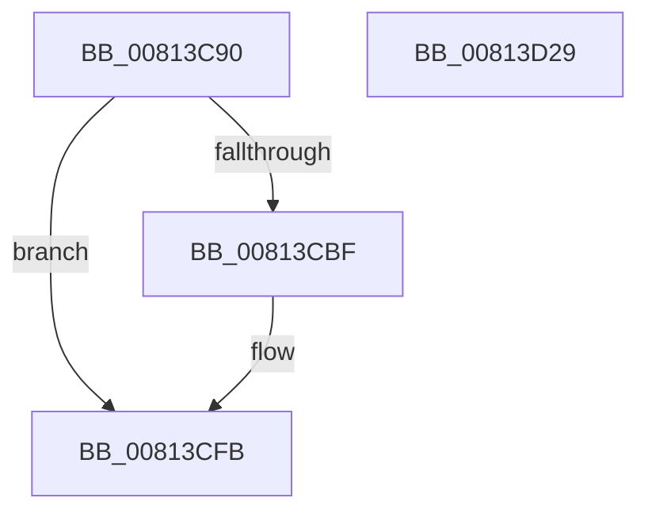

# SdbpCheckBackupApplicationAttributes

- RVA: `0x00813C90`–`0x00813D2A` (길이 `154` bytes)
- VA: `0x0000000140813C90`
- 실행 섹션: `PAGE`
- PDB 이름 있음: `예`; PDB Function 태그: `아니요`
- unwind 정보 RVA: `0x000CC43C`
- 디코드: `39`개 명령, `154/154` bytes 표시
- 미해석 바이트: `0` (있으면 어셈블리에 `.byte`로 보존)

> 이 문서는 커널 이미지의 기계어와 PDB 기호를 분석해 생성했습니다. 4번과 5번은 함수 원형과 자료형을 바이너리 사용 방식에서 추정한 C 해석이며 원본 소스 복구 결과는 아닙니다.

## 1. Dependencies

- 직접 호출 지점: **3**; 고유 호출 대상: **3**
- 직접 호출자로 확인된 함수: **0**
- RIP 상대 이미지 참조: **2**

### Outgoing calls
- `0x00813CE2` → [wil_details_FeatureReporting_ReportUsageToService](../../text/53/wil_details_FeatureReporting_ReportUsageToService_function_0053E6E4.md) (function, `0x0053E6E4`)
- `0x00813CF6` → [wil_details_FeatureStateCache_TryEnableDeviceUsageFastPath](../../text/53/wil_details_FeatureStateCache_TryEnableDeviceUsageFastPath_function_0053E774.md) (function, `0x0053E774`)
- `0x00813D0F` → [SdbpCheckApplicationTypeAttributes](../../text/69/SdbpCheckApplicationTypeAttributes_function_0069C93C.md) (function, `0x0069C93C`)

### Direct callers
- 이 함수 시작 RVA로 연결되는 직접 call은 확인되지 않았습니다. 간접 호출은 완전히 역산할 수 없습니다.

### Static image references
- `0x00813CB0` → RVA `0x00FC4E40` (`.data`; read)
- `0x00813CD3` → RVA `0x000E05A8` (`.rdata`; read)

## 2. Other-region calls and transfers

- 다른 실행 섹션으로 향하는 call: **3**
  - `0x00813CE2` → [wil_details_FeatureReporting_ReportUsageToService](../../text/53/wil_details_FeatureReporting_ReportUsageToService_function_0053E6E4.md) (`PAGE` → `.text`)
  - `0x00813CF6` → [wil_details_FeatureStateCache_TryEnableDeviceUsageFastPath](../../text/53/wil_details_FeatureStateCache_TryEnableDeviceUsageFastPath_function_0053E774.md) (`PAGE` → `.text`)
  - `0x00813D0F` → [SdbpCheckApplicationTypeAttributes](../../text/69/SdbpCheckApplicationTypeAttributes_function_0069C93C.md) (`PAGE` → `.text`)
- 별도 외부 분기/꼬리 이동을 확인하지 못했습니다.

## 3. Assembly (complete function range)

```asm
00813C90  48 89 5C 24 08                  mov qword ptr [rsp + 8], rbx
00813C95  48 89 6C 24 10                  mov qword ptr [rsp + 0x10], rbp
00813C9A  57                              push rdi
00813C9B  48 83 EC 30                     sub rsp, 0x30
00813C9F  49 8B D8                        mov rbx, r8
00813CA2  48 8B F9                        mov rdi, rcx
00813CA5  48 83 64 24 20 00               and qword ptr [rsp + 0x20], 0
00813CAB  BD 01 00 00 00                  mov ebp, 1
00813CB0  8B 15 8A 11 7B 00               mov edx, dword ptr [rip + 0x7b118a]
00813CB6  89 54 24 20                     mov dword ptr [rsp + 0x20], edx
00813CBA  F6 C2 10                        test dl, 0x10
00813CBD  75 3C                           jne 0x140813cfb
00813CBF  48 8B 44 24 20                  mov rax, qword ptr [rsp + 0x20]
00813CC4  44 8D 45 02                     lea r8d, [rbp + 2]
00813CC8  0B D5                           or edx, ebp
00813CCA  48 89 44 24 20                  mov qword ptr [rsp + 0x20], rax
00813CCF  89 54 24 20                     mov dword ptr [rsp + 0x20], edx
00813CD3  48 8D 0D CE C8 8C FF            lea rcx, [rip - 0x733732]
00813CDA  48 8B 54 24 20                  mov rdx, qword ptr [rsp + 0x20]
00813CDF  44 8B CD                        mov r9d, ebp
00813CE2  E8 FD A9 D2 FF                  call 0x14053e6e4
00813CE7  48 8B 4C 24 20                  mov rcx, qword ptr [rsp + 0x20]
00813CEC  4C 8D 05 B5 C8 8C FF            lea r8, [rip - 0x73374b]
00813CF3  8D 55 02                        lea edx, [rbp + 2]
00813CF6  E8 79 AA D2 FF                  call 0x14053e774
00813CFB  48 8B 44 24 68                  mov rax, qword ptr [rsp + 0x68]
00813D00  48 8B D3                        mov rdx, rbx
00813D03  44 8B 44 24 60                  mov r8d, dword ptr [rsp + 0x60]
00813D08  48 8B CF                        mov rcx, rdi
00813D0B  4C 8B 48 60                     mov r9, qword ptr [rax + 0x60]
00813D0F  E8 28 8C E8 FF                  call 0x14069c93c
00813D14  85 C0                           test eax, eax
00813D16  0F 45 C5                        cmovne eax, ebp
00813D19  48 8B 5C 24 40                  mov rbx, qword ptr [rsp + 0x40]
00813D1E  48 8B 6C 24 48                  mov rbp, qword ptr [rsp + 0x48]
00813D23  48 83 C4 30                     add rsp, 0x30
00813D27  5F                              pop rdi
00813D28  C3                              ret
00813D29  CC                              int3
```

## 4. C-style interpretation (structured pseudocode)

```c
__int64 __fastcall SdbpCheckBackupApplicationAttributes(__int64 a1, __int64 a2, __int64 a3, __int64 a4, unsigned int a5, __int64 a6)
{
    __int64 result;
    __int64 v_rsp;
    unsigned __int64 v_stack_m18;
    unsigned __int64 v_stack_p10;
    unsigned __int64 v_stack_p8;

    v_stack_p8 = v_rbx;
    v_stack_p10 = v_rbp;
    v_rsp = (v_rsp) - (48);
    v_stack_m18 = (unsigned int)((unsigned int)(*(unsigned int *)(v_rip + 8065418)));
    if ((((unsigned __int8)((unsigned int)(*(unsigned int *)(v_rip + 8065418)))) & (16)) == 0) {
        result = v_stack_m18;
        a3 = 1 + 2;
        a2 = (unsigned int)(((unsigned int)(*(unsigned int *)(v_rip + 8065418))) | (1));
        v_stack_m18 = result;
        v_stack_m18 = (unsigned int)(a2);
        a1 = v_rip - 7550770;
        a2 = v_stack_m18;
        a4 = 1;
        result = wil_details_FeatureReporting_ReportUsageToService(a1, a2, a3, a4);
        a1 = v_stack_m18;
        a3 = v_rip - 7550795;
        a2 = 1 + 2;
        result = wil_details_FeatureStateCache_TryEnableDeviceUsageFastPath(a1, a2, a3, a4);
    }
    result = SdbpCheckApplicationTypeAttributes(a1, a3, (unsigned int)(a5), *(unsigned __int64 *)(a6 + 96));
    if ((unsigned int)(result) != 0) { result = 1; }
    v_rsp = (v_rsp) + (48);
    return result;
}
```

## 5. (Beta) C Style

```c
int64_t SdbpCheckBackupApplicationAttributes(int64_t Arg1, int64_t Arg2, int64_t Arg3, int64_t Arg4, uint32_t Arg5, void *Arg6)
{
    uint8_t *arg6 = (uint8_t *)Arg6;

    int64_t result;
    int64_t local_rsp;
    uint64_t v_stack_m18;
    uint64_t v_stack_p10;
    uint64_t v_stack_p8;

    v_stack_p8 = local_rbx;
    v_stack_p10 = local_rbp;
    local_rsp = (local_rsp) - (48);
    v_stack_m18 = (uint32_t)((uint32_t)(*(uint32_t *)(v_rip + 0x7B118A)));
    if ((((uint8_t)((uint32_t)(*(uint32_t *)(v_rip + 0x7B118A)))) & (16)) == 0) {
        result = v_stack_m18;
        Arg3 = 1 + 2;
        Arg2 = (uint32_t)(((uint32_t)(*(uint32_t *)(v_rip + 0x7B118A))) | (1));
        v_stack_m18 = result;
        v_stack_m18 = (uint32_t)(Arg2);
        Arg1 = v_rip - 7550770;
        Arg2 = v_stack_m18;
        Arg4 = 1;
        result = wil_details_FeatureReporting_ReportUsageToService(Arg1, Arg2, Arg3, Arg4);
        Arg1 = v_stack_m18;
        Arg3 = v_rip - 7550795;
        Arg2 = 1 + 2;
        result = wil_details_FeatureStateCache_TryEnableDeviceUsageFastPath(Arg1, Arg2, Arg3, Arg4);
    }
    result = SdbpCheckApplicationTypeAttributes(Arg1, Arg3, (uint32_t)(Arg5), *(uint64_t *)(arg6 + 0x60));
    if ((uint32_t)(result) != 0) { result = 1; }
    local_rsp = (local_rsp) + (48);
    return result;
}
```

### 관측된 메모리 오프셋

구조체 형식이 확인되지 않은 접근은 인자 기준의 오프셋으로만 기록했습니다.

| 기준 인자 | 오프셋 표현 | 폭 (bit) | 접근 |
|---|---:|---:|---|
| `Arg6` | `+ 0x60` | `64` | `R` |

## 6. Execution-region graph

[열기: 2D/3D 그래프와 함수 탐색 컨트롤 패널](../../../control-panel.html?section=page&rva=0x00813C90&view=graph)

- 2D 그래프는 위에서 아래로 흐르고, 3D 그래프는 빈 공간을 드래그해 회전합니다. Shift+드래그는 이동, 휠은 확대·축소, 함수 노드 선택은 대상 보고서 이동입니다.

### Static fallback


