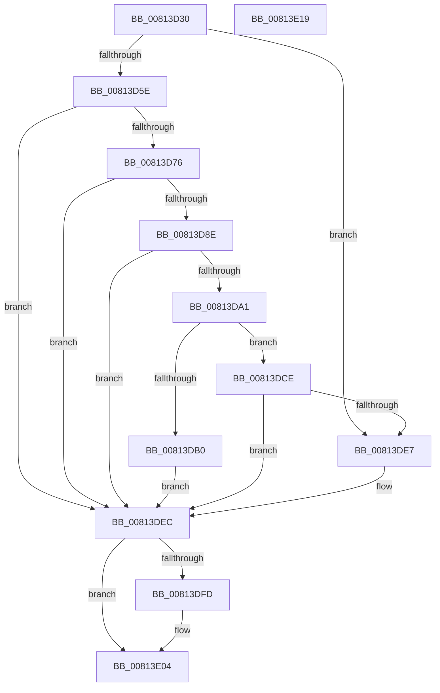

# SdbpCheckContainment

- RVA: `0x00813D30`–`0x00813E1A` (길이 `234` bytes)
- VA: `0x0000000140813D30`
- 실행 섹션: `PAGE`
- PDB 이름 있음: `예`; PDB Function 태그: `아니요`
- unwind 정보 RVA: `0x000CC304`
- 디코드: `70`개 명령, `234/234` bytes 표시
- 미해석 바이트: `0` (있으면 어셈블리에 `.byte`로 보존)

> 이 문서는 커널 이미지의 기계어와 PDB 기호를 분석해 생성했습니다. 4번과 5번은 함수 원형과 자료형을 바이너리 사용 방식에서 추정한 C 해석이며 원본 소스 복구 결과는 아닙니다.

## 1. Dependencies

- 직접 호출 지점: **7**; 고유 호출 대상: **6**
- 직접 호출자로 확인된 함수: **0**
- RIP 상대 이미지 참조: **2**

### Outgoing calls
- `0x00813D51` → [Feature_CompatMatchingContainment__private_IsEnabledDeviceUsageNoInline](../../text/69/Feature_CompatMatchingContainment__private_IsEnabledDeviceUsageNoInline_function_0069C060.md) (function, `0x0069C060`)
- `0x00813D6B` → [SdbFindFirstTag](../95/SdbFindFirstTag_function_0095E34C.md) (function, `0x0095E34C`)
- `0x00813D83` → [SdbFindFirstTag](../95/SdbFindFirstTag_function_0095E34C.md) (function, `0x0095E34C`)
- `0x00813D96` → [SdbReadDWORDTag](../95/SdbReadDWORDTag_function_0095D408.md) (function, `0x0095D408`)
- `0x00813DA6` → [SdbGetStringTagPtr](../95/SdbGetStringTagPtr_function_0095DDA8.md) (function, `0x0095DDA8`)
- `0x00813DC7` → [AslLogCallPrintf](../95/AslLogCallPrintf_function_0095E4EC.md) (function, `0x0095E4EC`)
- `0x00813DDE` → [SdbpGetVelocityState](SdbpGetVelocityState_function_00816088.md) (function, `0x00816088`)

### Direct callers
- 이 함수 시작 RVA로 연결되는 직접 call은 확인되지 않았습니다. 간접 호출은 완전히 역산할 수 없습니다.

### Static image references
- `0x00813DB0` → RVA `0x0003C7D8` (`.rdata`; read)
- `0x00813DBD` → RVA `0x0003C7C0` (`.rdata`; read)

## 2. Other-region calls and transfers

- 다른 실행 섹션으로 향하는 call: **1**
  - `0x00813D51` → [Feature_CompatMatchingContainment__private_IsEnabledDeviceUsageNoInline](../../text/69/Feature_CompatMatchingContainment__private_IsEnabledDeviceUsageNoInline_function_0069C060.md) (`PAGE` → `.text`)
- 별도 외부 분기/꼬리 이동을 확인하지 못했습니다.

## 3. Assembly (complete function range)

```asm
00813D30  48 8B C4                        mov rax, rsp
00813D33  48 89 58 10                     mov qword ptr [rax + 0x10], rbx
00813D37  48 89 68 18                     mov qword ptr [rax + 0x18], rbp
00813D3B  56                              push rsi
00813D3C  57                              push rdi
00813D3D  41 56                           push r14
00813D3F  48 83 EC 30                     sub rsp, 0x30
00813D43  33 FF                           xor edi, edi
00813D45  49 8B D8                        mov rbx, r8
00813D48  21 78 08                        and dword ptr [rax + 8], edi
00813D4B  4C 8B F1                        mov r14, rcx
00813D4E  21 78 D8                        and dword ptr [rax - 0x28], edi
00813D51  E8 0A 83 E8 FF                  call 0x14069c060
00813D56  85 C0                           test eax, eax
00813D58  0F 84 89 00 00 00               je 0x140813de7
00813D5E  8B 54 24 70                     mov edx, dword ptr [rsp + 0x70]
00813D62  41 B8 64 40 00 00               mov r8d, 0x4064
00813D68  48 8B CB                        mov rcx, rbx
00813D6B  E8 DC A5 14 00                  call 0x14095e34c
00813D70  8B F0                           mov esi, eax
00813D72  85 C0                           test eax, eax
00813D74  74 76                           je 0x140813dec
00813D76  8B 54 24 70                     mov edx, dword ptr [rsp + 0x70]
00813D7A  41 B8 49 60 00 00               mov r8d, 0x6049
00813D80  48 8B CB                        mov rcx, rbx
00813D83  E8 C4 A5 14 00                  call 0x14095e34c
00813D88  8B E8                           mov ebp, eax
00813D8A  85 C0                           test eax, eax
00813D8C  74 5E                           je 0x140813dec
00813D8E  45 33 C0                        xor r8d, r8d
00813D91  8B D6                           mov edx, esi
00813D93  48 8B CB                        mov rcx, rbx
00813D96  E8 6D 96 14 00                  call 0x14095d408
00813D9B  8B F0                           mov esi, eax
00813D9D  85 C0                           test eax, eax
00813D9F  74 4B                           je 0x140813dec
00813DA1  8B D5                           mov edx, ebp
00813DA3  48 8B CB                        mov rcx, rbx
00813DA6  E8 FD 9F 14 00                  call 0x14095dda8
00813DAB  48 85 C0                        test rax, rax
00813DAE  75 1E                           jne 0x140813dce
00813DB0  4C 8D 0D 21 8A 82 FF            lea r9, [rip - 0x7d75df]
00813DB7  41 B8 23 0B 00 00               mov r8d, 0xb23
00813DBD  48 8D 15 FC 89 82 FF            lea rdx, [rip - 0x7d7604]
00813DC4  8D 4F 01                        lea ecx, [rdi + 1]
00813DC7  E8 20 A7 14 00                  call 0x14095e4ec
00813DCC  EB 1E                           jmp 0x140813dec
00813DCE  44 8B CE                        mov r9d, esi
00813DD1  48 8D 54 24 50                  lea rdx, [rsp + 0x50]
00813DD6  4C 8B C0                        mov r8, rax
00813DD9  48 8D 4C 24 20                  lea rcx, [rsp + 0x20]
00813DDE  E8 A5 22 00 00                  call 0x140816088
00813DE3  85 C0                           test eax, eax
00813DE5  74 05                           je 0x140813dec
00813DE7  BF 01 00 00 00                  mov edi, 1
00813DEC  8B 4C 24 50                     mov ecx, dword ptr [rsp + 0x50]
00813DF0  41 89 0E                        mov dword ptr [r14], ecx
00813DF3  48 8B 4C 24 78                  mov rcx, qword ptr [rsp + 0x78]
00813DF8  48 85 C9                        test rcx, rcx
00813DFB  74 07                           je 0x140813e04
00813DFD  C7 41 50 01 00 00 00            mov dword ptr [rcx + 0x50], 1
00813E04  48 8B 5C 24 58                  mov rbx, qword ptr [rsp + 0x58]
00813E09  8B C7                           mov eax, edi
00813E0B  48 8B 6C 24 60                  mov rbp, qword ptr [rsp + 0x60]
00813E10  48 83 C4 30                     add rsp, 0x30
00813E14  41 5E                           pop r14
00813E16  5F                              pop rdi
00813E17  5E                              pop rsi
00813E18  C3                              ret
00813E19  CC                              int3
```

## 4. C-style interpretation (structured pseudocode)

```c
__int64 __fastcall SdbpCheckContainment(__int64 a1, __int64 a2, __int64 a3, __int64 a4, unsigned int a5, __int64 a6)
{
    __int64 result;
    __int64 v_rdi;
    __int64 v_rsp;
    unsigned __int64 v_stack_m28;
    unsigned __int64 v_stack_p10;
    unsigned __int64 v_stack_p18;
    unsigned __int64 v_stack_p8;

    *(unsigned __int64 *)(v_rsp + 16) = v_rbx;
    *(unsigned __int64 *)(v_rsp + 24) = v_rbp;
    v_rsp = (v_rsp) - (48);
    v_rdi = 0;
    result = Feature_CompatMatchingContainment__private_IsEnabledDeviceUsageNoInline(a1, a2, a3, a4);
    if ((unsigned int)(result) == 0) goto loc_00813DE7;
    result = SdbFindFirstTag(a3, (unsigned int)(a5), (unsigned int)(0x4064ULL), a4);
    if ((unsigned int)(result) == 0) goto loc_00813DEC;
    result = SdbFindFirstTag(a3, (unsigned int)(a5), (unsigned int)(0x6049ULL), a4);
    if ((unsigned int)(result) == 0) goto loc_00813DEC;
    a3 = 0;
    result = SdbReadDWORDTag(0, (unsigned int)((unsigned int)((unsigned int)((unsigned int)(result)))), a3, a4);
    if ((unsigned int)(result) == 0) goto loc_00813DEC;
    result = SdbGetStringTagPtr(0, (unsigned int)((unsigned int)((unsigned int)((unsigned int)(result)))), a3, a4);
    if (result != 0) goto loc_00813DCE;
    result = AslLogCallPrintf(v_rdi + 1, v_rip - 8222212, (unsigned int)(0xB23ULL), v_rip - 8222175);
    goto loc_00813DEC;
loc_00813DCE:
    result = SdbpGetVelocityState(v_stack_m28, v_stack_p8, result, (unsigned int)((unsigned int)((unsigned int)((unsigned int)(result)))));
    if ((unsigned int)(result) != 0) {
        v_rdi = 1;
    }
    *(unsigned int *)(a1) = (unsigned int)((unsigned int)(v_stack_p8));
    if (a6 != 0) {
        *(unsigned int *)(a6 + 80) = 1;
    }
    v_rsp = (v_rsp) + (48);
    return (unsigned int)((unsigned int)(v_rdi));
}
```

## 5. (Beta) C Style

```c
int64_t SdbpCheckContainment(void *Arg1, int64_t Arg2, int64_t Arg3, int64_t Arg4, uint32_t Arg5, int64_t Arg6)
{
    uint8_t *arg1 = (uint8_t *)Arg1;

    int64_t result;
    int64_t local_rdi;
    int64_t local_rsp;
    uint64_t v_stack_m28;
    uint64_t v_stack_p10;
    uint64_t v_stack_p18;
    uint64_t v_stack_p8;

    *(uint64_t *)(local_rsp + 0x10) = local_rbx;
    *(uint64_t *)(local_rsp + 0x18) = local_rbp;
    local_rsp = (local_rsp) - (48);
    local_rdi = 0;
    result = Feature_CompatMatchingContainment__private_IsEnabledDeviceUsageNoInline(Arg1, Arg2, Arg3, Arg4);
    if ((uint32_t)(result) == 0) goto loc_00813DE7;
    result = SdbFindFirstTag(Arg3, (uint32_t)(Arg5), (uint32_t)(0x4064ULL), Arg4);
    if ((uint32_t)(result) == 0) goto loc_00813DEC;
    result = SdbFindFirstTag(Arg3, (uint32_t)(Arg5), (uint32_t)(0x6049ULL), Arg4);
    if ((uint32_t)(result) == 0) goto loc_00813DEC;
    Arg3 = 0;
    result = SdbReadDWORDTag(0, (uint32_t)((uint32_t)((uint32_t)((uint32_t)(result)))), Arg3, Arg4);
    if ((uint32_t)(result) == 0) goto loc_00813DEC;
    result = SdbGetStringTagPtr(0, (uint32_t)((uint32_t)((uint32_t)((uint32_t)(result)))), Arg3, Arg4);
    if (result != 0) goto loc_00813DCE;
    result = AslLogCallPrintf(local_rdi + 1, v_rip - 8222212, (uint32_t)(0xB23ULL), v_rip - 8222175);
    goto loc_00813DEC;
loc_00813DCE:
    result = SdbpGetVelocityState(v_stack_m28, v_stack_p8, result, (uint32_t)((uint32_t)((uint32_t)((uint32_t)(result)))));
    if ((uint32_t)(result) != 0) {
        local_rdi = 1;
    }
    *(uint32_t *)(arg1) = (uint32_t)((uint32_t)(v_stack_p8));
    if (Arg6 != 0) {
        *(uint32_t *)(Arg6 + 0x50) = 1;
    }
    local_rsp = (local_rsp) + (48);
    return (uint32_t)((uint32_t)(local_rdi));
}
```

### 관측된 메모리 오프셋

구조체 형식이 확인되지 않은 접근은 인자 기준의 오프셋으로만 기록했습니다.

| 기준 인자 | 오프셋 표현 | 폭 (bit) | 접근 |
|---|---:|---:|---|
| `Arg1` | `+ 0x0` | `32` | `W` |

## 6. Execution-region graph

[열기: 2D/3D 그래프와 함수 탐색 컨트롤 패널](../../../control-panel.html?section=page&rva=0x00813D30&view=graph)

- 2D 그래프는 위에서 아래로 흐르고, 3D 그래프는 빈 공간을 드래그해 회전합니다. Shift+드래그는 이동, 휠은 확대·축소, 함수 노드 선택은 대상 보고서 이동입니다.

### Static fallback


