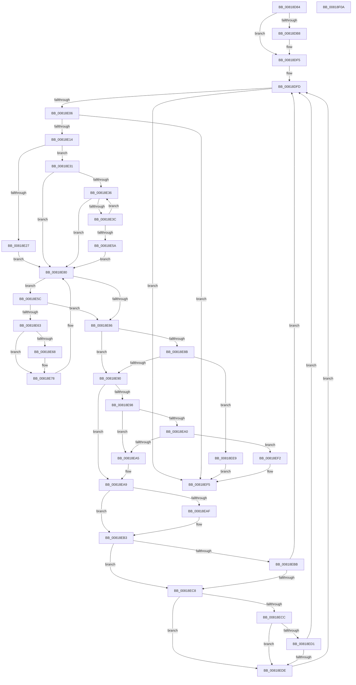

# SdbpCheckFromStringVersion

- RVA: `0x00818D84`–`0x00818F0B` (길이 `391` bytes)
- VA: `0x0000000140818D84`
- 실행 섹션: `PAGE`
- PDB 이름 있음: `예`; PDB Function 태그: `아니요`
- unwind 정보 RVA: `0x000701D4`
- 디코드: `116`개 명령, `391/391` bytes 표시
- 미해석 바이트: `0` (있으면 어셈블리에 `.byte`로 보존)

> 이 문서는 커널 이미지의 기계어와 PDB 기호를 분석해 생성했습니다. 4번과 5번은 함수 원형과 자료형을 바이너리 사용 방식에서 추정한 C 해석이며 원본 소스 복구 결과는 아닙니다.

## 1. Dependencies

- 직접 호출 지점: **2**; 고유 호출 대상: **2**
- 직접 호출자로 확인된 함수: **2**
- RIP 상대 이미지 참조: **2**

### Outgoing calls
- `0x00818DDD` → [wil_details_FeatureReporting_ReportUsageToService](../../text/53/wil_details_FeatureReporting_ReportUsageToService_function_0053E6E4.md) (function, `0x0053E6E4`)
- `0x00818DF0` → [wil_details_FeatureStateCache_TryEnableDeviceUsageFastPath](../../text/53/wil_details_FeatureStateCache_TryEnableDeviceUsageFastPath_function_0053E774.md) (function, `0x0053E774`)

### Direct callers
- [SdbpCheckApplicationTypeAttributes](../../text/69/SdbpCheckApplicationTypeAttributes_function_0069C93C.md) at `0x0069CC14`
- [SdbpCheckAttribute](SdbpCheckAttribute_function_00818A84.md) at `0x00818CBB`

### Static image references
- `0x00818DA1` → RVA `0x00FC4E40` (`.data`; read)
- `0x00818DD3` → RVA `0x000E05A8` (`.rdata`; read)

## 2. Other-region calls and transfers

- 다른 실행 섹션으로 향하는 call: **2**
  - `0x00818DDD` → [wil_details_FeatureReporting_ReportUsageToService](../../text/53/wil_details_FeatureReporting_ReportUsageToService_function_0053E6E4.md) (`PAGE` → `.text`)
  - `0x00818DF0` → [wil_details_FeatureStateCache_TryEnableDeviceUsageFastPath](../../text/53/wil_details_FeatureStateCache_TryEnableDeviceUsageFastPath_function_0053E774.md) (`PAGE` → `.text`)
- 별도 외부 분기/꼬리 이동을 확인하지 못했습니다.

## 3. Assembly (complete function range)

```asm
00818D84  48 89 5C 24 10                  mov qword ptr [rsp + 0x10], rbx
00818D89  48 89 6C 24 18                  mov qword ptr [rsp + 0x18], rbp
00818D8E  56                              push rsi
00818D8F  57                              push rdi
00818D90  41 56                           push r14
00818D92  48 83 EC 20                     sub rsp, 0x20
00818D96  48 8B DA                        mov rbx, rdx
00818D99  48 8B F9                        mov rdi, rcx
00818D9C  BE 01 00 00 00                  mov esi, 1
00818DA1  8B 0D 99 C0 7A 00               mov ecx, dword ptr [rip + 0x7ac099]
00818DA7  45 33 F6                        xor r14d, r14d
00818DAA  4C 89 74 24 40                  mov qword ptr [rsp + 0x40], r14
00818DAF  89 4C 24 40                     mov dword ptr [rsp + 0x40], ecx
00818DB3  F6 C1 10                        test cl, 0x10
00818DB6  75 3D                           jne 0x140818df5
00818DB8  48 8B 44 24 40                  mov rax, qword ptr [rsp + 0x40]
00818DBD  8D 6E 02                        lea ebp, [rsi + 2]
00818DC0  0B CE                           or ecx, esi
00818DC2  48 89 44 24 40                  mov qword ptr [rsp + 0x40], rax
00818DC7  89 4C 24 40                     mov dword ptr [rsp + 0x40], ecx
00818DCB  44 8B CE                        mov r9d, esi
00818DCE  48 8B 54 24 40                  mov rdx, qword ptr [rsp + 0x40]
00818DD3  48 8D 0D CE 77 8C FF            lea rcx, [rip - 0x738832]
00818DDA  44 8B C5                        mov r8d, ebp
00818DDD  E8 02 59 D2 FF                  call 0x14053e6e4
00818DE2  48 8B 4C 24 40                  mov rcx, qword ptr [rsp + 0x40]
00818DE7  4C 8D 05 BA 77 8C FF            lea r8, [rip - 0x738846]
00818DEE  8B D5                           mov edx, ebp
00818DF0  E8 7F 59 D2 FF                  call 0x14053e774
00818DF5  0F B7 17                        movzx edx, word ptr [rdi]
00818DF8  BD 30 00 00 00                  mov ebp, 0x30
00818DFD  66 85 D2                        test dx, dx
00818E00  0F 84 EF 00 00 00               je 0x140818ef5
00818E06  44 0F B7 03                     movzx r8d, word ptr [rbx]
00818E0A  66 45 85 C0                     test r8w, r8w
00818E0E  0F 84 E1 00 00 00               je 0x140818ef5
00818E14  B8 2A 00 00 00                  mov eax, 0x2a
00818E19  4D 8B D6                        mov r10, r14
00818E1C  4D 8B CE                        mov r9, r14
00818E1F  45 8B DE                        mov r11d, r14d
00818E22  66 3B C2                        cmp ax, dx
00818E25  75 0A                           jne 0x140818e31
00818E27  44 8D 58 D7                     lea r11d, [rax - 0x29]
00818E2B  48 83 C7 02                     add rdi, 2
00818E2F  EB 4F                           jmp 0x140818e80
00818E31  66 3B EA                        cmp bp, dx
00818E34  77 4A                           ja 0x140818e80
00818E36  66 83 FA 39                     cmp dx, 0x39
00818E3A  77 44                           ja 0x140818e80
00818E3C  0F B7 C2                        movzx eax, dx
00818E3F  4F 8D 14 92                     lea r10, [r10 + r10*4]
00818E43  48 83 C7 02                     add rdi, 2
00818E47  4D 8D 52 E8                     lea r10, [r10 - 0x18]
00818E4B  4E 8D 14 50                     lea r10, [rax + r10*2]
00818E4F  0F B7 07                        movzx eax, word ptr [rdi]
00818E52  0F B7 D0                        movzx edx, ax
00818E55  66 3B E8                        cmp bp, ax
00818E58  76 DC                           jbe 0x140818e36
00818E5A  EB 24                           jmp 0x140818e80
00818E5C  66 41 83 F8 39                  cmp r8w, 0x39
00818E61  77 23                           ja 0x140818e86
00818E63  45 85 DB                        test r11d, r11d
00818E66  75 10                           jne 0x140818e78
00818E68  4F 8D 0C 89                     lea r9, [r9 + r9*4]
00818E6C  41 0F B7 C0                     movzx eax, r8w
00818E70  4D 8D 49 E8                     lea r9, [r9 - 0x18]
00818E74  4E 8D 0C 48                     lea r9, [rax + r9*2]
00818E78  48 83 C3 02                     add rbx, 2
00818E7C  44 0F B7 03                     movzx r8d, word ptr [rbx]
00818E80  66 41 3B E8                     cmp bp, r8w
00818E84  76 D6                           jbe 0x140818e5c
00818E86  45 85 DB                        test r11d, r11d
00818E89  75 05                           jne 0x140818e90
00818E8B  4D 3B D1                        cmp r10, r9
00818E8E  75 59                           jne 0x140818ee9
00818E90  0F B7 07                        movzx eax, word ptr [rdi]
00818E93  66 85 C0                        test ax, ax
00818E96  74 11                           je 0x140818ea9
00818E98  0F B7 0B                        movzx ecx, word ptr [rbx]
00818E9B  66 85 C9                        test cx, cx
00818E9E  74 05                           je 0x140818ea5
00818EA0  66 3B C1                        cmp ax, cx
00818EA3  75 4D                           jne 0x140818ef2
00818EA5  48 83 C7 02                     add rdi, 2
00818EA9  66 44 39 33                     cmp word ptr [rbx], r14w
00818EAD  74 04                           je 0x140818eb3
00818EAF  48 83 C3 02                     add rbx, 2
00818EB3  0F B7 07                        movzx eax, word ptr [rdi]
00818EB6  66 85 C0                        test ax, ax
00818EB9  75 0D                           jne 0x140818ec8
00818EBB  41 8B D6                        mov edx, r14d
00818EBE  66 44 39 33                     cmp word ptr [rbx], r14w
00818EC2  0F 84 35 FF FF FF               je 0x140818dfd
00818EC8  85 F6                           test esi, esi
00818ECA  74 12                           je 0x140818ede
00818ECC  66 85 C0                        test ax, ax
00818ECF  75 0D                           jne 0x140818ede
00818ED1  41 0F B7 D6                     movzx edx, r14w
00818ED5  45 85 DB                        test r11d, r11d
00818ED8  0F 85 1F FF FF FF               jne 0x140818dfd
00818EDE  41 8B F6                        mov esi, r14d
00818EE1  0F B7 D0                        movzx edx, ax
00818EE4  E9 14 FF FF FF                  jmp 0x140818dfd
00818EE9  41 8B F6                        mov esi, r14d
00818EEC  40 0F 92 C6                     setb sil
00818EF0  EB 03                           jmp 0x140818ef5
00818EF2  41 8B F6                        mov esi, r14d
00818EF5  48 8B 5C 24 48                  mov rbx, qword ptr [rsp + 0x48]
00818EFA  8B C6                           mov eax, esi
00818EFC  48 8B 6C 24 50                  mov rbp, qword ptr [rsp + 0x50]
00818F01  48 83 C4 20                     add rsp, 0x20
00818F05  41 5E                           pop r14
00818F07  5F                              pop rdi
00818F08  5E                              pop rsi
00818F09  C3                              ret
00818F0A  CC                              int3
```

## 4. C-style interpretation (structured pseudocode)

```c
__int64 __fastcall SdbpCheckFromStringVersion(__int64 a1, __int64 a2)
{
    __int64 result;
    __int64 v_r14;
    __int64 v_rbp;
    __int64 v_rbx;
    __int64 v_rdi;
    __int64 v_rsi;
    __int64 v_rsp;
    unsigned __int64 v_stack_p10;
    unsigned __int64 v_stack_p18;
    unsigned __int64 v_stack_p8;

    v_stack_p10 = v_rbx;
    v_stack_p18 = v_rbp;
    v_rsp = (v_rsp) - (32);
    v_r14 = 0;
    v_stack_p8 = 0;
    v_stack_p8 = (unsigned int)((unsigned int)(*(unsigned int *)(v_rip + 8044697)));
    if ((((unsigned __int8)((unsigned int)(*(unsigned int *)(v_rip + 8044697)))) & (16)) == 0) {
        result = v_stack_p8;
        v_rbp = 1 + 2;
        a1 = (unsigned int)(((unsigned int)(*(unsigned int *)(v_rip + 8044697))) | (1));
        v_stack_p8 = result;
        v_stack_p8 = (unsigned int)(a1);
        a4 = 1;
        a2 = v_stack_p8;
        a1 = v_rip - 7571506;
        a3 = (unsigned int)(v_rbp);
        result = wil_details_FeatureReporting_ReportUsageToService(a1, a2, a3, a4);
        a1 = v_stack_p8;
        a3 = v_rip - 7571526;
        a2 = (unsigned int)(v_rbp);
        result = wil_details_FeatureStateCache_TryEnableDeviceUsageFastPath(a1, a2, a3, a4);
    }
loc_00818DFD:
    if ((unsigned __int16)(*(unsigned __int16 *)(a1)) == 0) goto loc_00818EF5;
    if ((unsigned __int16)(*(unsigned __int16 *)(a2)) == 0) goto loc_00818EF5;
    if (42 != ((unsigned __int16)(*(unsigned __int16 *)(a1)))) goto loc_00818E31;
    v_rdi = (a1) + (2);
    goto loc_00818E80;
loc_00818E31:
    if (48 > ((unsigned __int16)(*(unsigned __int16 *)(a1)))) goto loc_00818E80;
loc_00818E36:
    if (((unsigned __int16)(*(unsigned __int16 *)(a1))) > 57) goto loc_00818E80;
    v_rdi = (v_rdi) + (2);
    if (48 <= ((unsigned __int16)(*(unsigned __int16 *)(v_rdi)))) goto loc_00818E36;
    goto loc_00818E80;
loc_00818E5C:
    if (((unsigned __int16)(*(unsigned __int16 *)(a2))) > 57) goto loc_00818E86;
    result = *(unsigned __int16 *)(v_rdi);
    if ((unsigned int)(42 - 41) == 0) {
        a4 = 0 + 0 * 4;
        result = (unsigned __int16)(*(unsigned __int16 *)(a2));
        a4 = a4 - 24;
        a4 = result + a4 * 2;
    }
    v_rbx = (a2) + (2);
loc_00818E80:
    if (48 <= ((unsigned __int16)(*(unsigned __int16 *)(v_rbx)))) goto loc_00818E5C;
loc_00818E86:
    if ((unsigned int)(42 - 41) != 0) goto loc_00818E90;
    if (((unsigned __int16)(*(unsigned __int16 *)(a1)) + 0 + 0 * 4 - 24 * 2) != a4) goto loc_00818EE9;
loc_00818E90:
    if ((unsigned __int16)(*(unsigned __int16 *)(v_rdi)) == 0) goto loc_00818EA9;
    if ((unsigned __int16)(*(unsigned __int16 *)(v_rbx)) == 0) goto loc_00818EA5;
    if (((unsigned __int16)(*(unsigned __int16 *)(v_rdi))) != ((unsigned __int16)(*(unsigned __int16 *)(v_rbx)))) goto loc_00818EF2;
loc_00818EA5:
    v_rdi = (v_rdi) + (2);
loc_00818EA9:
    if ((*(unsigned __int16 *)(v_rbx)) != 0) {
        v_rbx = (v_rbx) + (2);
    }
    if ((unsigned __int16)(*(unsigned __int16 *)(v_rdi)) != 0) goto loc_00818EC8;
    if ((*(unsigned __int16 *)(v_rbx)) == 0) goto loc_00818DFD;
loc_00818EC8:
    if (1 == 0) goto loc_00818EDE;
    if ((unsigned __int16)(*(unsigned __int16 *)(v_rdi)) != 0) goto loc_00818EDE;
    if ((unsigned int)(42 - 41) != 0) goto loc_00818DFD;
loc_00818EDE:
    goto loc_00818DFD;
loc_00818EE9:
    v_rsi = (condition_is_below) ? 1 : 0;
    goto loc_00818EF5;
loc_00818EF2:
loc_00818EF5:
    v_rsp = (v_rsp) + (32);
    return 0;
}
```

## 5. (Beta) C Style

```c
int64_t SdbpCheckFromStringVersion(void *Arg1, void *Arg2)
{
    uint8_t *arg1 = (uint8_t *)Arg1;
    uint8_t *arg2 = (uint8_t *)Arg2;

    int64_t result;
    int64_t local_r14;
    int64_t local_rbp;
    int64_t local_rbx;
    int64_t local_rdi;
    int64_t local_rsi;
    int64_t local_rsp;
    uint64_t v_stack_p10;
    uint64_t v_stack_p18;
    uint64_t v_stack_p8;

    v_stack_p10 = local_rbx;
    v_stack_p18 = local_rbp;
    local_rsp = (local_rsp) - (32);
    local_r14 = 0;
    v_stack_p8 = 0;
    v_stack_p8 = (uint32_t)((uint32_t)(*(uint32_t *)(v_rip + 0x7AC099)));
    if ((((uint8_t)((uint32_t)(*(uint32_t *)(v_rip + 0x7AC099)))) & (16)) == 0) {
        result = v_stack_p8;
        local_rbp = 1 + 2;
        Arg1 = (uint32_t)(((uint32_t)(*(uint32_t *)(v_rip + 0x7AC099))) | (1));
        v_stack_p8 = result;
        v_stack_p8 = (uint32_t)(Arg1);
        a4 = 1;
        Arg2 = v_stack_p8;
        Arg1 = v_rip - 7571506;
        a3 = (uint32_t)(local_rbp);
        result = wil_details_FeatureReporting_ReportUsageToService(Arg1, Arg2, a3, a4);
        Arg1 = v_stack_p8;
        a3 = v_rip - 7571526;
        Arg2 = (uint32_t)(local_rbp);
        result = wil_details_FeatureStateCache_TryEnableDeviceUsageFastPath(Arg1, Arg2, a3, a4);
    }
loc_00818DFD:
    if ((uint16_t)(*(uint16_t *)(arg1)) == 0) goto loc_00818EF5;
    if ((uint16_t)(*(uint16_t *)(arg2)) == 0) goto loc_00818EF5;
    if (42 != ((uint16_t)(*(uint16_t *)(arg1)))) goto loc_00818E31;
    local_rdi = (Arg1) + (2);
    goto loc_00818E80;
loc_00818E31:
    if (48 > ((uint16_t)(*(uint16_t *)(arg1)))) goto loc_00818E80;
loc_00818E36:
    if (((uint16_t)(*(uint16_t *)(arg1))) > 57) goto loc_00818E80;
    local_rdi = (local_rdi) + (2);
    if (48 <= ((uint16_t)(*(uint16_t *)(local_rdi)))) goto loc_00818E36;
    goto loc_00818E80;
loc_00818E5C:
    if (((uint16_t)(*(uint16_t *)(arg2))) > 57) goto loc_00818E86;
    result = *(uint16_t *)(local_rdi);
    if ((uint32_t)(42 - 41) == 0) {
        a4 = 0 + 0 * 4;
        result = (uint16_t)(*(uint16_t *)(arg2));
        a4 = a4 - 24;
        a4 = result + a4 * 2;
    }
    local_rbx = (Arg2) + (2);
loc_00818E80:
    if (48 <= ((uint16_t)(*(uint16_t *)(local_rbx)))) goto loc_00818E5C;
loc_00818E86:
    if ((uint32_t)(42 - 41) != 0) goto loc_00818E90;
    if (((uint16_t)(*(uint16_t *)(arg1)) + 0 + 0 * 4 - 24 * 2) != a4) goto loc_00818EE9;
loc_00818E90:
    if ((uint16_t)(*(uint16_t *)(local_rdi)) == 0) goto loc_00818EA9;
    if ((uint16_t)(*(uint16_t *)(local_rbx)) == 0) goto loc_00818EA5;
    if (((uint16_t)(*(uint16_t *)(local_rdi))) != ((uint16_t)(*(uint16_t *)(local_rbx)))) goto loc_00818EF2;
loc_00818EA5:
    local_rdi = (local_rdi) + (2);
loc_00818EA9:
    if ((*(uint16_t *)(local_rbx)) != 0) {
        local_rbx = (local_rbx) + (2);
    }
    if ((uint16_t)(*(uint16_t *)(local_rdi)) != 0) goto loc_00818EC8;
    if ((*(uint16_t *)(local_rbx)) == 0) goto loc_00818DFD;
loc_00818EC8:
    if (1 == 0) goto loc_00818EDE;
    if ((uint16_t)(*(uint16_t *)(local_rdi)) != 0) goto loc_00818EDE;
    if ((uint32_t)(42 - 41) != 0) goto loc_00818DFD;
loc_00818EDE:
    goto loc_00818DFD;
loc_00818EE9:
    local_rsi = (condition_is_below) ? 1 : 0;
    goto loc_00818EF5;
loc_00818EF2:
loc_00818EF5:
    local_rsp = (local_rsp) + (32);
    return 0;
}
```

### 관측된 메모리 오프셋

구조체 형식이 확인되지 않은 접근은 인자 기준의 오프셋으로만 기록했습니다.

| 기준 인자 | 오프셋 표현 | 폭 (bit) | 접근 |
|---|---:|---:|---|
| `Arg1` | `+ 0x0` | `16` | `R` |
| `Arg2` | `+ 0x0` | `16` | `R` |

## 6. Execution-region graph

[열기: 2D/3D 그래프와 함수 탐색 컨트롤 패널](../../../control-panel.html?section=page&rva=0x00818D84&view=graph)

- 2D 그래프는 위에서 아래로 흐르고, 3D 그래프는 빈 공간을 드래그해 회전합니다. Shift+드래그는 이동, 휠은 확대·축소, 함수 노드 선택은 대상 보고서 이동입니다.

### Static fallback


