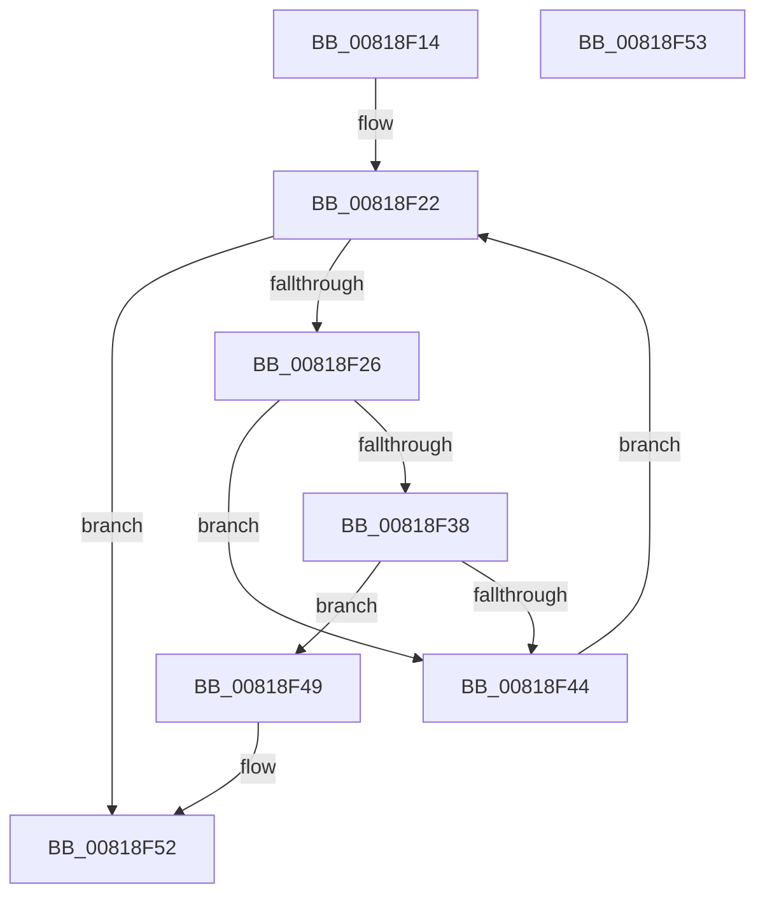

# SdbpCheckFromVersion

- RVA: `0x00818F14`–`0x00818F54` (길이 `64` bytes)
- VA: `0x0000000140818F14`
- 실행 섹션: `PAGE`
- PDB 이름 있음: `예`; PDB Function 태그: `아니요`
- unwind 정보 RVA: `0x000DB714`
- 디코드: `22`개 명령, `64/64` bytes 표시
- 미해석 바이트: `0` (있으면 어셈블리에 `.byte`로 보존)

> 이 문서는 커널 이미지의 기계어와 PDB 기호를 분석해 생성했습니다. 4번과 5번은 함수 원형과 자료형을 바이너리 사용 방식에서 추정한 C 해석이며 원본 소스 복구 결과는 아닙니다.

## 1. Dependencies

- 직접 호출 지점: **0**; 고유 호출 대상: **0**
- 직접 호출자로 확인된 함수: **3**
- RIP 상대 이미지 참조: **0**

### Outgoing calls
- 직접 디코드된 call 명령이 없습니다.

### Direct callers
- [SdbpCheckApplicationTypeAttributes](../../text/69/SdbpCheckApplicationTypeAttributes_function_0069C93C.md) at `0x0069CB6C`
- [SdbpCheckAttribute](SdbpCheckAttribute_function_00818A84.md) at `0x00818D5A`
- [SdbpMatchOsVersion](../A1/SdbpMatchOsVersion_function_00A18FC0.md) at `0x00A1908B`

### Static image references
- 디코드된 RIP-relative 메모리 참조가 없습니다.

## 2. Other-region calls and transfers

- 다른 실행 섹션으로 향하는 call: **0**
- 별도 외부 분기/꼬리 이동을 확인하지 못했습니다.

## 3. Assembly (complete function range)

```asm
00818F14  B8 01 00 00 00                  mov eax, 1
00818F19  4C 8B D1                        mov r10, rcx
00818F1C  4C 8B CA                        mov r9, rdx
00818F1F  8D 48 2F                        lea ecx, [rax + 0x2f]
00818F22  85 C9                           test ecx, ecx
00818F24  78 2C                           js 0x140818f52
00818F26  4D 8B C2                        mov r8, r10
00818F29  49 8B D1                        mov rdx, r9
00818F2C  49 D3 E8                        shr r8, cl
00818F2F  48 D3 EA                        shr rdx, cl
00818F32  66 44 3B C2                     cmp r8w, dx
00818F36  74 0C                           je 0x140818f44
00818F38  41 BB FF FF 00 00               mov r11d, 0xffff
00818F3E  66 45 3B C3                     cmp r8w, r11w
00818F42  75 05                           jne 0x140818f49
00818F44  83 E9 10                        sub ecx, 0x10
00818F47  EB D9                           jmp 0x140818f22
00818F49  33 C0                           xor eax, eax
00818F4B  66 44 3B C2                     cmp r8w, dx
00818F4F  0F 92 C0                        setb al
00818F52  C3                              ret
00818F53  CC                              int3
```

## 4. C-style interpretation (structured pseudocode)

```c
__int64 __fastcall SdbpCheckFromVersion(__int64 a1, __int64 a2)
{
    __int64 result;

loc_00818F22:
    if (sign_flag) goto loc_00818F52;
    a3 = (a1) >> ((unsigned __int8)(1 + 47));
    a2 = (a2) >> ((unsigned __int8)(1 + 47));
    if (((unsigned __int16)(a3)) == ((unsigned __int16)(a2))) goto loc_00818F44;
    if (((unsigned __int16)(a3)) != ((unsigned __int16)((unsigned int)(0xFFFFULL)))) goto loc_00818F49;
loc_00818F44:
    a1 = (unsigned int)((1 + 47) - (16));
    goto loc_00818F22;
loc_00818F49:
    result = 0;
    result = (((unsigned __int16)(a3)) < ((unsigned __int16)(a2))) ? 1 : 0;
loc_00818F52:
    return result;
}
```

## 5. (Beta) C Style

```c
int64_t SdbpCheckFromVersion(int64_t Arg1, int64_t Arg2)
{
    int64_t result;

loc_00818F22:
    if (sign_flag) goto loc_00818F52;
    a3 = (Arg1) >> ((uint8_t)(1 + 47));
    Arg2 = (Arg2) >> ((uint8_t)(1 + 47));
    if (((uint16_t)(a3)) == ((uint16_t)(Arg2))) goto loc_00818F44;
    if (((uint16_t)(a3)) != ((uint16_t)((uint32_t)(0xFFFFULL)))) goto loc_00818F49;
loc_00818F44:
    Arg1 = (uint32_t)((1 + 47) - (16));
    goto loc_00818F22;
loc_00818F49:
    result = 0;
    result = (((uint16_t)(a3)) < ((uint16_t)(Arg2))) ? 1 : 0;
loc_00818F52:
    return result;
}
```

## 6. Execution-region graph

[열기: 2D/3D 그래프와 함수 탐색 컨트롤 패널](../../../control-panel.html?section=page&rva=0x00818F14&view=graph)

- 2D 그래프는 위에서 아래로 흐르고, 3D 그래프는 빈 공간을 드래그해 회전합니다. Shift+드래그는 이동, 휠은 확대·축소, 함수 노드 선택은 대상 보고서 이동입니다.

### Static fallback


