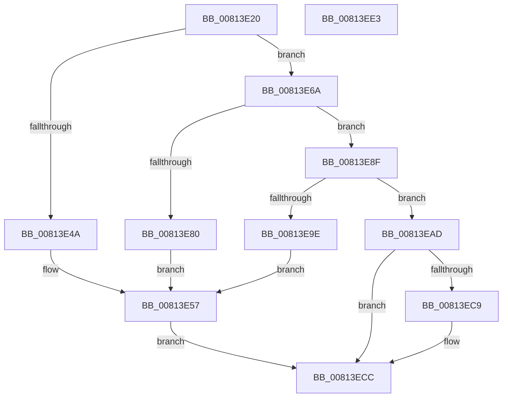

# SdbpCheckMatchingDevice

- RVA: `0x00813E20`–`0x00813EE4` (길이 `196` bytes)
- VA: `0x0000000140813E20`
- 실행 섹션: `PAGE`
- PDB 이름 있음: `예`; PDB Function 태그: `아니요`
- unwind 정보 RVA: `0x0005C954`
- 디코드: `52`개 명령, `196/196` bytes 표시
- 미해석 바이트: `0` (있으면 어셈블리에 `.byte`로 보존)

> 이 문서는 커널 이미지의 기계어와 PDB 기호를 분석해 생성했습니다. 4번과 5번은 함수 원형과 자료형을 바이너리 사용 방식에서 추정한 C 해석이며 원본 소스 복구 결과는 아닙니다.

## 1. Dependencies

- 직접 호출 지점: **4**; 고유 호출 대상: **4**
- 직접 호출자로 확인된 함수: **0**
- RIP 상대 이미지 참조: **4**

### Outgoing calls
- `0x00813E63` → [AslLogCallPrintf](../95/AslLogCallPrintf_function_0095E4EC.md) (function, `0x0095E4EC`)
- `0x00813E77` → [SdbFindFirstTag](../95/SdbFindFirstTag_function_0095E34C.md) (function, `0x0095E34C`)
- `0x00813E94` → [SdbGetStringTagPtr](../95/SdbGetStringTagPtr_function_0095DDA8.md) (function, `0x0095DDA8`)
- `0x00813EB3` → [guard_dispatch_icall](../../text/6B/guard_dispatch_icall_function_006BAAD0.md) (function, `0x006BAAD0`)

### Direct callers
- 이 함수 시작 RVA로 연결되는 직접 call은 확인되지 않았습니다. 간접 호출은 완전히 역산할 수 없습니다.

### Static image references
- `0x00813E4A` → RVA `0x0003C878` (`.rdata`; read)
- `0x00813E57` → RVA `0x0003C860` (`.rdata`; read)
- `0x00813E80` → RVA `0x0003C840` (`.rdata`; read)
- `0x00813E9E` → RVA `0x0003C828` (`.rdata`; read)

## 2. Other-region calls and transfers

- 다른 실행 섹션으로 향하는 call: **1**
  - `0x00813EB3` → [guard_dispatch_icall](../../text/6B/guard_dispatch_icall_function_006BAAD0.md) (`PAGE` → `.text`)
- 별도 외부 분기/꼬리 이동을 확인하지 못했습니다.

## 3. Assembly (complete function range)

```asm
00813E20  48 89 5C 24 08                  mov qword ptr [rsp + 8], rbx
00813E25  48 89 6C 24 10                  mov qword ptr [rsp + 0x10], rbp
00813E2A  48 89 74 24 18                  mov qword ptr [rsp + 0x18], rsi
00813E2F  57                              push rdi
00813E30  48 83 EC 20                     sub rsp, 0x20
00813E34  48 8B AA D0 06 00 00            mov rbp, qword ptr [rdx + 0x6d0]
00813E3B  33 DB                           xor ebx, ebx
00813E3D  21 19                           and dword ptr [rcx], ebx
00813E3F  49 8B F8                        mov rdi, r8
00813E42  48 8B F1                        mov rsi, rcx
00813E45  48 85 ED                        test rbp, rbp
00813E48  75 20                           jne 0x140813e6a
00813E4A  4C 8D 0D 27 8A 82 FF            lea r9, [rip - 0x7d75d9]
00813E51  41 B8 DB 08 00 00               mov r8d, 0x8db
00813E57  48 8D 15 02 8A 82 FF            lea rdx, [rip - 0x7d75fe]
00813E5E  B9 01 00 00 00                  mov ecx, 1
00813E63  E8 84 A6 14 00                  call 0x14095e4ec
00813E68  EB 62                           jmp 0x140813ecc
00813E6A  8B 54 24 50                     mov edx, dword ptr [rsp + 0x50]
00813E6E  41 B8 01 60 00 00               mov r8d, 0x6001
00813E74  48 8B CF                        mov rcx, rdi
00813E77  E8 D0 A4 14 00                  call 0x14095e34c
00813E7C  85 C0                           test eax, eax
00813E7E  75 0F                           jne 0x140813e8f
00813E80  4C 8D 0D B9 89 82 FF            lea r9, [rip - 0x7d7647]
00813E87  41 B8 E1 08 00 00               mov r8d, 0x8e1
00813E8D  EB C8                           jmp 0x140813e57
00813E8F  8B D0                           mov edx, eax
00813E91  48 8B CF                        mov rcx, rdi
00813E94  E8 0F 9F 14 00                  call 0x14095dda8
00813E99  48 85 C0                        test rax, rax
00813E9C  75 0F                           jne 0x140813ead
00813E9E  4C 8D 0D 83 89 82 FF            lea r9, [rip - 0x7d767d]
00813EA5  41 B8 E7 08 00 00               mov r8d, 0x8e7
00813EAB  EB AA                           jmp 0x140813e57
00813EAD  48 8B C8                        mov rcx, rax
00813EB0  48 8B C5                        mov rax, rbp
00813EB3  E8 18 6C EA FF                  call 0x1406baad0
00813EB8  48 8B 4C 24 58                  mov rcx, qword ptr [rsp + 0x58]
00813EBD  BB 01 00 00 00                  mov ebx, 1
00813EC2  89 06                           mov dword ptr [rsi], eax
00813EC4  48 85 C9                        test rcx, rcx
00813EC7  74 03                           je 0x140813ecc
00813EC9  89 59 50                        mov dword ptr [rcx + 0x50], ebx
00813ECC  48 8B 6C 24 38                  mov rbp, qword ptr [rsp + 0x38]
00813ED1  8B C3                           mov eax, ebx
00813ED3  48 8B 5C 24 30                  mov rbx, qword ptr [rsp + 0x30]
00813ED8  48 8B 74 24 40                  mov rsi, qword ptr [rsp + 0x40]
00813EDD  48 83 C4 20                     add rsp, 0x20
00813EE1  5F                              pop rdi
00813EE2  C3                              ret
00813EE3  CC                              int3
```

## 4. C-style interpretation (structured pseudocode)

```c
__int64 __fastcall SdbpCheckMatchingDevice(__int64 a1, __int64 a2, __int64 a3, __int64 a4, unsigned int a5, __int64 a6)
{
    __int64 result;
    __int64 v_rbx;
    __int64 v_rsp;
    unsigned __int64 v_stack_p10;
    unsigned __int64 v_stack_p18;
    unsigned __int64 v_stack_p8;

    v_stack_p8 = v_rbx;
    v_stack_p10 = v_rbp;
    v_stack_p18 = v_rsi;
    v_rsp = (v_rsp) - (32);
    v_rbx = 0;
    if (*(unsigned __int64 *)(a2 + 1744) != 0) goto loc_00813E6A;
loc_00813E57:
    result = AslLogCallPrintf(1, v_rip - 8222206, (unsigned int)(0x8DBULL), v_rip - 8222169);
    goto loc_00813ECC;
loc_00813E6A:
    result = SdbFindFirstTag(a3, (unsigned int)(a5), (unsigned int)(0x6001ULL), v_rip - 8222169);
    if ((unsigned int)(result) != 0) goto loc_00813E8F;
    goto loc_00813E57;
loc_00813E8F:
    result = SdbGetStringTagPtr(a3, (unsigned int)((unsigned int)(result)), (unsigned int)(0x8E1ULL), v_rip - 8222279);
    if (result != 0) goto loc_00813EAD;
    goto loc_00813E57;
loc_00813EAD:
    result = guard_dispatch_icall(result, (unsigned int)((unsigned int)(result)), (unsigned int)(0x8E7ULL), v_rip - 8222333);
    *(unsigned int *)(a1) = (unsigned int)(result);
    if (a6 != 0) {
        *(unsigned int *)(a6 + 80) = 1;
    }
    v_rsp = (v_rsp) + (32);
    return 1;
}
```

## 5. (Beta) C Style

```c
int64_t SdbpCheckMatchingDevice(void *Arg1, void *Arg2, int64_t Arg3, int64_t Arg4, uint32_t Arg5, int64_t Arg6)
{
    uint8_t *arg1 = (uint8_t *)Arg1;
    uint8_t *arg2 = (uint8_t *)Arg2;

    int64_t result;
    int64_t local_rbx;
    int64_t local_rsp;
    uint64_t v_stack_p10;
    uint64_t v_stack_p18;
    uint64_t v_stack_p8;

    v_stack_p8 = local_rbx;
    v_stack_p10 = local_rbp;
    v_stack_p18 = local_rsi;
    local_rsp = (local_rsp) - (32);
    local_rbx = 0;
    if (*(uint64_t *)(arg2 + 0x6D0) != 0) goto loc_00813E6A;
loc_00813E57:
    result = AslLogCallPrintf(1, v_rip - 8222206, (uint32_t)(0x8DBULL), v_rip - 8222169);
    goto loc_00813ECC;
loc_00813E6A:
    result = SdbFindFirstTag(Arg3, (uint32_t)(Arg5), (uint32_t)(0x6001ULL), v_rip - 8222169);
    if ((uint32_t)(result) != 0) goto loc_00813E8F;
    goto loc_00813E57;
loc_00813E8F:
    result = SdbGetStringTagPtr(Arg3, (uint32_t)((uint32_t)(result)), (uint32_t)(0x8E1ULL), v_rip - 8222279);
    if (result != 0) goto loc_00813EAD;
    goto loc_00813E57;
loc_00813EAD:
    result = guard_dispatch_icall(result, (uint32_t)((uint32_t)(result)), (uint32_t)(0x8E7ULL), v_rip - 8222333);
    *(uint32_t *)(arg1) = (uint32_t)(result);
    if (Arg6 != 0) {
        *(uint32_t *)(Arg6 + 0x50) = 1;
    }
    local_rsp = (local_rsp) + (32);
    return 1;
}
```

### 관측된 메모리 오프셋

구조체 형식이 확인되지 않은 접근은 인자 기준의 오프셋으로만 기록했습니다.

| 기준 인자 | 오프셋 표현 | 폭 (bit) | 접근 |
|---|---:|---:|---|
| `Arg1` | `+ 0x0` | `32` | `R/W` |
| `Arg1` | `+ 0x0` | `32` | `W` |
| `Arg2` | `+ 0x6D0` | `64` | `R` |

## 6. Execution-region graph

[열기: 2D/3D 그래프와 함수 탐색 컨트롤 패널](../../../control-panel.html?section=page&rva=0x00813E20&view=graph)

- 2D 그래프는 위에서 아래로 흐르고, 3D 그래프는 빈 공간을 드래그해 회전합니다. Shift+드래그는 이동, 휠은 확대·축소, 함수 노드 선택은 대상 보고서 이동입니다.

### Static fallback


