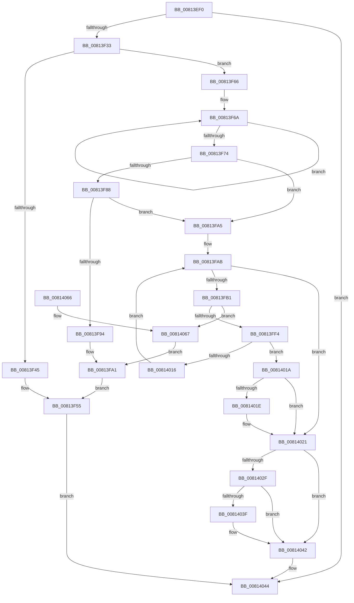

# SdbpCheckMatchingDir

- RVA: `0x00813EF0`–`0x00814079` (길이 `393` bytes)
- VA: `0x0000000140813EF0`
- 실행 섹션: `PAGE`
- PDB 이름 있음: `예`; PDB Function 태그: `아니요`
- unwind 정보 RVA: `0x000D998C`
- 디코드: `107`개 명령, `393/393` bytes 표시
- 미해석 바이트: `0` (있으면 어셈블리에 `.byte`로 보존)

> 이 문서는 커널 이미지의 기계어와 PDB 기호를 분석해 생성했습니다. 4번과 5번은 함수 원형과 자료형을 바이너리 사용 방식에서 추정한 C 해석이며 원본 소스 복구 결과는 아닙니다.

## 1. Dependencies

- 직접 호출 지점: **7**; 고유 호출 대상: **7**
- 직접 호출자로 확인된 함수: **0**
- RIP 상대 이미지 참조: **4**

### Outgoing calls
- `0x00813F26` → [SdbFindFirstTag](../95/SdbFindFirstTag_function_0095E34C.md) (function, `0x0095E34C`)
- `0x00813F38` → [SdbGetStringTagPtr](../95/SdbGetStringTagPtr_function_0095DDA8.md) (function, `0x0095DDA8`)
- `0x00813F5C` → [AslLogCallPrintf](../95/AslLogCallPrintf_function_0095E4EC.md) (function, `0x0095E4EC`)
- `0x00813F8B` → [SdbpInitializeSearchDBContext](SdbpInitializeSearchDBContext_function_00816210.md) (function, `0x00816210`)
- `0x00813FEB` → [SdbpResolveMatchingFile](SdbpResolveMatchingFile_function_00816A20.md) (function, `0x00816A20`)
- `0x00813FFC` → [AslDoesDirectoryExistNtPath](AslDoesDirectoryExistNtPath_function_00819B38.md) (function, `0x00819B38`)
- `0x0081400C` → [AslFree](../95/AslFree_function_0095B674.md) (function, `0x0095B674`)

### Direct callers
- 이 함수 시작 RVA로 연결되는 직접 call은 확인되지 않았습니다. 간접 호출은 완전히 역산할 수 없습니다.

### Static image references
- `0x00813F45` → RVA `0x0003C7D8` (`.rdata`; read)
- `0x00813F55` → RVA `0x0003C790` (`.rdata`; read)
- `0x00813F94` → RVA `0x0003C9C0` (`.rdata`; read)
- `0x00814067` → RVA `0x0003C770` (`.rdata`; read)

## 2. Other-region calls and transfers

- 다른 실행 섹션으로 향하는 call: **0**
- 별도 외부 분기/꼬리 이동을 확인하지 못했습니다.

## 3. Assembly (complete function range)

```asm
00813EF0  48 89 5C 24 18                  mov qword ptr [rsp + 0x18], rbx
00813EF5  48 89 54 24 10                  mov qword ptr [rsp + 0x10], rdx
00813EFA  48 89 4C 24 08                  mov qword ptr [rsp + 8], rcx
00813EFF  55                              push rbp
00813F00  56                              push rsi
00813F01  57                              push rdi
00813F02  41 54                           push r12
00813F04  41 55                           push r13
00813F06  41 56                           push r14
00813F08  41 57                           push r15
00813F0A  48 83 EC 30                     sub rsp, 0x30
00813F0E  8B 94 24 90 00 00 00            mov edx, dword ptr [rsp + 0x90]
00813F15  49 8B F8                        mov rdi, r8
00813F18  33 DB                           xor ebx, ebx
00813F1A  48 8B CF                        mov rcx, rdi
00813F1D  41 B8 01 60 00 00               mov r8d, 0x6001
00813F23  44 8B E3                        mov r12d, ebx
00813F26  E8 21 A4 14 00                  call 0x14095e34c
00813F2B  85 C0                           test eax, eax
00813F2D  0F 84 11 01 00 00               je 0x140814044
00813F33  8B D0                           mov edx, eax
00813F35  48 8B CF                        mov rcx, rdi
00813F38  E8 6B 9E 14 00                  call 0x14095dda8
00813F3D  4C 8B F8                        mov r15, rax
00813F40  48 85 C0                        test rax, rax
00813F43  75 21                           jne 0x140813f66
00813F45  4C 8D 0D 8C 88 82 FF            lea r9, [rip - 0x7d7774]
00813F4C  41 B8 FF 0B 00 00               mov r8d, 0xbff
00813F52  8D 4B 01                        lea ecx, [rbx + 1]
00813F55  48 8D 15 34 88 82 FF            lea rdx, [rip - 0x7d77cc]
00813F5C  E8 8B A5 14 00                  call 0x14095e4ec
00813F61  E9 DE 00 00 00                  jmp 0x140814044
00813F66  49 83 CE FF                     or r14, 0xffffffffffffffff
00813F6A  49 FF C6                        inc r14
00813F6D  66 42 39 1C 70                  cmp word ptr [rax + r14*2], bx
00813F72  75 F6                           jne 0x140813f6a
00813F74  48 8B B4 24 98 00 00 00         mov rsi, qword ptr [rsp + 0x98]
00813F7C  BF 01 00 00 00                  mov edi, 1
00813F81  8B 06                           mov eax, dword ptr [rsi]
00813F83  40 84 C7                        test dil, al
00813F86  75 1D                           jne 0x140813fa5
00813F88  48 8B CE                        mov rcx, rsi
00813F8B  E8 80 22 00 00                  call 0x140816210
00813F90  85 C0                           test eax, eax
00813F92  75 11                           jne 0x140813fa5
00813F94  4C 8D 0D 25 8A 82 FF            lea r9, [rip - 0x7d75db]
00813F9B  41 B8 0C 0C 00 00               mov r8d, 0xc0c
00813FA1  8B CF                           mov ecx, edi
00813FA3  EB B0                           jmp 0x140813f55
00813FA5  4C 8B 6E 48                     mov r13, qword ptr [rsi + 0x48]
00813FA9  8B EB                           mov ebp, ebx
00813FAB  41 3B 6D 00                     cmp ebp, dword ptr [r13]
00813FAF  7D 70                           jge 0x140814021
00813FB1  48 8D 8C 24 98 00 00 00         lea rcx, [rsp + 0x98]
00813FB9  48 63 C5                        movsxd rax, ebp
00813FBC  48 89 4C 24 28                  mov qword ptr [rsp + 0x28], rcx
00813FC1  45 8B CE                        mov r9d, r14d
00813FC4  48 8B 4C 24 78                  mov rcx, qword ptr [rsp + 0x78]
00813FC9  4D 8B C7                        mov r8, r15
00813FCC  48 8B D6                        mov rdx, rsi
00813FCF  48 89 9C 24 98 00 00 00         mov qword ptr [rsp + 0x98], rbx
00813FD7  48 8D 04 40                     lea rax, [rax + rax*2]
00813FDB  48 C1 E0 04                     shl rax, 4
00813FDF  48 83 C0 08                     add rax, 8
00813FE3  49 03 C5                        add rax, r13
00813FE6  48 89 44 24 20                  mov qword ptr [rsp + 0x20], rax
00813FEB  E8 30 2A 00 00                  call 0x140816a20
00813FF0  85 C0                           test eax, eax
00813FF2  74 73                           je 0x140814067
00813FF4  48 8B 8C 24 98 00 00 00         mov rcx, qword ptr [rsp + 0x98]
00813FFC  E8 37 5B 00 00                  call 0x140819b38
00814001  48 8B 94 24 98 00 00 00         mov rdx, qword ptr [rsp + 0x98]
00814009  44 8B E0                        mov r12d, eax
0081400C  E8 63 76 14 00                  call 0x14095b674
00814011  45 85 E4                        test r12d, r12d
00814014  75 04                           jne 0x14081401a
00814016  03 EF                           add ebp, edi
00814018  EB 91                           jmp 0x140813fab
0081401A  85 ED                           test ebp, ebp
0081401C  7E 03                           jle 0x140814021
0081401E  89 7E 50                        mov dword ptr [rsi + 0x50], edi
00814021  41 0F B7 07                     movzx eax, word ptr [r15]
00814025  66 83 E8 25                     sub ax, 0x25
00814029  66 83 F8 37                     cmp ax, 0x37
0081402D  77 13                           ja 0x140814042
0081402F  48 B9 01 02 00 00 00 00 80 00   movabs rcx, 0x80000000000201
00814039  48 0F A3 C1                     bt rcx, rax
0081403D  73 03                           jae 0x140814042
0081403F  89 7E 50                        mov dword ptr [rsi + 0x50], edi
00814042  8B DF                           mov ebx, edi
00814044  48 8B 44 24 70                  mov rax, qword ptr [rsp + 0x70]
00814049  44 89 20                        mov dword ptr [rax], r12d
0081404C  8B C3                           mov eax, ebx
0081404E  48 8B 9C 24 80 00 00 00         mov rbx, qword ptr [rsp + 0x80]
00814056  48 83 C4 30                     add rsp, 0x30
0081405A  41 5F                           pop r15
0081405C  41 5E                           pop r14
0081405E  41 5D                           pop r13
00814060  41 5C                           pop r12
00814062  5F                              pop rdi
00814063  5E                              pop rsi
00814064  5D                              pop rbp
00814065  C3                              ret
00814066  CC                              int3
00814067  4C 8D 0D 02 87 82 FF            lea r9, [rip - 0x7d78fe]
0081406E  41 B8 24 0C 00 00               mov r8d, 0xc24
00814074  E9 28 FF FF FF                  jmp 0x140813fa1
```

## 4. C-style interpretation (structured pseudocode)

```c
__int64 __fastcall SdbpCheckMatchingDir(__int64 a1, __int64 a2, __int64 a3, __int64 a4, unsigned int a5, __int64 a6)
{
    __int64 result;
    __int64 v_r14;
    __int64 v_rbp;
    __int64 v_rbx;
    __int64 v_rsp;
    unsigned __int64 v_stack_m40;
    unsigned __int64 v_stack_m48;
    unsigned __int64 v_stack_p10;
    unsigned __int64 v_stack_p18;
    unsigned __int64 v_stack_p30;
    unsigned __int64 v_stack_p8;

    v_stack_p18 = v_rbx;
    v_stack_p10 = a2;
    v_stack_p8 = a1;
    v_rsp = (v_rsp) - (48);
    v_rbx = 0;
    result = SdbFindFirstTag(a3, (unsigned int)(a5), (unsigned int)(0x6001ULL), a4);
    if ((unsigned int)(result) == 0) goto loc_00814044;
    result = SdbGetStringTagPtr(a3, (unsigned int)((unsigned int)(result)), (unsigned int)(0x6001ULL), a4);
    if (result != 0) goto loc_00813F66;
loc_00813F55:
    result = AslLogCallPrintf(v_rbx + 1, v_rip - 8222668, (unsigned int)(0xBFFULL), v_rip - 8222580);
    goto loc_00814044;
loc_00813F66:
    v_r14 = (v_r14) | (-1);
loc_00813F6A:
    v_r14 = (v_r14) + 1;
    if ((*(unsigned __int16 *)(result + v_r14 * 2)) != 0) goto loc_00813F6A;
    if (((1) & ((unsigned __int8)((unsigned int)(*(unsigned int *)(a6))))) != 0) goto loc_00813FA5;
    result = SdbpInitializeSearchDBContext(a6, v_rip - 8222668, (unsigned int)(0xBFFULL), v_rip - 8222580);
    if ((unsigned int)(result) != 0) goto loc_00813FA5;
loc_00813FA1:
    goto loc_00813F55;
loc_00813FA5:
loc_00813FAB:
    if (0 >= (*(unsigned int *)(*(unsigned __int64 *)(a6 + 72)))) goto loc_00814021;
    v_stack_m40 = a6;
    v_stack_p30 = 0;
    result = ((int)(0) + (int)(0) * 2) << (4);
    result = (result) + (8);
    result = (result) + (*(unsigned __int64 *)(a6 + 72));
    v_stack_m48 = result;
    result = SdbpResolveMatchingFile(v_stack_p10, a6, result, (unsigned int)((unsigned int)(v_r14)));
    if ((unsigned int)(result) == 0) goto loc_00814067;
    result = AslDoesDirectoryExistNtPath(a6, a6, result, (unsigned int)((unsigned int)(v_r14)));
    result = AslFree(a6, a6, result, (unsigned int)((unsigned int)(v_r14)));
    if ((unsigned int)((unsigned int)((unsigned int)(result))) != 0) goto loc_0081401A;
    v_rbp = (unsigned int)((0) + (1));
    goto loc_00813FAB;
loc_0081401A:
    if (!(condition_is_less_or_equal)) {
        *(unsigned int *)(a6 + 80) = 1;
    }
    result = (unsigned __int16)((*(unsigned __int16 *)(result)) - (37));
    if (((unsigned __int16)(result)) > 55) goto loc_00814042;
    if (((unsigned __int16)(result)) < 55) {
        *(unsigned int *)(a6 + 80) = 1;
    }
loc_00814044:
    *(unsigned int *)(v_stack_p8) = (unsigned int)((unsigned int)((unsigned int)(result)));
    v_rsp = (v_rsp) + (48);
    return 1;
loc_00814067:
    goto loc_00813FA1;
}
```

## 5. (Beta) C Style

```c
int64_t SdbpCheckMatchingDir(int64_t Arg1, int64_t Arg2, int64_t Arg3, int64_t Arg4, uint32_t Arg5, void *Arg6)
{
    uint8_t *arg6 = (uint8_t *)Arg6;

    int64_t result;
    int64_t local_r14;
    int64_t local_rbp;
    int64_t local_rbx;
    int64_t local_rsp;
    uint64_t v_stack_m40;
    uint64_t v_stack_m48;
    uint64_t v_stack_p10;
    uint64_t v_stack_p18;
    uint64_t v_stack_p30;
    uint64_t v_stack_p8;

    v_stack_p18 = local_rbx;
    v_stack_p10 = Arg2;
    v_stack_p8 = Arg1;
    local_rsp = (local_rsp) - (48);
    local_rbx = 0;
    result = SdbFindFirstTag(Arg3, (uint32_t)(Arg5), (uint32_t)(0x6001ULL), Arg4);
    if ((uint32_t)(result) == 0) goto loc_00814044;
    result = SdbGetStringTagPtr(Arg3, (uint32_t)((uint32_t)(result)), (uint32_t)(0x6001ULL), Arg4);
    if (result != 0) goto loc_00813F66;
loc_00813F55:
    result = AslLogCallPrintf(local_rbx + 1, v_rip - 8222668, (uint32_t)(0xBFFULL), v_rip - 8222580);
    goto loc_00814044;
loc_00813F66:
    local_r14 = (local_r14) | (-1);
loc_00813F6A:
    local_r14 = (local_r14) + 1;
    if ((*(uint16_t *)(result + local_r14 * 2)) != 0) goto loc_00813F6A;
    if (((1) & ((uint8_t)((uint32_t)(*(uint32_t *)(arg6))))) != 0) goto loc_00813FA5;
    result = SdbpInitializeSearchDBContext(Arg6, v_rip - 8222668, (uint32_t)(0xBFFULL), v_rip - 8222580);
    if ((uint32_t)(result) != 0) goto loc_00813FA5;
loc_00813FA1:
    goto loc_00813F55;
loc_00813FA5:
loc_00813FAB:
    if (0 >= (*(uint32_t *)(*(uint64_t *)(arg6 + 0x48)))) goto loc_00814021;
    v_stack_m40 = Arg6;
    v_stack_p30 = 0;
    result = ((int32_t)(0) + (int32_t)(0) * 2) << (4);
    result = (result) + (8);
    result = (result) + (*(uint64_t *)(arg6 + 0x48));
    v_stack_m48 = result;
    result = SdbpResolveMatchingFile(v_stack_p10, Arg6, result, (uint32_t)((uint32_t)(local_r14)));
    if ((uint32_t)(result) == 0) goto loc_00814067;
    result = AslDoesDirectoryExistNtPath(Arg6, Arg6, result, (uint32_t)((uint32_t)(local_r14)));
    result = AslFree(Arg6, Arg6, result, (uint32_t)((uint32_t)(local_r14)));
    if ((uint32_t)((uint32_t)((uint32_t)(result))) != 0) goto loc_0081401A;
    local_rbp = (uint32_t)((0) + (1));
    goto loc_00813FAB;
loc_0081401A:
    if (!(condition_is_less_or_equal)) {
        *(uint32_t *)(arg6 + 0x50) = 1;
    }
    result = (uint16_t)((*(uint16_t *)(result)) - (37));
    if (((uint16_t)(result)) > 55) goto loc_00814042;
    if (((uint16_t)(result)) < 55) {
        *(uint32_t *)(arg6 + 0x50) = 1;
    }
loc_00814044:
    *(uint32_t *)(v_stack_p8) = (uint32_t)((uint32_t)((uint32_t)(result)));
    local_rsp = (local_rsp) + (48);
    return 1;
loc_00814067:
    goto loc_00813FA1;
}
```

### 관측된 메모리 오프셋

구조체 형식이 확인되지 않은 접근은 인자 기준의 오프셋으로만 기록했습니다.

| 기준 인자 | 오프셋 표현 | 폭 (bit) | 접근 |
|---|---:|---:|---|
| `Arg6` | `+ 0x0` | `32` | `R` |
| `Arg6` | `+ 0x48` | `64` | `R` |
| `Arg6` | `+ 0x50` | `32` | `W` |

## 6. Execution-region graph

[열기: 2D/3D 그래프와 함수 탐색 컨트롤 패널](../../../control-panel.html?section=page&rva=0x00813EF0&view=graph)

- 2D 그래프는 위에서 아래로 흐르고, 3D 그래프는 빈 공간을 드래그해 회전합니다. Shift+드래그는 이동, 휠은 확대·축소, 함수 노드 선택은 대상 보고서 이동입니다.

### Static fallback


